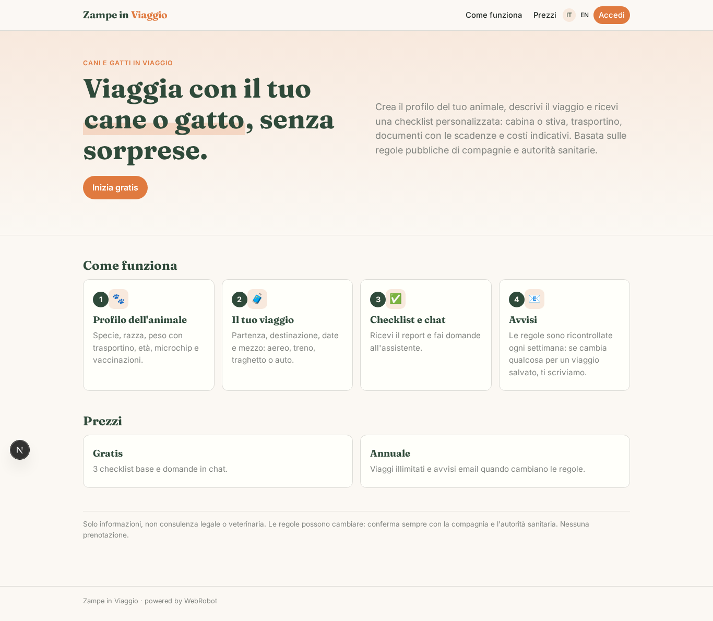
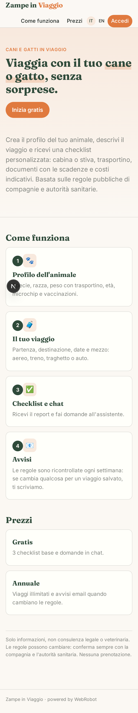
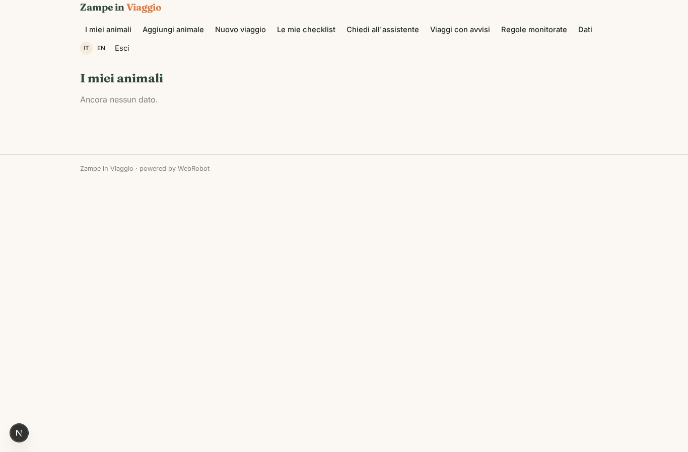
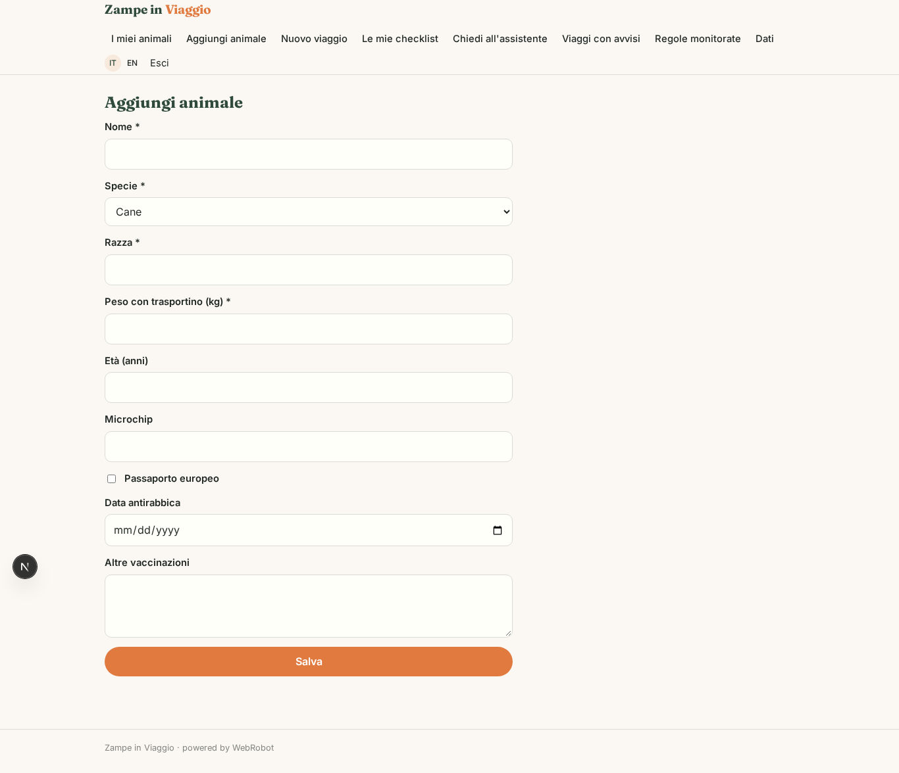
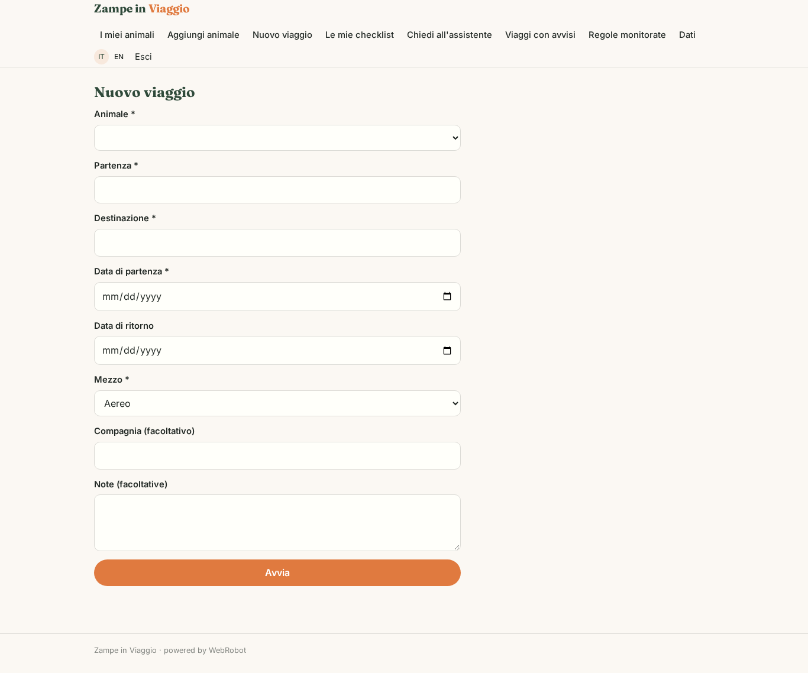
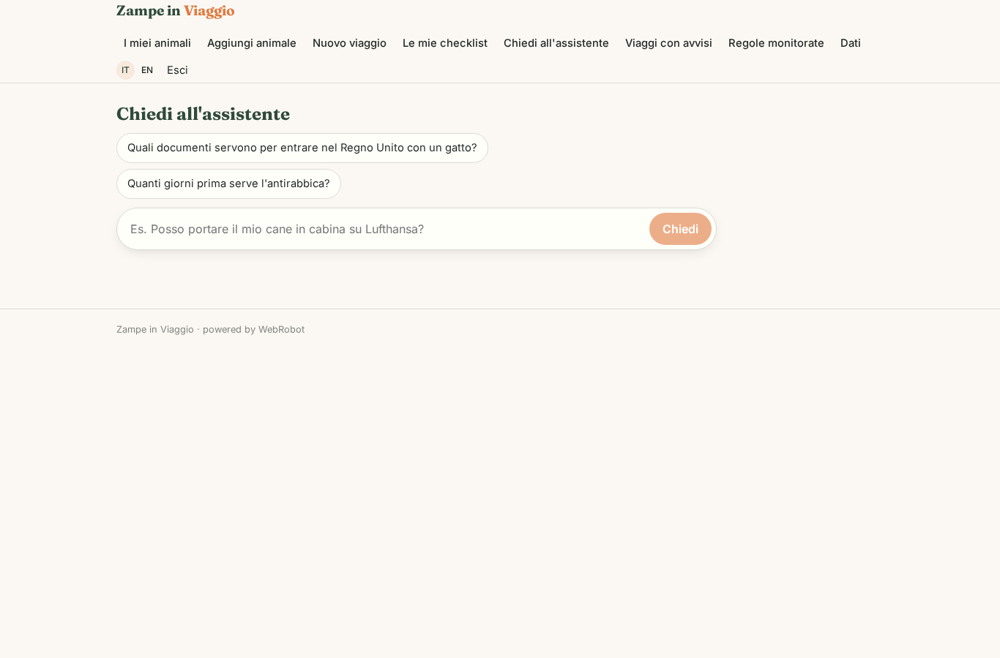
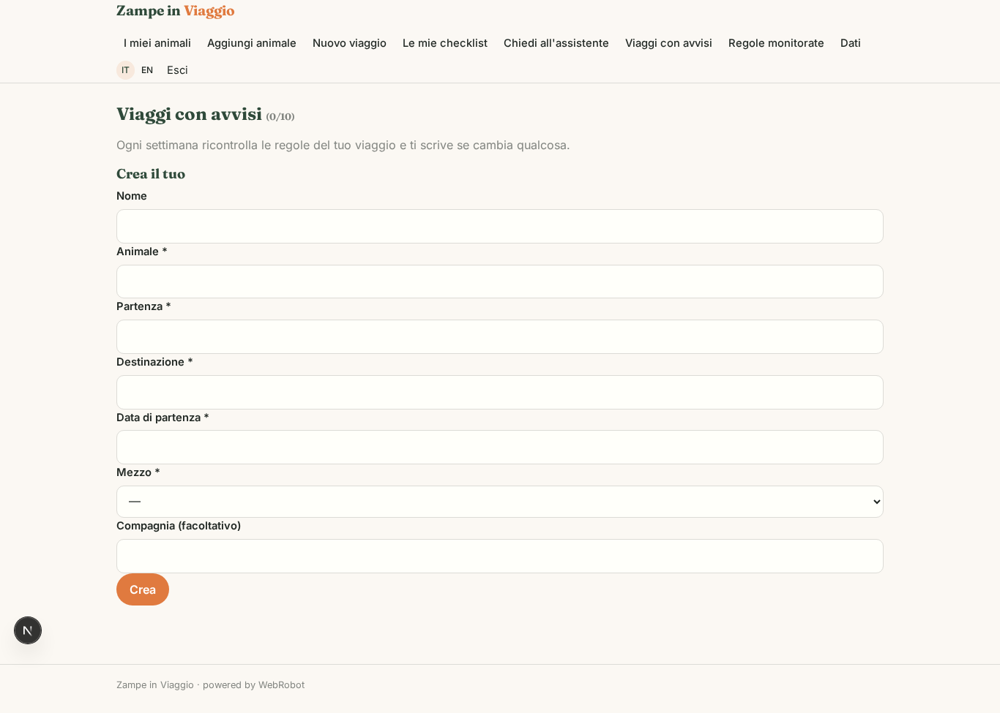
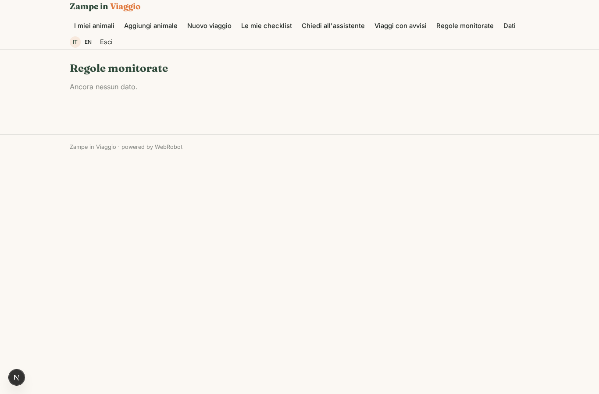
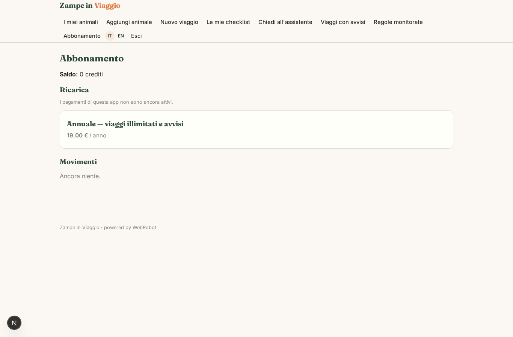

# Zampe in Viaggio

_Viaggia con il tuo cane o gatto con la checklist giusta._

**Manifest:** valid (schema + runtime contract) · **Functional test:** passed (14 checks passed)

## Description given to the app builder (Italian)

Vorrei un'app chiamata Zampe in Viaggio per chi viaggia con cani e gatti. L'utente si registra e crea il profilo dei suoi animali: specie, razza, peso con trasportino, età, microchip, vaccinazioni. Poi descrive il viaggio: partenza, destinazione, date e mezzo (aereo, treno, traghetto, auto). Un agente consulta una base di conoscenza costruita dalle regole pubbliche delle compagnie aeree, ferroviarie e di navigazione sul trasporto di animali e dalle norme pubblicate dalle autorità sanitarie su passaporto europeo, antirabbica e requisiti di ingresso nei paesi, e restituisce una checklist personalizzata: se l'animale può viaggiare in cabina o in stiva, dimensioni del trasportino, documenti da preparare e con quanti giorni di anticipo, costi indicativi. Dopo il report l'utente può fare domande in chat. Non vogliamo integrare portali di prenotazione alberghiera, solo informazioni. Le regole vengono ricontrollate ogni settimana e, se cambia una regola che riguarda un viaggio salvato, l'utente riceve un'email. Ogni utente vede solo i suoi animali e viaggi. Gratis per la checklist base, abbonamento annuale economico per viaggi illimitati e avvisi.

## Features not expressible today (spec.extensions)

- **alerts_plan_gate**: Trip alerts (templates) are meant for annual subscribers only; the manifest limits free checklists to 3 but cannot yet restrict creating trip_watch instances to a plan.

## Screenshots (interpretive runtime, no data)

### home-anon

### home-mobile

### home

### pets

### pet_form

### new

### trips

### ask

### watches

### rules_kb

### account

