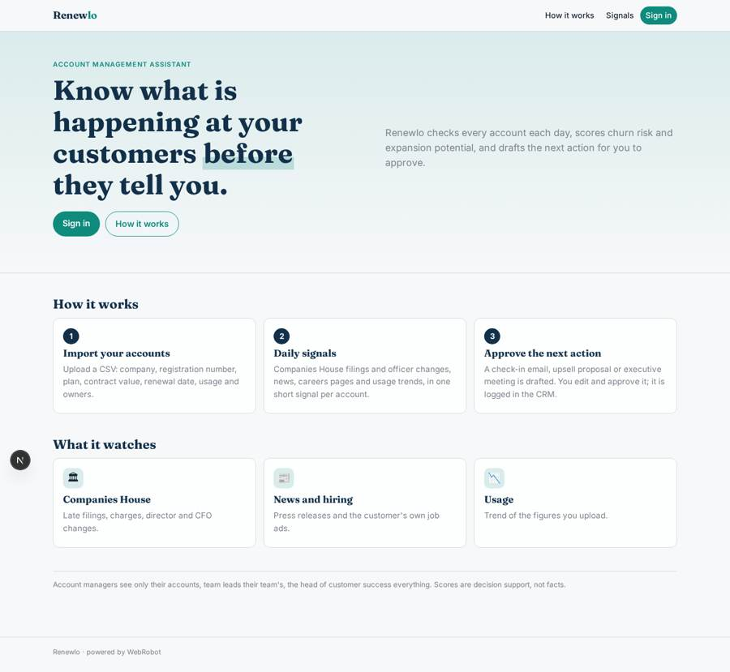
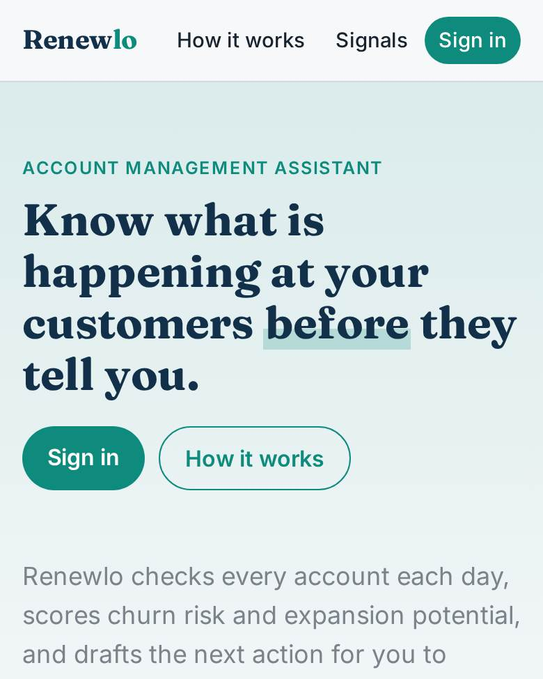
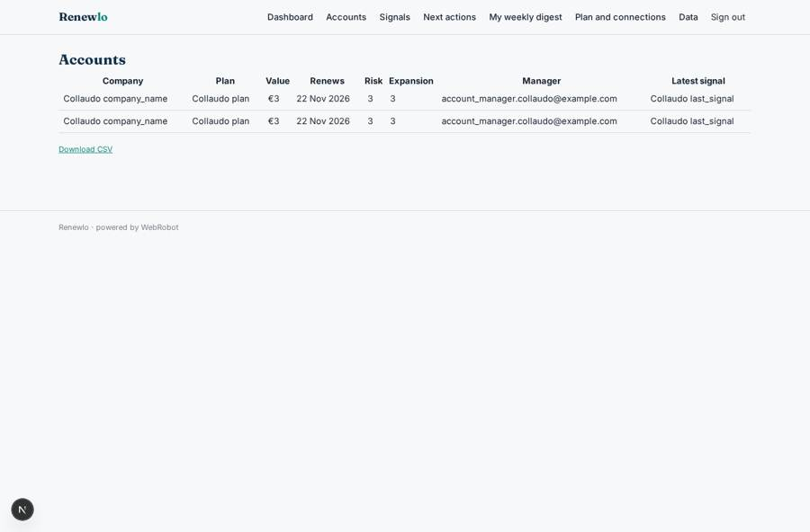
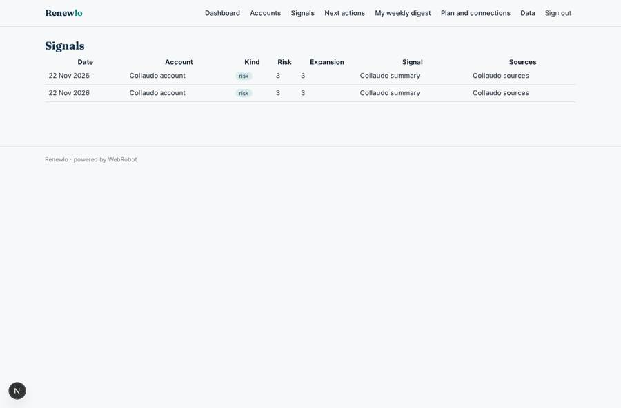
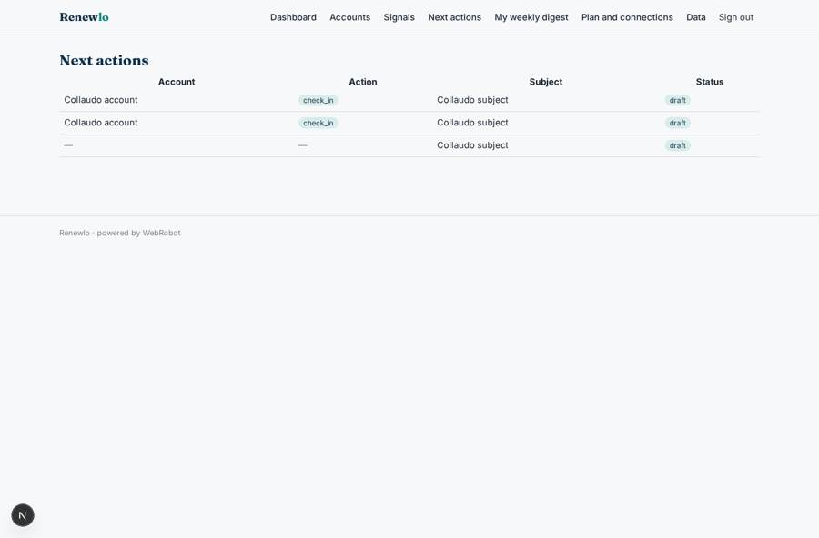
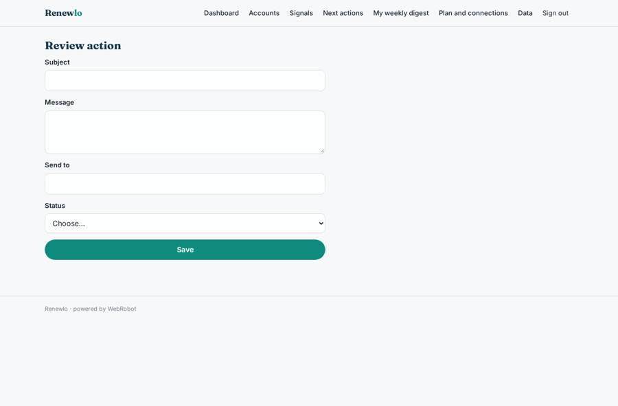

# Renewlo

_Spot the signals on your customers before they renew, churn or grow._

**Sector:** B2B AI and SaaS · **Manifest:** valid (schema + runtime contract) · **Functional test:** passed (21 checks passed)

## Description given to the app builder

We need Renewlo, an account management assistant for B2B companies that spots signals on existing customers and suggests next actions. The company signs up; account managers see only their accounts, team leads their team, the head of customer success everything. Accounts are imported by CSV with company name, registration number, plan, contract value, renewal date and usage figures. Each day an agent checks every account: Companies House filings and officer changes, public news and press releases, job ads on the customer's own careers page, and usage trends from the uploaded data. It writes a short signal with a risk or expansion score and drafts a next action (check-in email, upsell proposal, executive meeting), which the account manager approves or edits before sending. A weekly email digest lists the top risks and opportunities, and a dashboard shows renewals in the next 90 days and churn risk. In the real product the data comes live from the CRM (Salesforce, HubSpot) and from each manager's Gmail or Outlook mailbox and calendar through OAuth, and actions are logged back to the CRM, so I want that as well. Pricing: subscription per account manager seat, via Stripe. English.

## Navigation recording

Signed in as the app's admin, the recorder opened 6 menu page(s): Dashboard, Accounts, Signals, Next actions, My weekly digest, Plan and connections.
No issue found.

Empty data pages are mostly expected on the local runtime: agents are mocked there, so the collections they fill stay empty.

## Features not expressible today (spec.extensions)

- **oauth_crm_mailbox_calendar**: Not available yet: OAuth sign-in to Salesforce, Gmail, Outlook and calendars. Today the CRM is HubSpot through a private app token (read and log notes) and accounts come from CSV. Salesforce live sync, reading each manager's mailbox and calendar, and sending approved emails from the manager's own mailbox need OAuth.
- **seat_quantity_billing**: The subscription is one plan priced per account manager seat. Counting seats and charging per seat quantity through Stripe is not expressed in the manifest; to be configured by the owner.
- **single_company_deployment**: One deployment serves one company: the head of customer success is the admin, team leads and account managers get their roles from the team_lead_email and am_email columns of the CSV. Several companies in one deployment is not supported.

## Screenshots (interpretive runtime, test data)

### home-anon

### home-mobile

### accounts

### signals

### actions

### review_action

