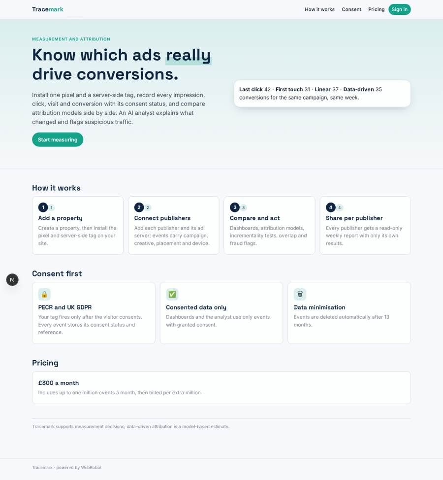
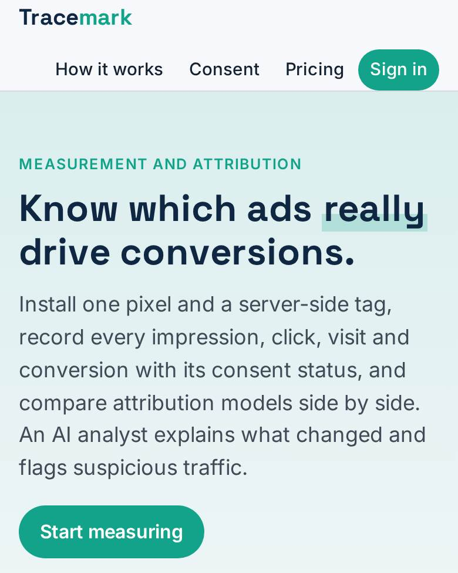
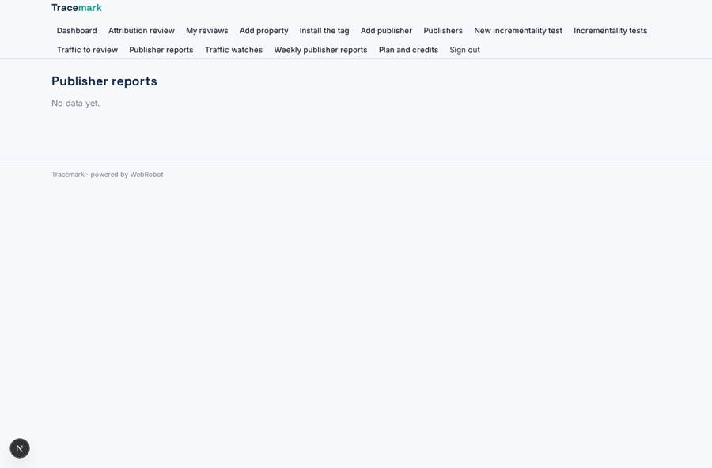
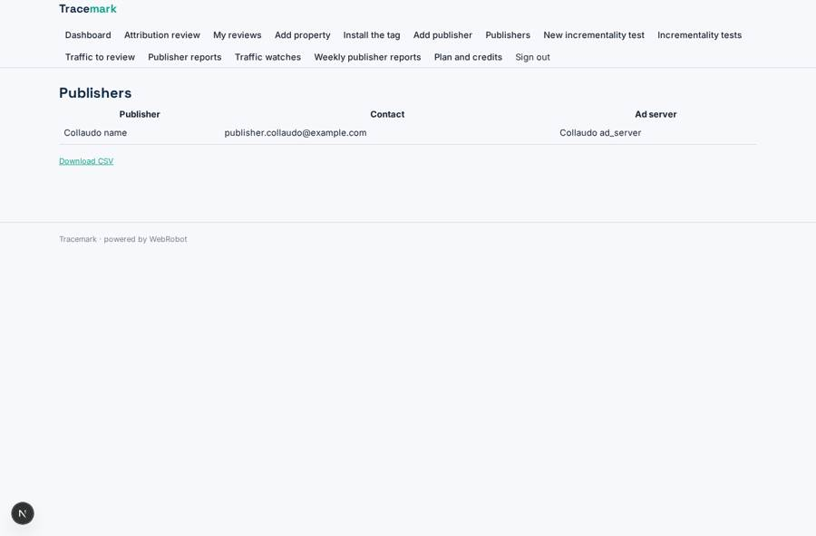
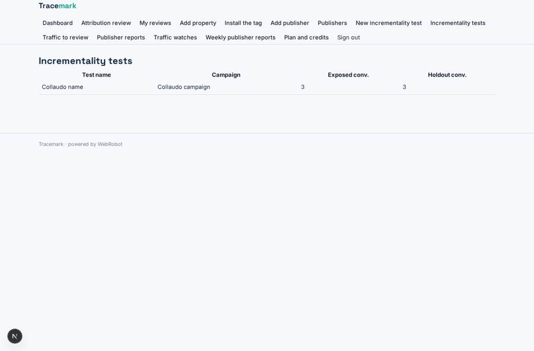
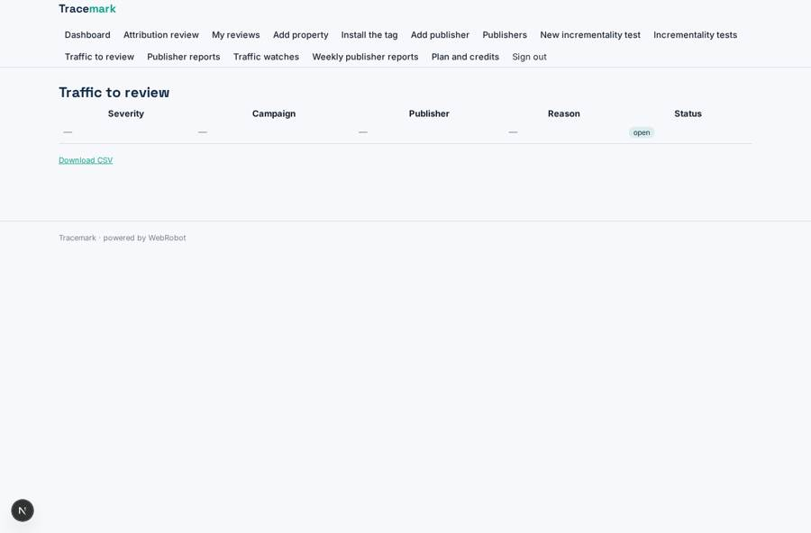

# Tracemark

_Advertising measurement and attribution you can trust, with consent built in._

**Sector:** Data, media, cyber, devtools · **Manifest:** valid (schema + runtime contract) · **Functional test:** passed (24 checks passed)

## Description given to the app builder

I want an app called Tracemark for advertising measurement and attribution, used by advertisers and publishers. An advertiser signs up, creates a property and installs our tracking pixel and server-side tag on their site; the real product ingests these events in real time and integrates with ad servers, and I want that included. Pixels fire only after user consent under PECR and UK GDPR, and the app must store consent status per event. Publishers connect their ad server through OAuth or API. The app records impressions, clicks, visits and conversions with campaign, creative, placement and device. Attribution models include last click, first touch, linear and data-driven; users can compare them side by side. Dashboards show conversions and revenue per campaign and publisher, incrementality tests and overlap between channels. An agent explains changes in performance and flags suspicious traffic such as bots or click spikes for review. Advertisers can share a read-only report with each publisher showing only that publisher's results. Weekly reports go by email. Roles: advertiser admin, analyst, publisher viewer. Pricing: £300 a month up to one million events, then per million. English only.

## Functional test: what did not pass

- **saved record shown where its collection is read** (view flags): a record was saved in traffic_flags (by advertiser_admin) but the page does not show it (as advertiser_admin) _(warning)_

## Navigation recording

Signed in as the app's admin, the recorder opened 7 menu page(s): Dashboard, Attribution review, My reviews, Add property, Install the tag, Add publisher, Publishers.
- agent run did not open: new_analysis: the run did not open
- data page empty: analyses (history)

Empty data pages are mostly expected on the local runtime: agents are mocked there, so the collections they fill stay empty.

## Features not expressible today (spec.extensions)

- **realtime_ingestion**: Events arrive through the app's webhook and are stored as records. A true high-volume real-time pipeline (millions of events, streaming aggregation) needs a dedicated ingestion service outside this manifest.
- **adserver_integrations**: Ad server connection by OAuth is not available yet; API-key integrations need a chosen vendor and host, then an http app tool with a credential.
- **consent_enforcement**: The tag must fire only after consent (PECR/UK GDPR); the app stores consent_status per event and uses only granted events, but the pixel and CMP integration run on the advertiser's site.
- **event_metering**: The £300 plan includes up to one million events; counting events and billing per extra million is not enforced automatically. The £40 per million price is an assumption to confirm.
- **event_ownership**: Hook events must carry the owning user and a team list (members) so analysts can read them; this mapping needs confirming against the hook's authentication.

## Screenshots (interpretive runtime, test data)

### home-anon

### home-mobile

### publisher_reports_view

### publisher_list

### tests

### flags

