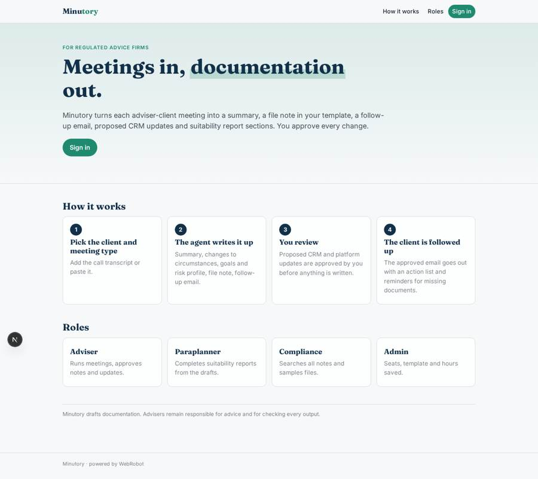
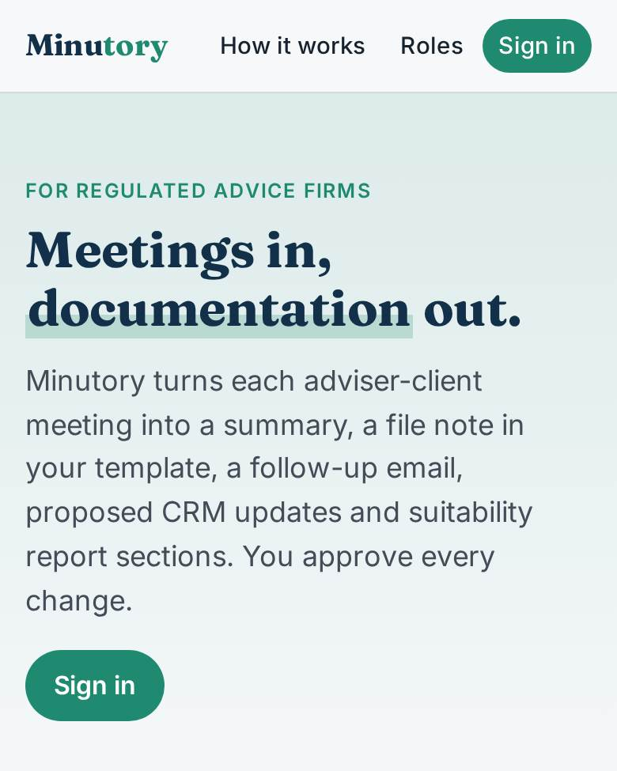
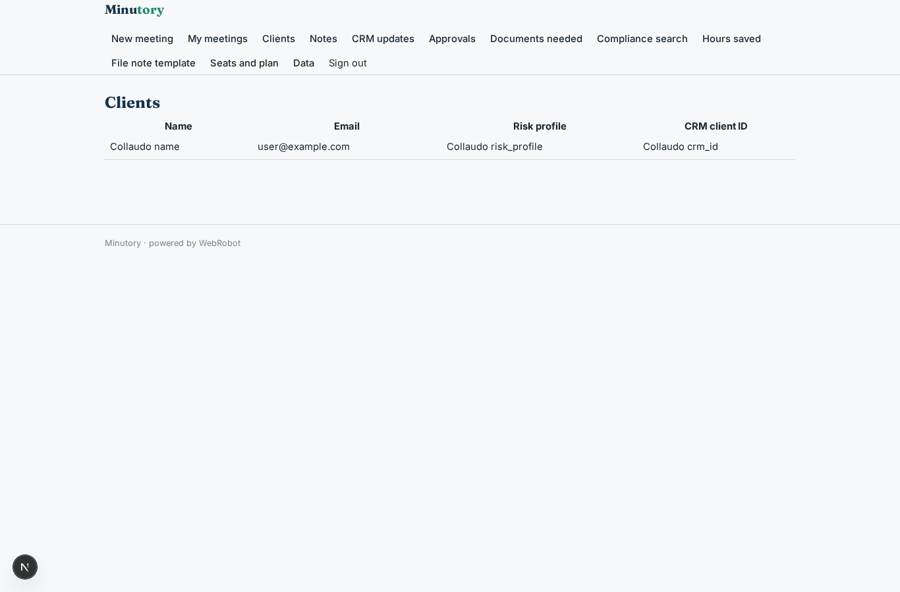
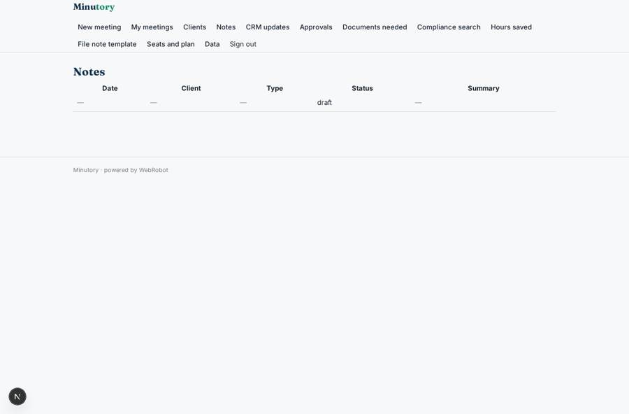
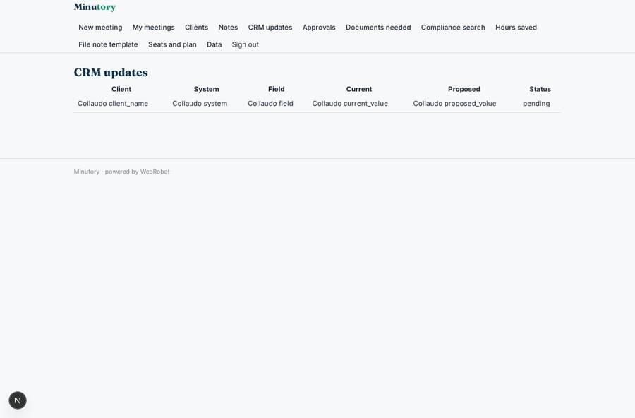
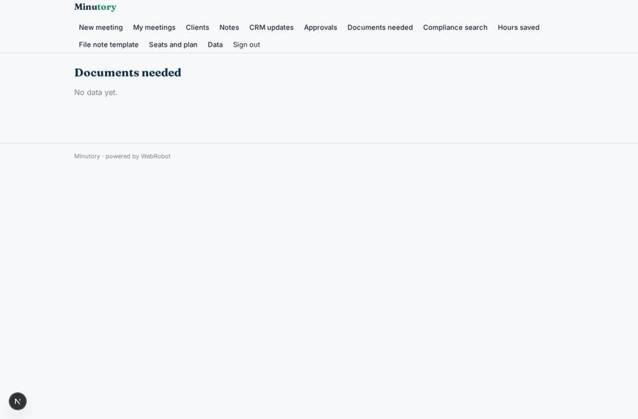

# Minutory

_Meeting notes, file notes and follow-ups written for you. You approve every change._

**Sector:** Fintech, proptech, insurtech · **Manifest:** valid (schema + runtime contract) · **Functional test:** passed (24 checks passed)

## Description given to the app builder

We need Minutory, which records adviser and client meetings, writes the documentation and updates back-office systems. Advice firms sign up; each adviser joins with their own account. Before a meeting the adviser picks the client and meeting type (initial, review, pension, protection); the app records audio in the browser or on the phone, or accepts an upload from a video call. It transcribes the conversation, produces a meeting summary, extracts changes to circumstances, goals and risk profile, and drafts a follow-up email and a file note in the firm's template. The agent then prepares updates for the adviser CRM (Intelliflo or similar, connected by OAuth) and the investment platform, but the adviser reviews and approves every change before it is written back. Suitability report sections are drafted from the meeting following FCA COBS 9. Compliance can search all notes and sample files. Clients receive the approved follow-up email with an action list and reminders for documents still needed. Roles: adviser, paraplanner, compliance, admin. Dashboards show admin hours saved. Pricing: monthly subscription per adviser seat. English.

## Functional test: what did not pass

- **saved record shown where its collection is read** (view notes): a record was saved in meeting_notes (by adviser) but the page does not show it (as adviser) _(warning)_

## Navigation recording

Signed in as the app's admin, the recorder opened 7 menu page(s): New meeting, My meetings, Clients, Notes, CRM updates, Approvals, Documents needed.
- agent run did not open: new_meeting: the run did not open
- data page empty: meetings (history)
- data page empty: documents (table)

Empty data pages are mostly expected on the local runtime: agents are mocked there, so the collections they fill stay empty.

## Features not expressible today (spec.extensions)

- **audio_recording**: Not available yet: recording audio in the browser or phone and transcribing it. For now the adviser adds the transcript exported from the video call tool (txt, docx, pdf) or pastes it.
- **crm_oauth**: Not available yet: OAuth connection to Intelliflo or another CRM and the investment platform. Updates are prepared and approved in the app; write-back needs the connection.
- **seat_billing**: Per-adviser seat billing across a firm: the plan is sold per adviser account; firm-level invoicing and seat counting are not expressed in the manifest.
- **client_actions_by_sms**: SMS and WhatsApp reminders are not available; clients get email only.

## Screenshots (interpretive runtime, test data)

### home-anon

### home-mobile

### clients

### notes

### crm_review

### documents

