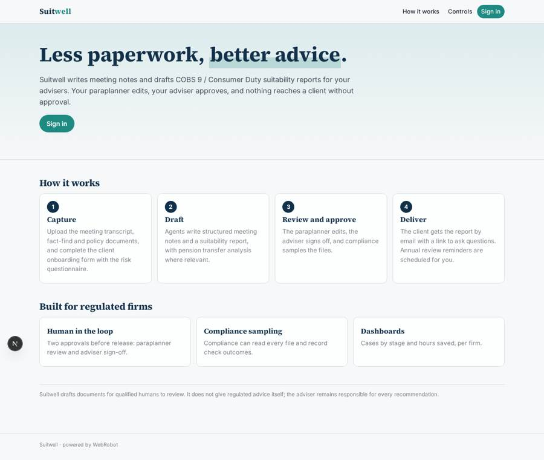
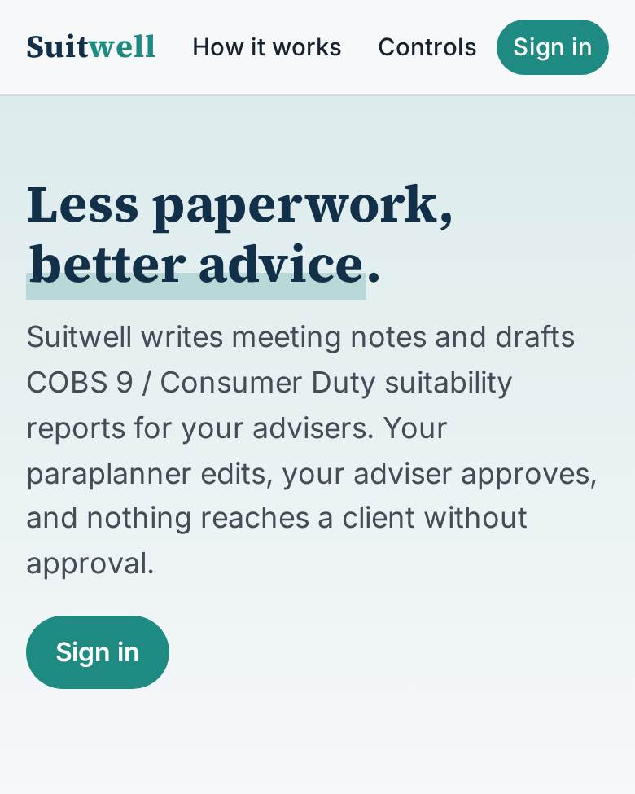
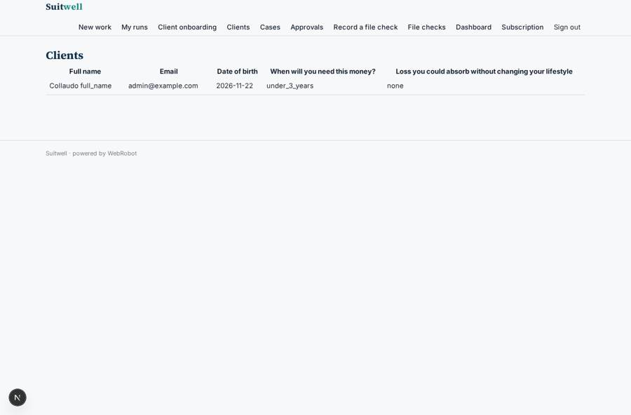
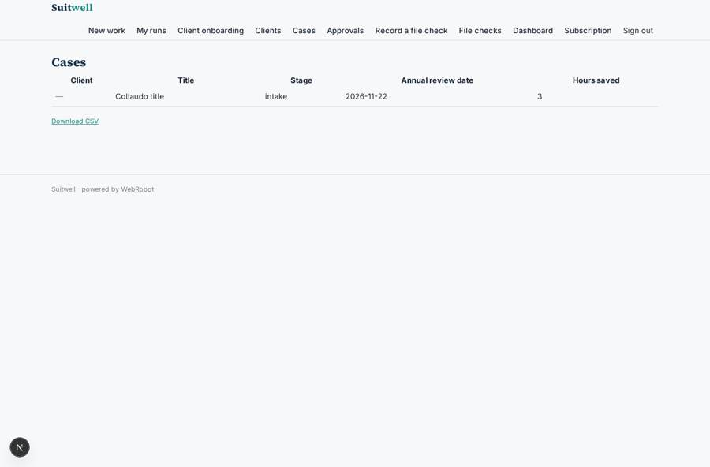
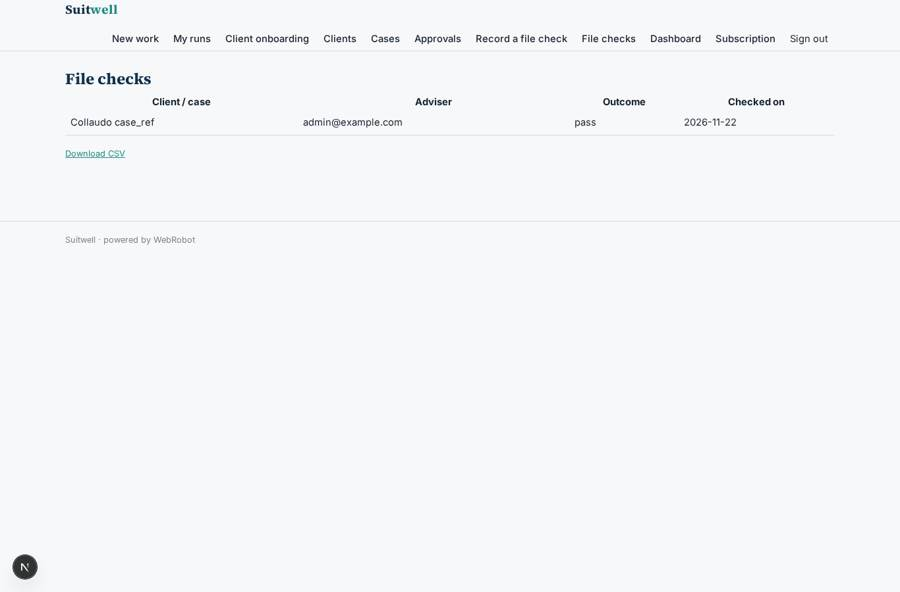
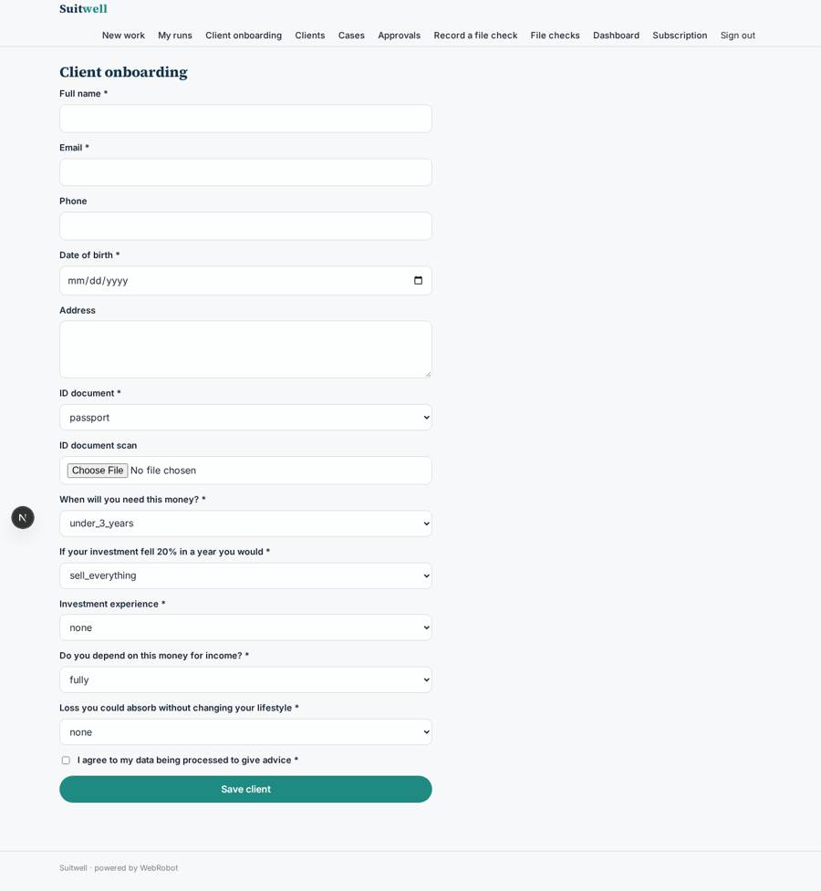

# Suitwell

_Meeting notes and suitability reports for advice firms, drafted by AI and approved by people._

**Sector:** Fintech, proptech, insurtech · **Manifest:** valid (schema + runtime contract) · **Functional test:** passed (31 checks passed)

## Description given to the app builder

I want Suitwell, an AI assistant for financial advisers. An advice firm signs up with roles for adviser, paraplanner, compliance and admin. The adviser records client meetings (audio recorded in the browser or uploaded), and the app transcribes them and writes structured meeting notes: objectives, attitude to risk, capacity for loss, existing arrangements, actions. Client fact-finds and existing policy documents are uploaded, and the firm's CRM and platform (such as Intelliflo) are connected by OAuth to pull and push client records. An onboarding form collects identity details and a risk questionnaire. Agents then draft the suitability report following FCA COBS 9 and Consumer Duty, explaining why the recommendation fits the client, plus pension transfer analysis where relevant. The paraplanner edits, the adviser approves, and compliance samples files for checking; nothing goes to the client without approval. Clients receive their report by email with a link for questions. Annual review reminders are scheduled automatically. Dashboards show cases by stage and time saved. Pricing: monthly subscription per adviser. English.

## Navigation recording

Signed in as the app's admin, the recorder opened 7 menu page(s): New work, My runs, Client onboarding, Clients, Cases, Approvals, Record a file check.
- form not sent: onboarding: When will you need this money? is required

Empty data pages are mostly expected on the local runtime: agents are mocked there, so the collections they fill stay empty.

## Features not expressible today (spec.extensions)

- **audio_transcription**: Recording audio in the browser or uploading audio files, with automatic transcription, is not available yet. Upload the transcript (txt, docx, pdf) from your recording tool.
- **crm_oauth**: Connecting Intelliflo or another CRM/platform by OAuth to pull and push client records is not available yet (OAuth is unsupported). Use the onboarding form and CSV export of cases meanwhile.
- **per_adviser_seats**: The subscription is a flat monthly price per adviser seat plan; counting seats per invited adviser is billed manually for now.
- **compliance_sampling**: Compliance picks files to check from the cases table and records outcomes; automatic random sampling is not included.

## Screenshots (interpretive runtime, test data)

### home-anon

### home-mobile

### client_list

### cases_list

### checks_list

### onboarding

