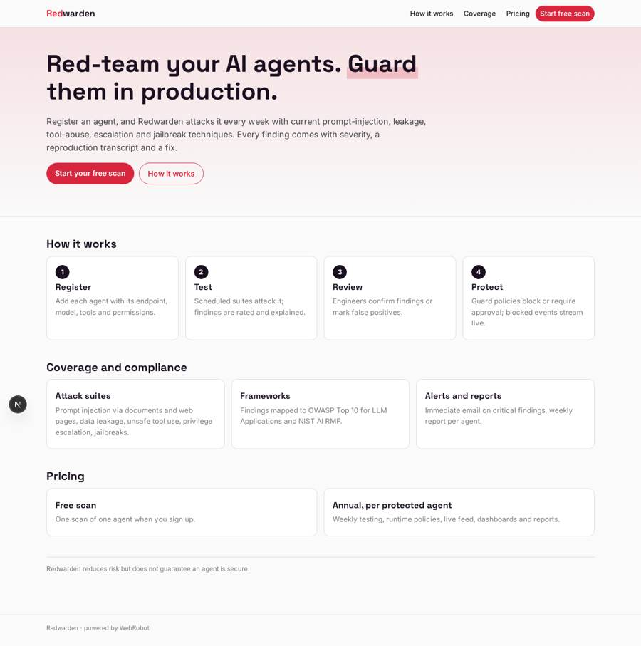
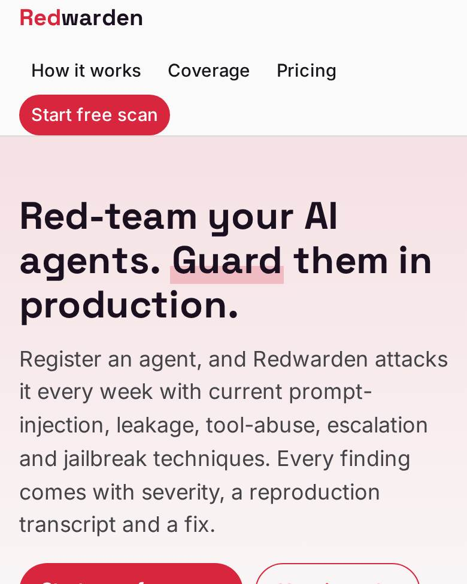
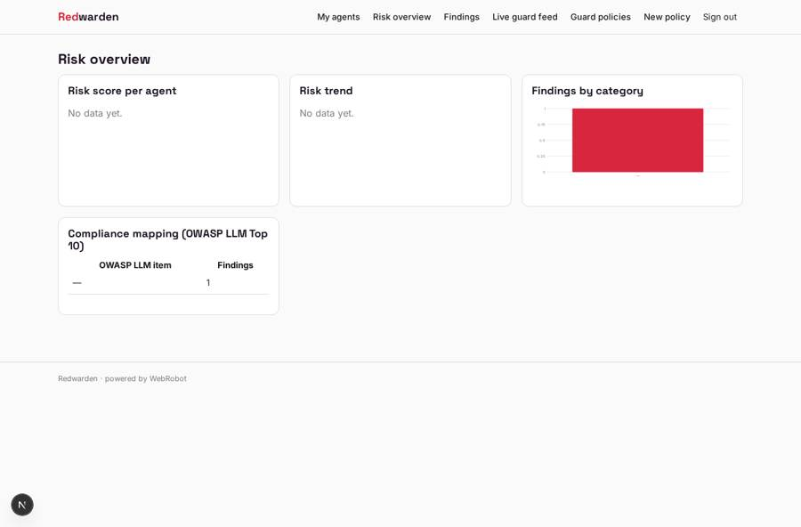
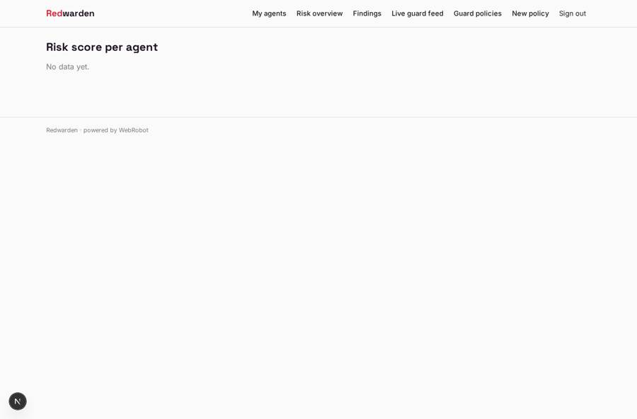
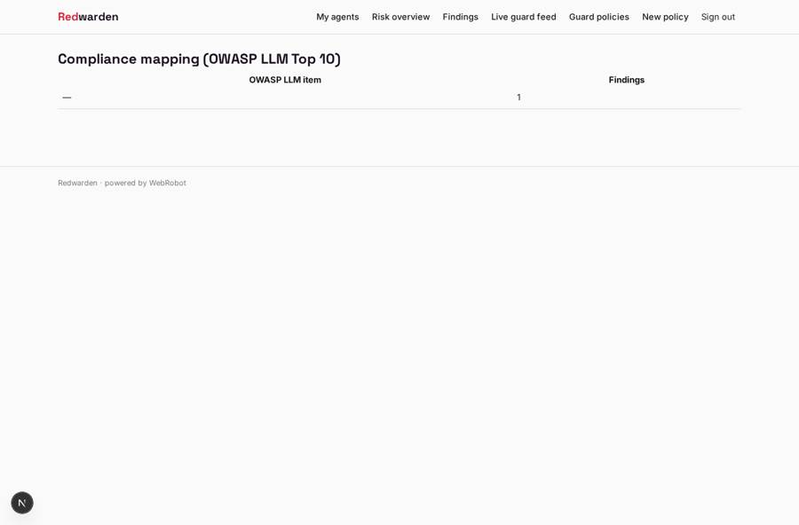
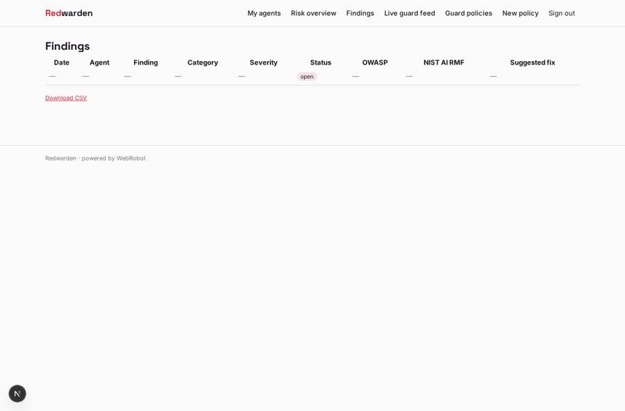

# Redwarden

_Red-team your AI agents. Guard them in production._

**Sector:** B2B AI and SaaS · **Manifest:** valid (schema + runtime contract) · **Functional test:** passed (13 checks passed)

## Description given to the app builder

I want Redwarden, a security product for companies deploying AI agents: it tests agents for vulnerabilities and protects them in production. The deepest part is outside what a builder can produce: original security research, attack libraries kept current with new techniques, and runtime protection that sits in the path of every model and tool call; I need the software around it, with those engines plugged in through an API. A company signs up, invites security engineers and developers, and registers each agent with its endpoint, model, tools and permissions through a form. A scheduled testing agent runs suites against each registered agent: prompt injection through documents and web pages, data leakage, unsafe tool use, privilege escalation, jailbreaks. Each finding gets a severity, a reproduction transcript and a suggested fix; an engineer confirms or marks it a false positive. Policies define what the runtime guard must block or require approval for, and blocked events appear in a live feed. Weekly email reports and immediate alerts on critical findings. Dashboards show risk score per agent, open findings, trends and compliance mapping to public frameworks. Pricing: annual subscription per protected agent, with a free scan for one agent. English.

## Functional test: what did not pass

- **saved record shown where its collection is read** (view findings_by_category): a record was saved in findings (by user) but the page does not show it (as user) _(warning)_
- **saved record shown where its collection is read** (view compliance): a record was saved in findings (by user) but the page does not show it (as user) _(warning)_
- **saved record shown where its collection is read** (view findings): a record was saved in findings (by user) but the page does not show it (as user) _(warning)_

## Navigation recording

Signed in as the app's admin, the recorder opened 6 menu page(s): My agents, Risk overview, Findings, Live guard feed, Guard policies, New policy.
- data page empty: risk (dashboard)

Empty data pages are mostly expected on the local runtime: agents are mocked there, so the collections they fill stay empty.

## Features not expressible today (spec.extensions)

- **team_invites**: Inviting security engineers and developers into a company workspace, with shared access to agents and findings, is not available yet: records belong to the signed-in user.
- **per_agent_seats**: Annual price per protected agent is modelled as one plan plus monthly credits; exact per-agent seat counting needs manual follow-up.
- **runtime_guard_engine**: The runtime guard sits in the model/tool path outside this app: it reads policies from /api/policies and posts blocked events to the guard_event webhook. The engine host engine.redwarden.io is an assumed placeholder.

## Screenshots (interpretive runtime, test data)

### home-anon

### home-mobile

### risk

### risk_scores

### compliance

### findings

