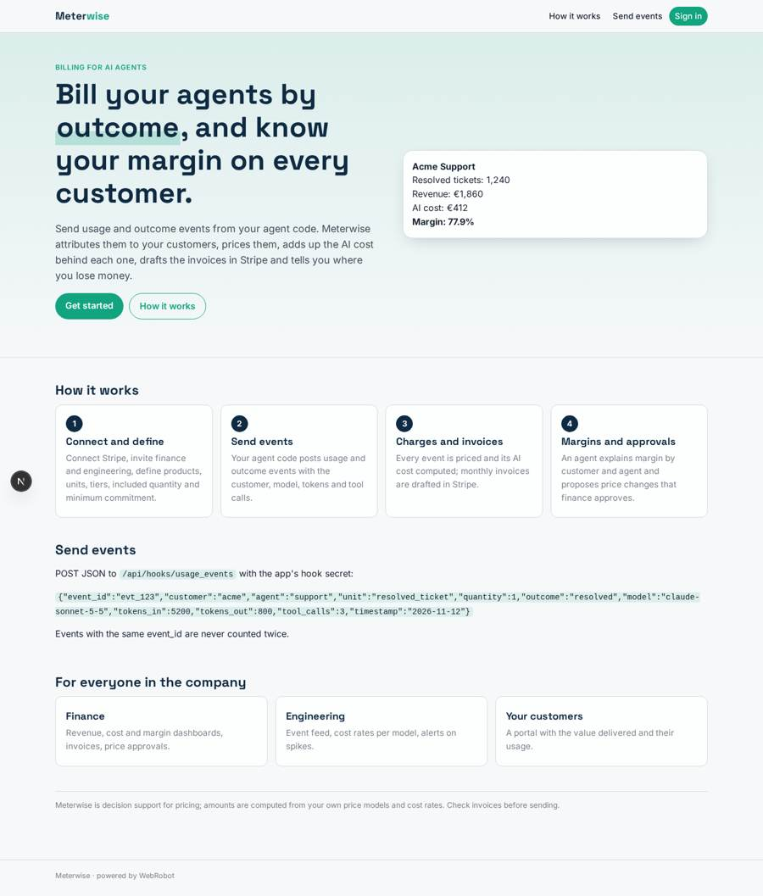
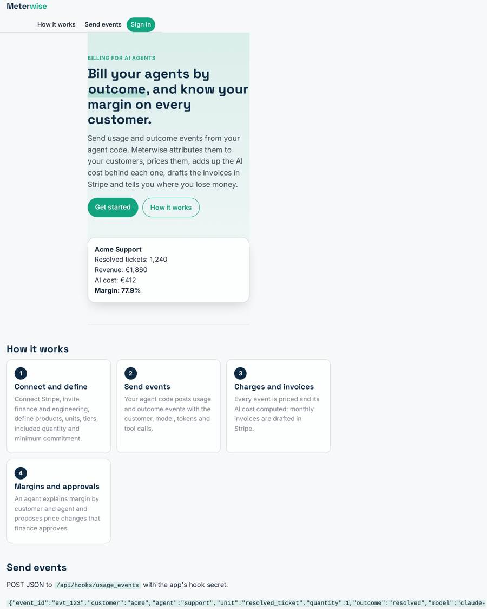
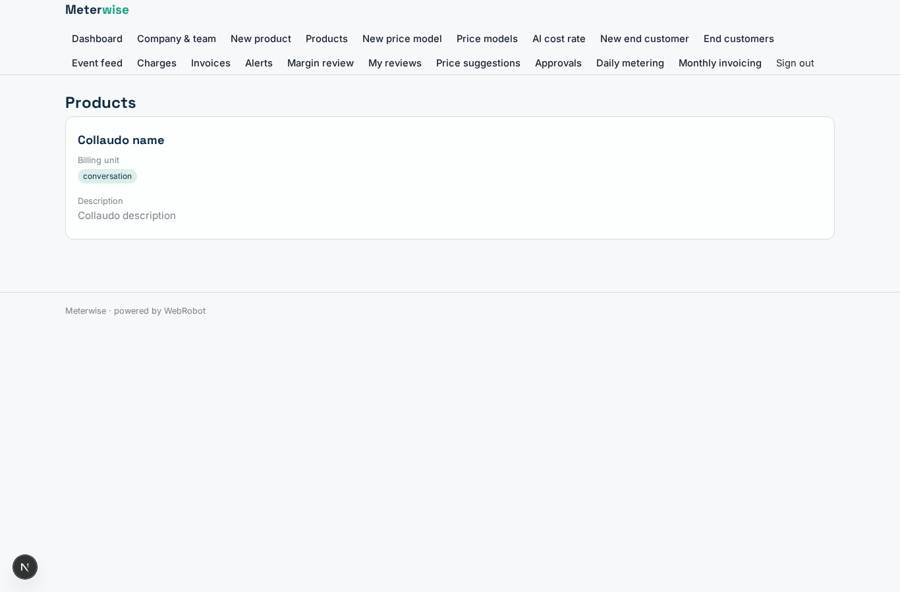
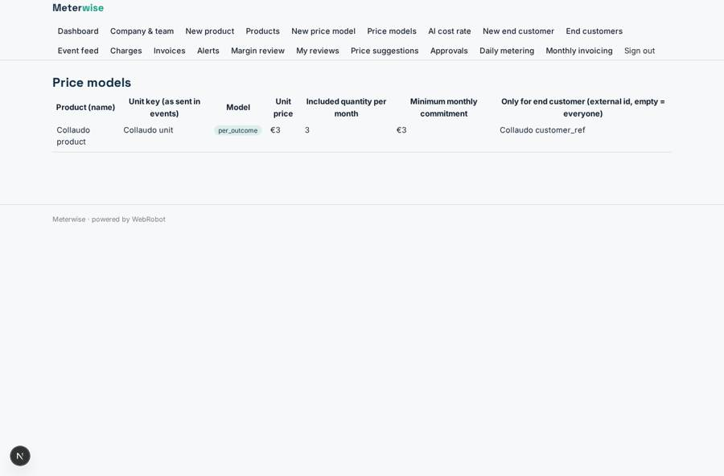
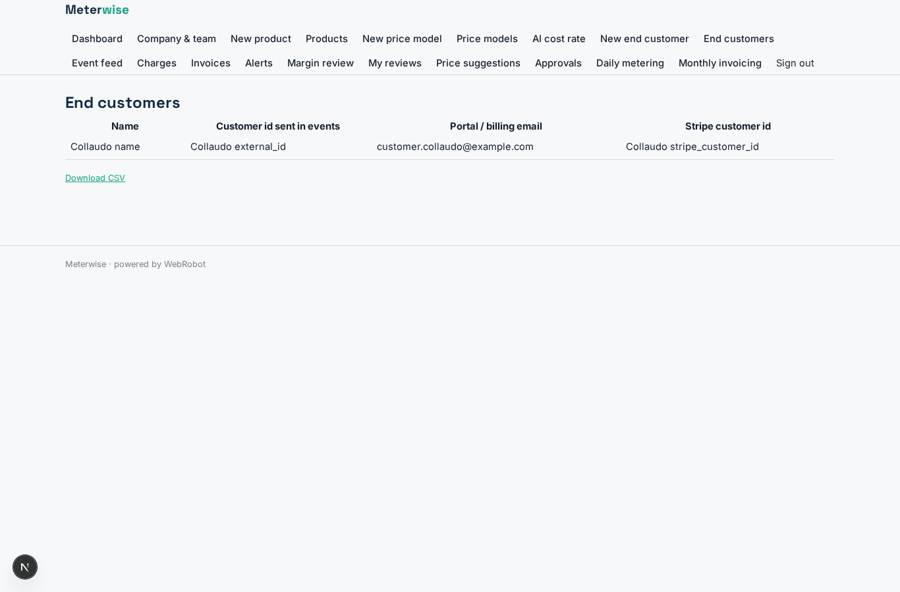
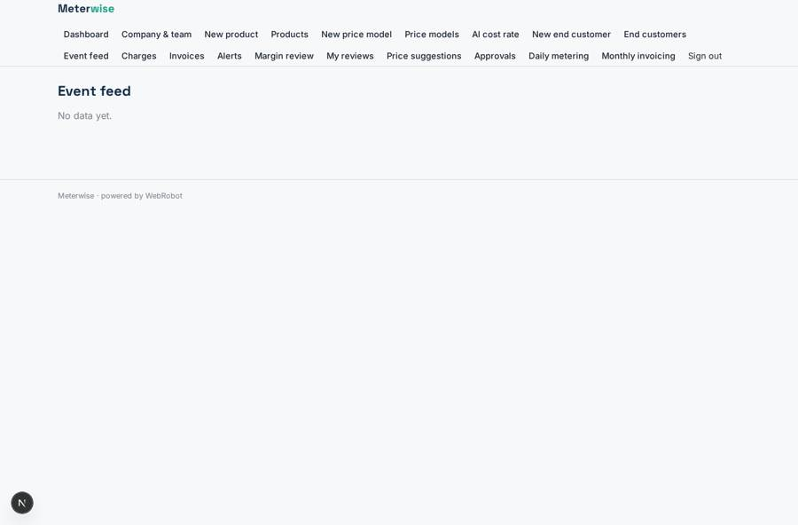

# Meterwise

_Meter, price and invoice your AI agents by outcome._

**Sector:** B2B AI and SaaS · **Manifest:** valid (schema + runtime contract) · **Functional test:** passed (31 checks passed)

## Description given to the app builder

We need Meterwise, billing and monetisation infrastructure for companies that sell AI agents. The core product is developer infrastructure rather than an app: an SDK that customers put into their agent code to send usage and outcome events, a metering service, and pricing logic for per-outcome, per-task and per-seat models; I need the software around it. A company signs up, connects its Stripe account, invites finance and engineering users, and defines products and price models through forms: unit (conversation, resolved ticket, document processed, meeting booked), price, included quantity, tiers, minimum commitment. Events arrive through an API key; the system attributes each event to the end customer, calculates charges and the AI cost behind each event (model tokens, tool calls) and creates invoices in Stripe. An agent explains margins per customer and per agent, flags customers whose cost exceeds revenue and suggests price changes, which finance approves. End customers get a portal showing the value delivered and their usage. Alerts by email for usage spikes and invoices ready. Dashboards of revenue, cost, margin and outcomes. Pricing: percentage of billed revenue with a monthly minimum. English.

## Navigation recording

Signed in as the app's admin, the recorder opened 7 menu page(s): Dashboard, Company & team, New product, Products, New price model, Price models, AI cost rate.
No issue found.

Empty data pages are mostly expected on the local runtime: agents are mocked there, so the collections they fill stay empty.

## Features not expressible today (spec.extensions)

- **revenue_percentage**: Pricing is a percentage of the revenue billed through Meterwise with a monthly minimum (the 199 EUR plan). The percentage fee on billed revenue is not expressible in the manifest and must be configured by WebRobot platform billing.
- **per_tenant_api_keys**: Events arrive on one webhook protected by the app's hook secret. Per-company API keys that attribute each event to its company, and the SDK packages themselves, are not available yet.
- **stripe_oauth_and_form_bodies**: Stripe is connected with a restricted API key, not OAuth (Connect). Stripe's write endpoints expect form-encoded bodies, which the http tool does not send yet; invoices are recorded in Meterwise and drafted in Stripe only when supported.
- **team_roles**: Finance and engineering colleagues are team members listed on the workspace; separate finance/engineering roles per company, and a finance-only approver, are not available. Price changes are approved by the account that ran the review.

## Screenshots (interpretive runtime, test data)

### home-anon

### home-mobile

### products

### prices

### customers

### events

