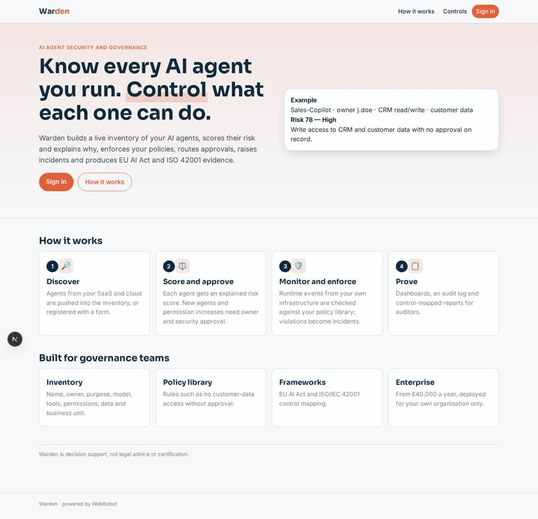
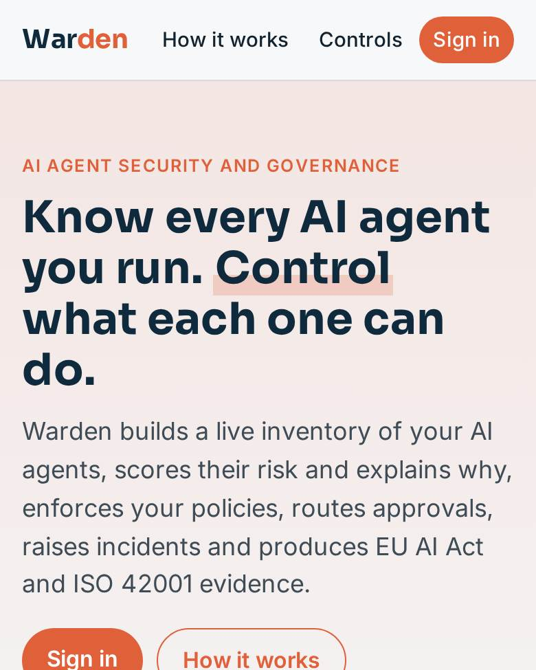
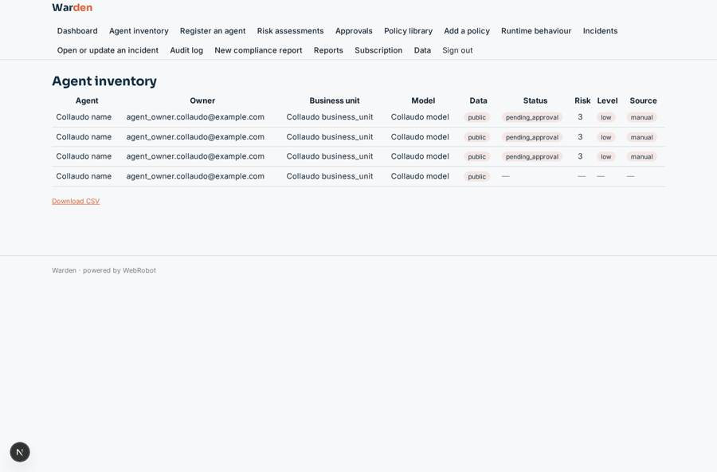
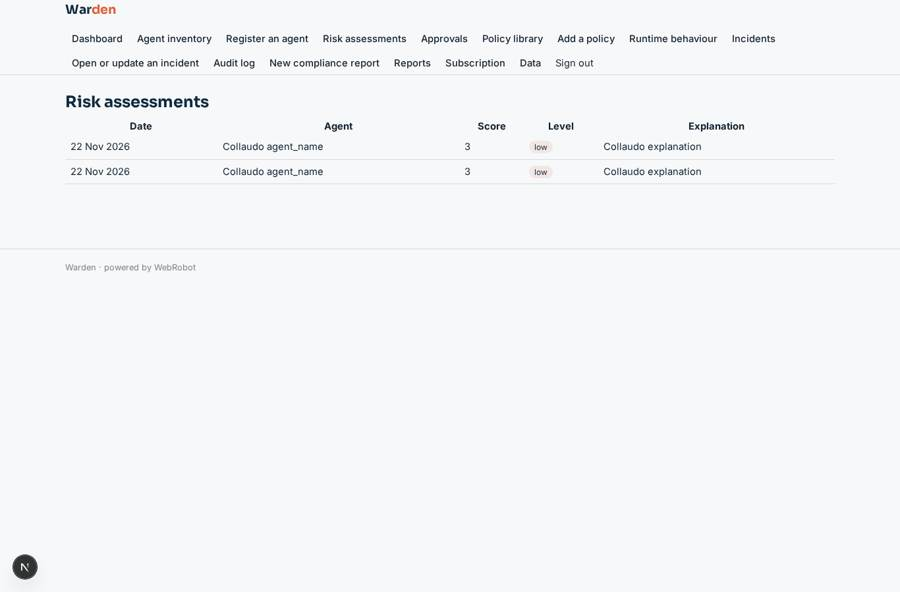
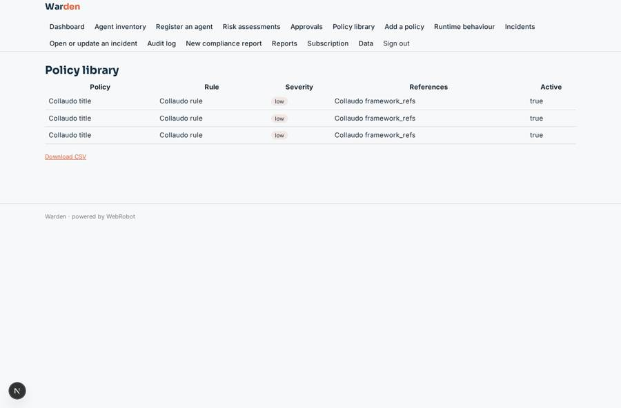
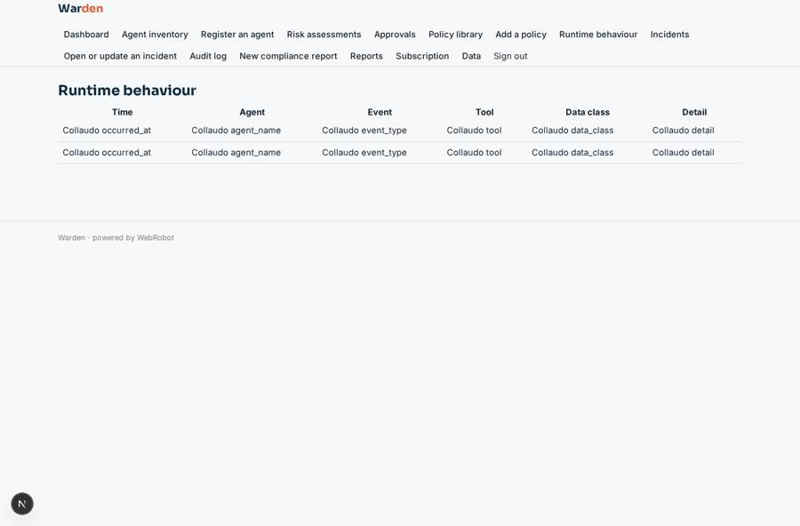

# Warden

_Security and governance for the AI agents your company runs._

**Sector:** Data, media, cyber, devtools · **Manifest:** valid (schema + runtime contract) · **Functional test:** passed (46 checks passed)

## Description given to the app builder

We need an app called Warden for security and governance of the AI agents a company uses. A security team signs up and the app discovers agents across the company's SaaS and cloud through OAuth connections to Microsoft 365, Google Workspace, Salesforce, AWS, Azure and GitHub, as the real product does; agents can also be registered with a form. Each agent record holds name, owner, purpose, model, tools and permissions, data accessed and business unit. The real product also monitors agent behaviour at runtime inside the customer's infrastructure, and I want that included. A policy library defines rules such as no agent may access customer data without approval. An agent scores each agent's risk from permissions, data sensitivity and behaviour, and explains the score. New agents and permission increases need approval from the agent owner and security. Violations create incidents with severity and an assignee, plus email and Slack alerts. Dashboards show inventory, risk distribution, policy compliance and trends, and an audit log records every change. Reports map controls to the EU AI Act and ISO 42001. Roles: admin, security analyst, agent owner, auditor. Pricing: enterprise, from £40,000 a year. English only. Only the customer's own tenants.

## Navigation recording

Signed in as the app's admin, the recorder opened 7 menu page(s): Dashboard, Agent inventory, Register an agent, Risk assessments, Approvals, Policy library, Add a policy.
No issue found.

Empty data pages are mostly expected on the local runtime: agents are mocked there, so the collections they fill stay empty.

## Features not expressible today (spec.extensions)

- **oauth_discovery**: Automatic discovery through OAuth connections to Microsoft 365, Google Workspace, Salesforce, Azure and AWS is not available yet. Today, discovered agents are pushed to the 'discovered' webhook by the customer's own connectors, or registered with the form.
- **slack_alerts**: Slack alerts are not available yet. Email alerts to security analysts, admins and agent owners work today.
- **runtime_collector**: The runtime monitor that runs inside the customer's infrastructure is deployed by the customer and posts events to the 'behavior' webhook; Warden stores and evaluates them but does not install the collector.
- **tenancy**: Assumes one deployment per customer organisation, so the organisation back office holds that customer's data and roles control who sees what. No data is shared between customers.
- **form_audit**: The audit log is written by Warden's agents for assessments, approvals and incidents. Manual edits in forms are not logged automatically.

## Screenshots (interpretive runtime, test data)

### home-anon

### home-mobile

### inventory

### assessments

### policy_library

### behavior

