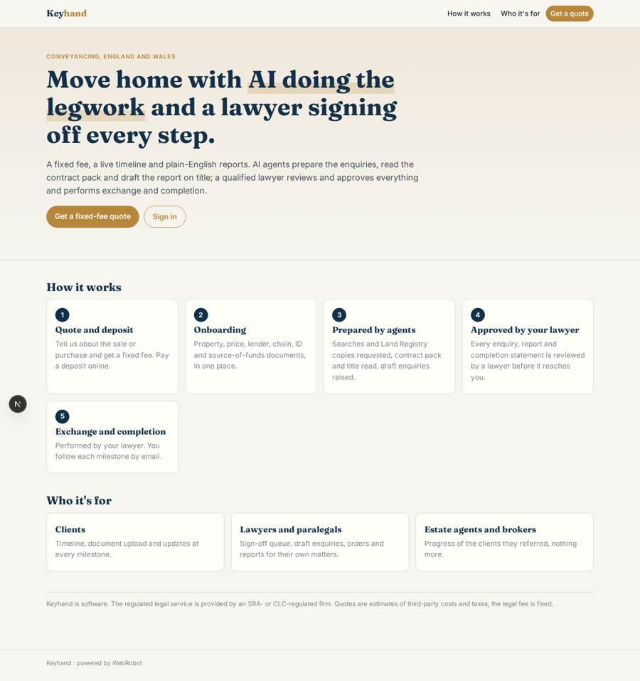
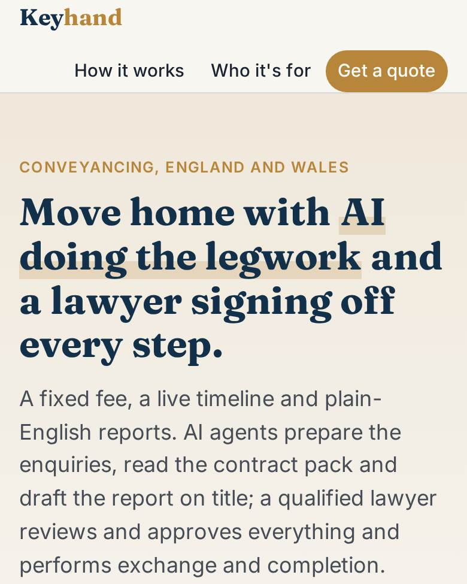
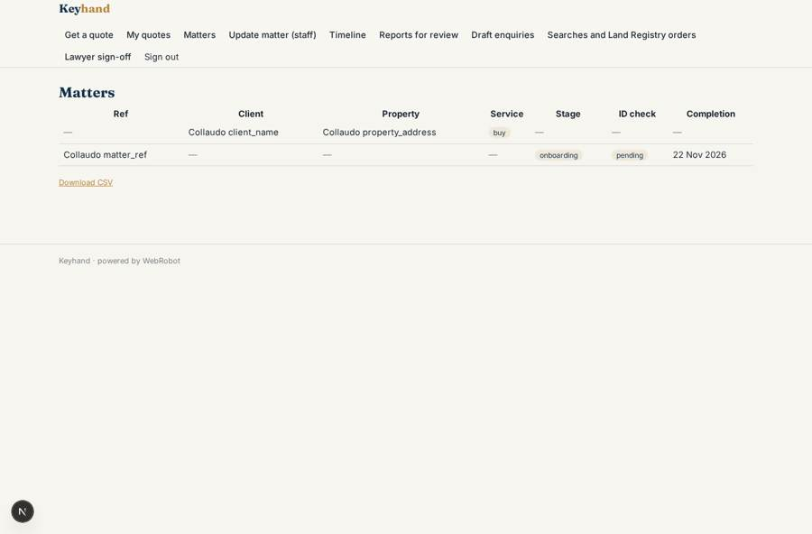
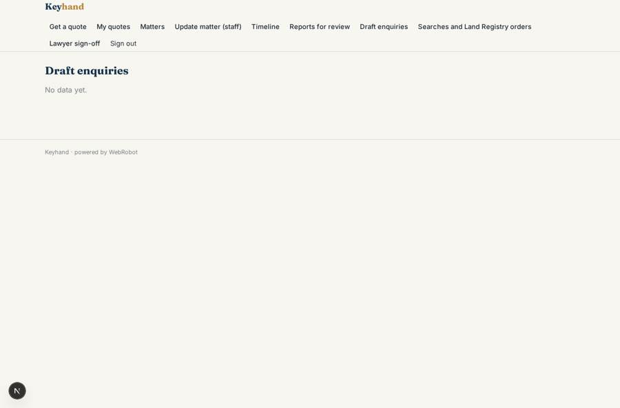

# Keyhand

_AI-led conveyancing, signed off by a qualified lawyer._

**Sector:** Fintech, proptech, insurtech · **Manifest:** valid (schema + runtime contract) · **Functional test:** passed (19 checks passed)

## Description given to the app builder

We want Keyhand, an AI-led conveyancing service for buyers and sellers in England and Wales, with qualified lawyers signing off every matter. The regulated legal service is provided by an SRA- or CLC-regulated firm; I need the software around it. Clients sign up, get a quote and pay a deposit online, then complete onboarding forms: property, price, lender, mortgage, chain details, ID and source-of-funds documents. Identity checks run through a certified partner. Agents order searches, obtain title registers and plans from HM Land Registry business e-services (paid per copy), read the contract pack, title and searches, raise draft enquiries and prepare the report on title in plain English. A lawyer reviews and approves every enquiry, report and completion statement; exchange and completion are performed by the lawyer. Clients see a timeline, upload documents and get email and SMS updates at each milestone; estate agents and brokers see progress for their own clients. Client money and stamp duty payments are handled through the firm's client account. Roles: client, lawyer, paralegal, agent or broker, admin. Pricing: fixed fee per transaction. English.

## Navigation recording

Signed in as the app's admin, the recorder opened 7 menu page(s): Get a quote, My quotes, Matters, Update matter (staff), Timeline, Reports for review, Draft enquiries.
- form not sent: quote: slots are not available on this runtime
- data page empty: quotes (history)
- data page empty: timeline (list)
- data page empty: review_reports (cards)
- data page empty: review_enquiries (table)

Empty data pages are mostly expected on the local runtime: agents are mocked there, so the collections they fill stay empty.

## Features not expressible today (spec.extensions)

- **sms_updates**: SMS updates at milestones are not available yet; clients get email updates only.
- **id_check_partner**: Identity checks through a certified partner need that partner's API and an organisation credential. Until connected, the lawyer sets id_check_status by hand.
- **hmlr_business_eservices**: Ordering searches and HM Land Registry official copies and plans (paid per copy) needs the firm's Business e-services access and is not available as an app tool yet. Agents prepare draft orders; a lawyer approves spend and the team places them.
- **client_account**: Client money and stamp duty payments go through the firm's client account outside this software. The deposit and fee packs here are Stripe payments to the app owner; align them with the firm's accounting and SRA/CLC client-money rules.
- **fee_amounts**: Fees, bands and deposit in the quote slot and packs are placeholder examples; set them to the firm's fixed-fee schedule.
- **lawyer_only_acts**: Exchange and completion are performed by the lawyer outside the app, who records them by updating the matter stage.

## Screenshots (interpretive runtime, test data)

### home-anon

### home-mobile

### my_reports

### review_reports

### my_matters

### review_enquiries

