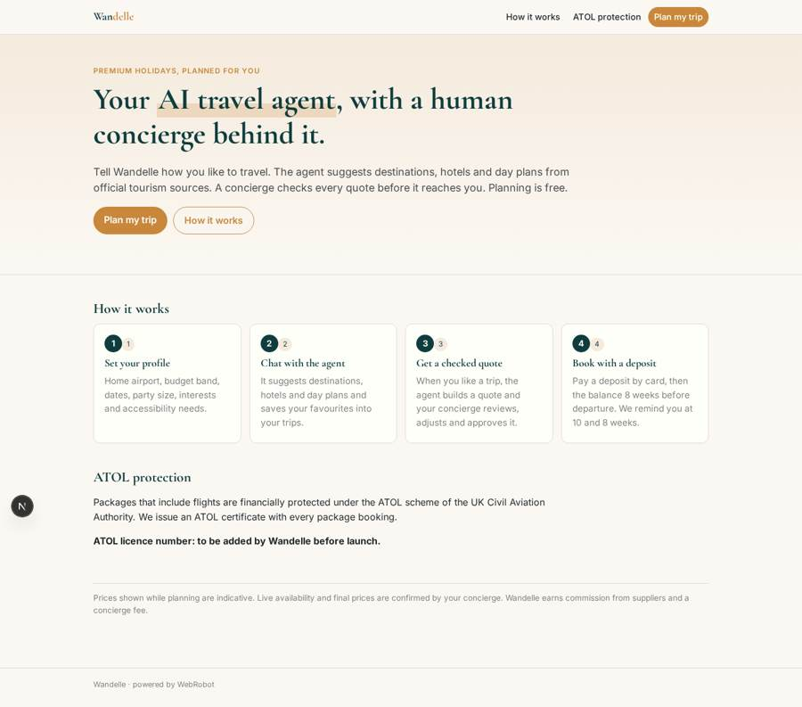
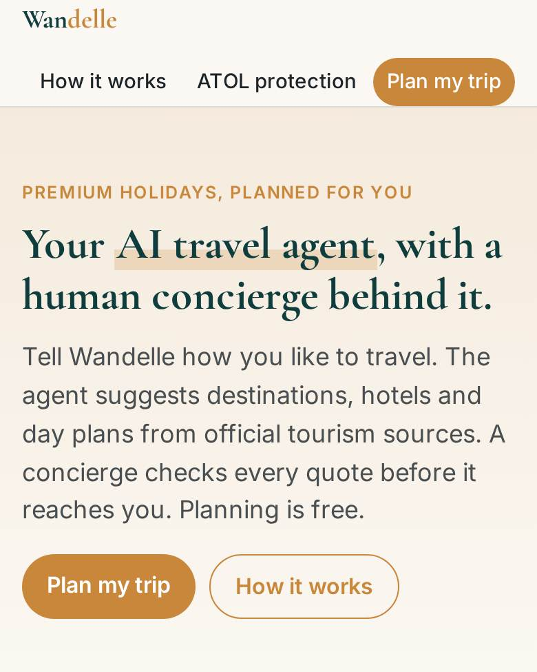
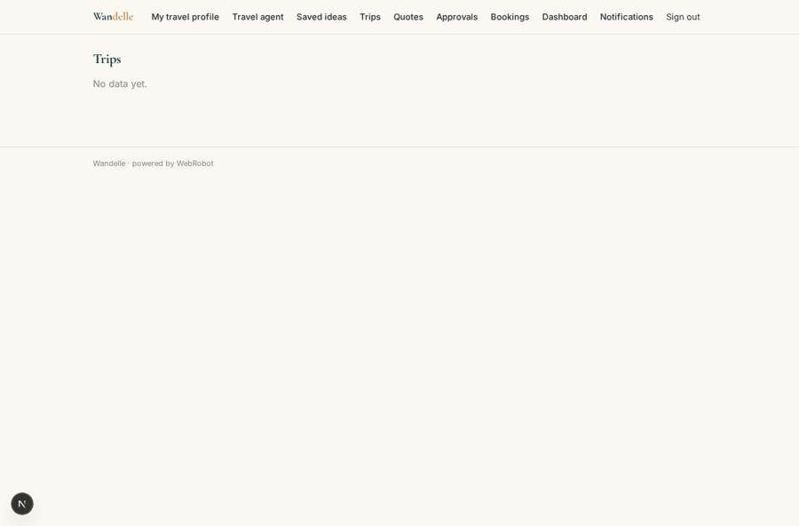
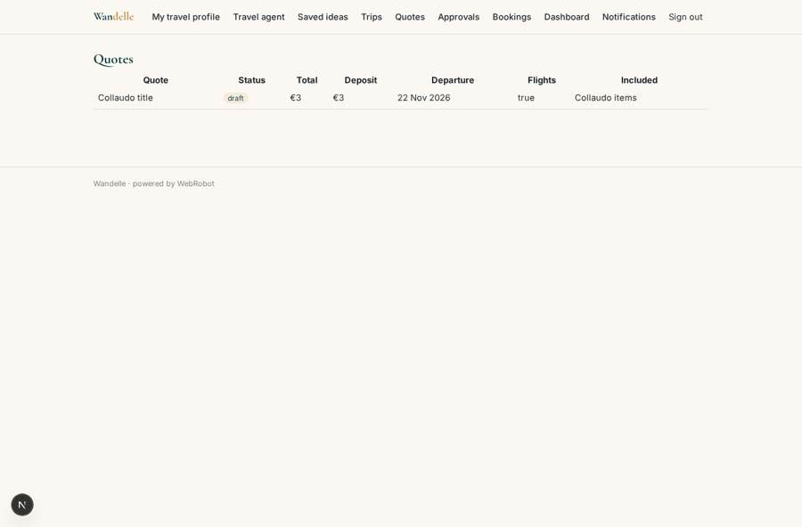
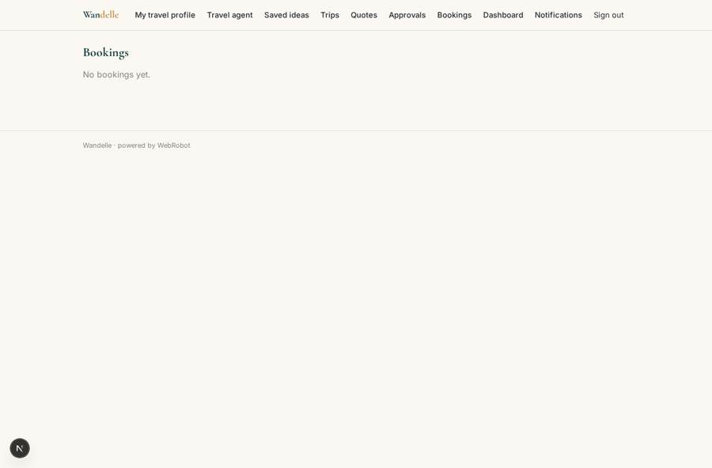

# Wandelle

_Premium holidays planned by an AI travel agent and finished by a human concierge._

**Sector:** Consumer, travel, retail · **Manifest:** valid (schema + runtime contract) · **Functional test:** passed (12 checks passed)

## Description given to the app builder

I want a web and phone app called Wandelle that plans and books premium holidays through an AI travel agent with a human concierge behind it. Travellers sign up, set a profile (home airport, budget band, travel dates, party size, interests, accessibility needs) and chat with the agent, which uses web search and official tourism board pages to suggest destinations, hotels and day plans, saving each idea into the traveller's trip collections. When the traveller likes a trip, the agent builds a quote; a concierge reviews and approves it before it is sent, and can edit prices or swap hotels. Live hotel and flight availability and booking must come from bed-bank and GDS inventory (HBX-type and Amadeus-type APIs), only if we have a partner contract. The traveller pays a deposit by card, then the balance 8 weeks before departure, with email reminders at 10 and 8 weeks. Because flight-inclusive packages need an ATOL licence from the CAA, the app must show our ATOL details and issue an ATOL certificate with each package booking. Travellers see only their trips; concierges see the trips assigned to them; admins see everything, plus a dashboard of quotes, conversions and deposits. Free to plan, we earn commission and a concierge fee. English only.

## Functional test: what did not pass

- **saved record shown where its collection is read** (view quotes): a record was saved in quotes (by admin) but the page does not show it (as user) _(warning)_

## Navigation recording

Signed in as the app's admin, the recorder opened 7 menu page(s): My travel profile, Travel agent, Saved ideas, Trips, Quotes, Approvals, Bookings.
- data page empty: trips (table)

Empty data pages are mostly expected on the local runtime: agents are mocked there, so the collections they fill stay empty.

## Features not expressible today (spec.extensions)

- **partner_inventory**: Live hotel and flight availability and booking through bed-bank (HBX-type) and GDS (Amadeus-type) APIs. Not included: it needs a signed partner contract and credentials. Until then the agent gives indicative prices from public sources and the concierge confirms them.
- **card_payments**: Collecting the card deposit and the balance 8 weeks before departure is not expressible yet. Deposit and balance status are recorded on each booking by the concierge or admin; the 10 and 8 week email reminders are already automatic.
- **atol_certificate**: Issuing the ATOL certificate itself needs the owner's CAA licence and the CAA certificate system. The concierge is notified on each booking, issues the certificate and records its reference. The owner must enter the real ATOL licence number on the home page before launch.
- **commission_and_fees**: Supplier commission and the concierge fee are not charged through the app; they are handled in the owner's own accounts. The app is free to plan with.

## Screenshots (interpretive runtime, test data)

### home-anon

### home-mobile

### ideas

### trips

### quotes

### bookings

