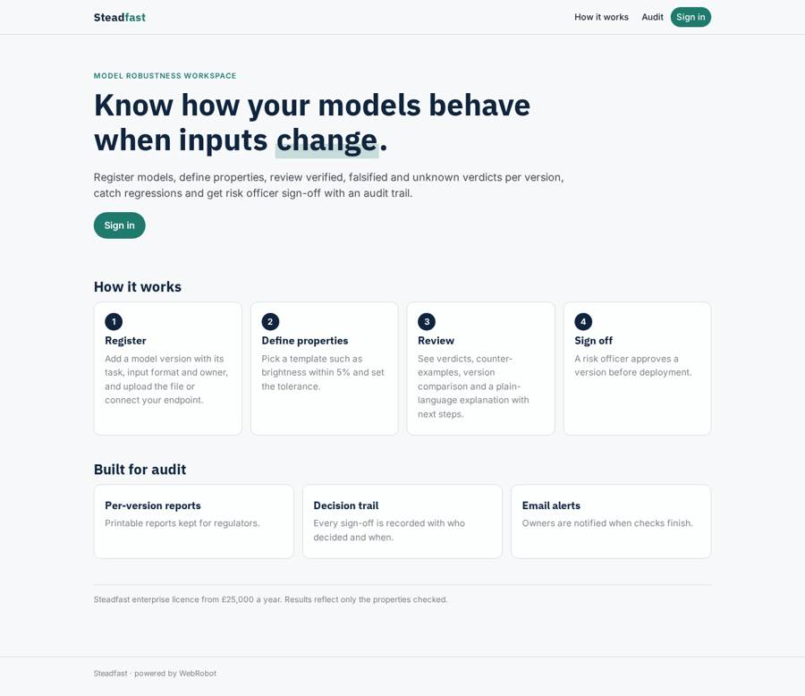
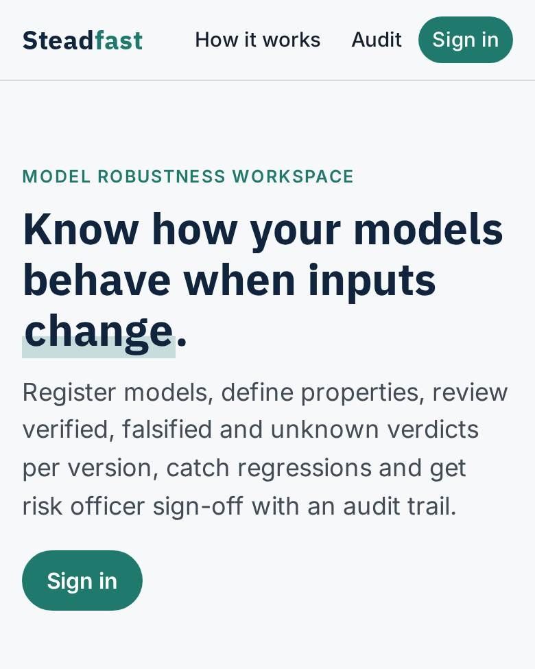
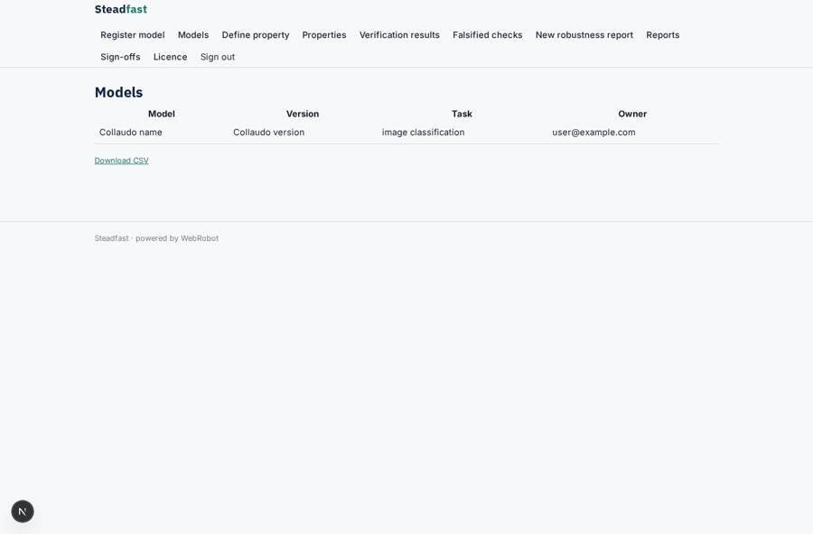
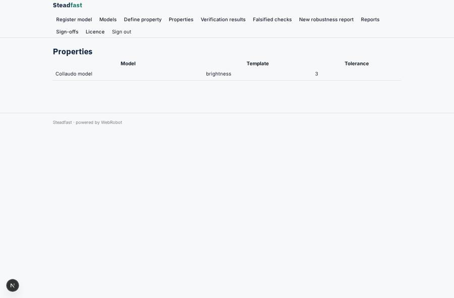
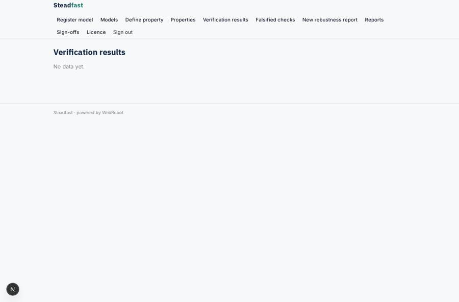
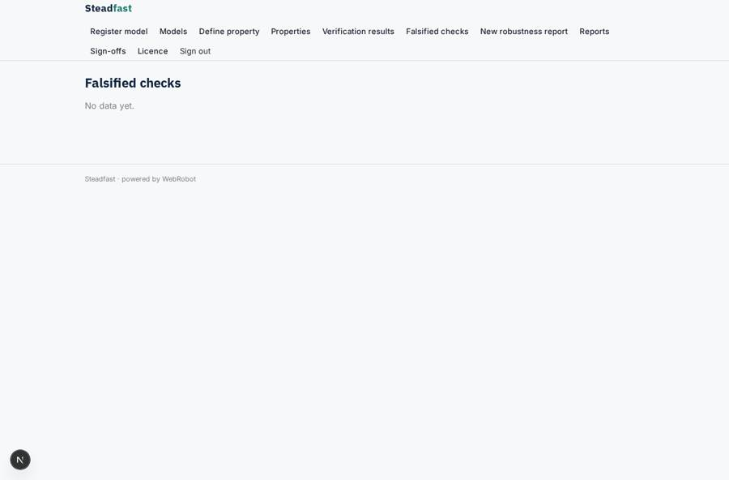

# Steadfast

_Prove how your AI models behave when inputs change._

**Sector:** Data, media, cyber, devtools · **Manifest:** valid (schema + runtime contract) · **Functional test:** passed (17 checks passed)

## Description given to the app builder

We need an app called Steadfast for verifying and stress-testing the robustness of AI models. The core of the real product is formal-verification research and proprietary verification engines that prove how a model behaves under input changes; that deep-tech engine is outside a software app, and I need the workspace and workflow around it. An ML team signs up and registers models with name, version, task, input format and owner, uploading the model file or connecting a model endpoint they own. They define properties to check, such as the prediction must not change if brightness varies by up to five percent, using a form with templates. The engine runs the checks and returns verified, falsified with counter-examples, or unknown. The app shows a robustness report per model version, compares versions and tracks regressions. An agent explains results in plain language and suggests data augmentation or retraining steps. A model risk officer must sign off a version before it is marked approved for deployment, and the report is kept for audit and regulators. Email notifies owners when checks finish. Roles: admin, ML engineer, risk officer. Pricing: enterprise licence from £25,000 a year. English only.

## Navigation recording

Signed in as the app's admin, the recorder opened 7 menu page(s): Register model, Models, Define property, Properties, Verification results, Falsified checks, New robustness report.
- data page empty: results (table)
- data page empty: regressions (table)
- agent run did not open: new_report: the run did not open

Empty data pages are mostly expected on the local runtime: agents are mocked there, so the collections they fill stay empty.

## Features not expressible today (spec.extensions)

- **verification_engine**: The proprietary formal-verification engine is outside this app. It must POST each verdict (run_id, model, version, property, verdict verified|falsified|unknown, counterexample, owner_email, date) to the webhook /api/hooks/engine_result with the app's hook secret. Model files and endpoints are stored for the engine to fetch.
- **approved_status**: The approved-for-deployment state is the recorded decision of the version_signoff approval; there is no automatic status field on models yet.

## Screenshots (interpretive runtime, test data)

### home-anon

### home-mobile

### models

### properties

### results

### regressions

