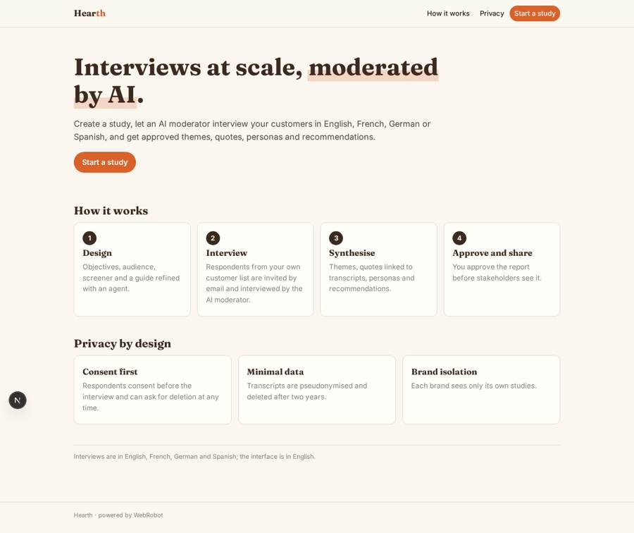
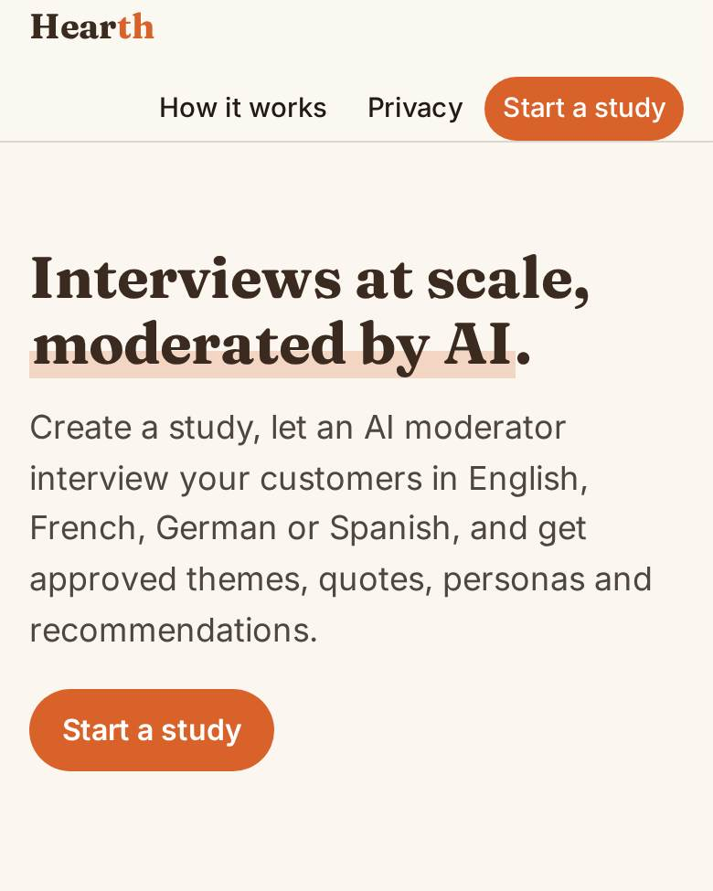
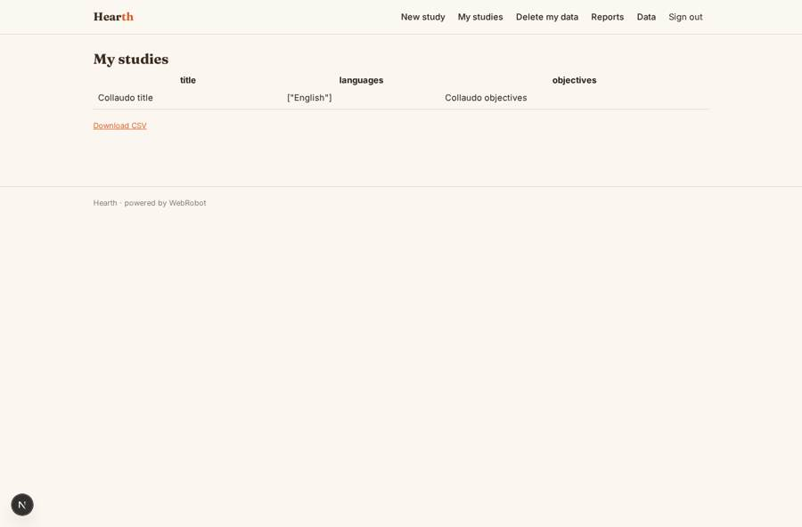
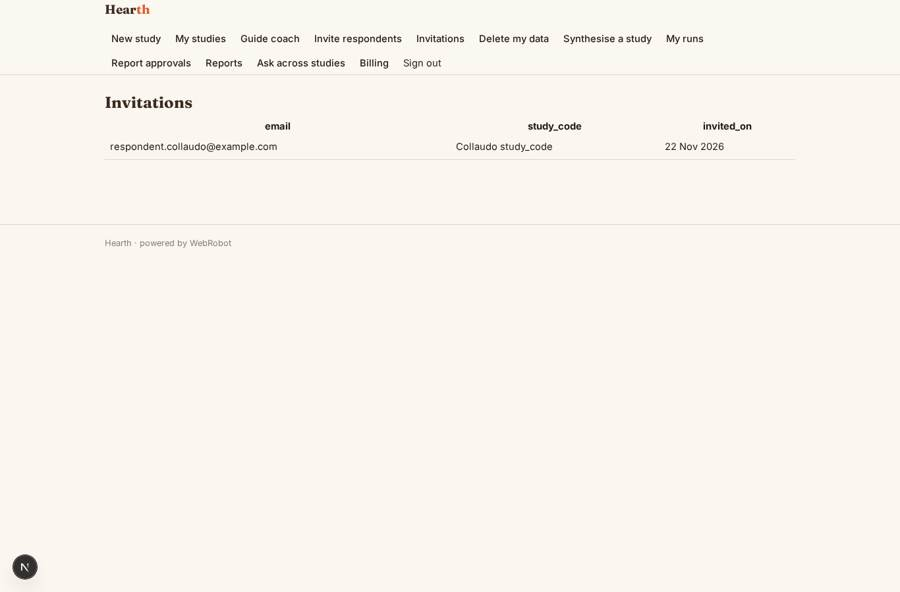
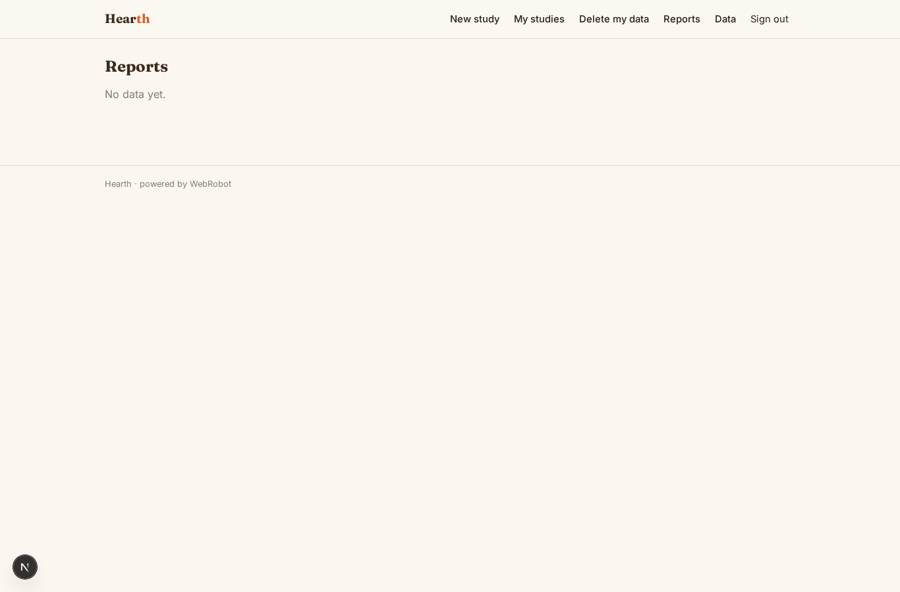
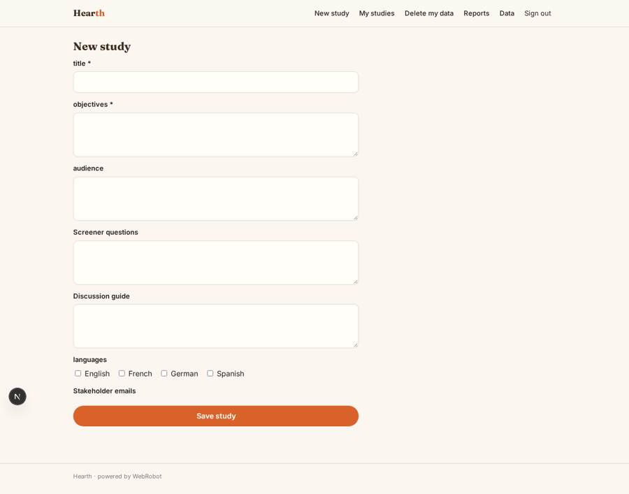

# Hearth

_AI-moderated consumer interviews, from guide to approved insight._

**Sector:** Data, media, cyber, devtools · **Manifest:** valid (schema + runtime contract) · **Functional test:** passed (25 checks passed)

## Description given to the app builder

We need an app called Hearth for AI-moderated consumer research interviews for brands. A brand's insight manager signs up, creates a study with objectives, target audience, screener questions and a discussion guide, and an agent helps refine the guide. Respondents receive a link and are interviewed by an AI moderator that asks follow-up questions; the real product runs these interviews by voice and video, recording and transcribing them, and I want that included, with text chat as a fallback. Respondents come from the brand's own customer lists or from a third-party panel, which we would use only under a licence; panel recruitment and incentives are part of the real product. After fieldwork, an agent synthesises the interviews into themes, quotes, personas and recommendations, with links to the source transcripts. A RAG assistant lets researchers ask questions across all past studies. Reports need researcher approval before they are shared with stakeholders. Respondents give consent and can request deletion; personal data is minimised. Roles: admin, researcher, stakeholder viewer; each brand sees only its own studies. Emails remind respondents who have not finished. Pricing: per study from £2,000, or annual licence. Interviews in English, French, German and Spanish; interface in English.

## Navigation recording

Signed in as the app's admin, the recorder opened 4 menu page(s): New study, My studies, Delete my data, Reports.
- data page empty: reports (table)

Empty data pages are mostly expected on the local runtime: agents are mocked there, so the collections they fill stay empty.

## Features not expressible today (spec.extensions)

- **voice_video_interviews**: Voice and video interviews with recording and transcription are not available yet; only text chat works (the fallback). Needs a realtime voice/video channel and a transcription service.
- **panel_recruitment**: Third-party panel recruitment and respondent incentives are not available. Panel use needs a signed licence; for now respondents come only from the brand's own lists via email invites.
- **respondent_roles**: Respondents sign in by email link and get the signup role as well; tokenised respondent links without an account are not available. Screener scoring is manual.

## Screenshots (interpretive runtime, test data)

### home-anon

### home-mobile

### studies

### invited

### reports

### new_study

