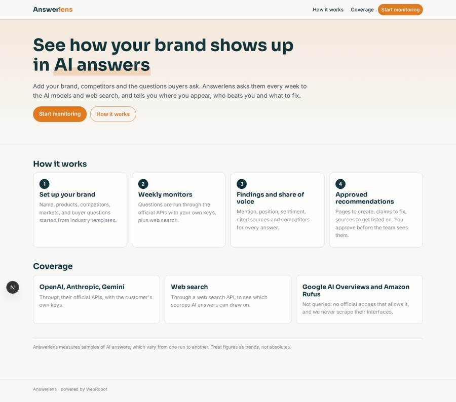
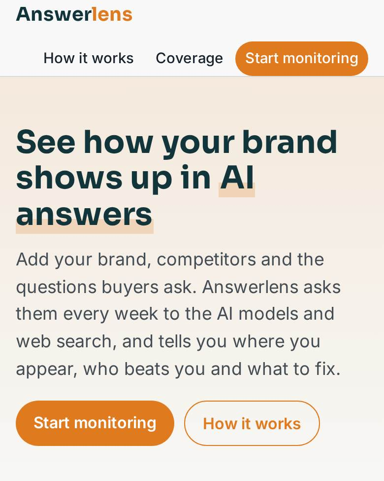
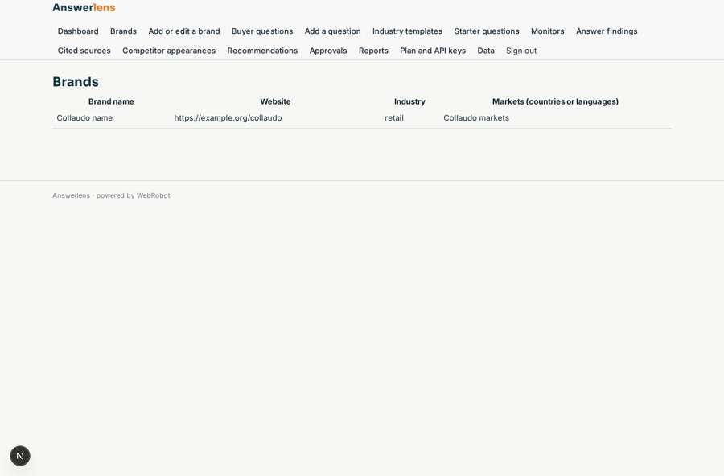
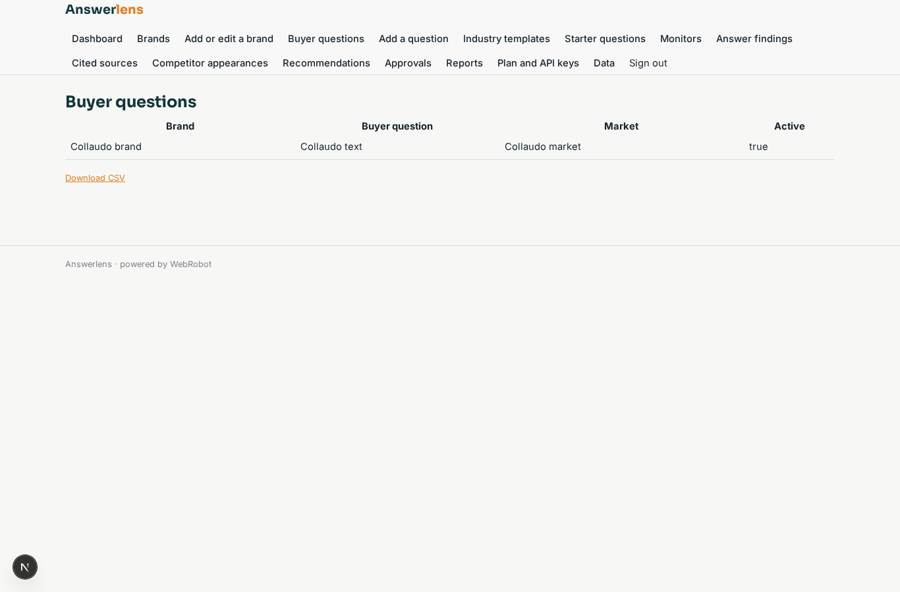
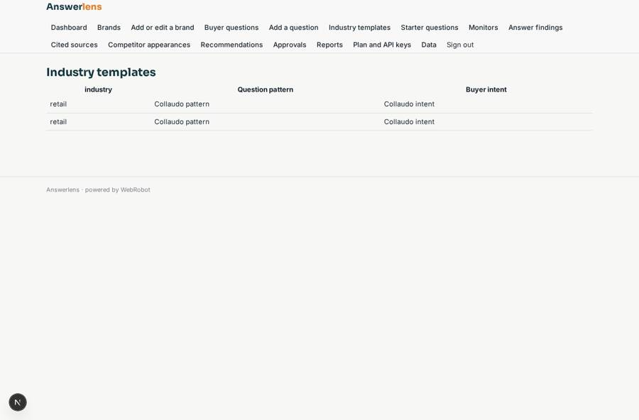
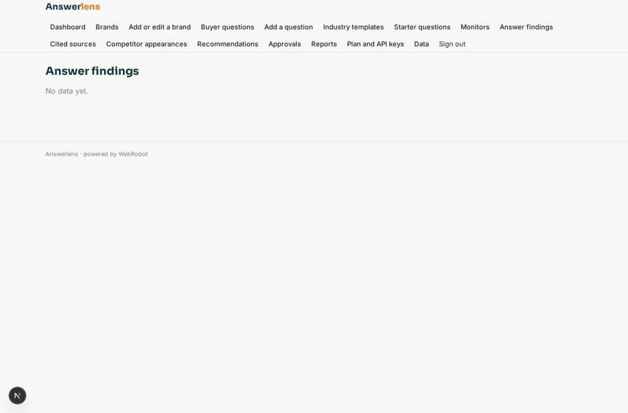

# Answerlens

_See how your brand appears in AI answers, and how to improve._

**Sector:** Consumer, travel, retail · **Manifest:** valid (schema + runtime contract) · **Functional test:** passed (22 checks passed)

## Description given to the app builder

We need an app called Answerlens that shows brands how they appear in AI answers and how to improve. A brand signs up, enters its name, products, competitors, markets and a list of buyer questions (for example "best running shoes for flat feet"), using templates per industry. Scheduled monitors run the questions every week against the AI models through their official APIs (OpenAI, Anthropic, Gemini) with the customer's own API keys, and also through web search APIs; Google AI Overviews and Amazon Rufus are covered only where their terms allow, never by scraping their interfaces. An agent records whether the brand is mentioned, its position, the sentiment, the sources cited and which competitors appear, then writes recommendations (pages to create, claims to fix, sources to get listed on). Recommendations go to the brand manager for approval before being shared with the team. Dashboards show share of voice per model, trend over time, top cited sources and competitor comparison, with CSV export. Brand users see only their brand; agencies can manage several brands; admins see everything. Weekly email digest. Pricing plans by number of questions and models, with quotas. English.

## Navigation recording

Signed in as the app's admin, the recorder opened 7 menu page(s): Dashboard, Brands, Add or edit a brand, Buyer questions, Add a question, Industry templates, Starter questions.
No issue found.

Empty data pages are mostly expected on the local runtime: agents are mocked there, so the collections they fill stay empty.

## Features not expressible today (spec.extensions)

- **ai_overviews_rufus**: Google AI Overviews and Amazon Rufus are not covered: no official API allows reuse and their interfaces must not be scraped. Add only if a licensed data source appears.
- **dashboard_brand_filter**: Dashboards show all of a user's brands together; a per-brand filter selector is not expressible yet.
- **question_quota_by_model**: Plan quotas count questions and brands; models are gated by plan in the monitor form.

## Screenshots (interpretive runtime, test data)

### home-anon

### home-mobile

### brands

### questions

### question_templates

### results

