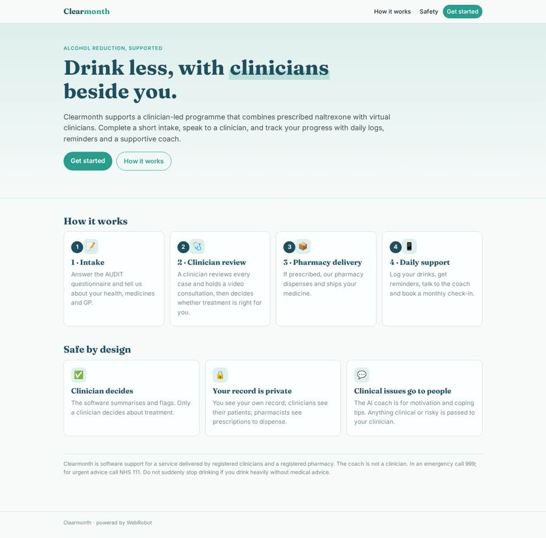
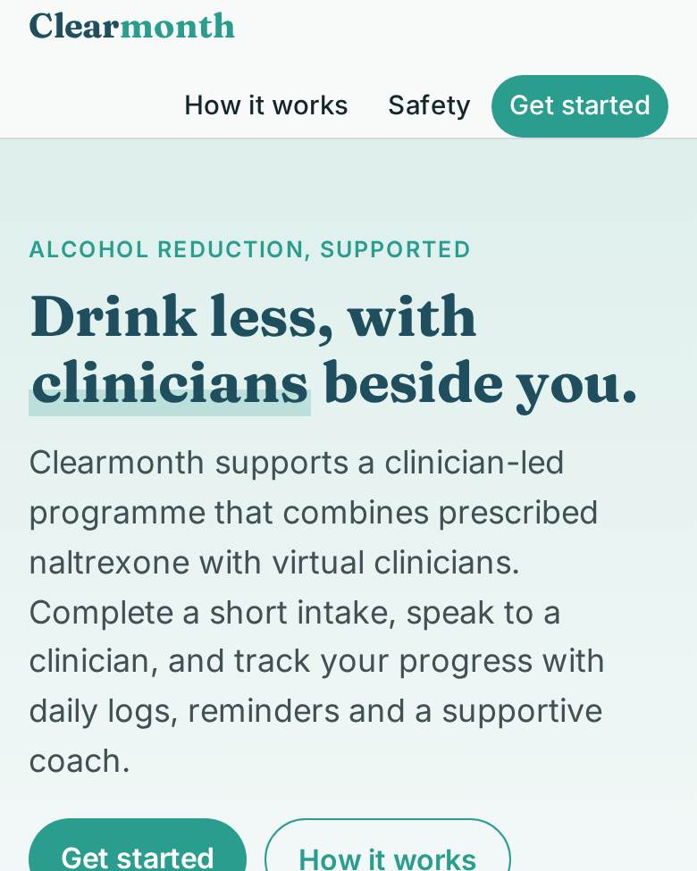
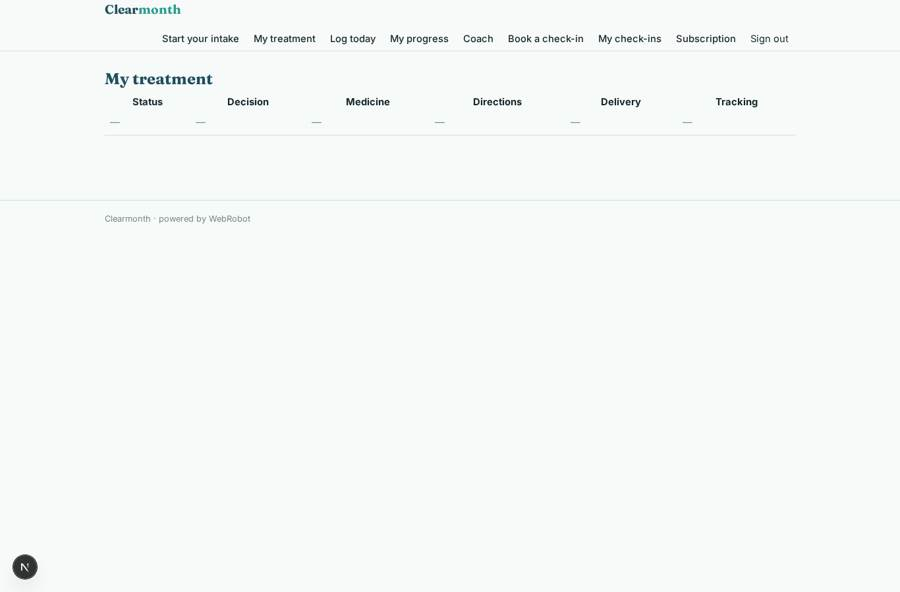
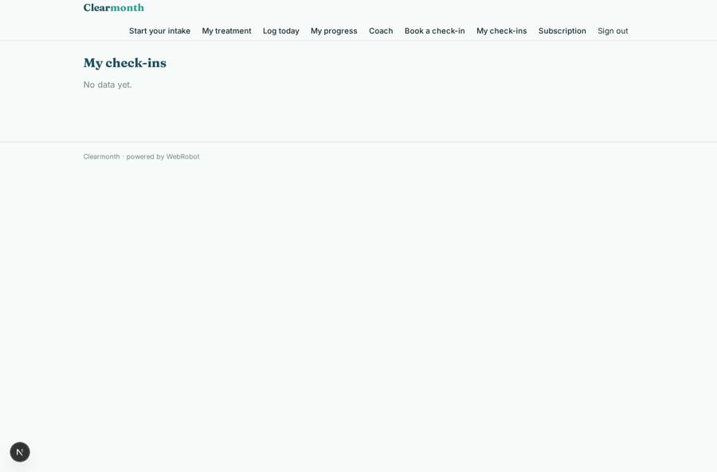
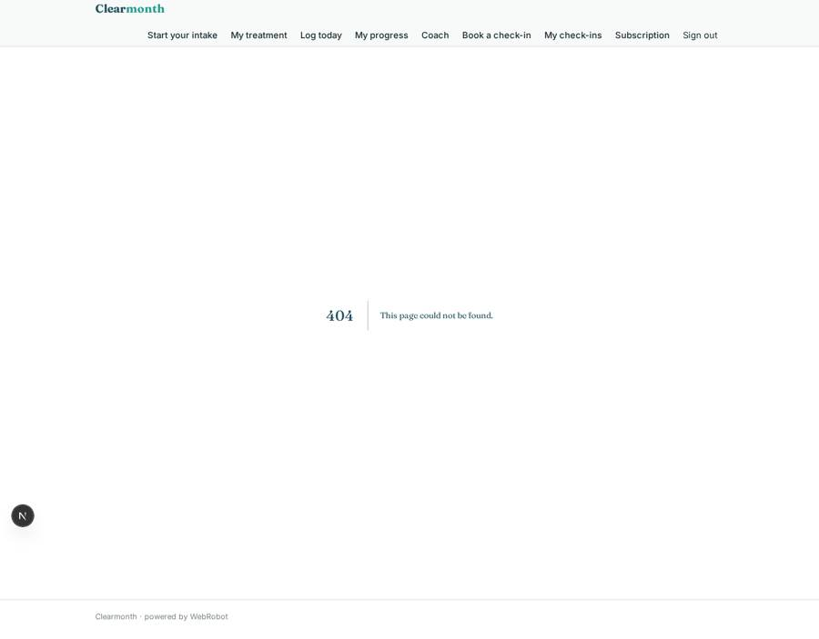

# Clearmonth

_Cut down on alcohol with clinician-led support, a daily log and an AI coach._

**Sector:** Consumer, travel, retail · **Manifest:** valid (schema + runtime contract) · **Functional test:** passed (27 checks passed)

## Description given to the app builder

We need an app called Clearmonth for our alcohol-reduction programme, which combines prescribed naltrexone with support from virtual clinicians. Prescribing, the clinical service and dispensing are outside the software: they are delivered by our clinicians and pharmacy under CQC registration, GPhC rules and MHRA requirements; I need the software around it. Users sign up and complete an intake form: drinking habits (AUDIT questionnaire), medical history, current medicines, liver conditions, pregnancy, GP details and consent. An agent summarises the intake and flags contraindications; a clinician reviews every case, holds a video consultation and decides whether to prescribe. Prescriptions go to our pharmacy, which ships the medicine. Users log drinks daily in the phone app, get push reminders, and chat with an AI coach for motivation and coping tips; anything clinical or risky goes to a clinician. Monthly clinician check-ins are booked in the app. Users see only their own record; clinicians see their patients; pharmacists see prescriptions to dispense; admins see programme dashboards with adherence and reduction in units. Monthly subscription. English.

## Functional test: what did not pass

- **form saves a record** (form review): only role clinician may fill it, and the test cannot hold that role _(warning)_
- **form saves a record** (form dispense): only role pharmacist may fill it, and the test cannot hold that role _(warning)_
- **saved record shown where its collection is read** (view status): a record was saved in cases (by user, admin) but the page does not show it (as user) _(warning)_
- **saved record shown where its collection is read** (view patients): a record was saved in cases (by user, admin) but the page does not show it (as clinician) _(warning)_
- **page opened by a role allowed to** (view dispensing): only role pharmacist may open it, the test cannot hold it _(warning)_
- **page opened by a role allowed to** (view dispense): only role pharmacist may open it, the test cannot hold it _(warning)_

## Navigation recording

Signed in as the app's admin, the recorder opened 2 menu page(s): All intakes, Programme dashboard.
No issue found.

Empty data pages are mostly expected on the local runtime: agents are mocked there, so the collections they fill stay empty.

## Design checks (linter)

- mobile.capabilities: an add-to-calendar button (view checkins) needs 'calendar' in the phone app

## Features not expressible today (spec.extensions)

- **video_consultation**: Video consultations are held in the clinical service's own video tool; the app only books the check-in slot. Embedded video and a link on the booking are not available yet.
- **clinician_booking_view**: Clinicians cannot yet see their own bookings in the app, only the check-in summaries; bookings are not tied to the clinician's email.
- **field_level_access**: The pharmacist sees the whole case record of prescribed patients; restricting them to name, address, allergies and prescription fields is not available.
- **prescribing_and_regulation**: Prescribing, dispensing and the clinical service itself, with CQC, GPhC and MHRA compliance, are outside the software. A GP letter, e-prescription transmission and SMS reminders are not available yet.
- **clinician_assignment**: Admins assign a clinician to each new case (view 'Assign a clinician'); the clinician role is derived from that assignment. Clinicians must also be added to the clinicians catalogue on the data page to be bookable.

## Screenshots (interpretive runtime, test data)

### home-anon

### home-mobile

### status

### checkins

### patients

### clinician_notes

