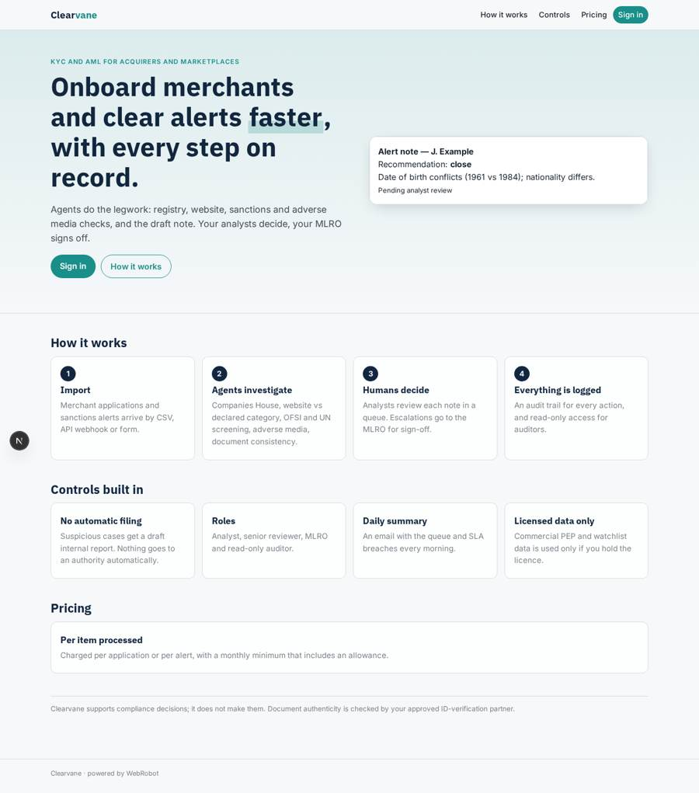
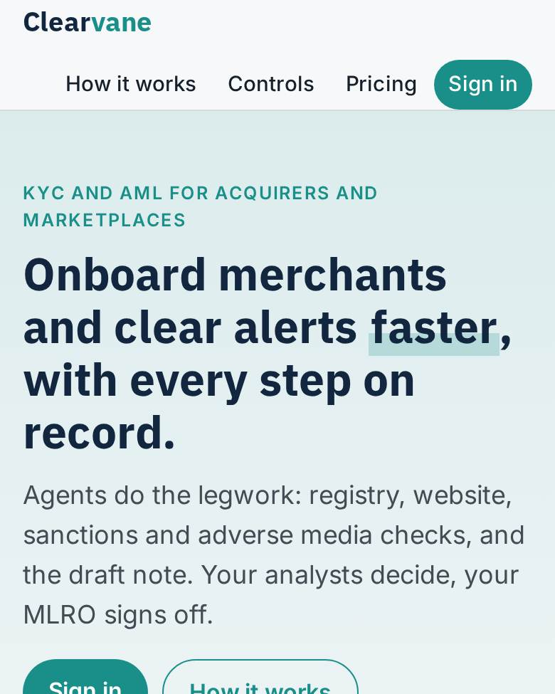
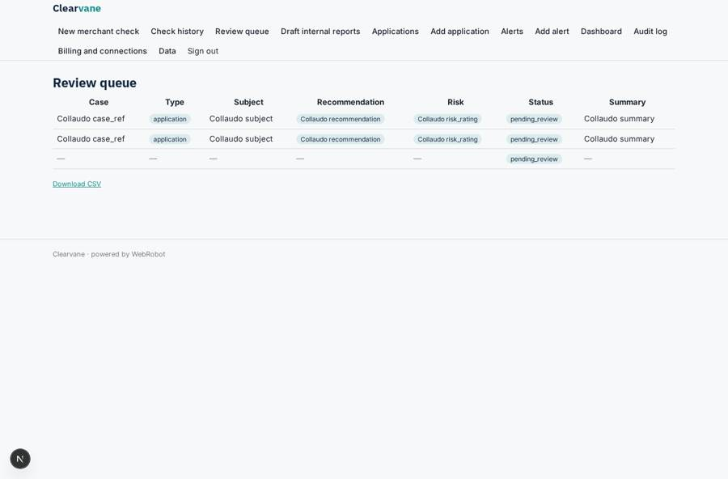
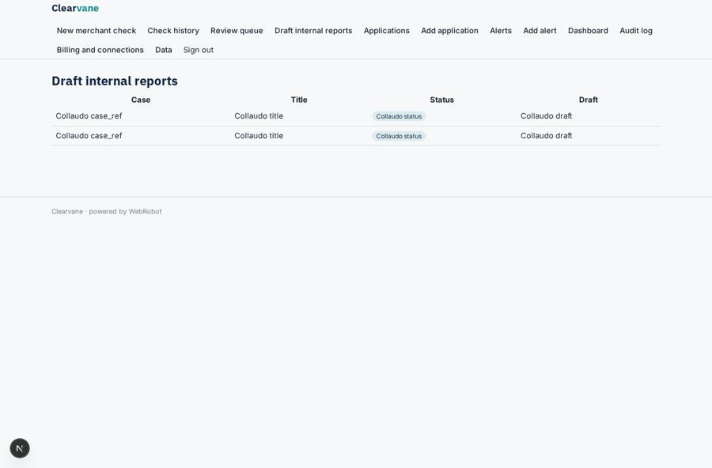
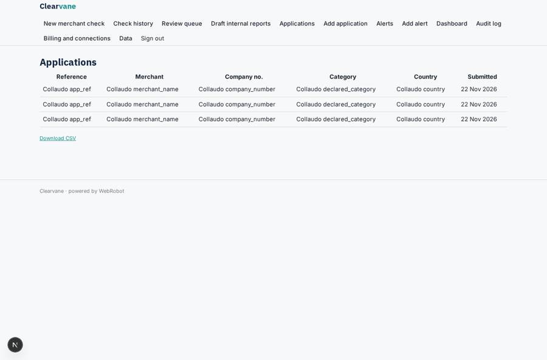
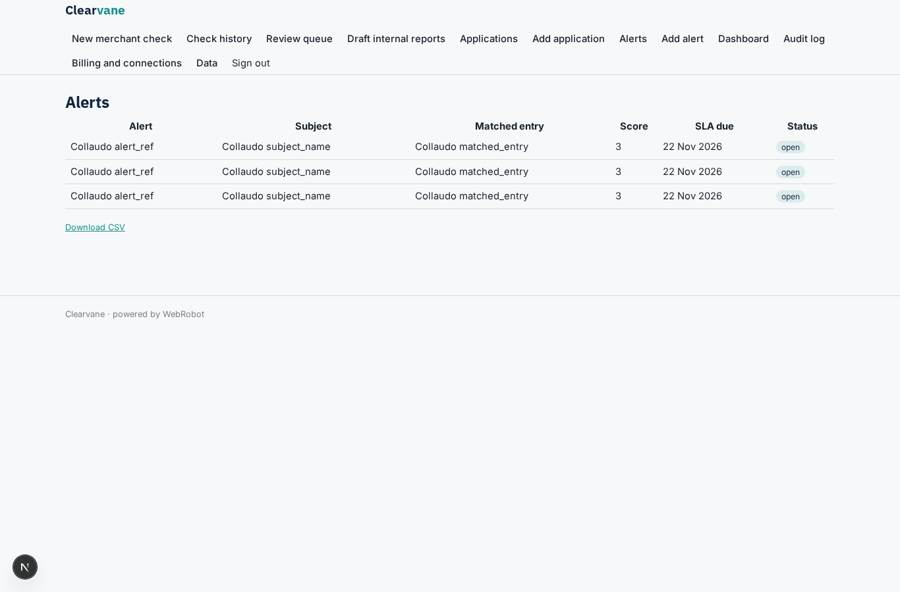

# Clearvane

_AI agents for end-to-end KYC and AML at acquirers and marketplaces._

**Sector:** Fintech, proptech, insurtech · **Manifest:** valid (schema + runtime contract) · **Functional test:** passed (38 checks passed)

## Description given to the app builder

I want Clearvane, AI agents for end-to-end KYC and AML at merchant acquirers and marketplaces. The compliance team signs up and imports merchant applications or sanctions alerts by CSV or API. For new merchants an agent checks the business on Companies House, reviews the merchant's own website content, compares stated activity with the declared category, screens owners against OFSI and UN lists and searches the web for adverse media. Uploaded identity documents and utility bills are read and checked for consistency, with an approved ID-verification partner doing the document authenticity check. Commercial PEP and watchlist data is used only if the customer has a licence. For screening alerts, the agent gathers evidence, compares names, dates of birth and nationalities, and drafts a remediation note recommending close or escalate. Analysts review each note in a queue and decide; escalations go to the MLRO for sign-off, and suspicious cases get a draft internal report, never filed automatically. Every action is logged. Roles: analyst, senior reviewer, MLRO, auditor read-only. Daily email summary of queue and SLA breaches; dashboards show alert backlog and false positive rate. Pricing: per alert or application processed, with monthly minimum. English.

## Functional test: what did not pass

- **page opened by a role allowed to** (view mlro_queue): only role mlro may open it, the test cannot hold it _(warning)_

## Navigation recording

Signed in as the app's admin, the recorder opened 7 menu page(s): New merchant check, Check history, Review queue, Draft internal reports, Applications, Add application, Alerts.
- agent run did not open: new_check: the run did not open
- data page empty: checks (history)

Empty data pages are mostly expected on the local runtime: agents are mocked there, so the collections they fill stay empty.

## Features not expressible today (spec.extensions)

- **id_verification_partner**: The approved ID-verification partner's document authenticity check is not connected: no partner or API is named yet. The agent checks consistency only and marks authenticity as pending. Name the partner to add an http tool with an org credential.
- **licensed_pep_feed**: Commercial PEP and watchlist data is not connected. Once the customer names its licensed vendor, add an org credential and an http tool. Until then the agents state that PEP screening was not performed.
- **sanctions_list_loading**: OFSI and UN lists are loaded into the shared watchlist collection by admins (CSV on /admin/data). Automatic refresh from the official publications is not set up.
- **per_customer_deployment**: Applications, alerts and cases are in the org back office, shared by the invited roles, so each acquirer should run its own app instance. Several customers in one instance would see each other's cases.
- **decision_segregation**: Who may set which status (for example only the MLRO setting signed_off) and four-eyes rules between analyst and senior reviewer are not enforced by field. MLRO sign-off is enforced through the approval.
- **sla_clock**: SLA breaches are computed by the daily digest agent from the sla_due field. There is no live SLA timer or alert-on-breach trigger.

## Screenshots (interpretive runtime, test data)

### home-anon

### home-mobile

### queue

### internal_reports

### applications

### alerts

