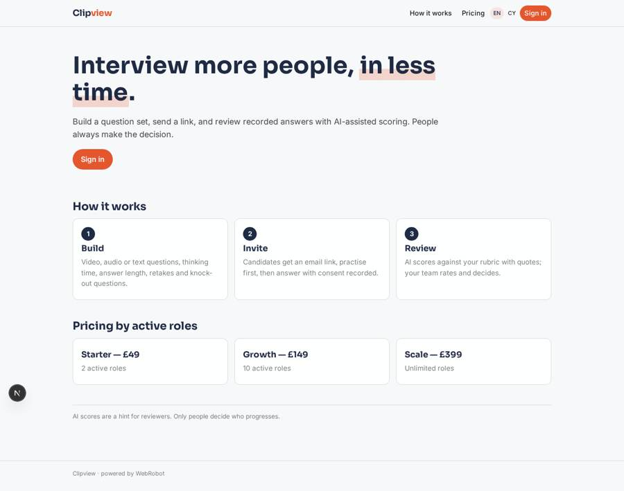
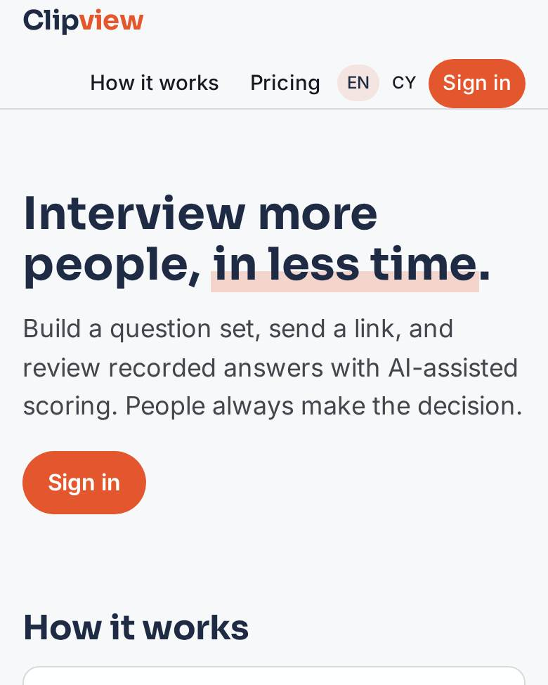
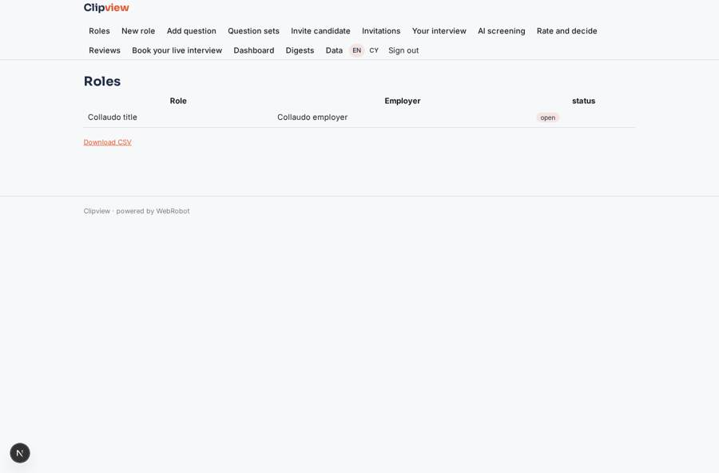
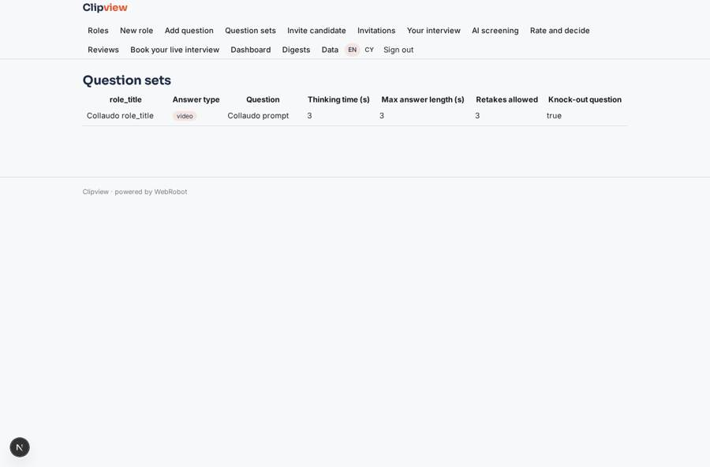
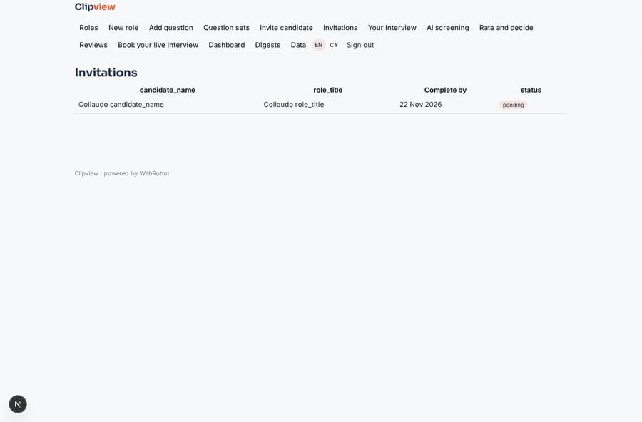
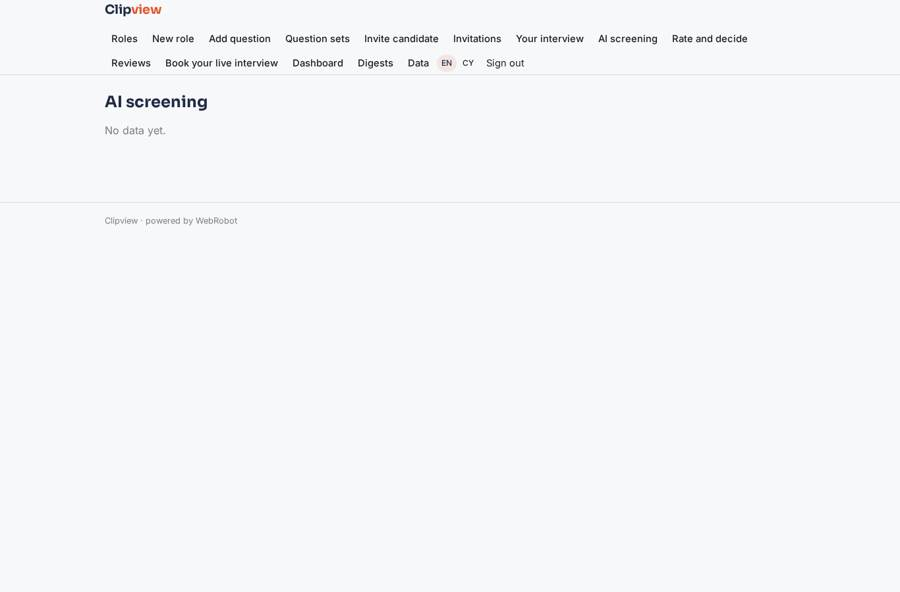

# Clipview

_Asynchronous video interviews, screened fairly._

**Sector:** B2B AI and SaaS · **Manifest:** valid (schema + runtime contract) · **Functional test:** passed (26 checks passed)

## Description given to the app builder

We need Clipview, an asynchronous video interviewing and screening tool. Employers and recruitment agencies sign up; recruiters create interviews, hiring managers review, and each user sees only the roles they work on. A recruiter builds a question set: video, audio or text questions, thinking time, maximum answer length, number of retakes, plus knock-out questions as forms. Candidates get a link by email, record answers in the browser or on their phone, and can practise first. The core of the real product is recording, storing and playing video, which must be included. Answers are transcribed; an agent scores each transcript against the recruiter's rubric with quotes and summarises strengths and concerns, while recruiters and managers watch, rate and comment, and only humans decide who progresses. Candidates who pass are invited to book a live interview slot. Candidate consent and retention periods are recorded, and videos are deleted after the period set. Reminder emails to candidates who have not completed, and digests to managers. Dashboards of completion rates, time to review and pipeline per role. Pricing: monthly plans by number of active roles via Stripe. English and Welsh.

## Navigation recording

Signed in as the app's admin, the recorder opened 7 menu page(s): Roles, New role, Add question, Question sets, Invite candidate, Invitations, Your interview.
No issue found.

Empty data pages are mostly expected on the local runtime: agents are mocked there, so the collections they fill stay empty.

## Features not expressible today (spec.extensions)

- **video_recording**: Not available yet: recording video or audio in the browser or on phones, storing and playing it back, practice mode with the camera, thinking-time and retake countdowns in the recorder, and automatic transcription. Today answers are text (typed or a pasted transcript) in the answers collection; the question settings (think time, length, retakes) are stored but not enforced by a recorder.
- **candidate_routing**: Not available yet: attaching a candidate's answers (members, rubric) to the role team from the invitation link automatically. For now these fields must be prefilled by the link or set by staff; until then team access relies on the members list.
- **knockout_rules**: Knock-out questions are stored with the expected answer, but automatic rejection is not applied: a reviewer decides.
- **retention_per_role**: Retention is a fixed 180 days on answers and AI scores; a per-role period needs per-record retention.

## Screenshots (interpretive runtime, test data)

### home-anon

### home-mobile

### roles

### question_list

### invitations_list

### screening

