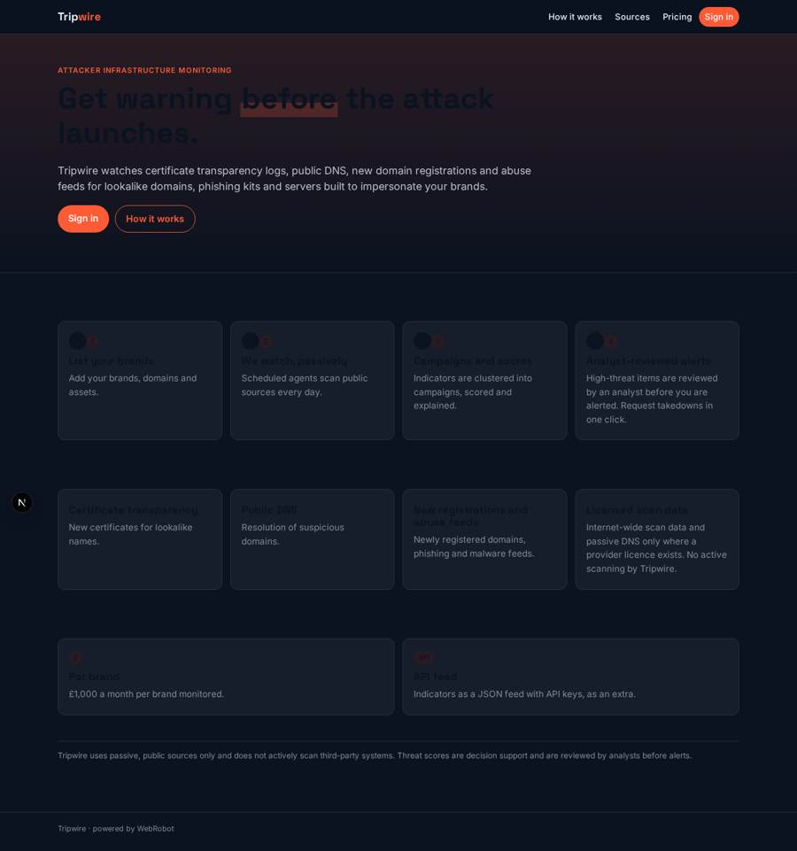
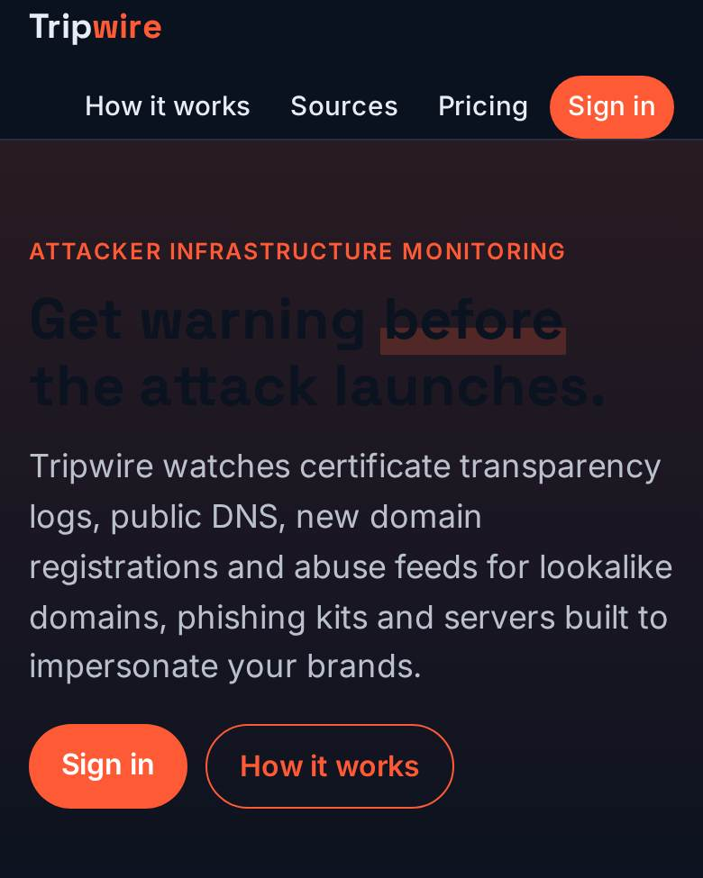
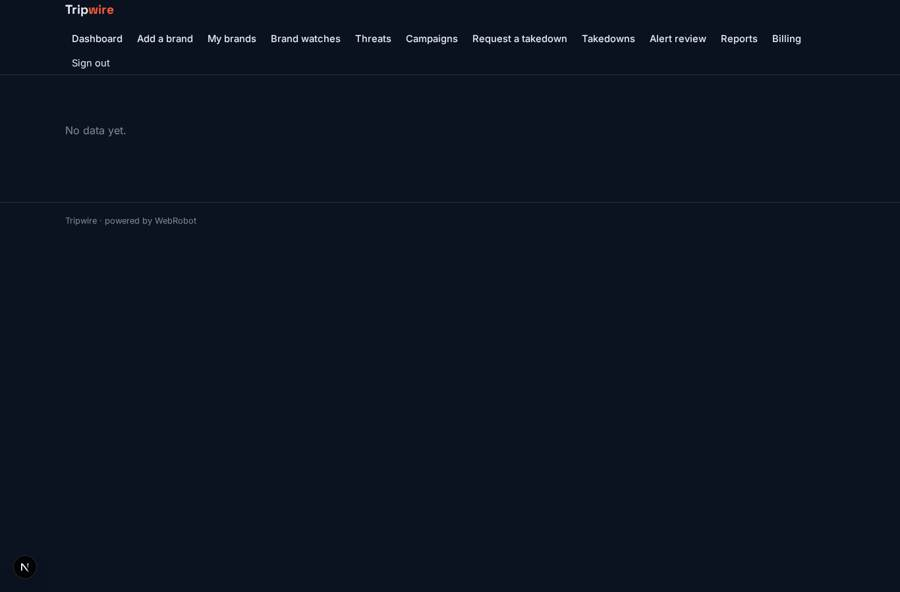
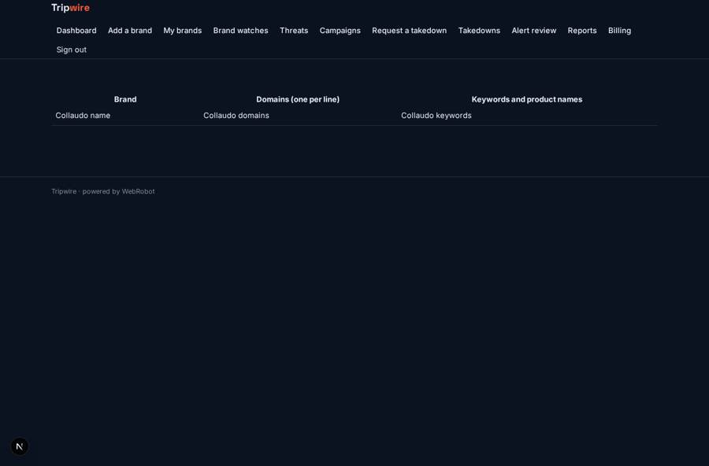
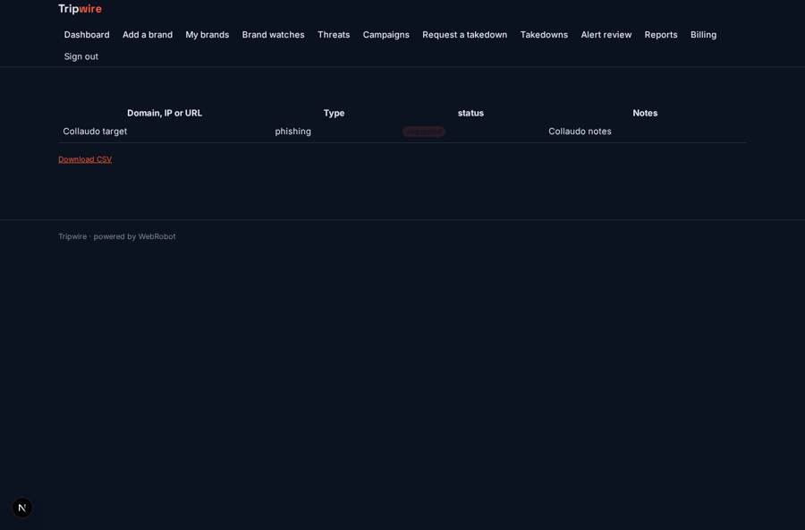

# Tripwire

_Warning before the attack launches._

**Sector:** Data, media, cyber, devtools · **Manifest:** valid (schema + runtime contract) · **Functional test:** passed (18 checks passed)

## Description given to the app builder

We need an app called Tripwire that tracks attacker infrastructure so customers get warning before attacks launch. A security team signs up and lists its brands, domains and assets it owns. Scheduled agents watch certificate transparency logs, public DNS, newly registered domains and public abuse feeds for lookalike domains, phishing kits and servers set up to impersonate the customer. The real product also relies on internet-wide scan data and passive DNS, which we use only if we have a licence from a provider; we do not run our own active scanning, which carries legal risk under the Computer Misuse Act. Each indicator stores domain or IP, first seen, registrar, hosting, certificate, similarity score and status. An agent clusters indicators into campaigns, scores threat level and explains why. An analyst reviews high-threat items before an alert goes out by email, Slack and webhook. Customers can request takedowns, tracked with status. Indicators are also available through an API feed with API keys. Dashboards show new threats, campaigns and time to detection. Roles: admin, analyst, read-only. Pricing: £1,000 a month per brand, API feed extra. English only.

## Navigation recording

Signed in as the app's admin, the recorder opened 7 menu page(s): Dashboard, Add a brand, My brands, Brand watches, Threats, Campaigns, Request a takedown.
- data page empty: threats (table)
- data page empty: campaigns (cards)

Empty data pages are mostly expected on the local runtime: agents are mocked there, so the collections they fill stay empty.

## Features not expressible today (spec.extensions)

- **per_brand_billing**: The £1,000 per month is charged per brand (quantity = number of brands watched); the plan model charges one flat subscription, so per-brand quantity billing and the API feed price (placeholder £500, set the real one) need configuring in Stripe.
- **slack_and_webhook_alerts**: Alerts by email are supported. Slack and outbound webhook delivery are not available yet.
- **api_keys**: The indicator feed at /api/indicators uses the app token access; per-customer self-service API keys with rotation are not available yet.
- **licensed_scan_data**: Internet-wide scan data and passive DNS require a provider licence and an API host; add the provider as an org credential and http tool once licensed. Tripwire does no active scanning.

## Screenshots (interpretive runtime, test data)

### home-anon

### home-mobile

### campaigns

### brand_list

### threats

### takedowns

