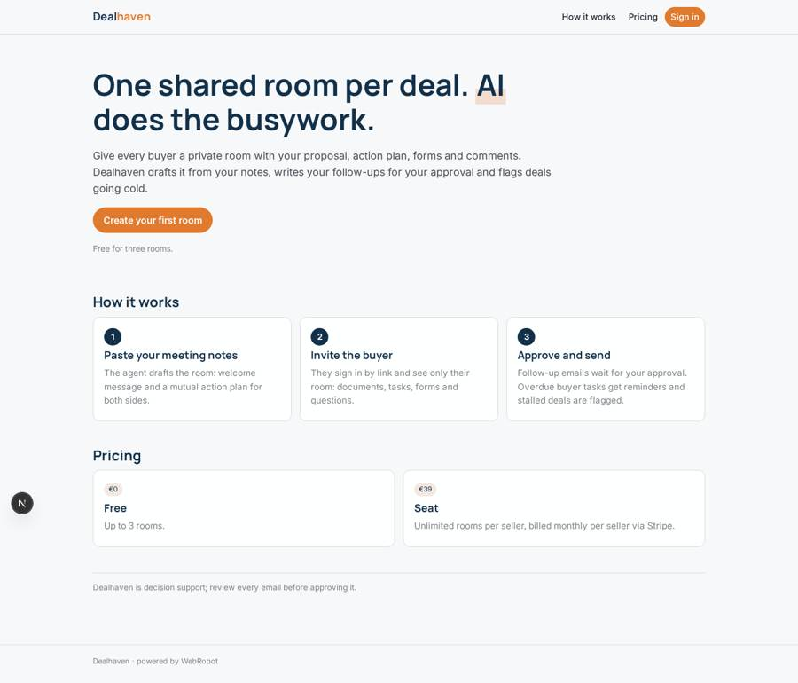
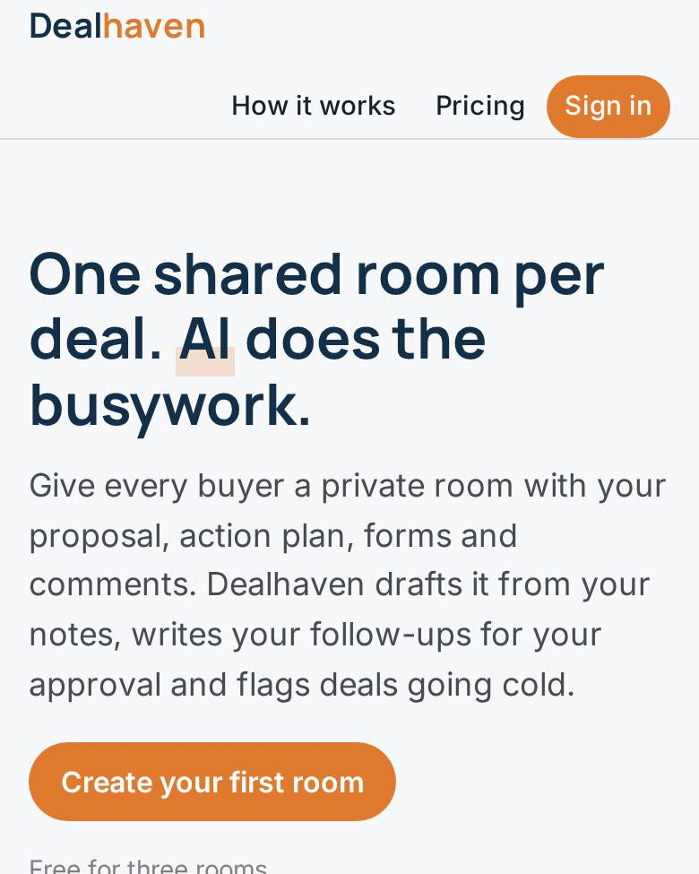
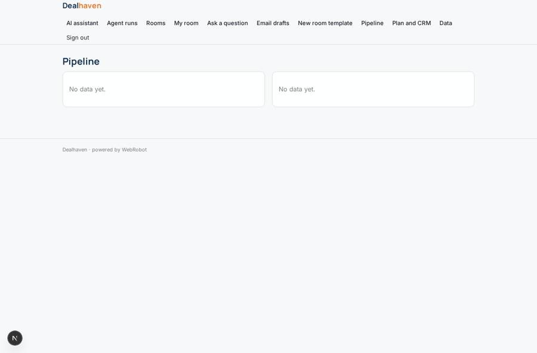
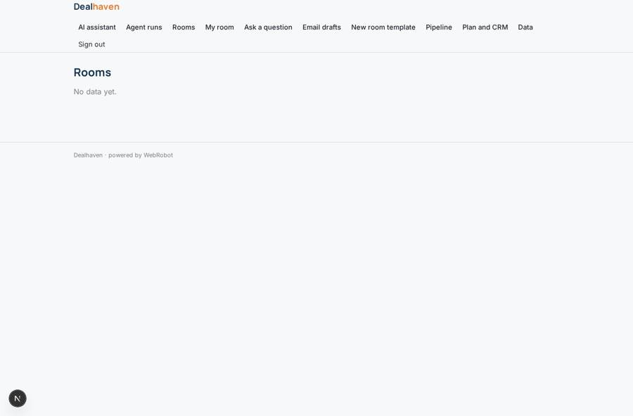
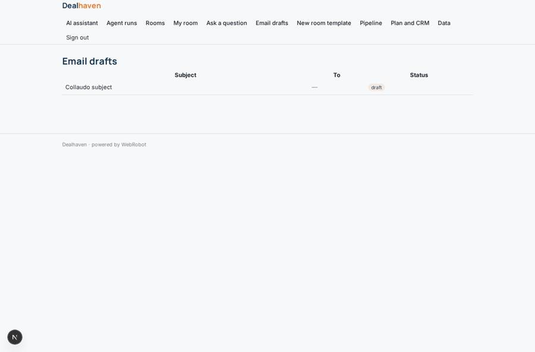
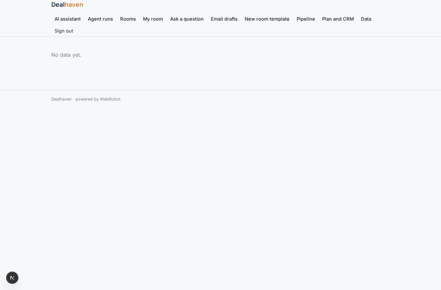

# Dealhaven

_One shared room per deal. AI does the busywork._

**Sector:** B2B AI and SaaS · **Manifest:** valid (schema + runtime contract) · **Functional test:** passed (23 checks passed)

## Description given to the app builder

I want Dealhaven, where B2B sales teams create a shared online room for each deal and AI takes over the non-selling tasks. The company signs up; sellers create rooms, managers see their team's rooms, and buyers are invited by link and see only their room. A room has a welcome message, the proposal and case studies uploaded by the seller, a mutual action plan with tasks, owners and dates for both sides, forms for the buyer (security questionnaire, procurement details), and a comments thread. An agent drafts the room from a template and the meeting notes the seller pastes, writes follow-up emails after each meeting, answers buyer questions from the company's uploaded documents and flags stalled deals; the seller approves every email before it goes. Buyers get reminders for their overdue tasks. Analytics show who opened what and for how long, and a pipeline dashboard shows deal stage and engagement. The real product also syncs deals and contacts with the CRM and tracks emails, which each seller connects through OAuth, so please include that. Pricing: free plan with three active rooms, then paid seats per seller via Stripe. English.

## Navigation recording

Signed in as the app's admin, the recorder opened 7 menu page(s): AI assistant, Agent runs, Rooms, My room, Ask a question, Email drafts, New room template.
- agent run did not open: new: the run did not open
- data page empty: history (history)
- data page empty: rooms (table)

Empty data pages are mostly expected on the local runtime: agents are mocked there, so the collections they fill stay empty.

## Features not expressible today (spec.extensions)

- **crm_oauth_sync**: Each seller connecting the CRM through OAuth and two-way sync of deals and contacts is not available yet. Interim: the seller pastes a HubSpot private-app key on the account page and the agent can read deals. Salesforce, Pipedrive and writing back to the CRM need OAuth.
- **email_tracking**: Tracking opens and replies of the follow-up emails is not available. The platform sends plain-text emails after the seller approves them.
- **room_engagement_analytics**: Tracking who opened which room item and for how long (page views, time on document) is not available yet. The pipeline dashboard shows stage, value, last activity and stalled flags instead. last_activity is set by the agents or edited by the seller.
- **active_room_quota**: The free plan limit counts every room a seller creates (window total), not only the active ones; closed rooms still count.

## Screenshots (interpretive runtime, test data)

### home-anon

### home-mobile

### pipeline

### rooms

### drafts

### pipeline_table

