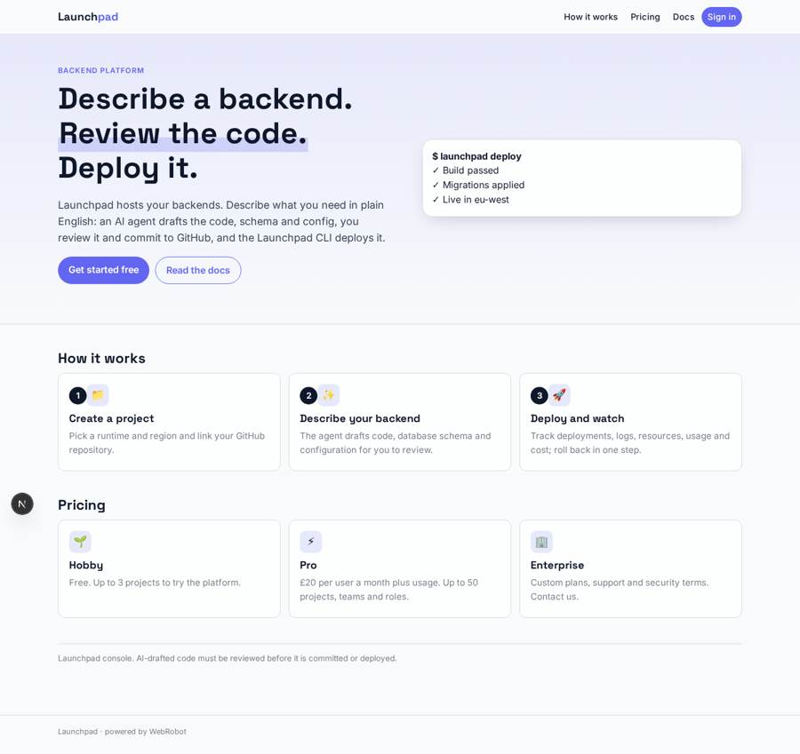
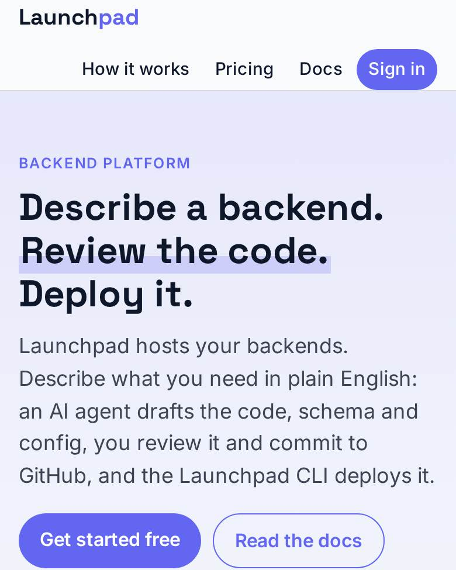
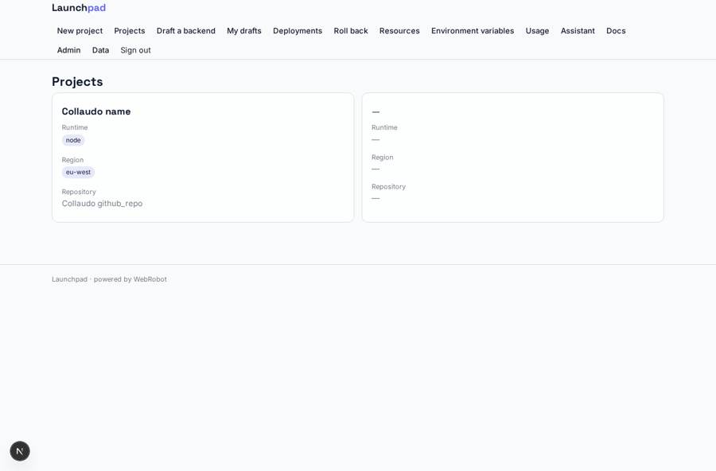
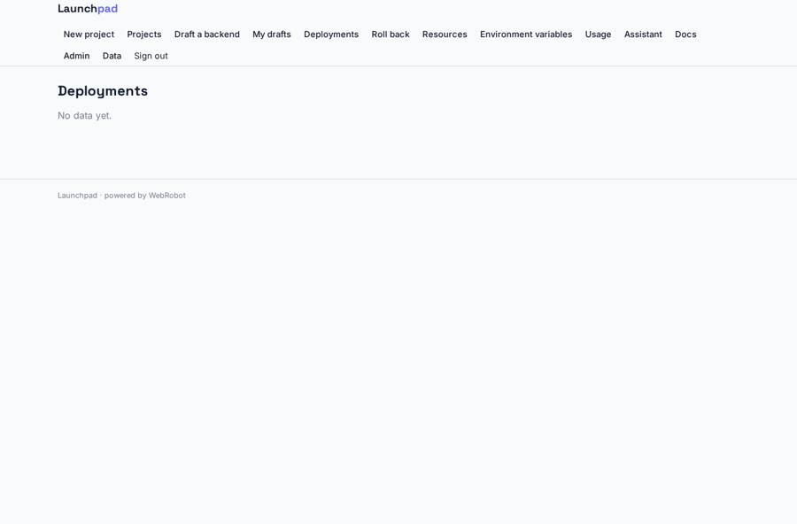
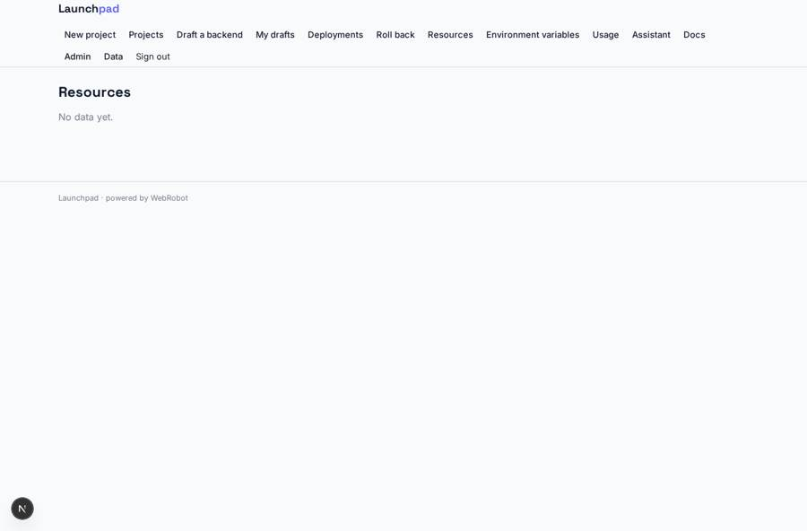
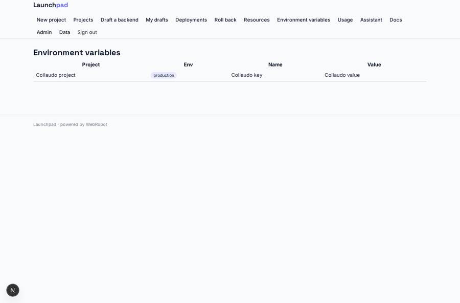

# Launchpad

_Describe a backend. Review the code. Deploy it._

**Sector:** Data, media, cyber, devtools · **Manifest:** valid (schema + runtime contract) · **Functional test:** passed (24 checks passed)

## Description given to the app builder

I want an app called Launchpad, an AI-assisted cloud platform where developers build and deploy backend applications. The real product is hosting and compute infrastructure plus a command-line tool and SDK that developers install; that infrastructure, CLI and SDK are ours and outside the app, and I need the web console and workflow around them. A developer signs up with email or GitHub and creates projects. In the console they describe a backend in plain English and an agent drafts the code, database schema and configuration, which the developer reviews and commits to their GitHub repository. Each project shows deployments with commit, status, build logs and runtime logs, plus provisioned resources such as Postgres databases, object storage and secrets. Developers can roll back to a previous deployment and set environment variables per environment. Usage dashboards show requests, CPU, memory and cost. Email alerts fire on failed deployments or when spending approaches a limit. Teams invite members with roles: owner, developer, viewer. Billing is through Stripe: free hobby tier, Pro at £20 per user a month plus usage, and enterprise plans. Documentation and an AI assistant answer questions using our docs. English only.

## Navigation recording

Signed in as the app's admin, the recorder opened 7 menu page(s): New project, Projects, Draft a backend, My drafts, Deployments, Roll back, Resources.
- agent run did not open: generate: the run did not open
- data page empty: deployments (table)
- data page empty: resources_view (table)

Empty data pages are mostly expected on the local runtime: agents are mocked there, so the collections they fill stay empty.

## Features not expressible today (spec.extensions)

- **github_signin_commit**: Sign-in with GitHub (OAuth) and committing the reviewed draft straight to the repository are not available yet: sign-in is by email link and the developer commits the draft with the git steps in the report.
- **infra_webhooks**: The Launchpad infrastructure must POST to the hooks deploy_hook, resource_hook, usage_hook and spend_hook (/api/hooks/<key>), including the owner and the team emails (owner_email, members, viewers) in each payload so records reach the right customers.
- **rollback_execution**: Rollback requests are saved and sent to admins; executing them on the infrastructure needs an integration on your side.
- **per_project_roles**: Roles owner, developer and viewer are modelled per project through the members and viewers lists: viewers read only, developers read and write, the owner manages the team. Environment variable values are plain text records: secret handling should live in your infrastructure.
- **enterprise_plans**: Enterprise plans are sold by contact; Stripe plans declared here are Pro only. Usage-based charges beyond credits are billed by your infrastructure.

## Screenshots (interpretive runtime, test data)

### home-anon

### home-mobile

### projects

### deployments

### resources_view

### env_list

