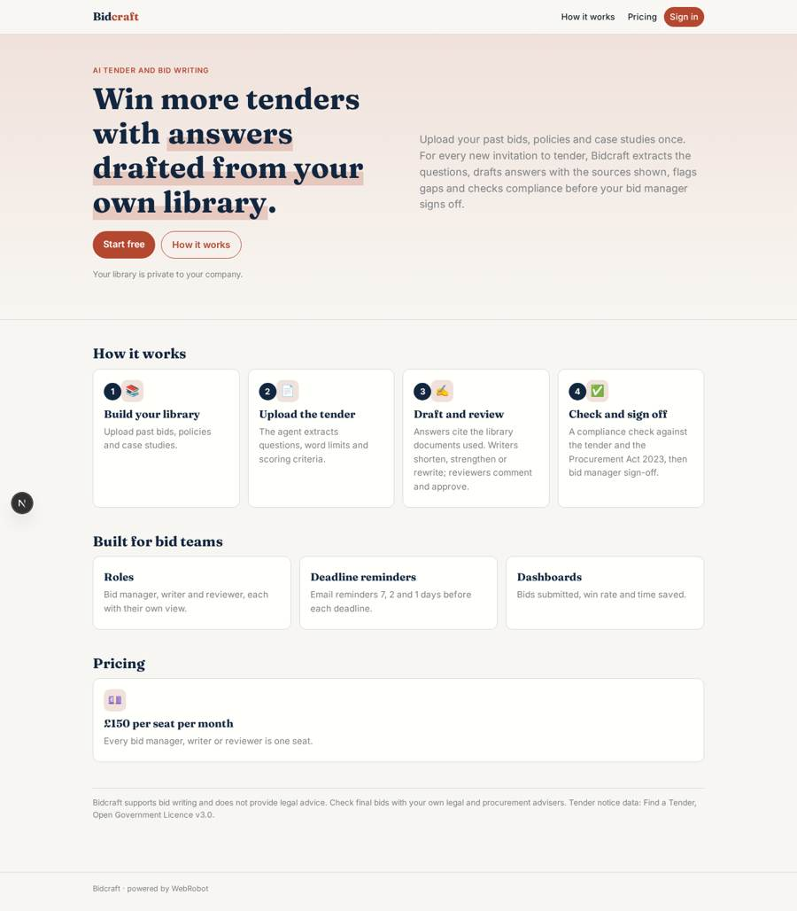
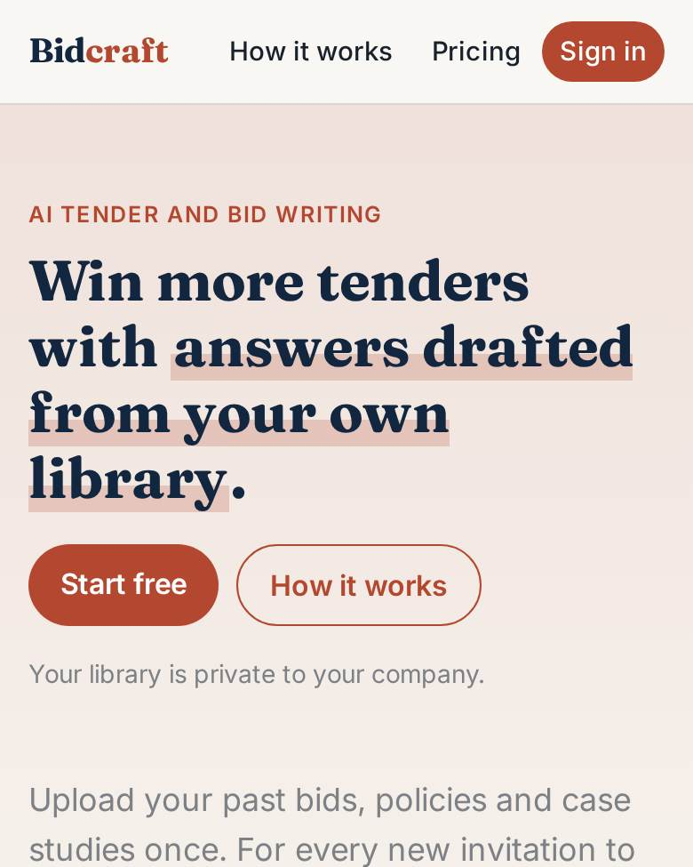
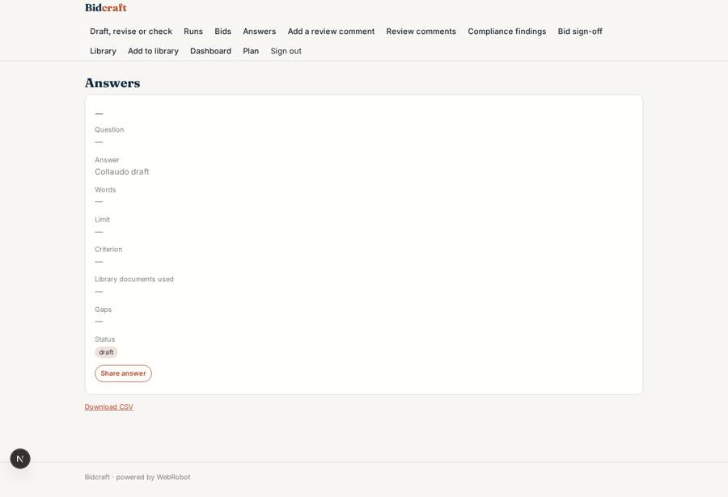
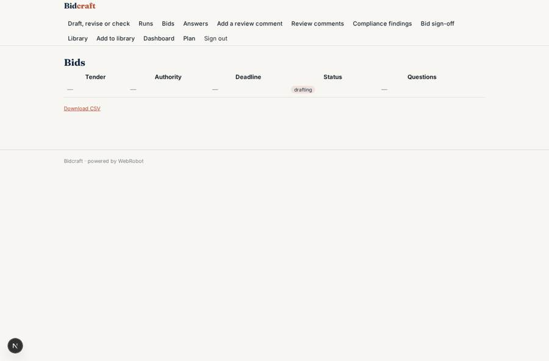
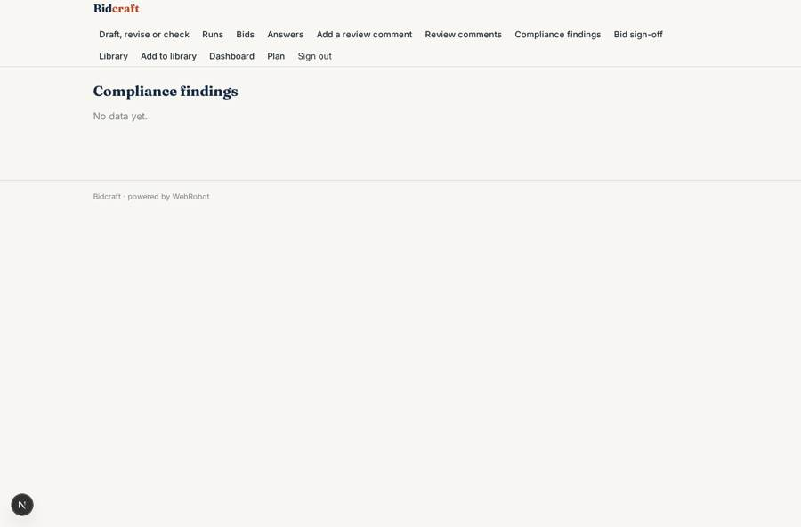
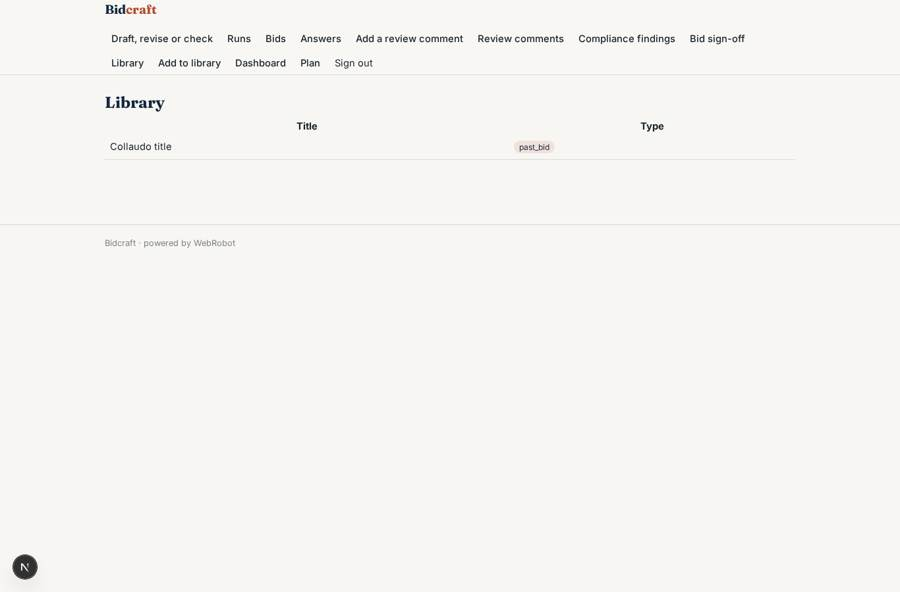

# Bidcraft

_Tender responses drafted from your own library, reviewed and signed off by your team._

**Sector:** Sanità, istruzione, energia, gov · **Manifest:** valid (schema + runtime contract) · **Functional test:** passed (37 checks passed)

## Description given to the app builder

We need Bidcraft, an AI tender and bid writing tool. A company signs up, uploads past bids, policies and case studies to a library. When a new invitation to tender arrives, they upload it; an agent extracts questions, word limits and scoring criteria, drafts answers from the library and tender notices in Find a Tender, and flags gaps. Bid managers review and approve each answer before export to Word. Roles: bid manager, writer, reviewer. Deadline reminders by email. Pricing per seat, £150 a month. Each answer shows which library documents it used, and writers can ask the agent to shorten, strengthen or rewrite for a scoring criterion. The library is per company and nobody outside it sees the content. A compliance checker compares the final draft with the tender's mandatory requirements and the Procurement Act 2023 rules, and lists anything missing. Dashboards show bids submitted, win rate and time saved. Reviewers comment inline and approve sections; the bid manager signs off the whole bid before export. English only.

## Navigation recording

Signed in as the app's admin, the recorder opened 7 menu page(s): Draft, revise or check, Runs, Bids, Answers, Add a review comment, Review comments, Compliance findings.
- data page empty: findings (table)

Empty data pages are mostly expected on the local runtime: agents are mocked there, so the collections they fill stay empty.

## Features not expressible today (spec.extensions)

- **word_export**: Export to Word (.docx) of the signed-off bid is not available yet. Use the printable report, save as PDF/copy into Word, or the CSV export of the answers view.
- **per_seat_billing**: Billing is a £150 per month plan; automatic per-seat quantity pricing is not available yet, so seats are charged by plan purchase per invited user.
- **inline_comments**: Comments are attached to an answer with an optional quoted passage; true highlighting inside the answer text is not available yet.
- **company_separation**: Company privacy relies on each document, bid and answer listing the company members' emails; a company-wide library shared automatically is not available yet.

## Screenshots (interpretive runtime, test data)

### home-anon

### home-mobile

### answers

### bids

### findings

### library

