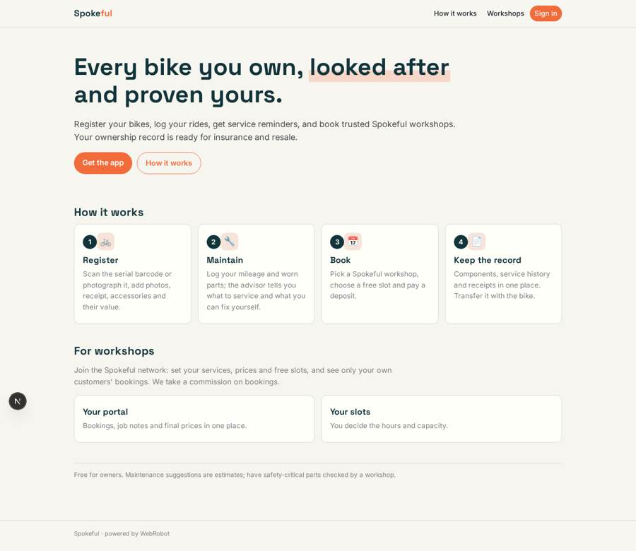
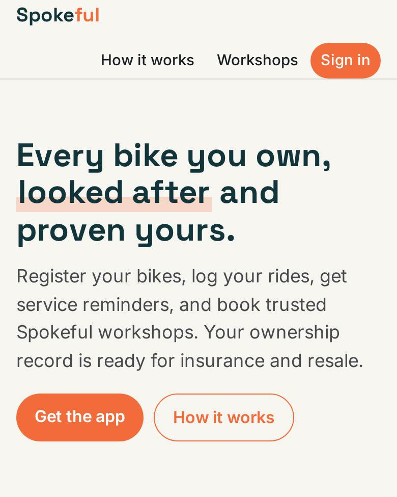
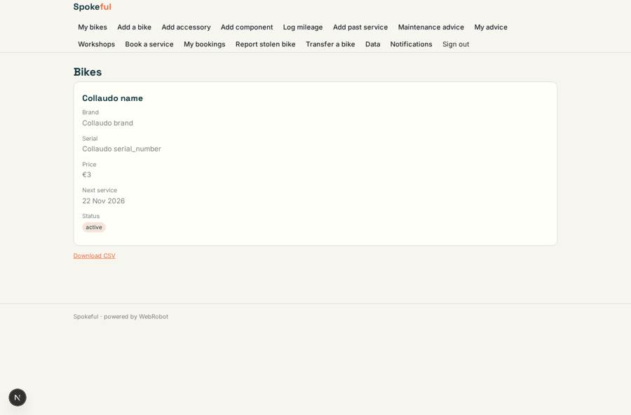
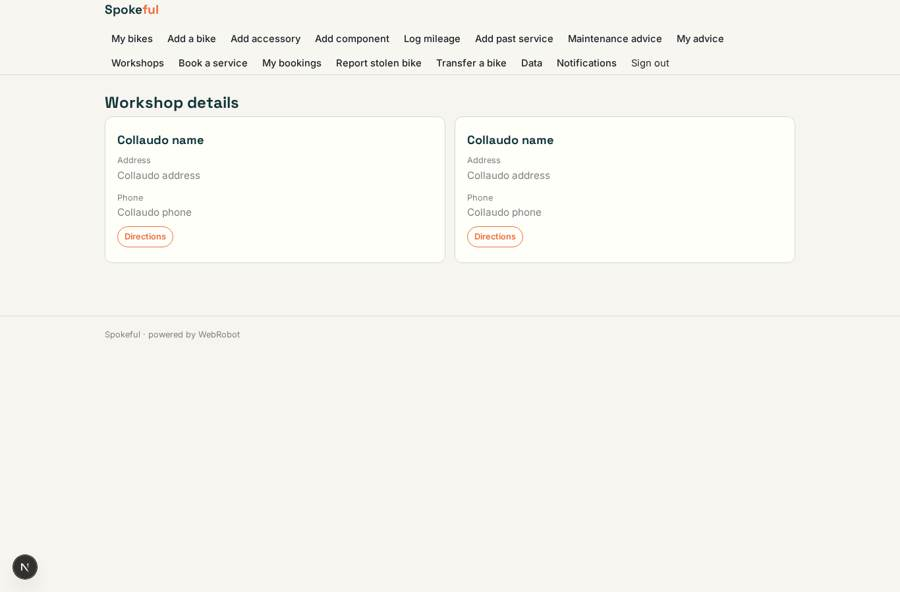
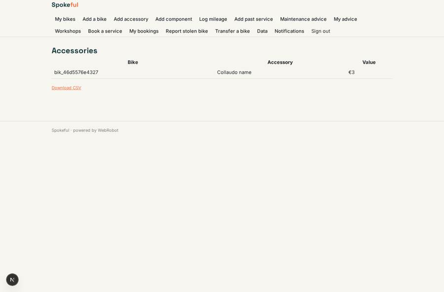
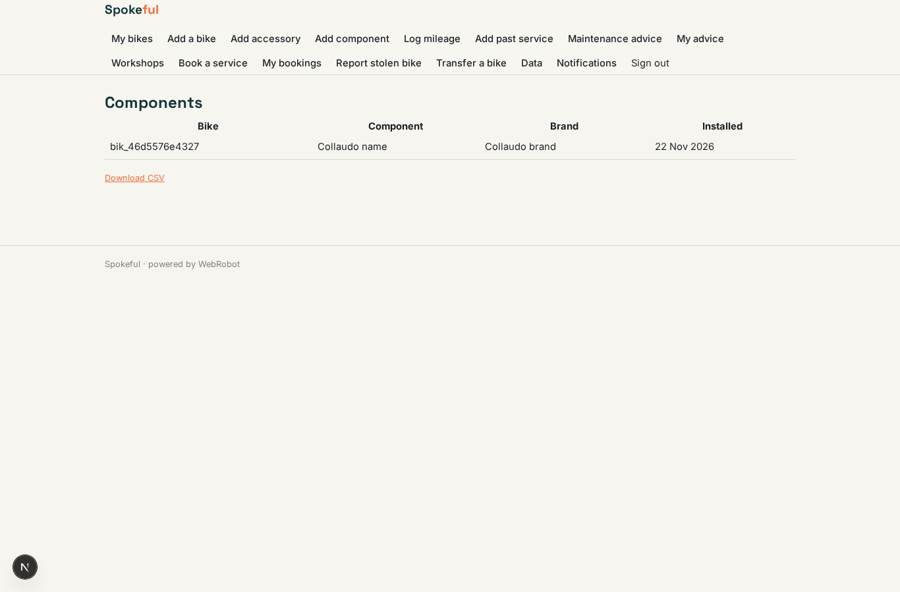

# Spokeful

_Every bike you own, looked after and proven yours._

**Sector:** Sanità, istruzione, energia, gov · **Manifest:** valid (schema + runtime contract) · **Functional test:** passed (43 checks passed)

## Description given to the app builder

I want Spokeful, a bike ownership app. Owners register bikes with photos and serial numbers, track maintenance, get reminders, and book servicing with partner workshops through Stripe. The physical servicing network is ours. Owners can add several bikes, upload a photo of the serial number or scan a barcode, and record accessories and their value. Workshops set their services, prices and free slots, and owners pay a deposit when booking. Each bike has an ownership record with purchase receipt, components and service history, useful for insurance and resale, and can be transferred to a new owner. An agent suggests maintenance based on mileage logged and photos of worn parts, and explains small fixes owners can do themselves. Workshops have a portal with bookings, job notes and prices; they see only their customers' bookings. Owners get push and email reminders for services and a report if a bike is stolen. Free for owners, workshops pay commission. Mobile app first. English only.

## Functional test: what did not pass

- **form saves a record** (form job_update): only role workshop may fill it, and the test cannot hold that role _(warning)_
- **form saves a record** (form service_form): only role workshop may fill it, and the test cannot hold that role _(warning)_

## Navigation recording

Signed in as the app's admin, the recorder opened 7 menu page(s): My bikes, Add a bike, Add accessory, Add component, Log mileage, Add past service, Maintenance advice.
No issue found.

Empty data pages are mostly expected on the local runtime: agents are mocked there, so the collections they fill stay empty.

## Features not expressible today (spec.extensions)

- **stripe_deposit_checkout**: Charging the owner's deposit through Stripe at the moment of booking, with payout to the workshop and Spokeful's commission, is not wired to the booking view yet. Billing is declared as per_transaction with a 12% commission on workshops; the checkout step must be set up in Stripe Connect.
- **ownership_transfer**: Moving a bike and its records to another owner is not available as an automatic action. The transfer form invites the new owner by email and the admins complete the handover from /admin/data.
- **workshop_onboarding**: Workshops are added by the Spokeful admins on /admin/data (name, address, owner_email, slots). Once added, the workshop owner signs in with that email and gets the portal.
- **sms_whatsapp**: SMS and WhatsApp reminders are not available; owners get email and push reminders.

## Screenshots (interpretive runtime, test data)

### home-anon

### home-mobile

### bikes_list

### workshop_list

### accessories_list

### components_list

