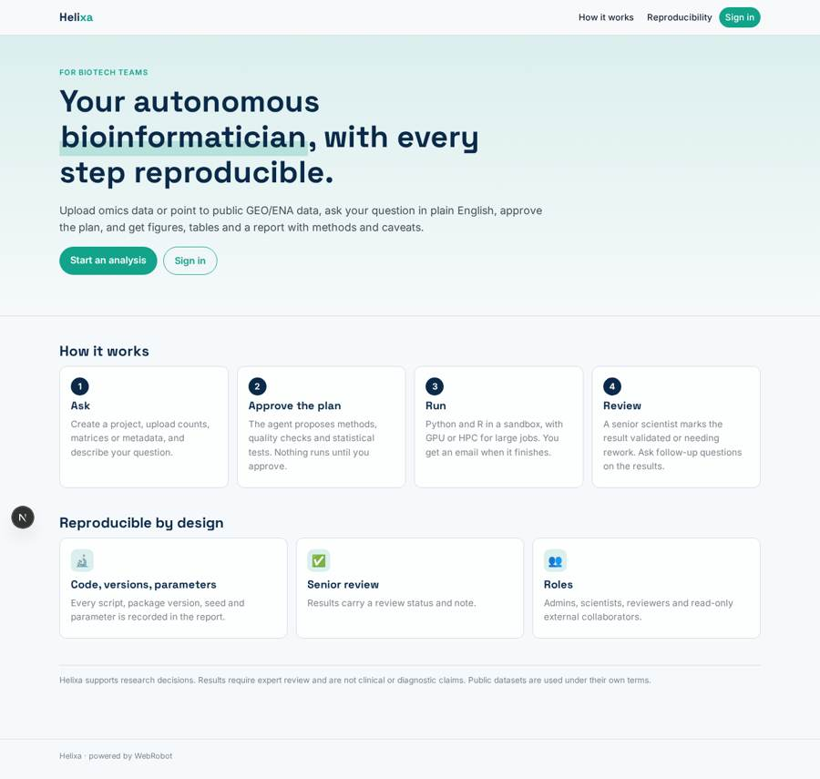
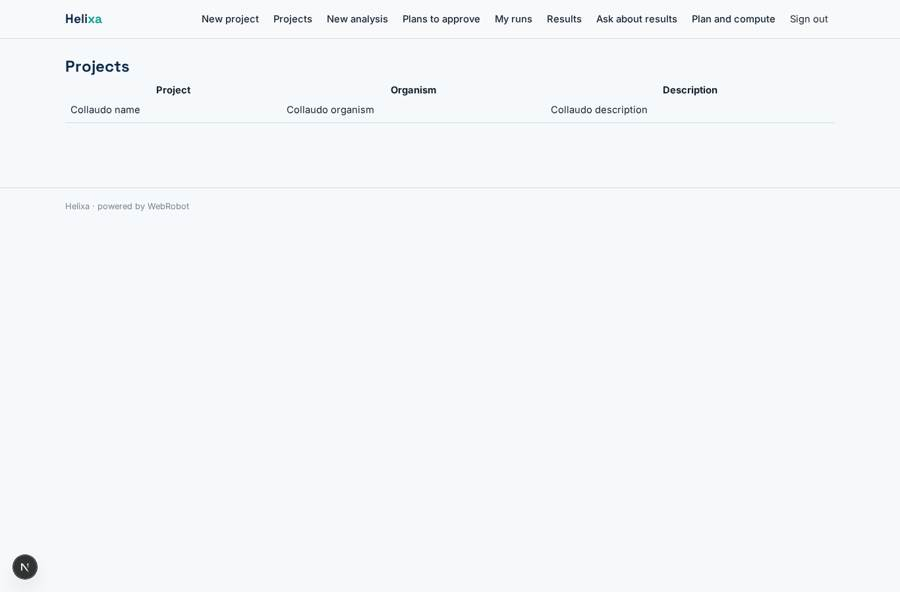
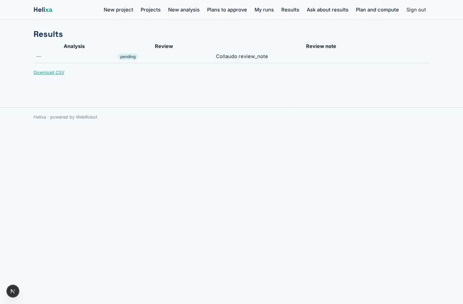
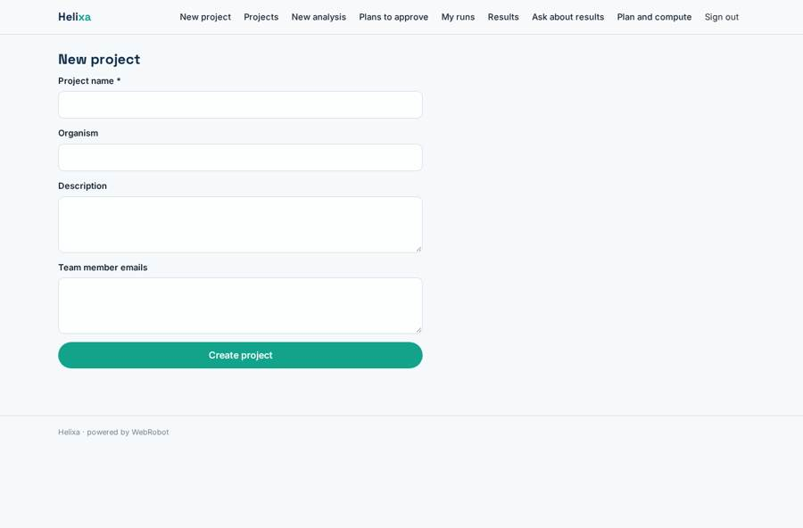
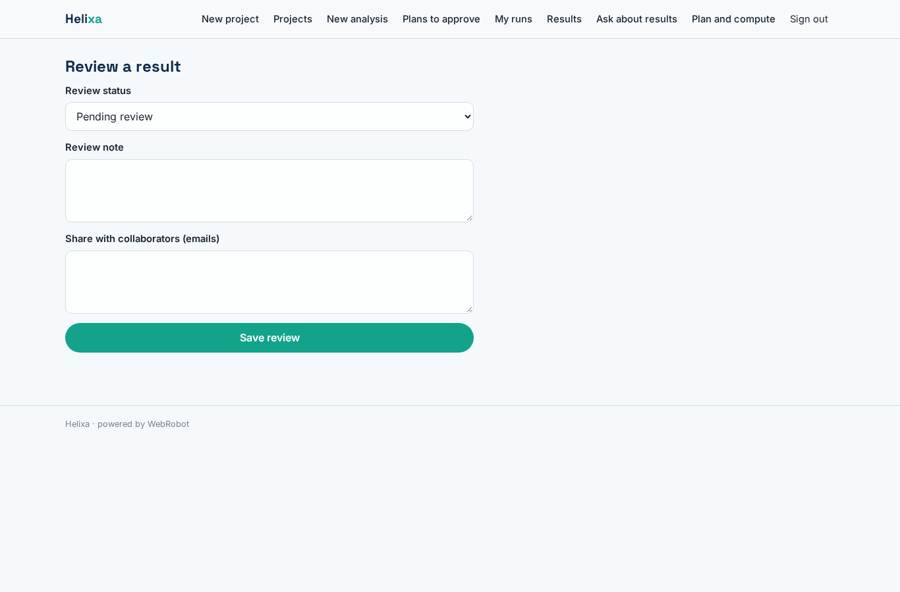

# Helixa

_An autonomous AI bioinformatician for biotech teams._

**Sector:** Data, media, cyber, devtools · **Manifest:** valid (schema + runtime contract) · **Functional test:** passed (15 checks passed)

## Description given to the app builder

I want an app called Helixa, an autonomous AI bioinformatician for biotech teams. A lab or biotech company signs up and creates projects. Scientists upload datasets such as RNA-seq counts, single-cell matrices, proteomics tables and sample metadata, or point to public data in GEO or ENA under their terms. They describe the question in plain English, for example which genes differ between treated and control samples. An agent proposes an analysis plan with methods, quality checks and statistical tests; a scientist approves the plan before anything runs. The agent then writes and runs Python and R code in a sandbox, including on large omics files and on GPU or HPC jobs when needed, which the real product does, and produces figures, tables and a written report with methods and caveats. All code, versions and parameters are saved so every result is reproducible. A senior scientist reviews results and marks them as validated or needing rework. Scientists can ask follow-up questions on the results. Email notifies the requester when a long job finishes. Roles: admin, scientist, reviewer, external collaborator with read-only access. Pricing: £1,000 a month per lab plus compute usage. English only.

## Functional test: what did not pass

- **saved record shown where its collection is read** (view results): a record was saved in analyses (by admin) but the page does not show it (as scientist) _(warning)_

## Navigation recording

Signed in as the app's admin, the recorder opened 7 menu page(s): New project, Projects, New analysis, Plans to approve, My runs, Results, Ask about results.
No issue found.

Empty data pages are mostly expected on the local runtime: agents are mocked there, so the collections they fill stay empty.

## Features not expressible today (spec.extensions)

- **gpu_hpc_sandbox**: GPU/HPC execution and the dedicated Python/R sandbox are delegated to WebRobot pipelines via the MCP; a dedicated per-lab isolated workspace and per-lab data separation across signed-up users are not expressible in the manifest yet.

## Screenshots (interpretive runtime, test data)

### home-anon

### home-mobile

### projects

### results

### new_project

### review

