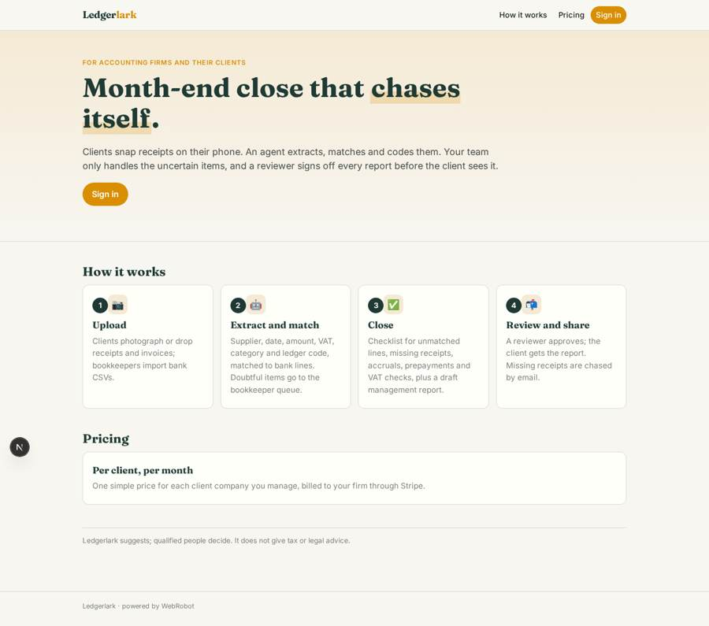
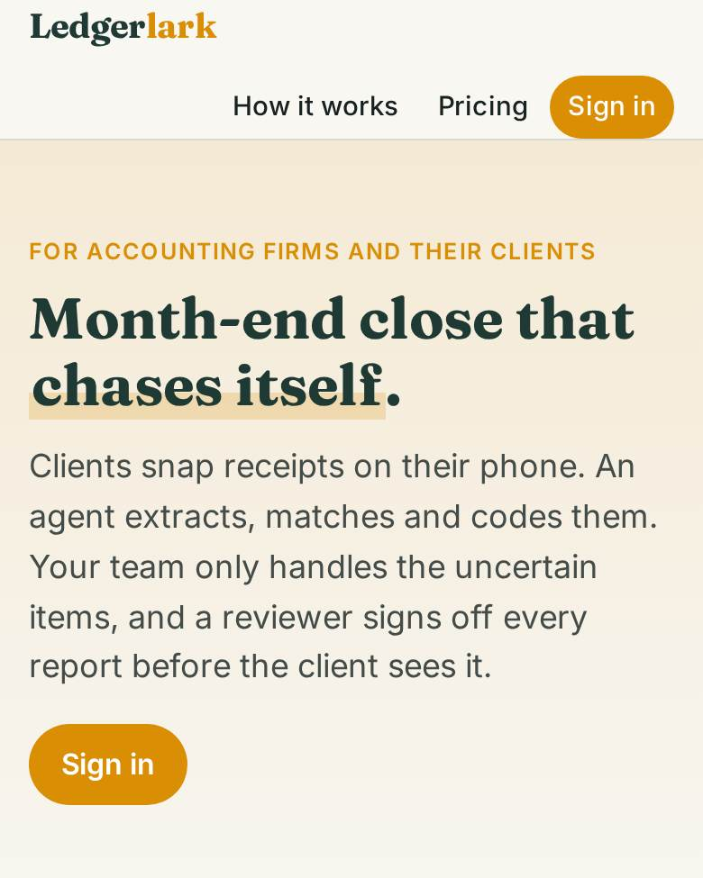
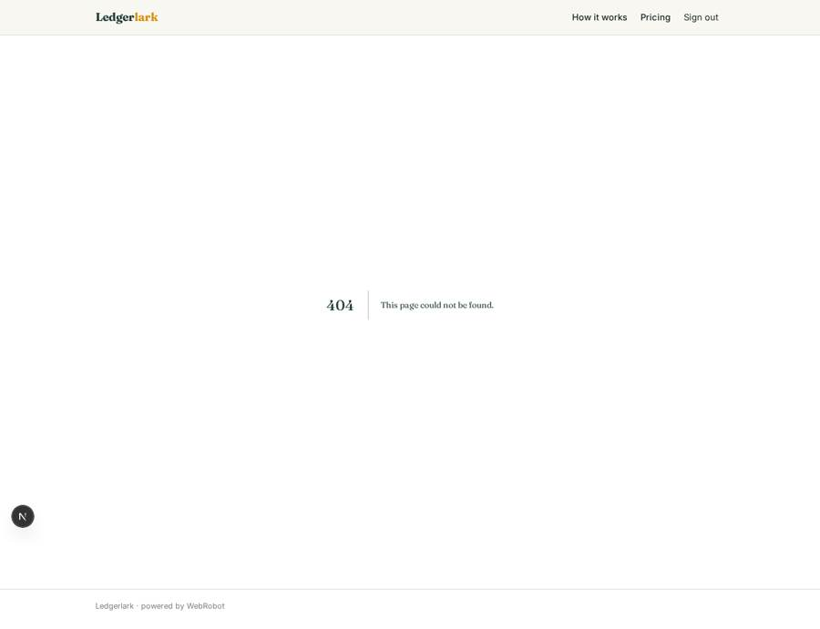
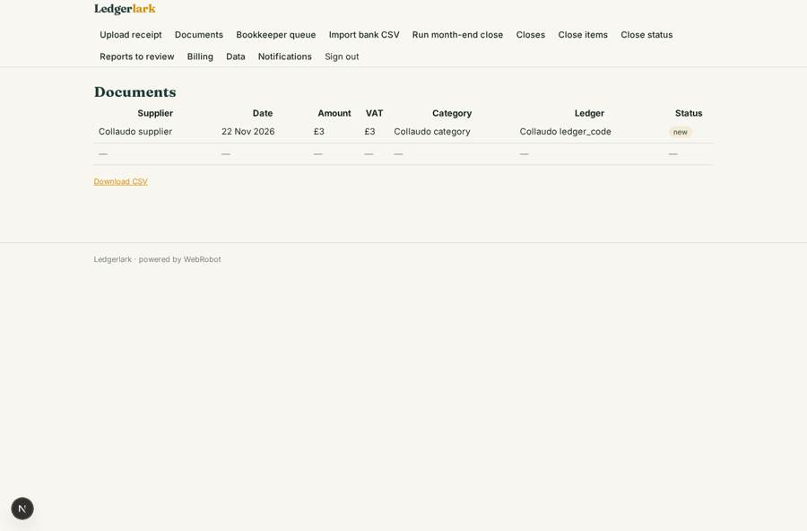
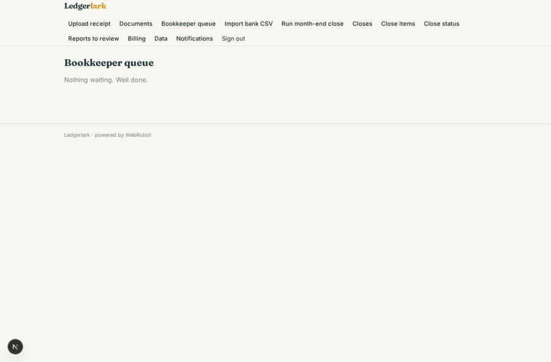
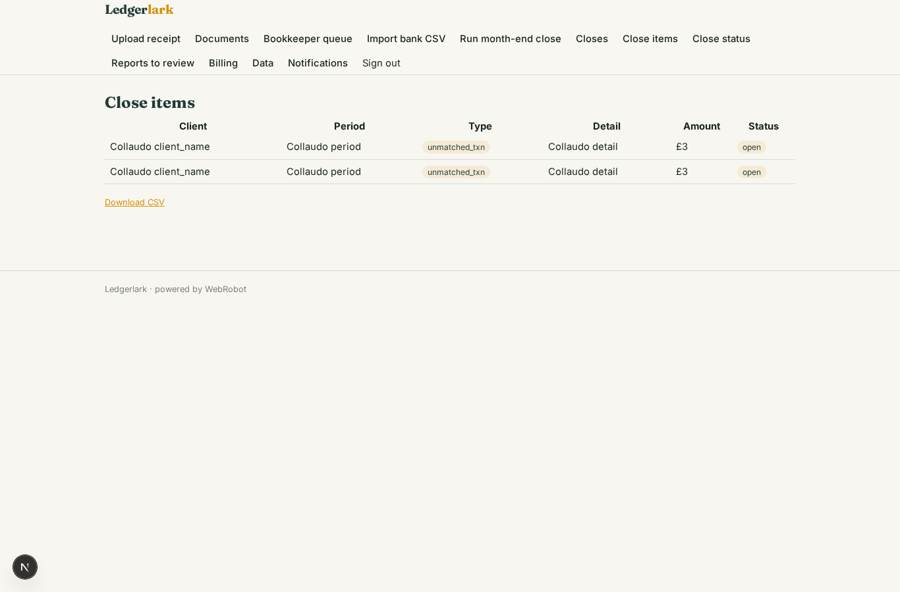

# Ledgerlark

_AI-native bookkeeping and month-end close for accounting firms and their clients._

**Sector:** B2B AI and SaaS · **Manifest:** valid (schema + runtime contract) · **Functional test:** passed (33 checks passed)

## Description given to the app builder

I want Ledgerlark, AI-native bookkeeping and month-end close for accounting firms and their small business clients. The firm signs up; bookkeepers and reviewers are the roles, each sees only the clients assigned, and clients log in to see only their own company. Clients upload receipts and invoices from their phone or by drag and drop; an agent extracts supplier, date, amount, VAT and category, matches them to bank transactions imported as CSV, and suggests the ledger code. Uncertain items go to a bookkeeper queue. At month end a close checklist runs: unmatched transactions, missing receipts, accruals and prepayments suggested by the agent, VAT checks, and a draft management report, all reviewed by a reviewer before it is shared with the client. Emails chase clients for missing receipts and remind the team of close deadlines. Dashboards show close status per client and bottlenecks. The real product syncs with Xero and QuickBooks via OAuth, receives receipts by forwarding to an inbound email address, and pulls bank feeds through Open Banking, which needs FCA authorisation as an account information service provider or a licensed partner, so include those. Pricing: per client per month via Stripe. English.

## Functional test: what did not pass

- **saved record shown where its collection is read** (view my_documents): a record was saved in documents (by admin, admin) but the page does not show it (as client) _(warning)_
- **saved record shown where its collection is read** (view close_items_view): a record was saved in close_items (by admin-data, admin-data) but the page does not show it (as bookkeeper) _(warning)_
- **saved record shown where its collection is read** (view review_reports): a record was saved in reports (by admin-data, admin-data, admin) but the page does not show it (as reviewer) _(warning)_
- **saved record shown where its collection is read** (view my_reports): a record was saved in reports (by admin-data, admin-data, admin) but the page does not show it (as client) _(warning)_

## Navigation recording

Signed in as the app's admin, the recorder opened 7 menu page(s): Upload receipt, Documents, Bookkeeper queue, Import bank CSV, Run month-end close, Closes, Close items.
No issue found.

Empty data pages are mostly expected on the local runtime: agents are mocked there, so the collections they fill stay empty.

## Features not expressible today (spec.extensions)

- **xero_quickbooks_sync**: Two-way sync with Xero and QuickBooks needs OAuth sign-in to those services, which is not available yet. For now accountants post the approved ledger codes by hand or by CSV export.
- **inbound_email**: Receiving receipts by forwarding to an inbound email address is not available yet. Clients upload from the phone app or the web (drag and drop).
- **open_banking_feeds**: Live bank feeds via Open Banking need FCA authorisation as an account information service provider, or a licensed partner (OAuth consent flow). Not available yet; bank transactions are imported as CSV.
- **per_client_quantity_billing**: Stripe billing is a flat monthly plan; automatic quantity billing by the number of active clients is not available yet, so the firm adjusts the number of subscriptions to its client count.

## Screenshots (interpretive runtime, test data)

### home-anon

### home-mobile

### my_reports

### my_documents

### review_queue

### close_items_view

