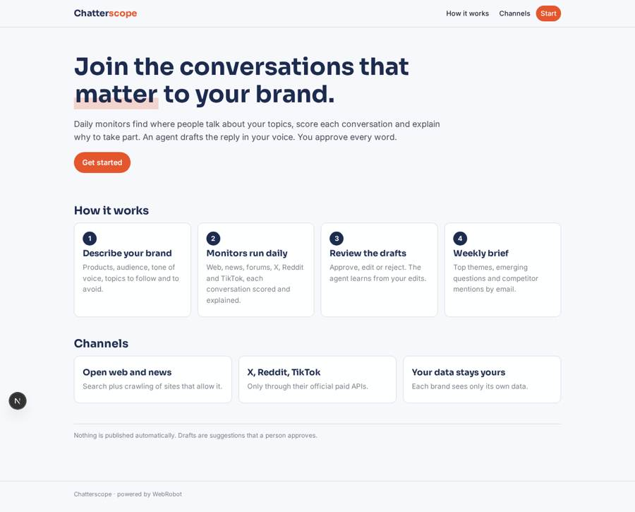
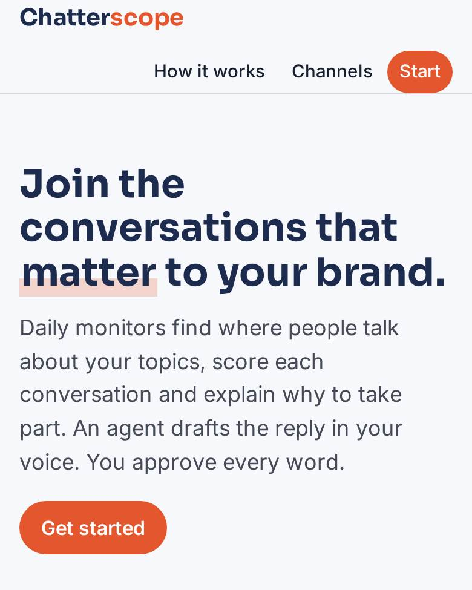
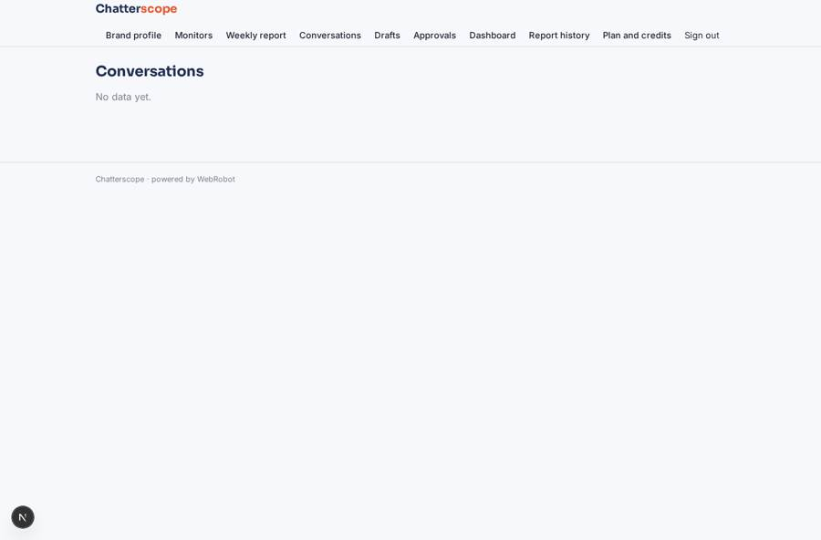
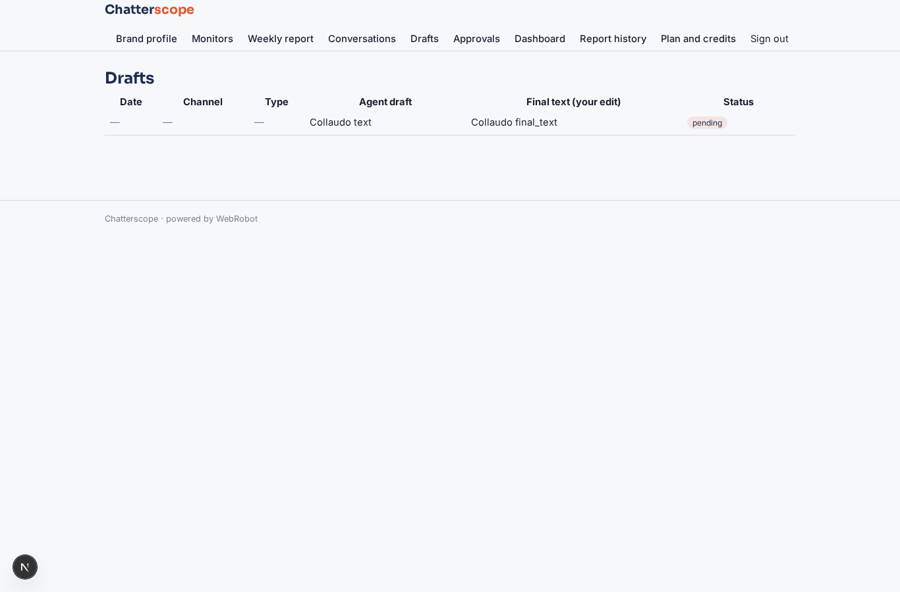
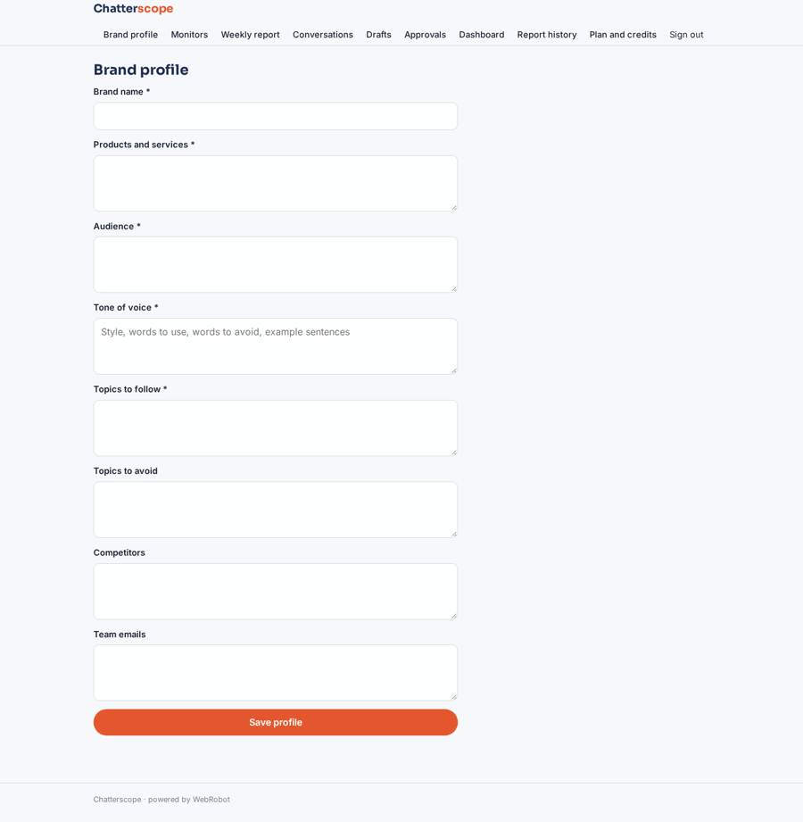
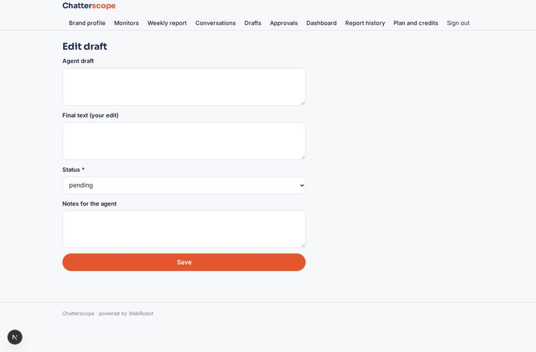

# Chatterscope

_Find the conversations your brand should join, and draft what to say._

**Sector:** Consumer, travel, retail · **Manifest:** valid (schema + runtime contract) · **Functional test:** passed (17 checks passed)

## Description given to the app builder

I want an app called Chatterscope that finds the online conversations a brand should join and drafts content for them. A brand signs up and describes its products, audience, tone of voice, topics to follow and topics to avoid. Scheduled monitors run daily: an agent searches the public web, forums and news with web search and crawling of sites that allow it, and reads X, TikTok and Reddit only through their official paid APIs. For each conversation it records source, link, topic, sentiment and relevance score, and explains why the brand should take part. Then it drafts a reply, post or short article in the brand's voice; a marketing manager approves, edits or rejects every draft before anything is used, and the agent learns from the edits. A weekly report emails top themes, emerging questions and competitor mentions. Dashboards show conversations by topic and channel over time, drafts approved and content published. Team roles: editors draft and approve, viewers read; each brand sees only its own data; admins see all. Pricing plans by monthly credits for monitors and drafts. English.

## Navigation recording

Signed in as the app's admin, the recorder opened 7 menu page(s): Brand profile, Monitors, Weekly report, Conversations, Drafts, Approvals, Dashboard.
- data page empty: conversations_table (table)

Empty data pages are mostly expected on the local runtime: agents are mocked there, so the collections they fill stay empty.

## Features not expressible today (spec.extensions)

- **oauth_social_tokens**: Reddit and TikTok APIs use OAuth tokens that expire; for now the app owner pastes a current token as the org credential. Automatic token refresh is not available yet.

## Screenshots (interpretive runtime, test data)

### home-anon

### home-mobile

### conversations_table

### drafts_table

### brand

### edit_draft

