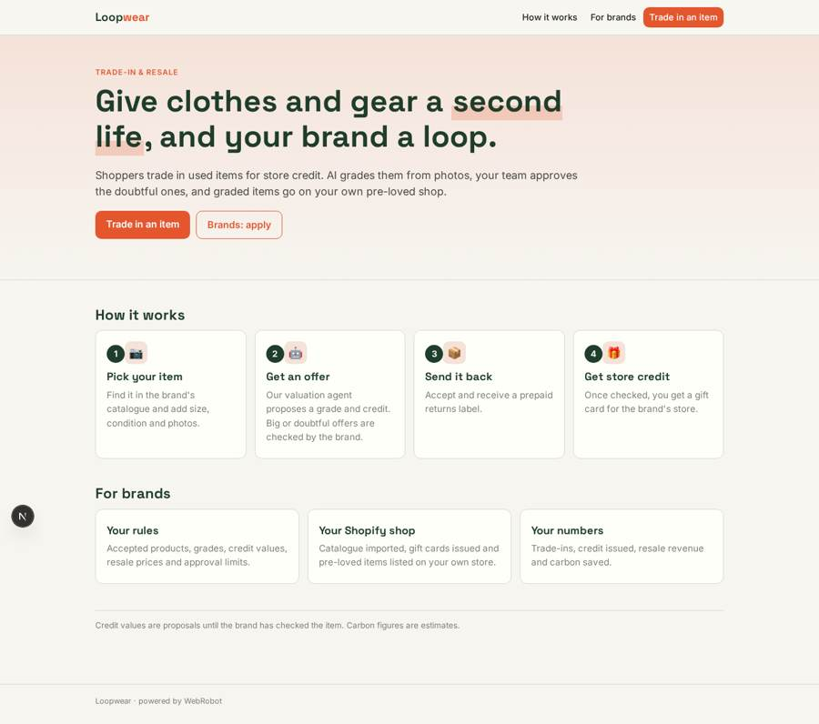
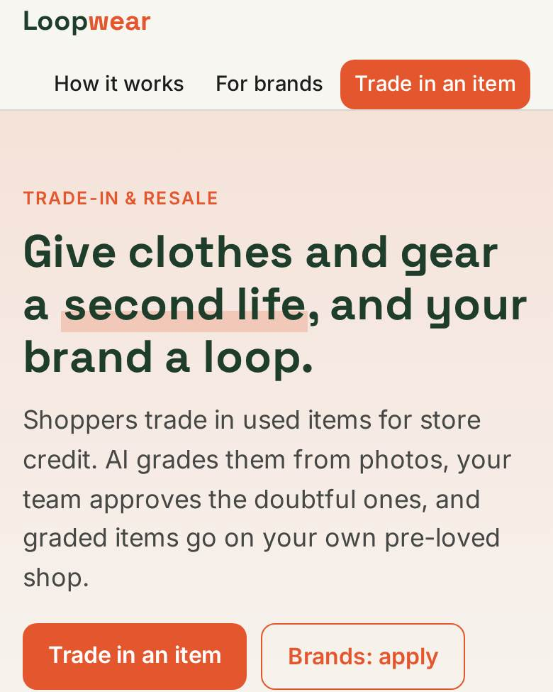
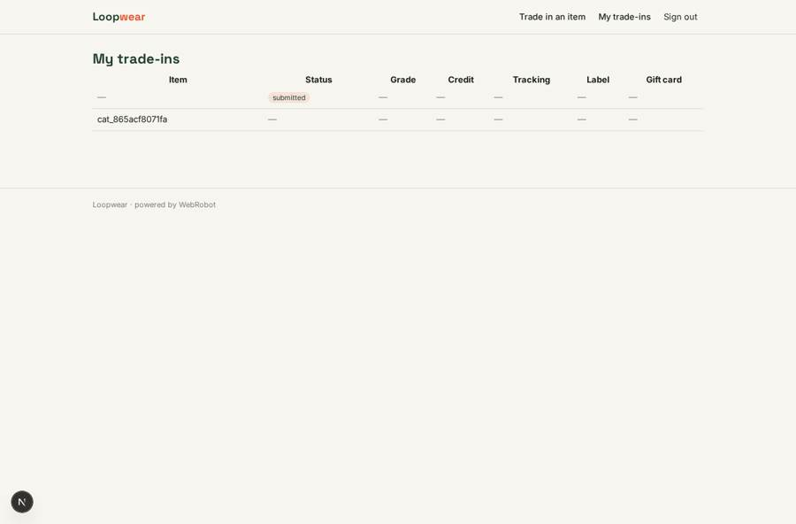
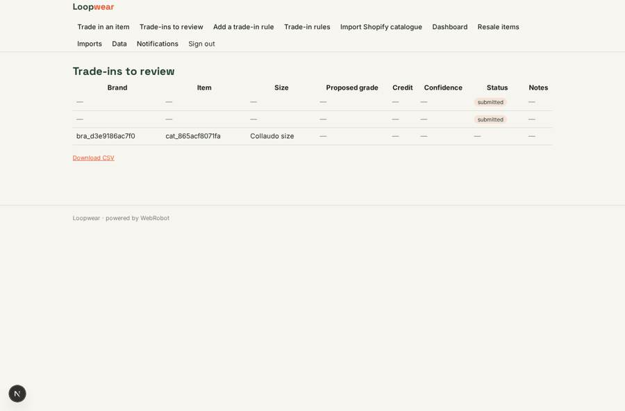
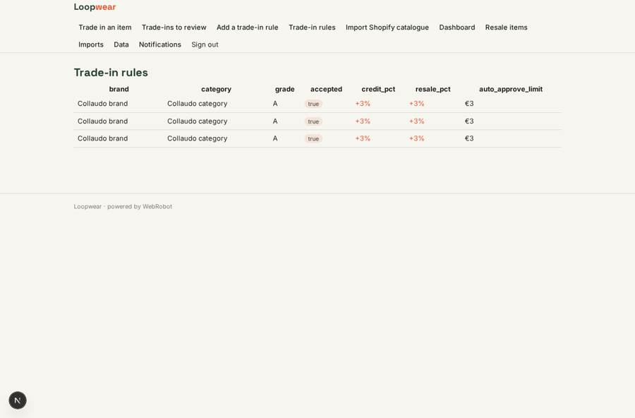

# Loopwear

_Trade-in and resale for fashion and sports brands._

**Sector:** Consumer, travel, retail · **Manifest:** valid (schema + runtime contract) · **Functional test:** passed (33 checks passed)

## Description given to the app builder

I want an app called Loopwear for trade-in and resale for fashion and sports brands. A brand signs up, connects its Shopify store with OAuth to import its catalogue, and sets trade-in rules: accepted products, condition grades, credit values and resale prices. Shoppers open the brand's trade-in page, find their item in the catalogue, and fill a form with size, condition and photos taken with the phone camera. A valuation agent assesses the photos and description and proposes a grade and credit; items above a set value, or doubtful ones, go to the brand's team for approval. The shopper accepts and gets a prepaid returns label; returns logistics are handled by a carrier we integrate. When the item arrives and is checked, the shopper receives store credit as a gift card in the brand's store. Graded items are listed for resale on the brand's own pre-loved shop. Shoppers see their trade-ins and credit; brand admins see only their brand's dashboard of trade-ins, credit issued, resale revenue and carbon saved; admins see all brands. Pricing: monthly subscription plus a fee per item. English.

## Functional test: what did not pass

- **page opened by a role allowed to** (view account): only role brand may open it, the test cannot hold it _(warning)_

## Navigation recording

Signed in as the app's admin, the recorder opened 7 menu page(s): Trade in an item, Trade-ins to review, Add a trade-in rule, Trade-in rules, Import Shopify catalogue, Dashboard, Resale items.
- data page empty: resale (table)

Empty data pages are mostly expected on the local runtime: agents are mocked there, so the collections they fill stay empty.

## Design checks (linter)

- view rules_form: roles brand cannot add to rules, a app collection only the admins fill — keep roles: [admin], or own the records by user

## Features not expressible today (spec.extensions)

- **shopify_oauth**: OAuth sign-in to Shopify is not available yet: brands paste a custom-app Admin API token on the account page. Gift cards need a Shopify plan that supports the Gift Cards API.
- **per_item_fee**: The per-item fee on top of the subscription cannot yet be charged to the brand on each credited item; it needs a billing hook on the brand's account.
- **brand_isolation**: Rules and catalogue are shared collections without per-brand write isolation; brand-level edit limits and a settler run using the brand's Shopify key (rather than the shopper's session) need platform support.
- **shopper_status_guard**: Shoppers confirm offers through the status field; a guard limiting them to accepted or declined is not yet expressible.
- **carrier**: The carrier is an EasyPost-style shipments API with one org key; swap the host and body for the chosen carrier. Tracking-based arrival is checked by the brand team by hand.

## Screenshots (interpretive runtime, test data)

### home-anon

### home-mobile

### my_tradeins

### brand_inbox

### rules_list

### resale

