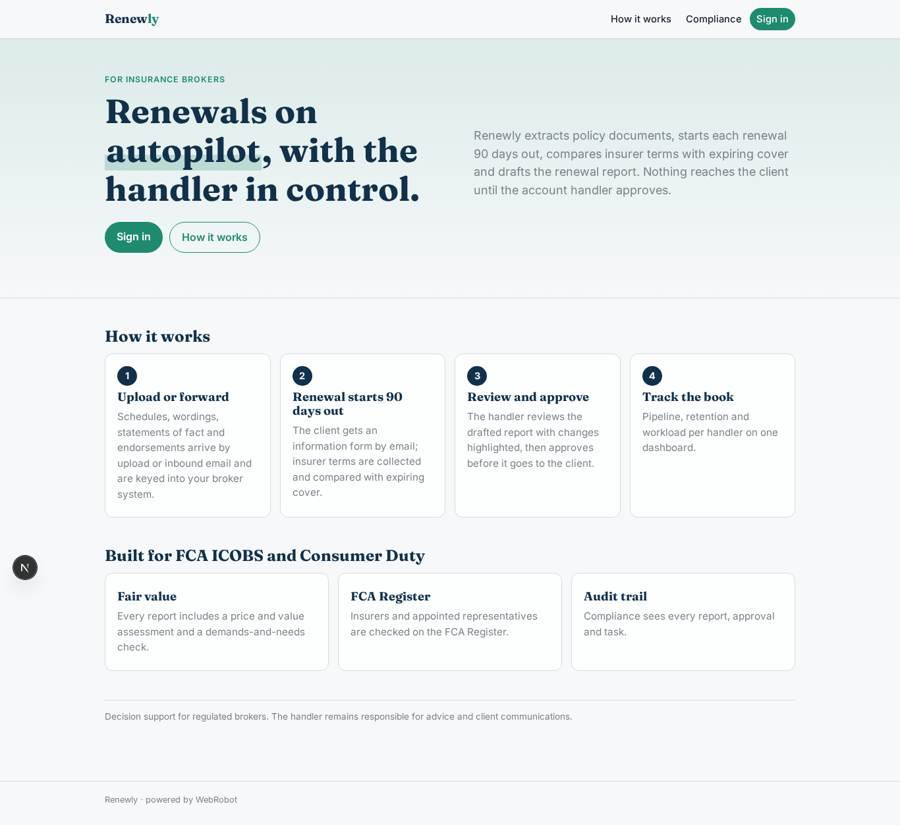
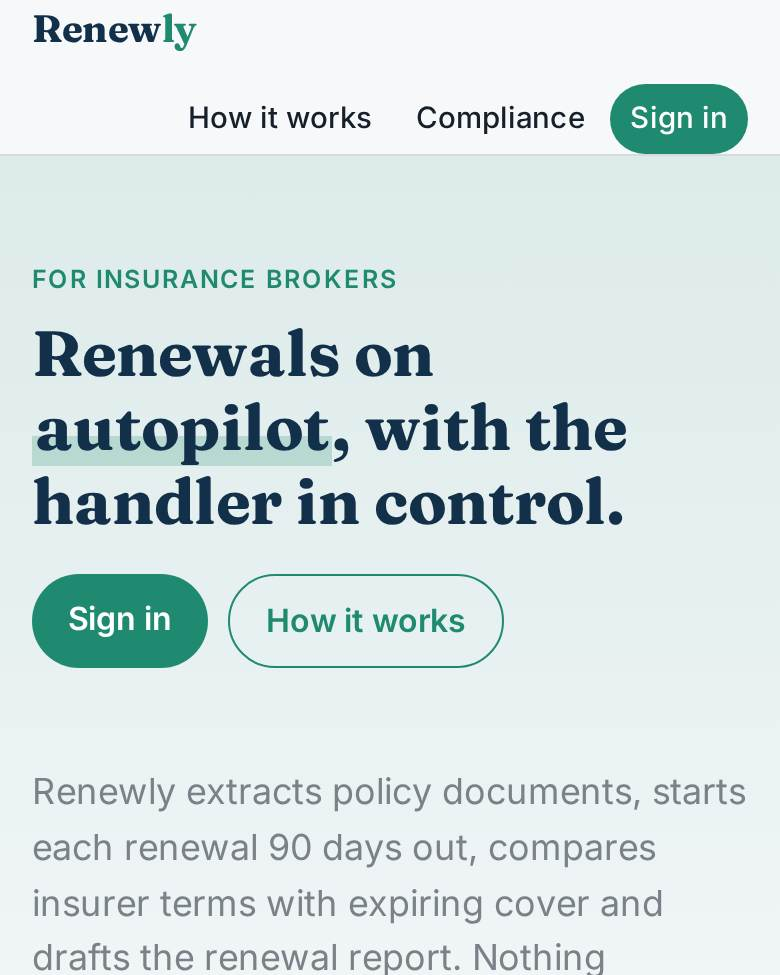
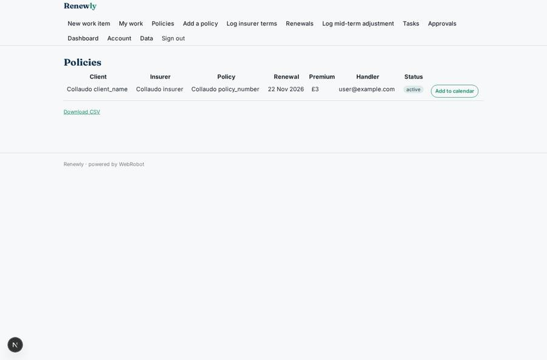
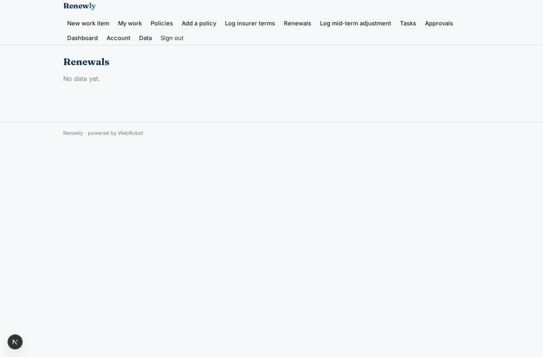
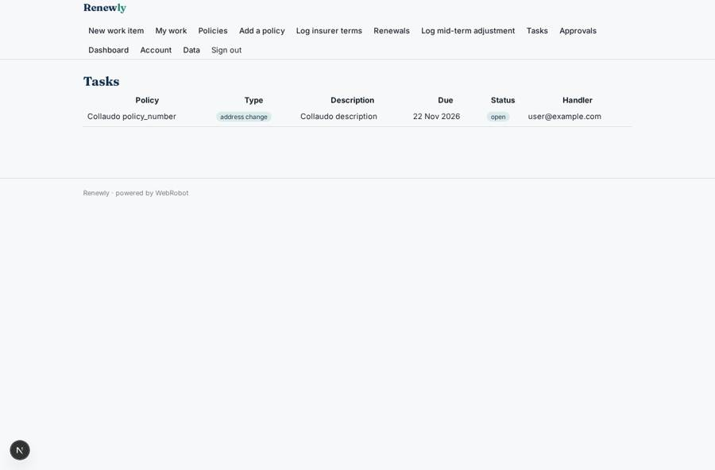
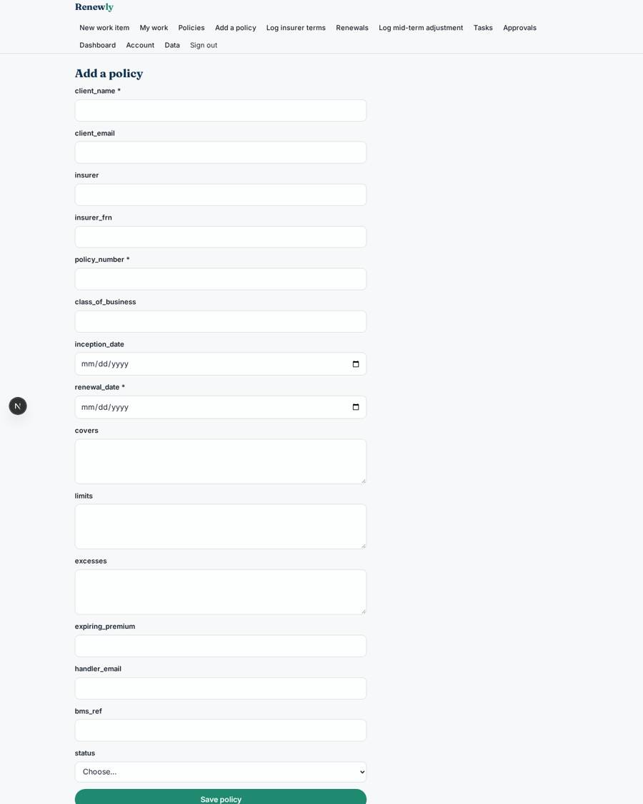

# Renewly

_The AI operating model that takes routine admin off insurance brokers._

**Sector:** Fintech, proptech, insurtech · **Manifest:** valid (schema + runtime contract) · **Functional test:** passed (23 checks passed)

## Description given to the app builder

We need Renewly, an AI operating model that takes routine admin off insurance brokers. A brokerage signs up with roles for account handler, team leader, compliance and admin. The broker connects its broker management system (such as Acturis) by OAuth or API, and handlers add their logins to insurer portals so the app can retrieve renewal terms. Policy schedules, wordings, statements of fact and endorsements arrive by upload or by inbound email; an agent extracts insured details, covers, limits, excesses and premiums and enters them into the broker system. Ninety days before renewal a scheduled job starts the renewal workflow: it requests updated information from the client by email with a form, collects renewal terms from insurers, compares them with expiring cover and drafts a renewal report highlighting changes. The account handler reviews and approves before anything goes to the client, following FCA ICOBS and Consumer Duty requirements for fair value. Mid-term adjustments are logged as tasks. The FCA Register is checked for insurer and appointed representative status. Dashboards show renewals pipeline, retention and workload per handler. Pricing: monthly fee per handler. English.

## Functional test: what did not pass

- **trigger has its effect** (trigger client_response_in): email to role:account_handler: no such recipient in the test (role nobody holds or empty field) _(warning)_

## Navigation recording

Signed in as the app's admin, the recorder opened 7 menu page(s): New work item, My work, Policies, Add a policy, Log insurer terms, Renewals, Log mid-term adjustment.
- data page empty: renewals_view (table)

Empty data pages are mostly expected on the local runtime: agents are mocked there, so the collections they fill stay empty.

## Features not expressible today (spec.extensions)

- **oauth_bms**: OAuth connection to the broker management system is not available yet; handlers and admins paste an API key on the Account page. The Acturis API path (/api/v1/policies) and fields must be confirmed against the broker's own API documentation.
- **insurer_portal_logins**: Storing handlers' insurer-portal usernames/passwords and logging into portals to retrieve terms is not available. Terms are logged by upload or the Log insurer terms form.
- **per_seat_billing**: The plan is a monthly fee; quantity-based per-handler billing and brokerage-level tenant isolation (one brokerage never seeing another) need setting up outside this manifest.
- **fca_register_headers**: The FCA Register API also needs an X-Auth-Email header with the key owner's email; this must be added to the tool by an administrator.

## Screenshots (interpretive runtime, test data)

### home-anon

### home-mobile

### policies_view

### renewals_view

### tasks_view

### policy_form

