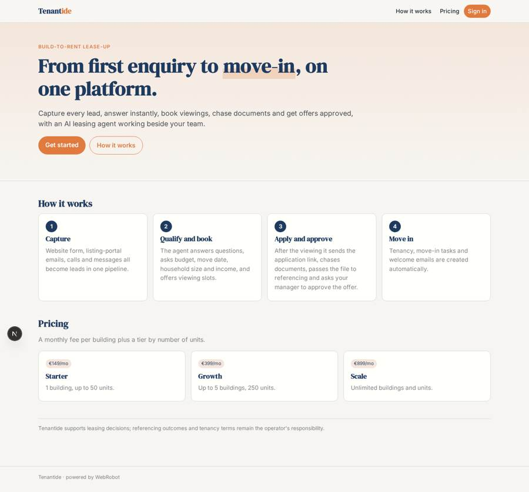
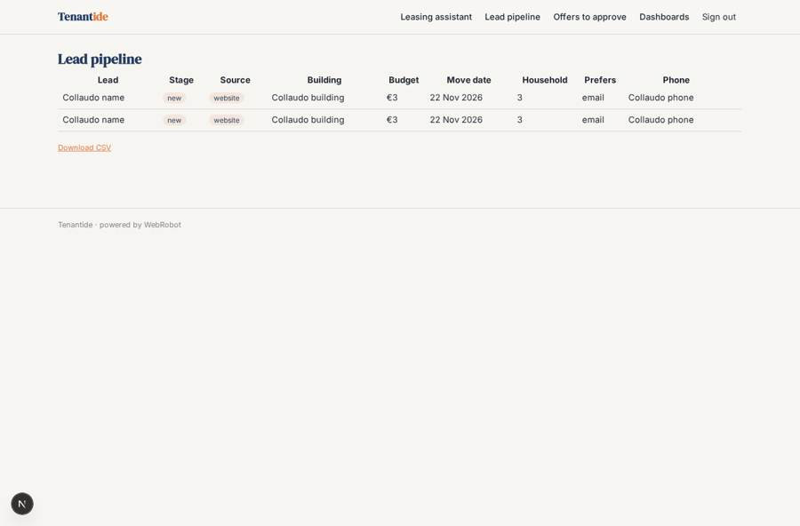
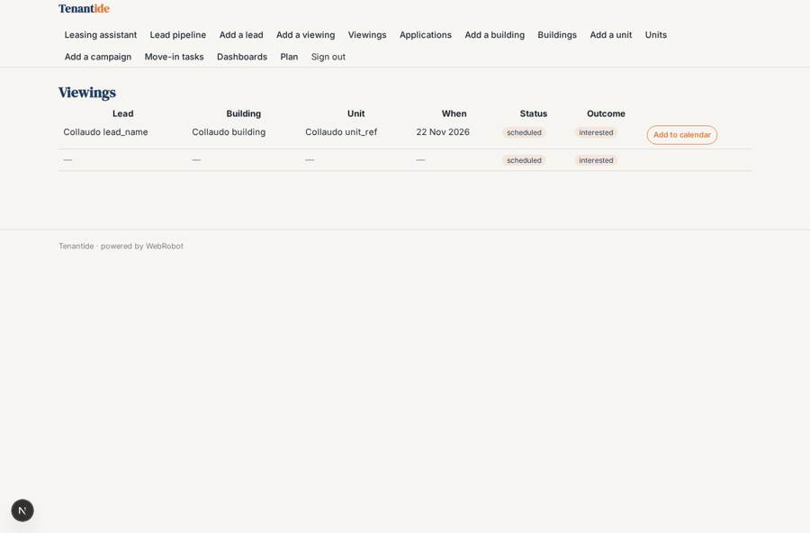
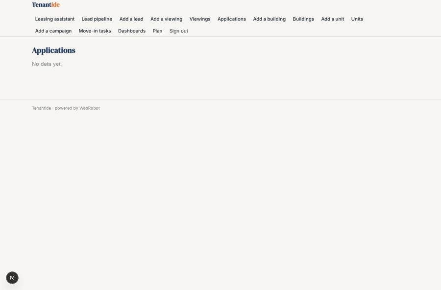
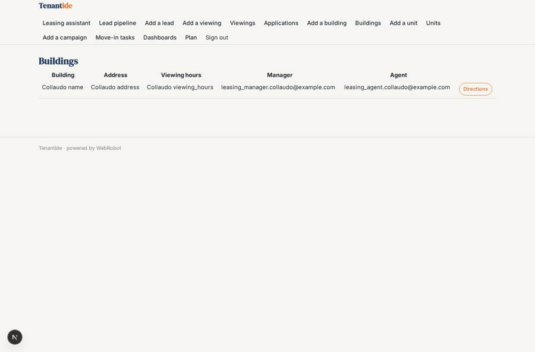

# Tenantide

_Lease-up for build-to-rent, from first enquiry to move-in._

**Sector:** Fintech, proptech, insurtech · **Manifest:** valid (schema + runtime contract) · **Functional test:** passed (30 checks passed)

## Description given to the app builder

I want Tenantide, a lease-up platform for build-to-rent operators, covering everything from first enquiry to move-in. The operator signs up, adds its buildings and units with rent, availability and floor plans. Enquiries arrive from the operator's website form, from listing portals by email, and from WhatsApp and phone calls; all are captured as leads. An agent answers questions about the building instantly, qualifies each lead (budget, move date, household size, income) and offers viewing slots, sending confirmations and reminders by email, SMS and WhatsApp, and following up by phone where the lead prefers. The leasing team sees all leads in a pipeline, takes over conversations when needed and records viewing feedback. After a viewing the agent sends the application link, chases missing documents and passes the file to referencing. The leasing manager approves the offer and holding deposit; move-in tasks and welcome emails are scheduled automatically. Roles: operator admin, leasing manager, leasing agent per building. Dashboards show conversion by source, time to let, occupancy and campaign performance. Pricing: monthly fee per building plus per-unit tier. English.

## Navigation recording

Signed in as the app's admin, the recorder opened 4 menu page(s): Leasing assistant, Lead pipeline, Offers to approve, Dashboards.
No issue found.

Empty data pages are mostly expected on the local runtime: agents are mocked there, so the collections they fill stay empty.

## Features not expressible today (spec.extensions)

- **sms_whatsapp**: SMS and WhatsApp confirmations, reminders and inbound WhatsApp capture are not available yet: notifications go by email only, and WhatsApp leads must be added by the team or a webhook.
- **phone_follow_up**: Outbound follow-up calls to leads who prefer phone are not available; the phone channel answers inbound calls and the pipeline shows the preferred contact.
- **referencing_provider**: Passing the file to an external referencing provider is not wired: the file moves to status referencing and the manager is notified.
- **per_building_metering**: Billing per building is modelled as three plan tiers with building and unit quotas rather than a metered per-building fee.
- **webhook_routing**: The website webhook saves leads under the app's hook secret; routing each enquiry to the right operator account needs per-operator setup.

## Screenshots (interpretive runtime, test data)

### home-anon

### home-mobile

### pipeline

### viewings

### applications_list

### buildings

