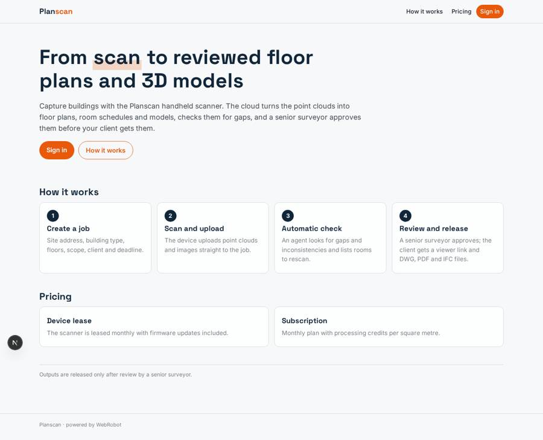
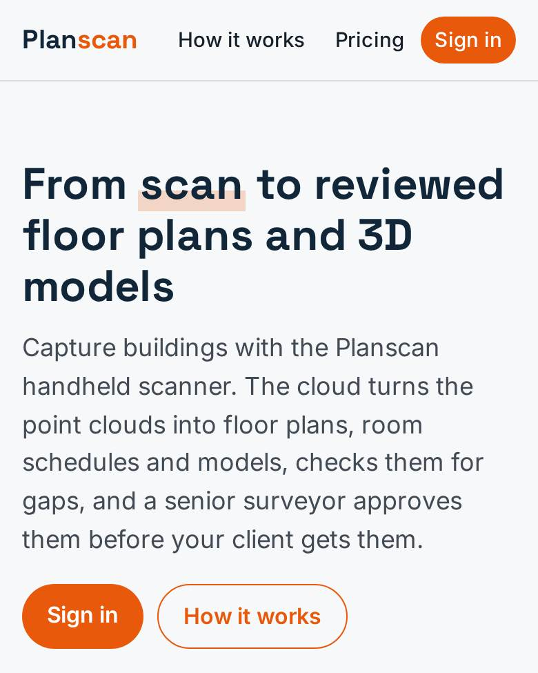
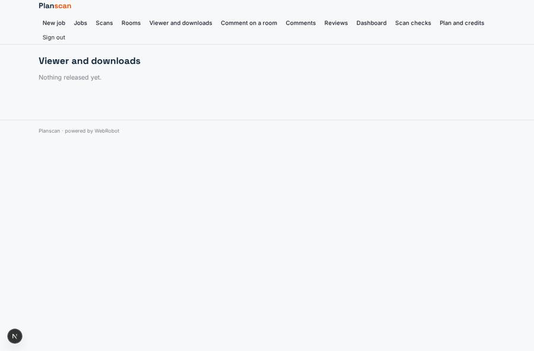
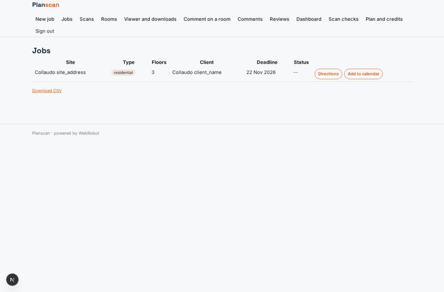
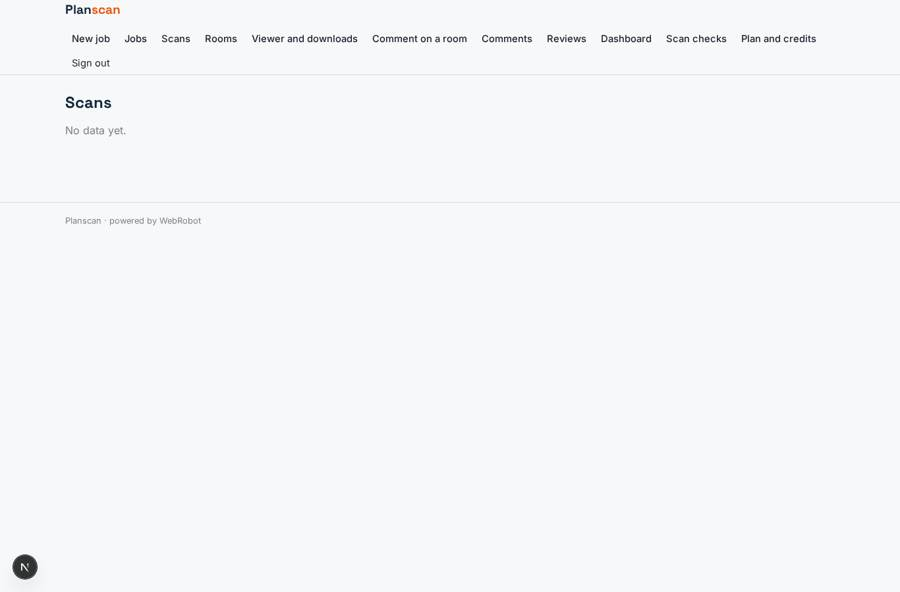

# Planscan

_From building scans to reviewed floor plans and models._

**Sector:** Fintech, proptech, insurtech · **Manifest:** valid (schema + runtime contract) · **Functional test:** passed (16 checks passed)

## Description given to the app builder

We want Planscan, which turns scans of existing buildings into floor plans and models. The capture device, a handheld AI scanner with lidar and cameras, is our own hardware and deep-tech product outside this software; I need the cloud platform around it. Surveyors, architects and contractors sign up as organisations; a surveyor creates a job with a form: site address, building type, floors, scope (plans, sections, elevations), client and deadline. After scanning, the device uploads point clouds and images to the job. The platform processes them into floor plans, room schedules with areas and a 3D model, and an agent checks for gaps in the scan and inconsistencies, listing rooms to rescan. A senior surveyor reviews and approves outputs before they are released. Clients get an email with a viewer link and can download DWG, PDF and IFC files, and comment on specific rooms. Jobs and devices are tracked on a dashboard, with device firmware status and usage. Roles: organisation admin, surveyor, reviewer, client (own jobs). Pricing: device lease plus monthly subscription with processing credits per square metre. English.

## Navigation recording

Signed in as the app's admin, the recorder opened 7 menu page(s): New job, Jobs, Scans, Rooms, Viewer and downloads, Comment on a room, Comments.
- form not sent: new_job: Scope is required
- data page empty: scans (table)
- data page empty: rooms (table)

Empty data pages are mostly expected on the local runtime: agents are mocked there, so the collections they fill stay empty.

## Features not expressible today (spec.extensions)

- **point_cloud_processing**: Generating floor plans, room schedules, the 3D model and DWG/PDF/IFC files from point clouds is done by the Planscan processing service, which delivers files through the processing_done webhook. The 3D viewer itself is a custom component; here the viewer view lists released files for download.
- **credits_per_sqm**: Charging credits per square metre of scanned area needs the area at job level; for now processing is metered per run and plans include monthly credits. Device lease is billed as part of the subscription plan.
- **organisation_teams**: Several members of one organisation sharing all its jobs is not modelled: surveyors see jobs they own or are listed on, reviewers see all.

## Screenshots (interpretive runtime, test data)

### home-anon

### home-mobile

### viewer

### jobs

### scans

### rooms

