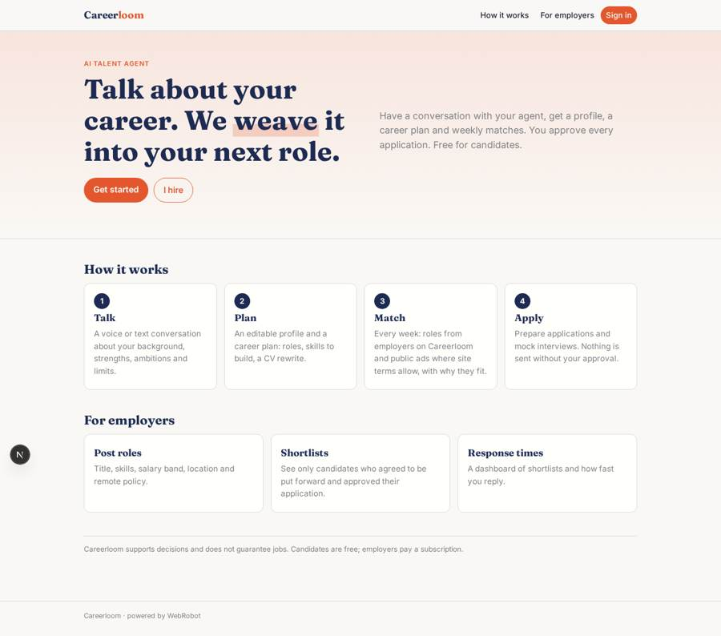
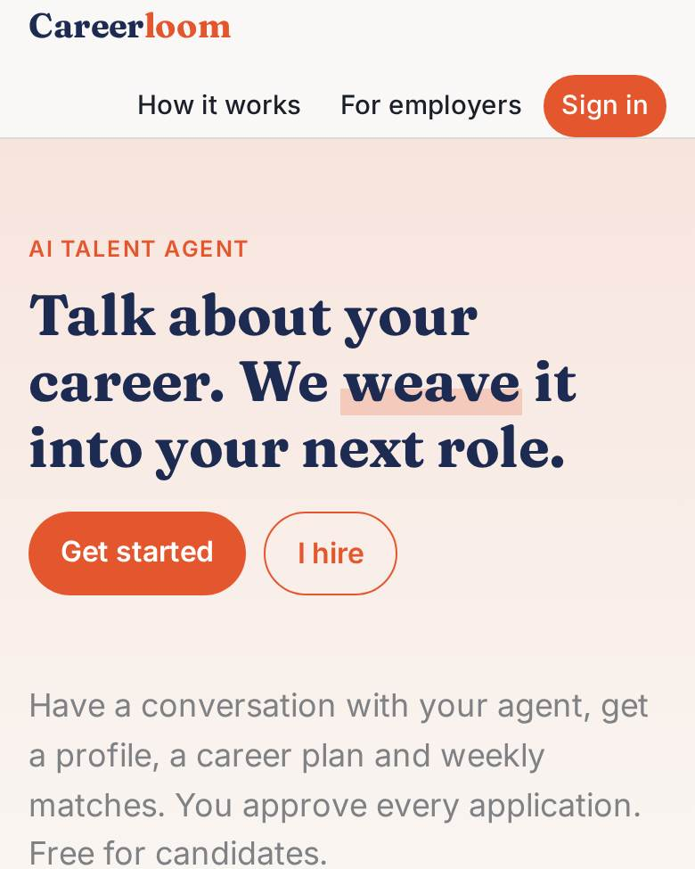
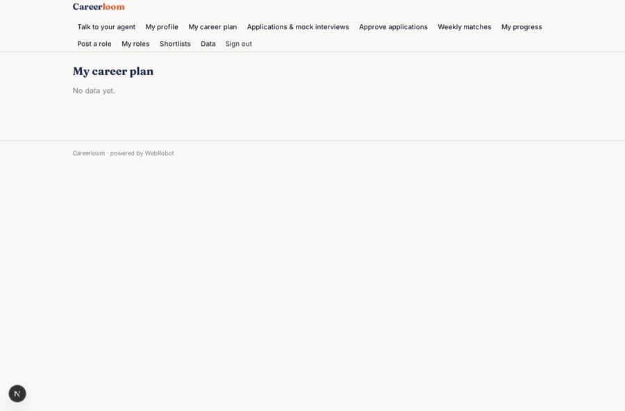
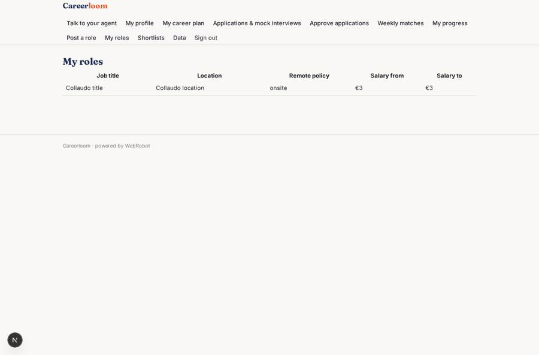
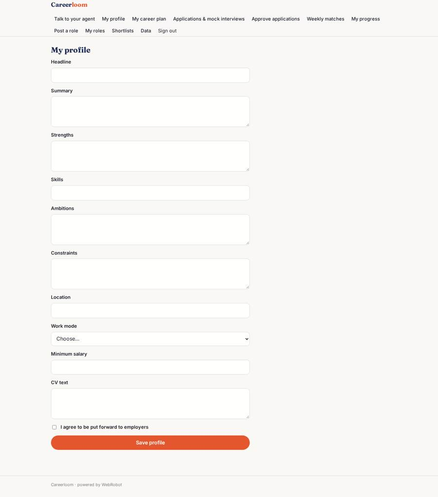
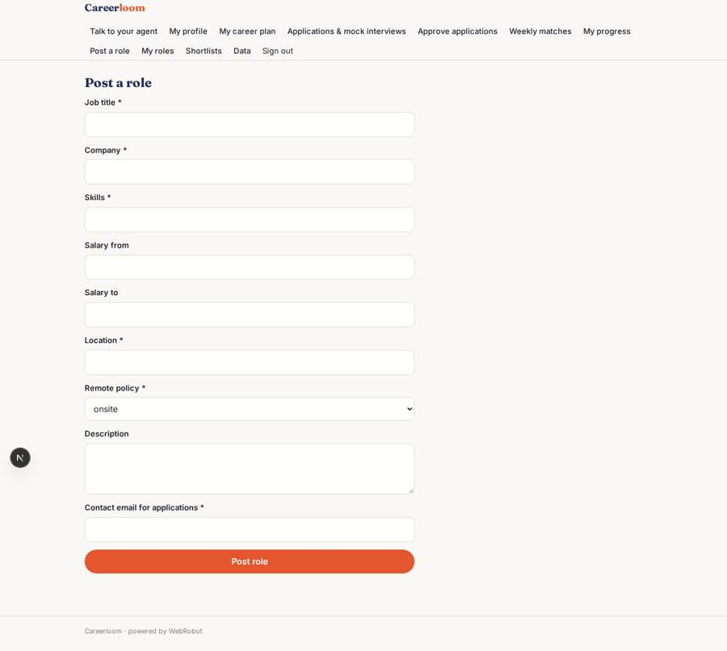

# Careerloom

_An AI talent agent that coaches you and matches you with the right job._

**Sector:** B2B AI and SaaS · **Manifest:** valid (schema + runtime contract) · **Functional test:** passed (19 checks passed)

## Description given to the app builder

We need Careerloom, an AI talent agent that coaches candidates and matches them with jobs. A candidate signs up and has a voice conversation in the browser with the agent about their background, strengths, ambitions and constraints; the agent turns this into a profile the candidate edits, plus a career plan with suggested roles, skills to build and a CV rewrite. Each week an agent finds roles from employers who post jobs on the platform and from public job ads where the site terms allow it, explains why each fits and helps prepare applications and mock interviews. Employers sign up, post roles through a form (title, skills, salary band, location, remote policy) and receive shortlists of candidates who have agreed to be put forward; employers see only those candidates. The candidate approves every application before it is sent. Emails for new matches, interview reminders and weekly progress. The real product also makes phone calls to candidates, and its value grows with a two-sided network. Dashboards for candidates show applications and progress; for employers, shortlists and response times. Pricing: free for candidates, employers pay a subscription or a fee per hire. English.

## Functional test: what did not pass

- **trigger has its effect** (trigger new_application): email to record.employer_email: no such recipient in the test (role nobody holds or empty field) _(warning)_

## Navigation recording

Signed in as the app's admin, the recorder opened 7 menu page(s): Talk to your agent, My profile, My career plan, Applications & mock interviews, Approve applications, Weekly matches, My progress.
- data page empty: plan (table)

Empty data pages are mostly expected on the local runtime: agents are mocked there, so the collections they fill stay empty.

## Features not expressible today (spec.extensions)

- **phone_calls**: Phone calls to candidates are not available yet. The agent coaches by chat and by voice input in the browser.
- **fee_per_hire**: A fee per hire charged to the employer is not expressible yet (triggers charge the event's user, here the candidate). Employers pay the monthly subscription; the fee per hire needs manual invoicing.
- **proactive_shortlists**: The agent cannot read all candidates' profiles on behalf of an employer; employers see only candidates who approved an application for their role. Proactive candidate search needs a platform change.
- **two_sided_network**: The network effect between candidates and employers relies on the shared job board; no cross-user matching beyond it.

## Screenshots (interpretive runtime, test data)

### home-anon

### home-mobile

### plan

### my_posts

### profile

### post_job

