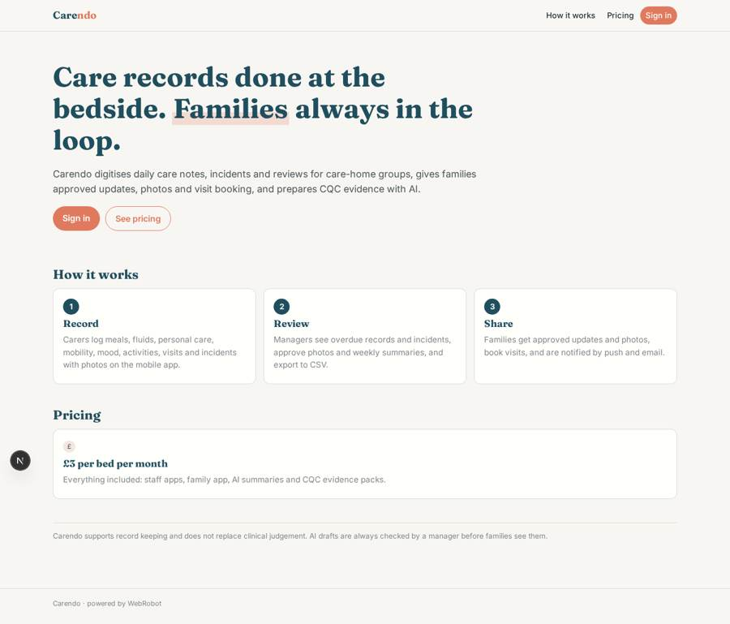
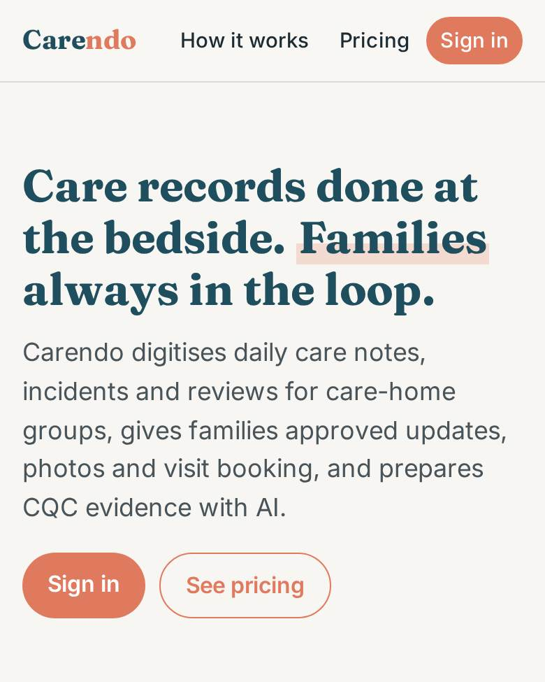
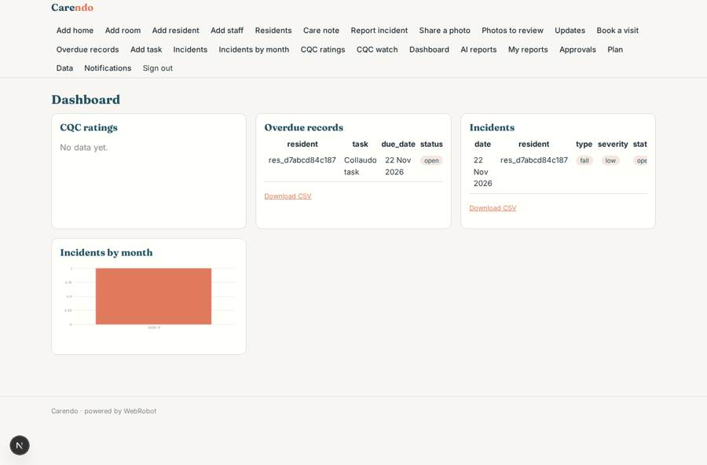
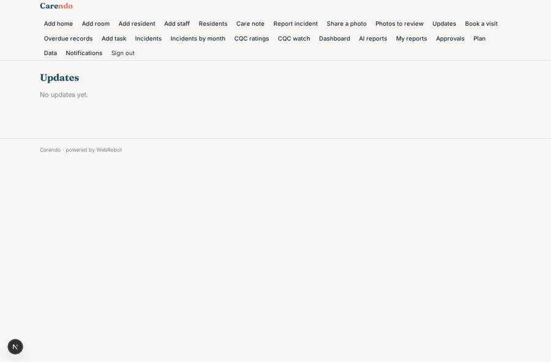
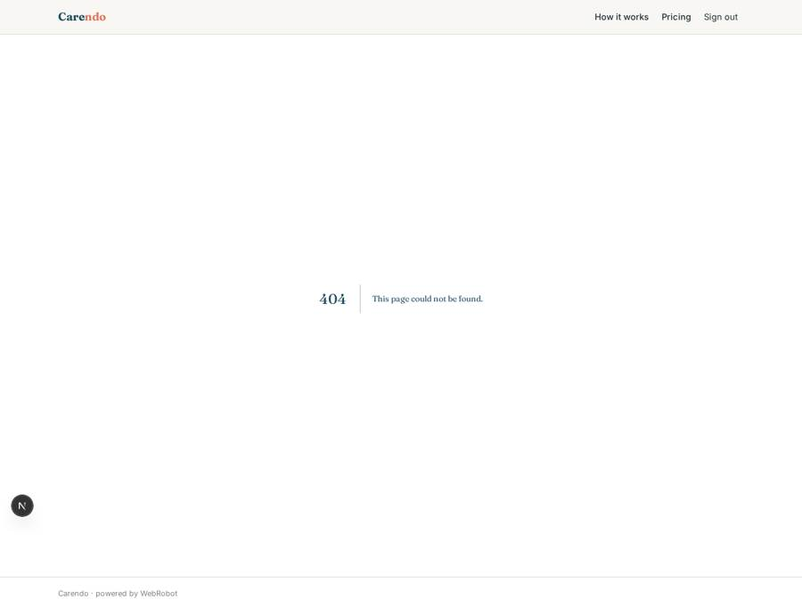
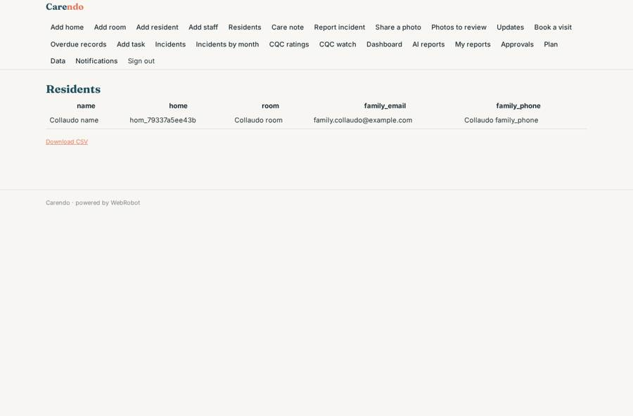

# Carendo

_Daily care records for care homes, and families who are always in the loop._

**Sector:** Sanità, istruzione, energia, gov · **Manifest:** valid (schema + runtime contract) · **Functional test:** passed (59 checks passed)

## Description given to the app builder

I want Carendo, a SaaS for care homes that digitises daily operations and keeps families informed. A care-home group signs up, adds homes, rooms, residents and staff. Roles: home manager, nurse, carer, activities coordinator, and family member; staff see residents in their home, families see only their relative. Carers record care notes on a mobile app through forms: meals and fluids, personal care, mobility, mood, activities joined, visits, and incidents with a photo. Families get a feed of approved updates and photos, can book visit slots, and receive push notifications and an email when something is shared; we would also like SMS for families who do not use the app. Photos involving other residents need manager approval before families see them. An agent drafts a weekly family summary per resident from the notes for the manager to check, and builds evidence packs mapped to the CQC Single Assessment Framework quality statements. The CQC public API gives each home's current rating and inspection dates on the dashboard. Managers see dashboards of overdue records and incidents, with CSV export. Pricing: £3 per bed per month. English, web and mobile.

## Functional test: what did not pass

- **trigger has its effect** (trigger photo_pending): email to role:manager: no such recipient in the test (role nobody holds or empty field) _(warning)_
- **trigger has its effect** (trigger incident_logged): email to role:manager: no such recipient in the test (role nobody holds or empty field) _(warning)_
- **saved record shown where its collection is read** (view incident_trend): a record was saved in incidents (by admin) but the page does not show it (as admin) _(warning)_

## Navigation recording

Signed in as the app's admin, the recorder opened 7 menu page(s): Add home, Add room, Add resident, Add staff, Residents, Care note, Report incident.
No issue found.

Empty data pages are mostly expected on the local runtime: agents are mocked there, so the collections they fill stay empty.

## Features not expressible today (spec.extensions)

- **sms_for_families**: SMS to families without the app is not available yet; they receive email, and phone numbers are stored so staff can call.
- **per_bed_pricing**: Billing is a flat subscription tier per bed band (£3 per bed); exact per-bed metering from the number of beds is not available.
- **home_scoping**: Staff roles are scoped to the group, not to a single home inside it; per-home visibility needs one app per group or a home-based role rule. Run one Carendo app per care-home group.
- **photo_visibility_check**: Every photo waits for manager approval (stricter than only photos showing other residents).

## Screenshots (interpretive runtime, test data)

### home-anon

### home-mobile

### manager_dash

### family_feed

### family_photos

### residents_list

