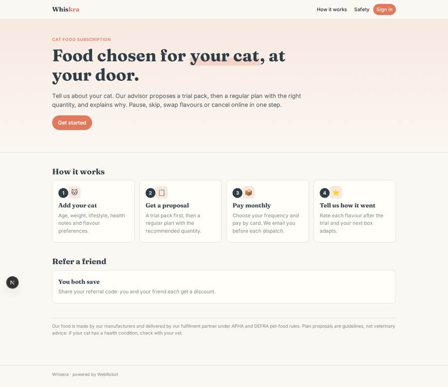
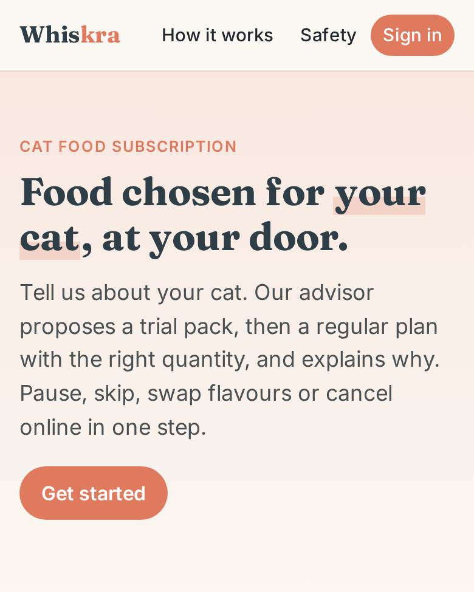
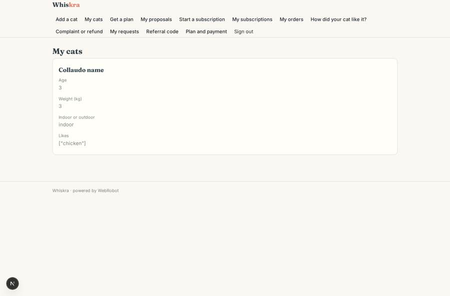
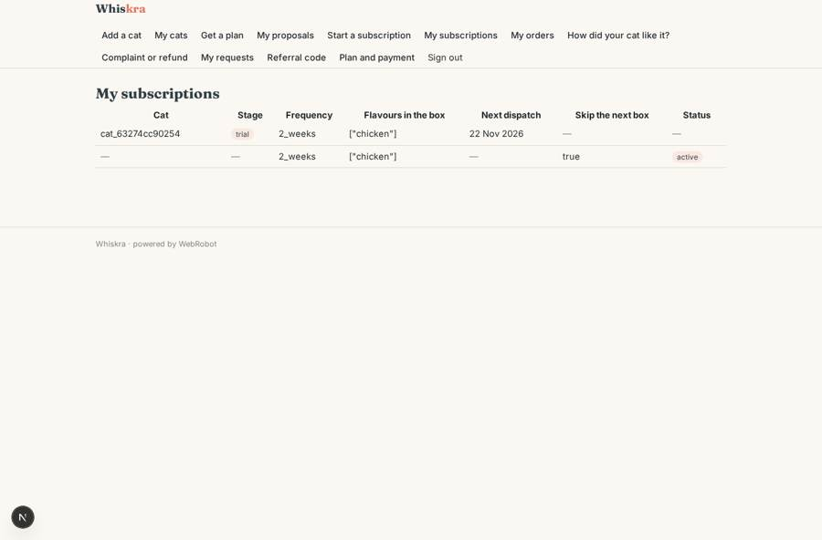
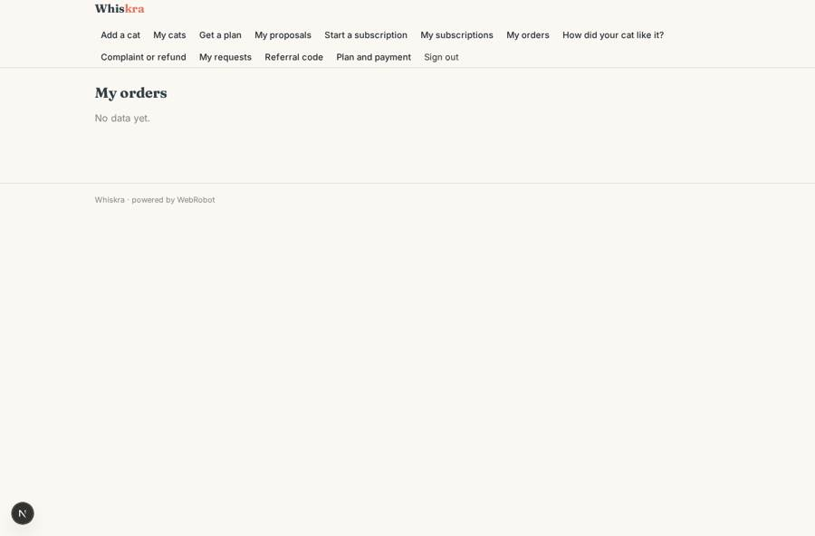
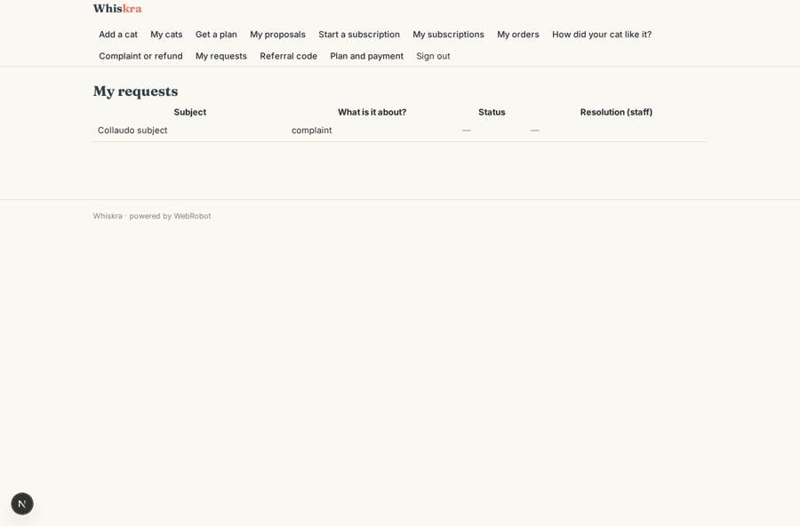

# Whiskra

_Cat food picked for your cat, delivered on your schedule._

**Sector:** Consumer, travel, retail · **Manifest:** valid (schema + runtime contract) · **Functional test:** passed (36 checks passed)

## Description given to the app builder

I want a subscription storefront called Whiskra for cat food. Production and the supply chain are outside the software, run by our manufacturers and fulfilment partner under APHA and DEFRA pet-food rules; I need the software around it. Owners sign up, add each cat (name, age, weight, indoor or outdoor, neutered, health issues, flavour preferences) and an agent proposes a trial pack and then a regular plan with recommended quantity, explaining the choice. Owners pay a monthly subscription by card, choose frequency, and can pause, skip, swap flavours or cancel online in one step. Before each dispatch they get a reminder email; after the trial an agent asks how the cat liked each flavour and adjusts the next box. Customer service handles complaints and refunds, with a manager approving refunds over a set amount. Customers see only their own cats and orders; customer service sees all subscriptions; admins see dashboards with active subscribers, churn, top flavours and forecast volumes for the supplier, exported as CSV weekly. A referral code gives both parties a discount. Phone app and web. English.

## Navigation recording

Signed in as the app's admin, the recorder opened 4 menu page(s): All subscriptions, Tickets, Refund approvals, Dashboard.
No issue found.

Empty data pages are mostly expected on the local runtime: agents are mocked there, so the collections they fill stay empty.

## Features not expressible today (spec.extensions)

- **referral_discount**: Applying the referral discount to both customers' Stripe subscriptions is not expressible yet: codes are stored and visible to customer service, who apply the discount.
- **weekly_csv_delivery**: The supplier forecast is served as a CSV through a signed URL (and per-view CSV export); emailing it to the supplier every week is not available yet.
- **dispatch_cycle**: Advancing next_dispatch after each dispatch, charging the card and creating the Stripe subscription at sign-up are handled by the payment and fulfilment integration, not by this manifest. The trial pack is a one-off pack.
- **refund_payout**: The refund itself is issued manually in Stripe after the manager approves.

## Screenshots (interpretive runtime, test data)

### home-anon

### home-mobile

### my_cats

### my_subs

### my_orders

### my_tickets

