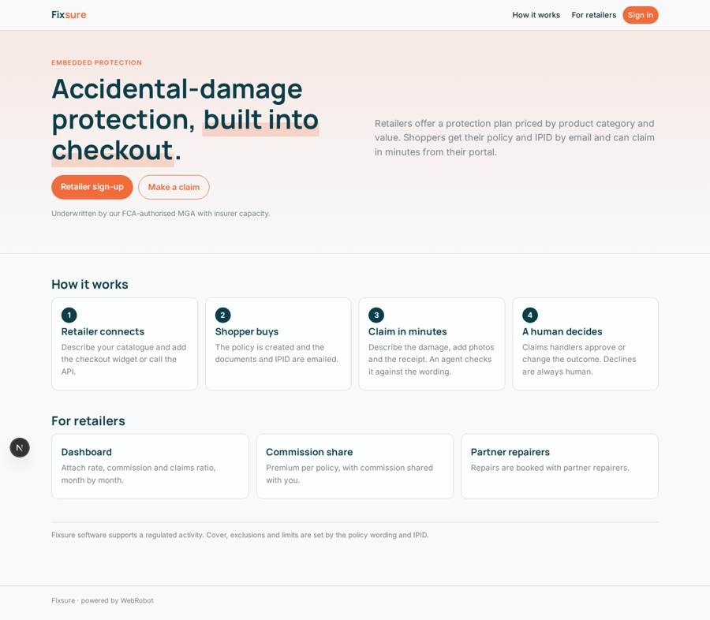
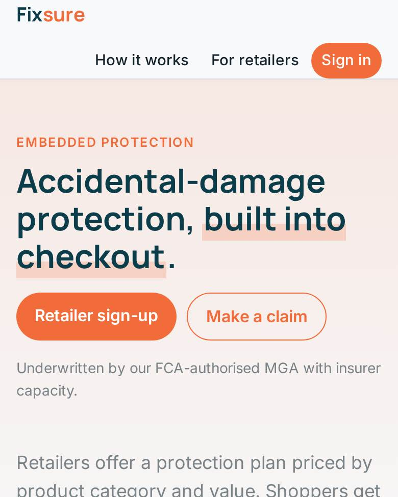
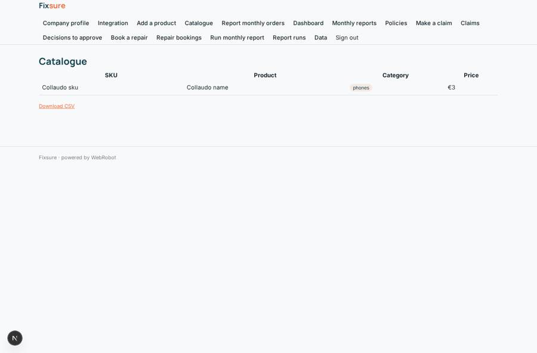
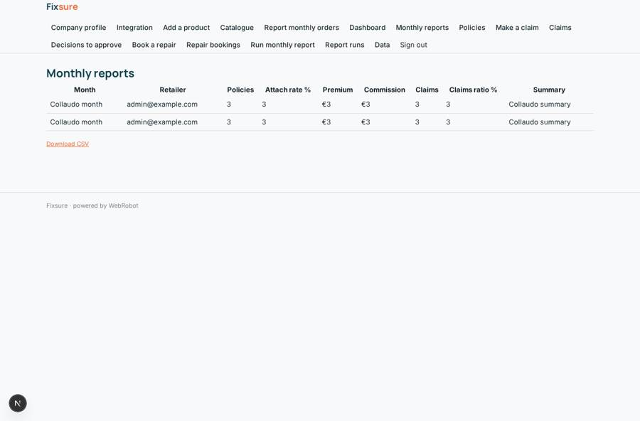
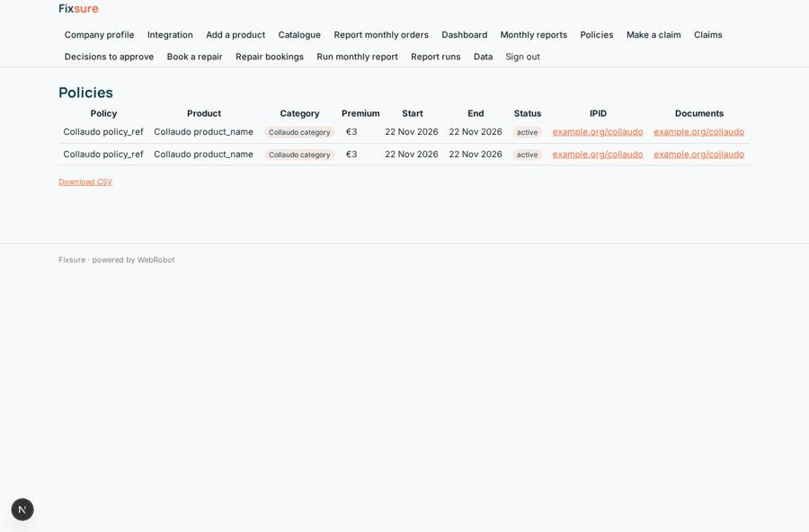
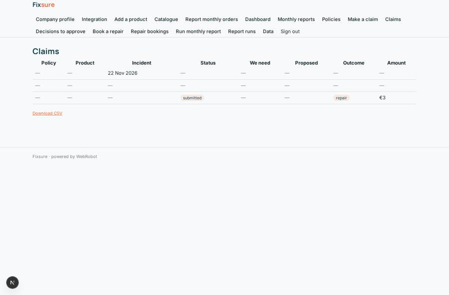

# Fixsure

_Accidental-damage protection, built into checkout._

**Sector:** Fintech, proptech, insurtech · **Manifest:** valid (schema + runtime contract) · **Functional test:** passed (46 checks passed)

## Description given to the app builder

We want Fixsure, embedded accidental-damage protection sold at online checkout. Underwriting the risk and acting as an FCA-authorised MGA with insurer capacity is the regulated part; I need the software around it. Retailers sign up, describe their product catalogue and install a checkout widget or call our API, which offers a protection plan priced by product category and value. When a shopper buys, the policy is created and the policy documents and IPID are emailed. Shoppers have a portal to see policies and make a claim with a form: what happened, date, photos or video of the damage, receipt. An agent checks the claim against the wording, asks for missing evidence and proposes an outcome (repair, replace, refund, decline); claims handlers approve or change it, and decline decisions always need a human. Repairs are booked with partner repairers. Monthly reports go to the insurer and retailer. Retailers see a dashboard of attach rate, commission and claims ratio. Roles: retailer, shopper, claims handler, insurer read-only, admin. Pricing: premium per policy, with commission shared with the retailer. English.

## Functional test: what did not pass

- **saved record shown where its collection is read** (view products): a record was saved in products (by admin) but the page does not show it (as retailer) _(warning)_
- **saved record shown where its collection is read** (view reports): a record was saved in reports (by admin-data, admin-data) but the page does not show it (as retailer) _(warning)_
- **saved record shown where its collection is read** (view claims): a record was saved in claims (by admin, admin, admin) but the page does not show it (as shopper) _(warning)_

## Navigation recording

Signed in as the app's admin, the recorder opened 7 menu page(s): Company profile, Integration, Add a product, Catalogue, Report monthly orders, Dashboard, Monthly reports.
No issue found.

Empty data pages are mostly expected on the local runtime: agents are mocked there, so the collections they fill stay empty.

## Features not expressible today (spec.extensions)

- **checkout_widget**: An embeddable checkout widget (JavaScript snippet) is not generated by the platform yet. Retailers integrate through the public rates feed /api/rates and the sale webhook /api/hooks/policy_sale; the widget needs to be built separately on those two endpoints.
- **server_side_pricing**: Premium and commission are looked up by the caller from the rates feed and sent with the sale; server-side quote calculation and validation against the rates table are not available.
- **policy_documents_pdf**: Policy documents and the IPID are emailed as links (documents_url, ipid_url) supplied with the sale. Generating and attaching PDFs is not available.
- **claim_video**: Photos and PDFs can be uploaded as claim evidence; video files are not an accepted file type yet.
- **repairer_notifications**: Partner repairers are not app users: repair bookings are visible to claims handlers, who pass them on. Direct repairer notification and SMS are not available.
- **regulatory**: Underwriting, FCA compliance, the IPID content and the policy wording belong to the MGA and insurer. This app only holds the wording the assessor reads, kept by the admins in the wording collection.

## Screenshots (interpretive runtime, test data)

### home-anon

### home-mobile

### products

### reports

### policies

### claims

