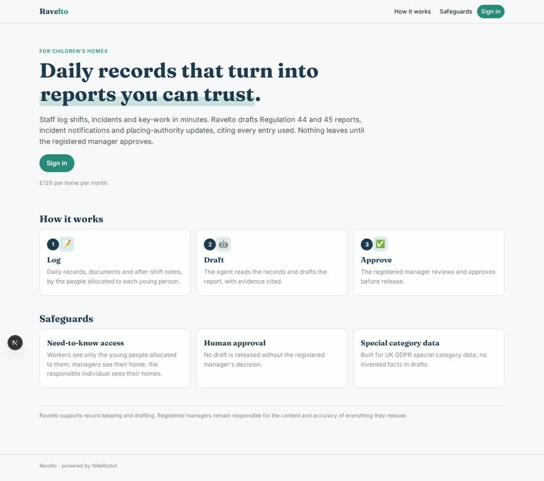
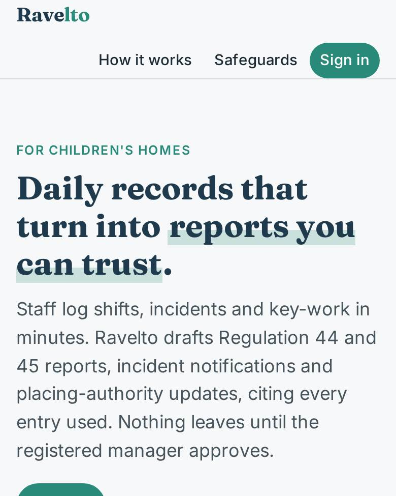
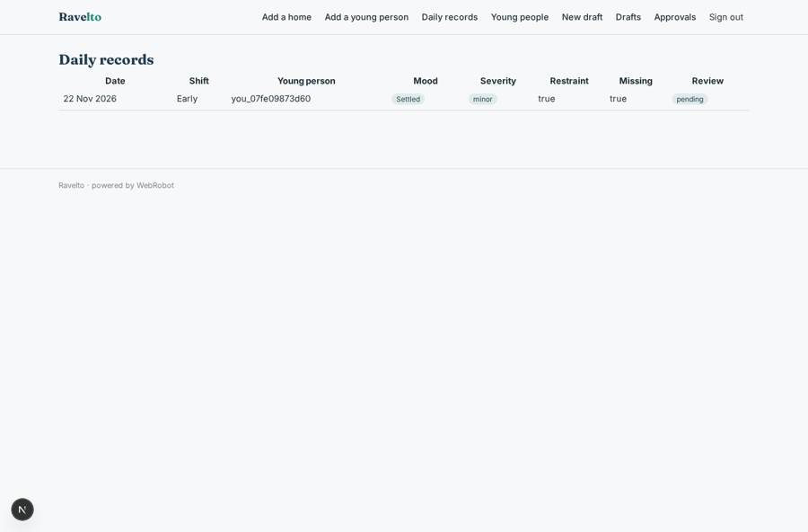
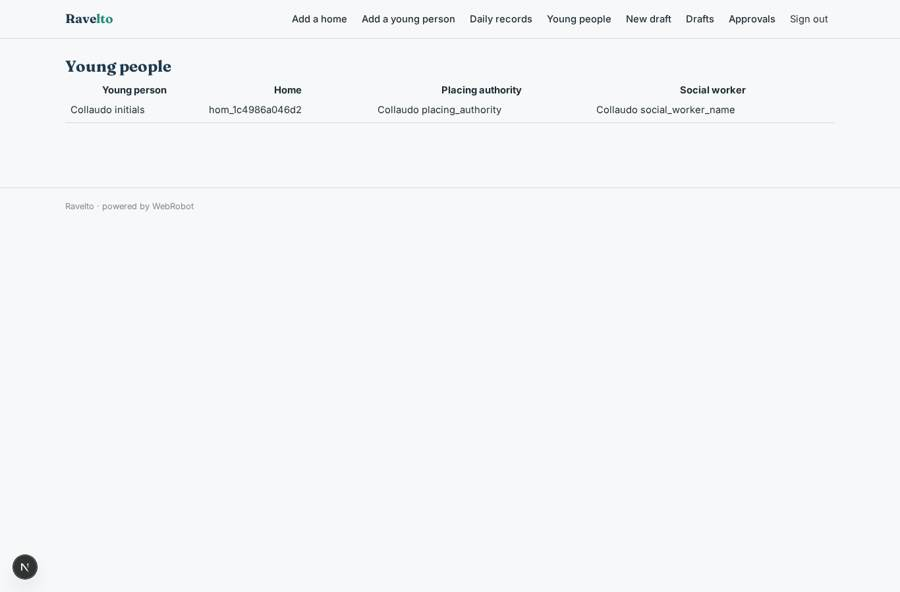
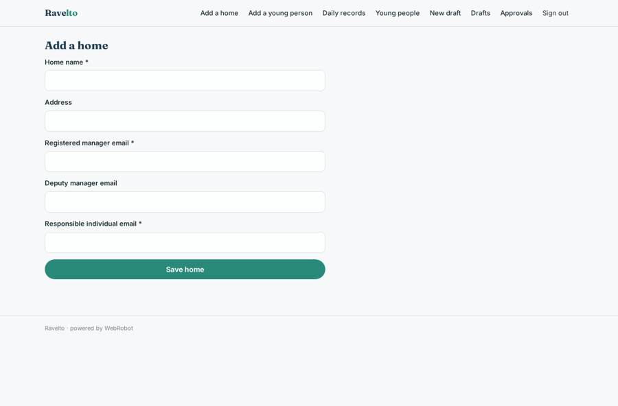
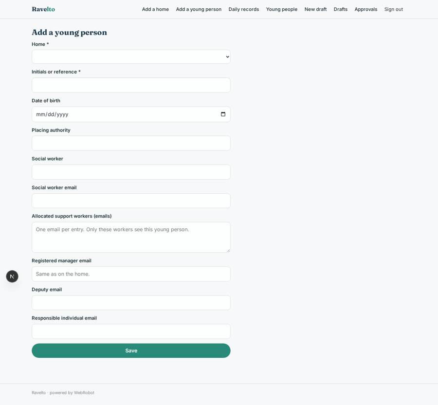

# Ravelto

_Records and reporting for children's homes._

**Sector:** Sanità, istruzione, energia, gov · **Manifest:** valid (schema + runtime contract) · **Functional test:** 1 failure(s) (21 checks passed)

## Description given to the app builder

We need Ravelto, a records and reporting platform for children's social care providers, starting with children's homes. Each provider organisation signs up with homes, staff and young people. Roles: registered manager, deputy, residential support worker, and responsible individual; each worker sees only the young people allocated to them, managers see their home, the responsible individual sees all homes. Staff log daily records through forms (date, shift, young person, mood, activities, education attendance, health, incidents with category and severity, restraint used yes/no, missing-from-care episodes) and upload documents such as care plans and placement agreements, from which text is extracted. Staff also record voice notes after shifts and we want key-work sessions and meetings transcribed from audio. An agent drafts the monthly Regulation 44 and 45 reports, incident notifications and placing-authority updates from the records, citing the entries it used; nothing leaves the system until the registered manager approves it. We want integration with local authority case-management systems to send updates to social workers. Weekly email digest of overdue records to managers. Data is UK GDPR special category; access logging is mandatory. Priced per home per month, around £120. English only, web first.

## Functional test: what did not pass

- **page opened by a role allowed to** (view account): status 200, error page (as user)

## Navigation recording

Signed in as the app's admin, the recorder opened 7 menu page(s): Add a home, Add a young person, Daily records, Young people, New draft, Drafts, Approvals.
No issue found.

Empty data pages are mostly expected on the local runtime: agents are mocked there, so the collections they fill stay empty.

## Features not expressible today (spec.extensions)

- **access_audit_log**: Mandatory logging of who viewed or changed each record is not yet declarable in the manifest; it needs a platform audit trail of reads. Required before handling live special category data.
- **audio_transcription**: Transcribing voice notes and key-work or meeting audio is not available yet (file uploads accept documents and images only). For now staff paste or type the note; an audio-to-text step is needed.
- **local_authority_integration**: Sending updates directly into local authority case-management systems needs per-authority APIs or OAuth, not available yet. Approved drafts are exported and emailed to the registered manager to forward; social workers' emails are stored for a later integration.
- **auto_routing_fields**: manager_email, deputy_email, ri_email and worker_emails on records should be copied automatically from the home and young person; today they are entered or copied by hand.
- **self_approval_gap**: A registered manager cannot approve a draft they requested themselves, so drafts are requested by the deputy or responsible individual. A second approver or a rule for sole managers is needed.
- **retention_policy**: Retention periods for children's records are long and set by statutory guidance and the provider; none is set here, so confirm and add retentionDays per collection.

## Screenshots (interpretive runtime, test data)

### home-anon

### home-mobile

### daily_table

### people_table

### homes_form

### young_person_form

