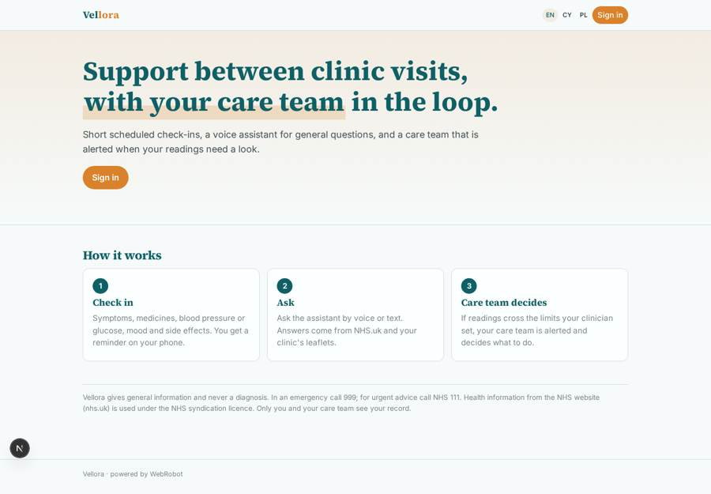
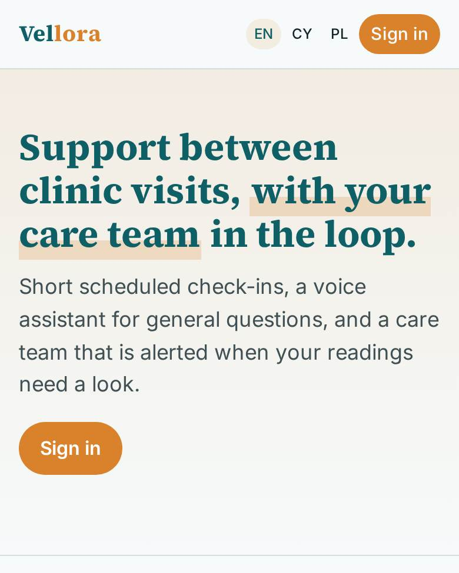
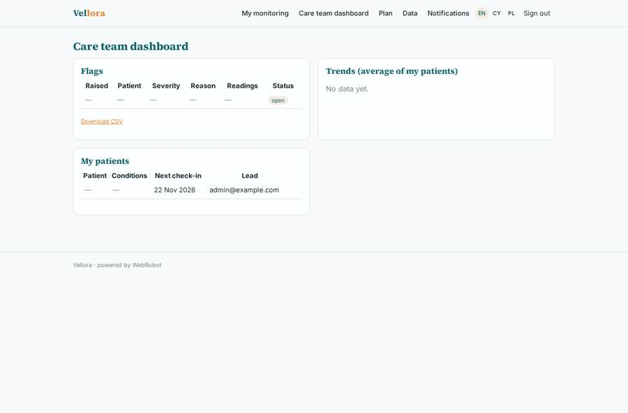
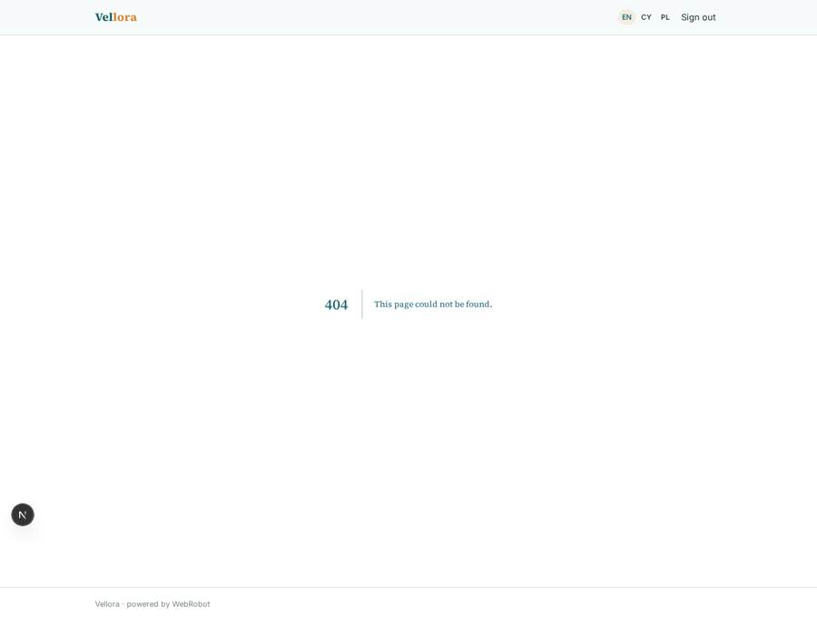
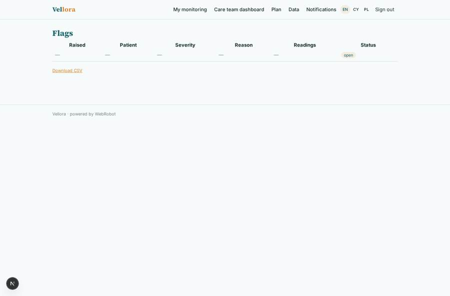
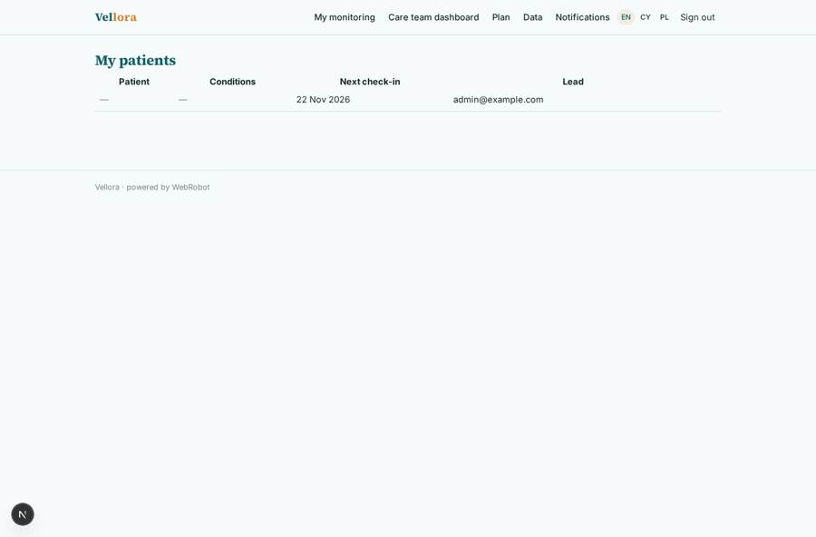

# Vellora

_Support between clinic visits, with your care team in the loop._

**Sector:** Sanità, istruzione, energia, gov · **Manifest:** valid (schema + runtime contract) · **Functional test:** passed (20 checks passed)

## Description given to the app builder

We need Vellora, a companion app supporting people with long-term conditions between clinic visits. A clinic signs up and invites patients; each patient has a care team of nurses and doctors. Patients complete scheduled check-ins as forms (symptoms, medication taken, blood pressure or glucose readings, mood, side effects) and can talk to an assistant by voice in the browser or on the phone app. The assistant answers general questions using NHS.uk content under its syndication licence and the clinic's own leaflets, and never gives a diagnosis. A monitor runs per patient on the clinic's schedule; when readings or answers cross thresholds set by the clinician, it escalates to the care team, who decide what to do. We want OAuth connections to wearables and health apps for readings. Patients get push reminders. Clinicians see a dashboard of their patients, flags and trends; patients see only their own record. Selling to the NHS needs a DCB0129 safety case, DTAC and DSPT, and those are ours. Pricing per patient per month to clinics. English, then Welsh and Polish.

## Functional test: what did not pass

- **form saves a record** (form profile): only role patient may fill it, and the test cannot hold that role _(warning)_
- **form saves a record** (form checkin): only role patient may fill it, and the test cannot hold that role _(warning)_
- **template instance created and run** (template patient_monitor): reserved to patient/admin _(warning)_
- **trigger has its effect** (trigger flag_raised): email to record.lead_clinician_email: no such recipient in the test (role nobody holds or empty field) _(warning)_
- **page opened by a role allowed to** (view profile): only role patient may open it, the test cannot hold it _(warning)_
- **page opened by a role allowed to** (view checkin): only role patient may open it, the test cannot hold it _(warning)_
- **page opened by a role allowed to** (view my_checkins): only role patient may open it, the test cannot hold it _(warning)_
- **page opened by a role allowed to** (view assistant_chat): only role patient may open it, the test cannot hold it _(warning)_
- **saved record shown where its collection is read** (view flags_table): a record was saved in flags (by admin) but the page does not show it (as user) _(warning)_
- **saved record shown where its collection is read** (view patients_table): a record was saved in patients (by admin) but the page does not show it (as user) _(warning)_

## Navigation recording

Signed in as the app's admin, the recorder opened 3 menu page(s): My monitoring, Care team dashboard, Plan.
- data page empty: care (dashboard)

Empty data pages are mostly expected on the local runtime: agents are mocked there, so the collections they fill stay empty.

## Features not expressible today (spec.extensions)

- **wearable_oauth**: OAuth connections to wearables and health apps (Apple Health, Google Fit, Withings, Dexcom, etc.) are not available yet. For now patients type blood pressure and glucose readings in the check-in; the 'source' field is ready for imported readings.
- **per_patient_billing**: Pricing is per active patient per month; the manifest only holds a flat monthly plan. Seat counting and invoicing per patient must be done on the Stripe side.
- **clinic_tenancy**: One app instance serves one clinic (its admins, invited clinicians and patients). A multi-clinic organisation would run one instance per clinic.
- **recurring_schedule**: The check-in reminder fires on each patient's next_checkin_date; the care team moves the date forward after each check-in. The monitor runs daily at 18:00 for all patients (the clinic cannot yet set a per-patient cron).
- **monitor_setup**: Each patient starts their own monitoring from 'My monitoring'; clinics should include this in onboarding.
- **nhs_compliance**: DCB0129 clinical safety case, DTAC and DSPT are the vendor's own deliverables and are not expressed in the manifest. Welsh and Polish text should be reviewed by clinical translators before go-live.

## Screenshots (interpretive runtime, test data)

### home-anon

### home-mobile

### care

### my_checkins

### flags_table

### patients_table

