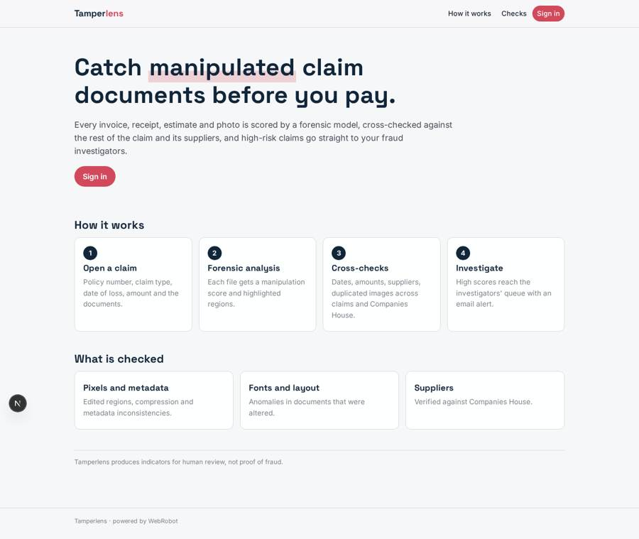
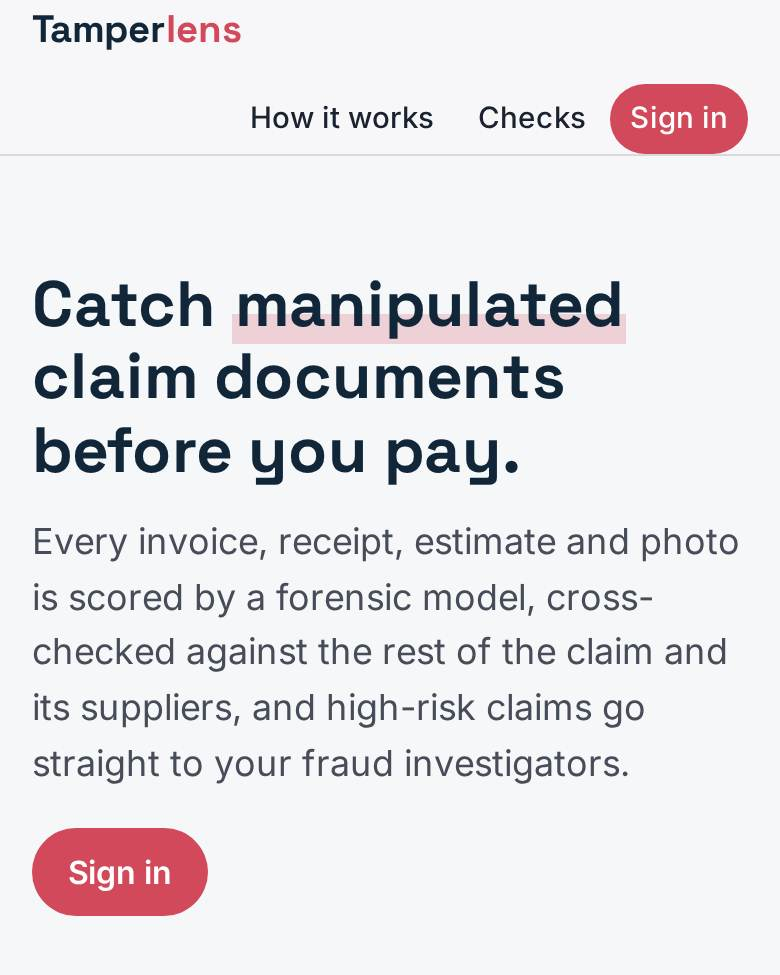
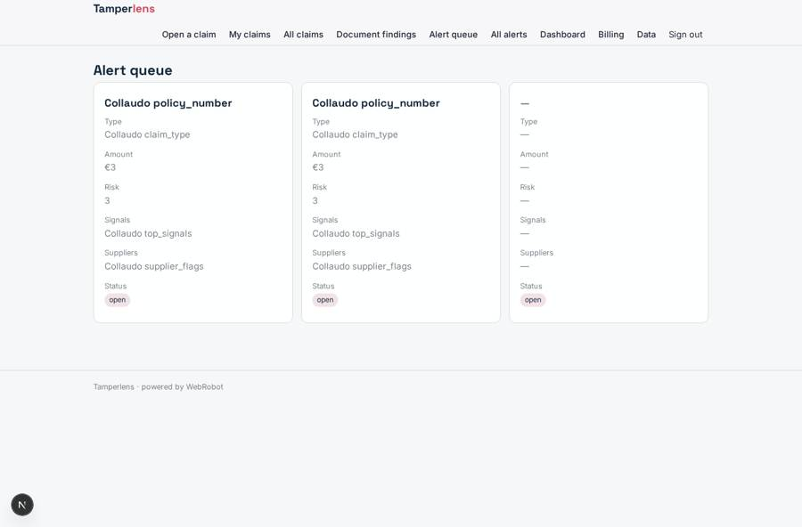
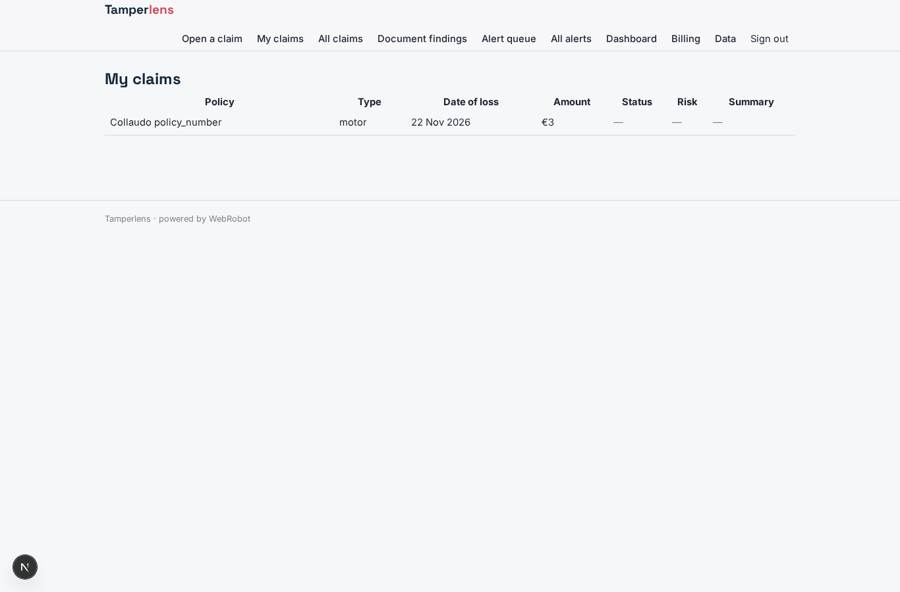
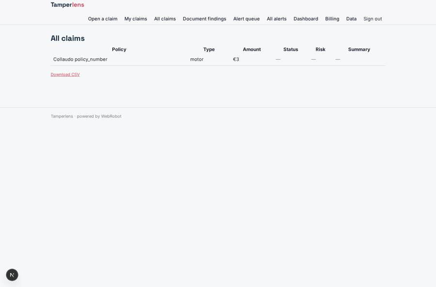
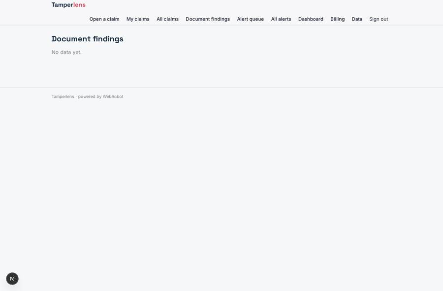

# Tamperlens

_Catch manipulated claim documents and photos before you pay._

**Sector:** B2B AI and SaaS · **Manifest:** valid (schema + runtime contract) · **Functional test:** passed (19 checks passed)

## Description given to the app builder

I want Tamperlens for insurers' claims and fraud teams to detect manipulated claim documents and photos. The core is outside what I expect a builder to produce: forensic detection of edited images and documents is proprietary machine learning (pixel-level analysis, metadata and compression inconsistencies, font and layout anomalies); I need the software around it and a place to plug that model in through an API. The insurer signs up; roles are claims handler, fraud investigator and manager, and handlers see only their claims. A handler opens a claim with policy number, claim type, date of loss, amount and uploads invoices, receipts, repair estimates and photos. Each file goes to the detection model, which returns a manipulation score and highlighted regions; an agent also checks consistency between documents (dates, amounts, supplier details, duplicated images across claims) and verifies suppliers against the Companies House API. High scores send the claim to a fraud investigator's queue, who decides and records the outcome. Emails to investigators on new alerts, daily summary to managers. Dashboards of alerts, confirmed fraud and savings. Pricing: per document analysed, with monthly minimums for larger insurers. English.

## Functional test: what did not pass

- **trigger has its effect** (trigger new_alert): email to role:investigator: no such recipient in the test (role nobody holds or empty field) _(warning)_

## Navigation recording

Signed in as the app's admin, the recorder opened 7 menu page(s): Open a claim, My claims, All claims, Document findings, Alert queue, All alerts, Dashboard.
- data page empty: findings (table)

Empty data pages are mostly expected on the local runtime: agents are mocked there, so the collections they fill stay empty.

## Features not expressible today (spec.extensions)

- **detection_model_files**: The detection model is plugged in as an HTTP app tool (detect_document, host model.tamperlens.eu, bearer key set by the admins). The runtime tool sends a JSON body only, so the model endpoint must fetch the file by its id (for example through a signed URL exchange). Sending raw file bytes to the model is not available yet. Set the real endpoint and its request and response format in the analyst's prompt.
- **per_document_pricing**: Pricing is pay per use (AI usage plus markup) with monthly-minimum plans that include credits. A strict price per document analysed, billed on a claim created by a form, is not available yet.
- **queue_row_links**: The alert queue lists alerts; opening the decision form for one alert is done at /v/alert_decision?id=<alert>. A per-row link button is not available yet.

## Screenshots (interpretive runtime, test data)

### home-anon

### home-mobile

### alerts_queue

### claims

### all_claims

### findings

