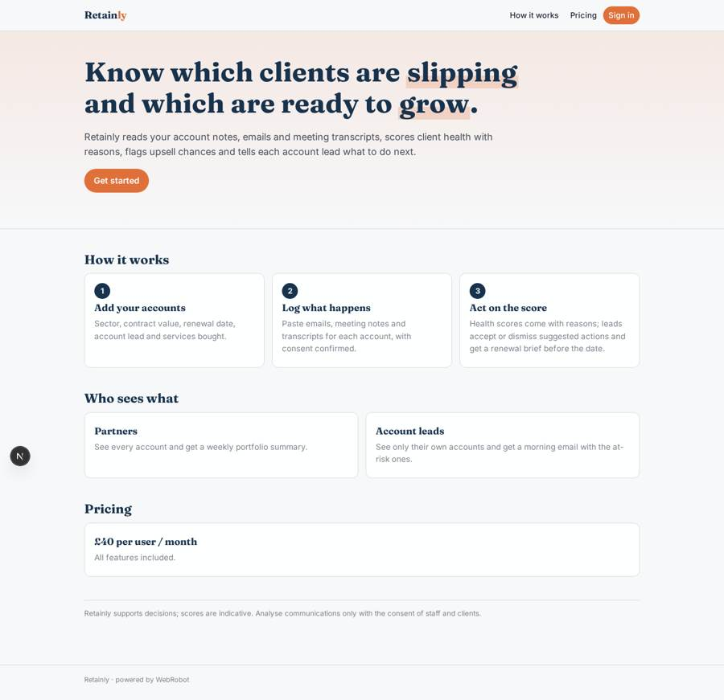
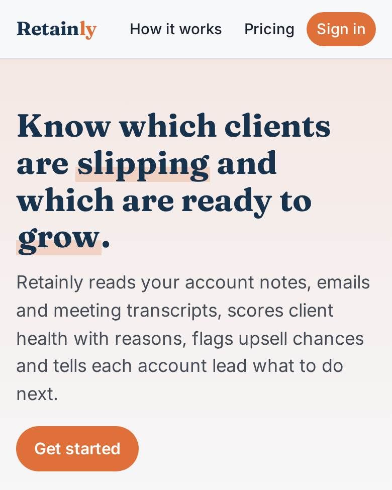
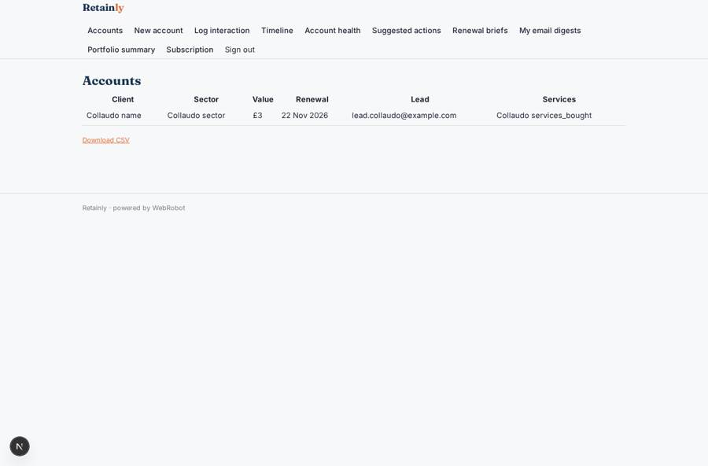
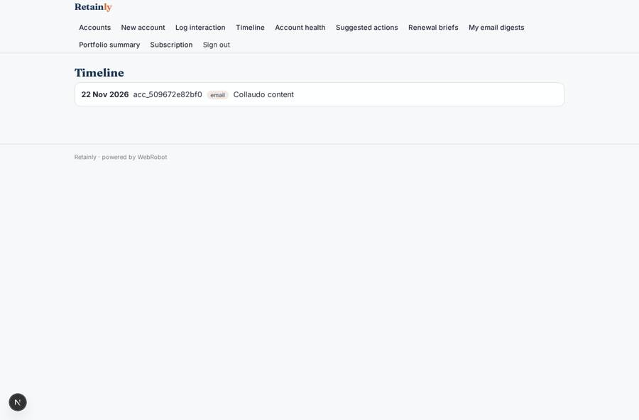
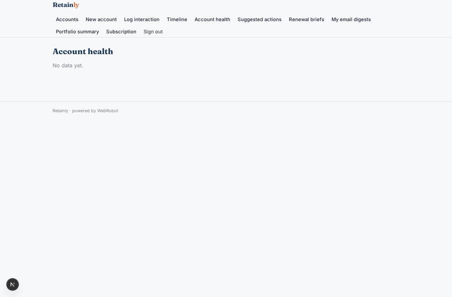
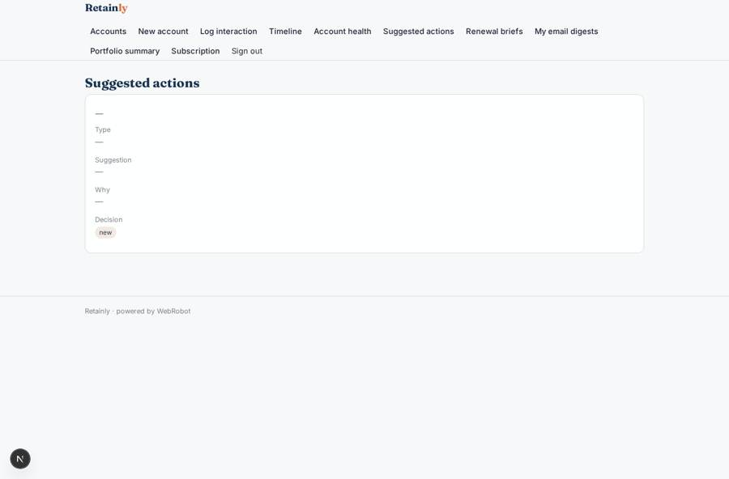

# Retainly

_Spot client churn risk and upsell chances before your renewal calendar does._

**Sector:** Data, media, cyber, devtools · **Manifest:** valid (schema + runtime contract) · **Functional test:** passed (20 checks passed)

## Description given to the app builder

We need an app called Retainly for professional-services firms such as agencies and consultancies to spot client churn risk and upsell chances. A firm signs up and creates client accounts with sector, contract value, renewal date, account lead and services bought. The real product connects through OAuth to Microsoft 365 and Google mail, calendar and meeting tools, and analyses meeting audio; I want that, with consent from staff and clients, plus a manual notes form as a fallback. An agent reads emails, meeting notes and transcripts per account and scores health: sentiment trend, response times, meeting frequency, escalations and mentions of budget or competitors. It also flags upsell signals, such as a client asking about a service the firm offers. Each account has a timeline, a health score with reasons, and suggested next actions that the account lead accepts or dismisses. Every morning account leads get an email with at-risk accounts; partners get a weekly portfolio summary. Before a renewal date the agent drafts a renewal brief for the lead to edit. Roles: admin, partner sees all accounts, account lead sees only their own. Pricing: £40 per user a month. English only.

## Functional test: what did not pass

- **template instance created and run** (template weekly_portfolio): reserved to admin/partner _(warning)_
- **trigger has its effect** (trigger brief_ready): email to record.lead_email: no such recipient in the test (role nobody holds or empty field) _(warning)_

## Navigation recording

Signed in as the app's admin, the recorder opened 7 menu page(s): Accounts, New account, Log interaction, Timeline, Account health, Suggested actions, Renewal briefs.
- data page empty: health (table)

Empty data pages are mostly expected on the local runtime: agents are mocked there, so the collections they fill stay empty.

## Features not expressible today (spec.extensions)

- **oauth_microsoft_google**: Not available yet: OAuth connection to Microsoft 365 and Google mail, calendar and meeting tools, with per-person consent. Fallback built: manual interaction log with a consent checkbox.
- **meeting_audio**: Not available yet: analysis of meeting audio. Paste transcripts into the interaction log instead.
- **per_seat_billing**: Billing is one £40/month plan per signed-up user; automatic seat counting for invited staff needs custom logic.

## Screenshots (interpretive runtime, test data)

### home-anon

### home-mobile

### portfolio

### timeline

### health

### next_actions

