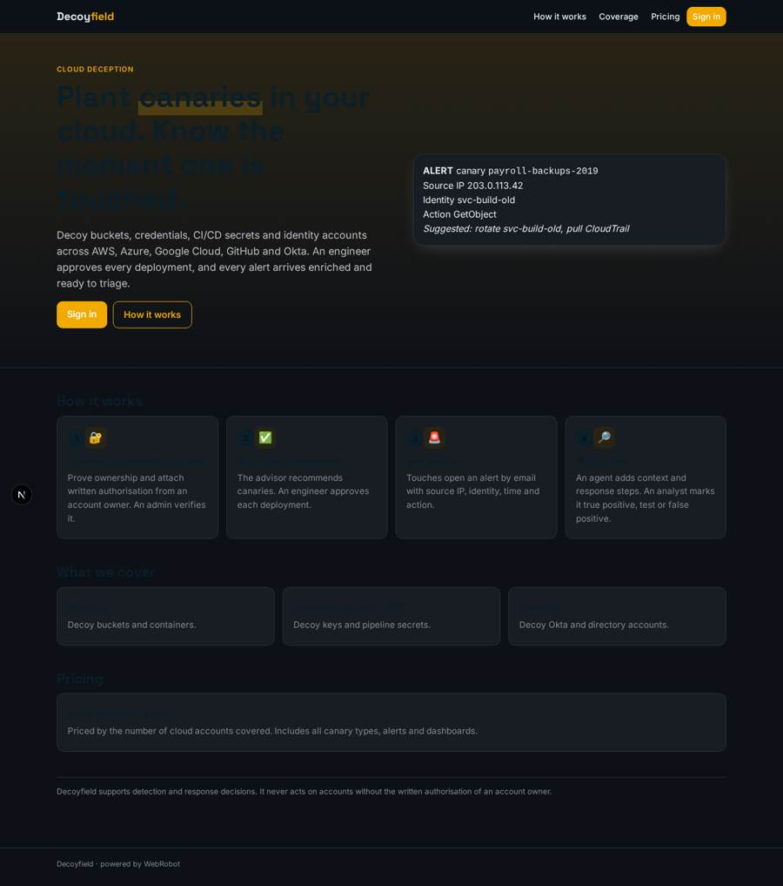
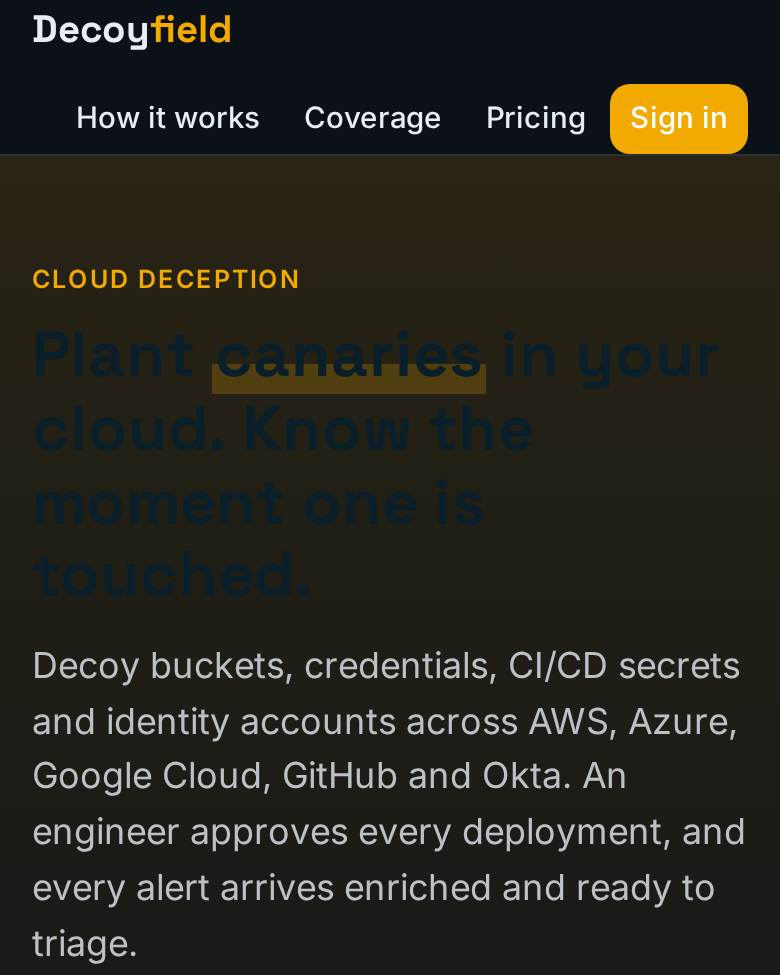
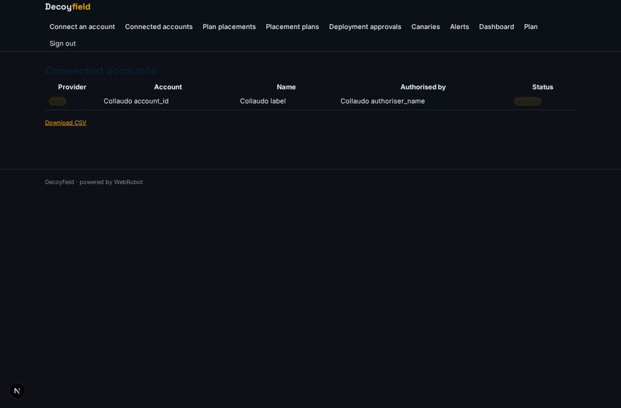
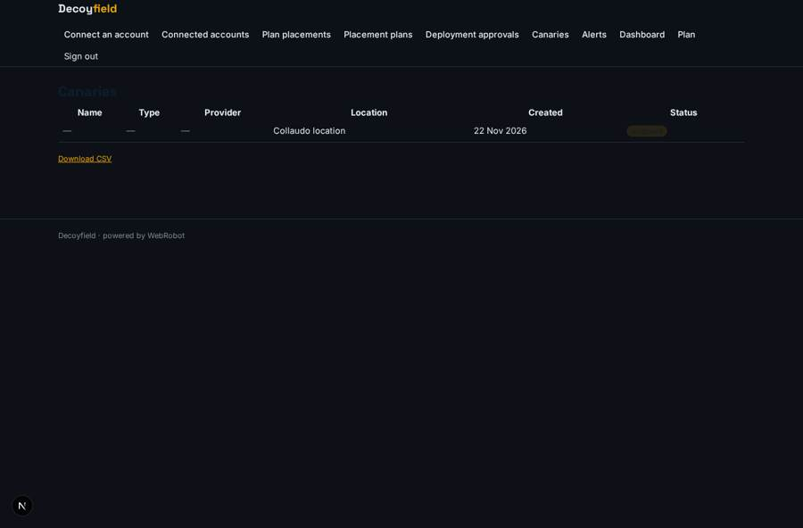
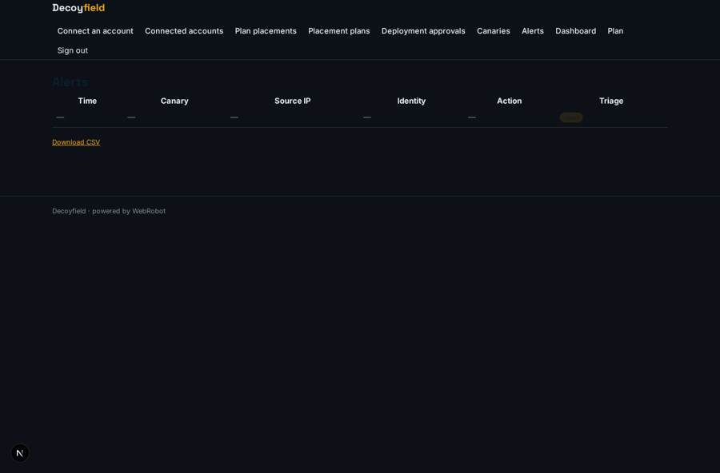
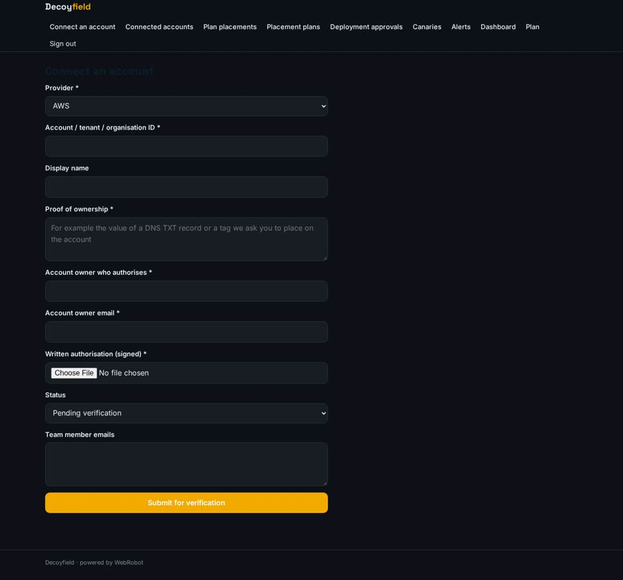

# Decoyfield

_Canaries in your cloud that tell you the moment an attacker touches them._

**Sector:** Data, media, cyber, devtools · **Manifest:** valid (schema + runtime contract) · **Functional test:** 1 failure(s) (30 checks passed)

## Description given to the app builder

I want an app called Decoyfield for cloud-native deception: placing canary resources that alert when an attacker touches them. The core of the real product is deploying decoys such as fake storage buckets, credentials, CI/CD secrets and identity-provider accounts into the customer's cloud and identity systems, and detecting their use in real time; that infrastructure and detection are outside a normal software app, and I need the console and workflow around them. A security team signs up and connects its AWS, Azure, Google Cloud, GitHub and Okta accounts, only accounts it proves it owns, with written authorisation from an account owner. The console lists recommended canary placements; an engineer approves each deployment. Each canary has type, location, creation date and status. When a canary is touched, an alert opens with source IP, identity used, time and action, and goes by email, Slack and webhook to the SIEM. An agent enriches the alert with context and suggests response steps; an analyst triages it as true positive, test or false positive. Dashboards show coverage, alert history and time to triage. Roles: admin, engineer, analyst. Pricing: from £20,000 a year by cloud accounts covered. English only.

## Functional test: what did not pass

- **run started and report ready** (view new_plan): required account (options from collection:cloud_accounts) has no option
- **saved record shown where its collection is read** (view alerts): a record was saved in alerts (by admin) but the page does not show it (as admin) _(warning)_

## Navigation recording

Signed in as the app's admin, the recorder opened 7 menu page(s): Connect an account, Connected accounts, Plan placements, Placement plans, Deployment approvals, Canaries, Alerts.
- agent run did not open: new_plan: the run did not open
- data page empty: plans (history)

Empty data pages are mostly expected on the local runtime: agents are mocked there, so the collections they fill stay empty.

## Features not expressible today (spec.extensions)

- **decoy_deployment**: Deploying decoys into AWS, Azure, Google Cloud, GitHub and Okta, and detecting their use in real time, is separate infrastructure that is not part of this app. It posts touches to the detection hook (/api/hooks/detection) with an event_id, and engineers set canary status here after deployment.
- **cloud_oauth**: Connecting accounts by OAuth or cloud roles is not available yet. This version records ownership proof and the signed authorisation letter for an admin to verify.
- **slack_and_siem_delivery**: Alerts go by email. Slack messages and outbound webhooks to a SIEM are not available yet.
- **per_tenant_alert_routing**: The hook writes alerts without a user. Routing each alert to the right customer team (the members list) is done by the detection layer.
- **account_quota_and_ttt**: Pricing per cloud accounts covered is not enforced in the app. Time to triage is entered by the analyst, not computed.

## Screenshots (interpretive runtime, test data)

### home-anon

### home-mobile

### accounts

### canaries

### alerts

### connect

