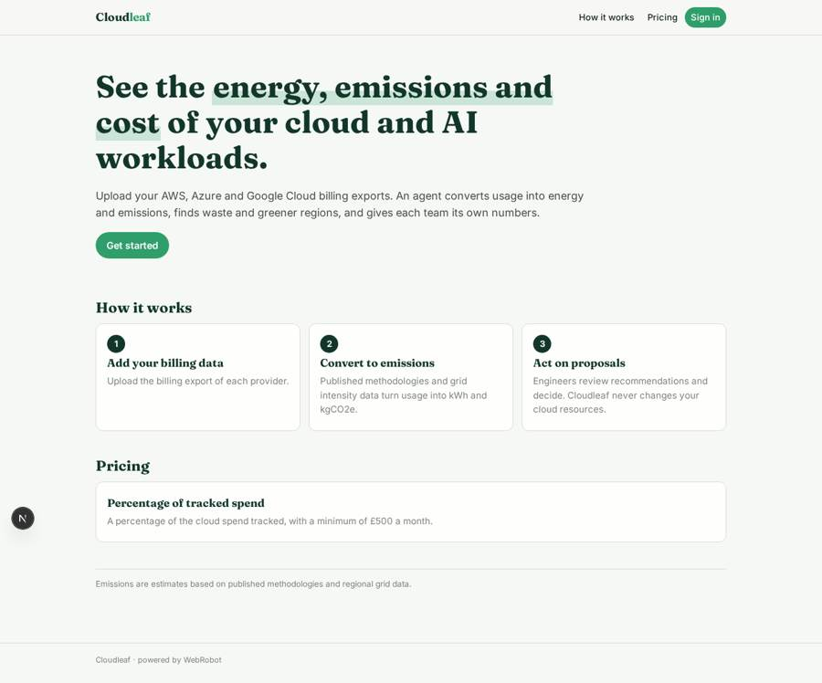
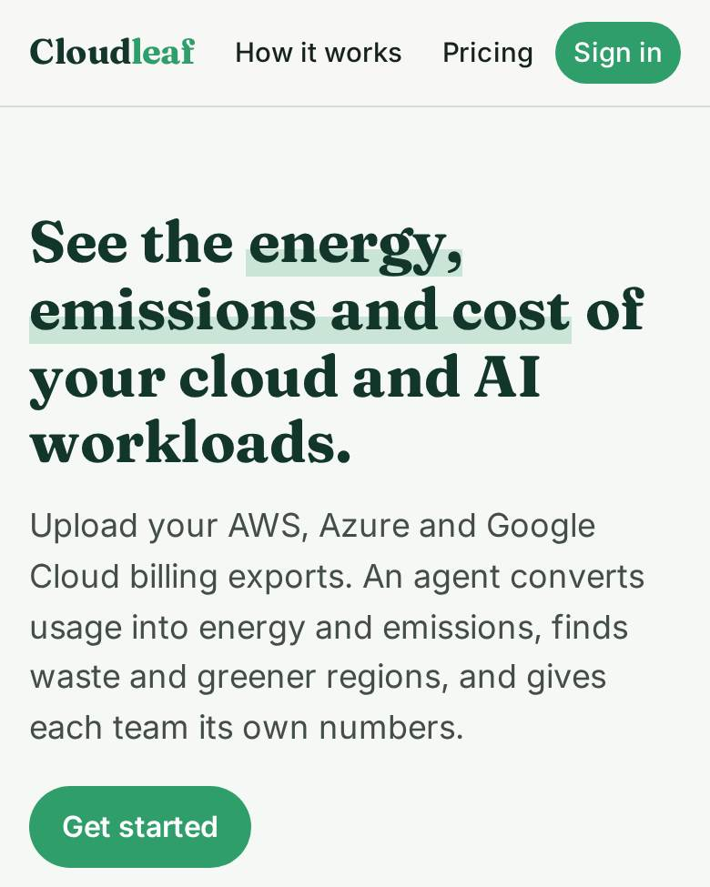
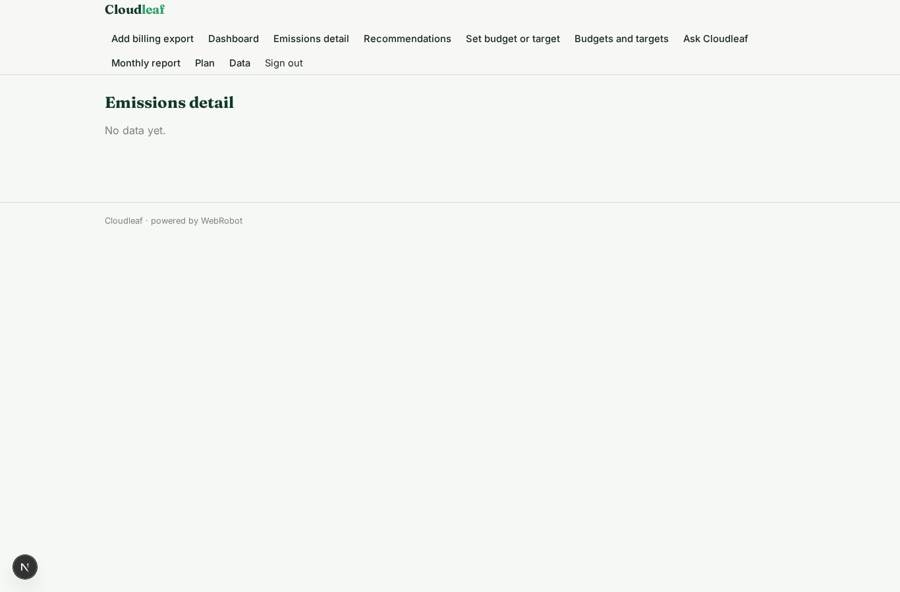
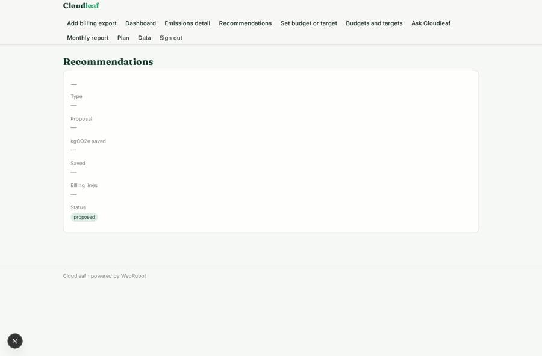
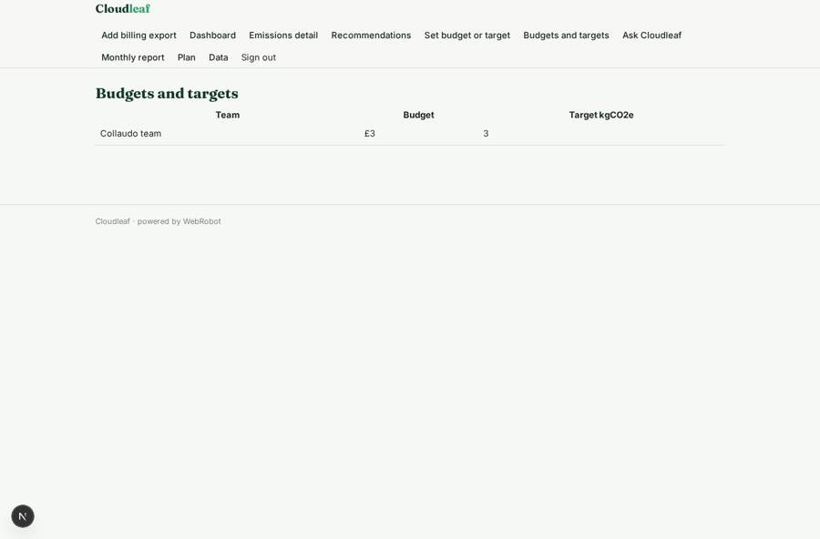
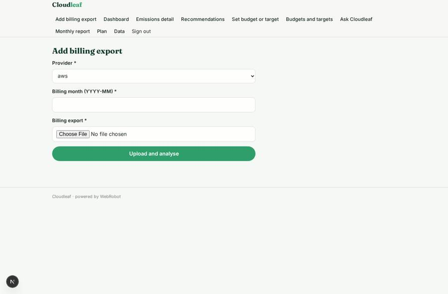

# Cloudleaf

_The energy, emissions and cost of your cloud and AI workloads._

**Sector:** Sanità, istruzione, energia, gov · **Manifest:** valid (schema + runtime contract) · **Functional test:** passed (17 checks passed)

## Description given to the app builder

We need Cloudleaf, a platform that shows the energy, emissions and cost of cloud and AI workloads. A company signs up and connects its AWS, Azure and Google Cloud accounts; we want IAM role and OAuth onboarding rather than pasting keys, and large billing exports must be ingested daily. An agent converts usage per service and region into energy and emissions using published methodologies and grid intensity data, and spots waste and greener region choices. Dashboards break emissions and cost down by team, project and tag. Engineering leads see their projects, the sustainability team sees everything. Monthly reports are emailed and exported to CSV for ESG reporting. Pricing: a percentage of cloud spend tracked, minimum £500 a month. Users can set budgets and emissions targets per team and get an email when a forecast breaches them. An assistant answers questions such as which services grew most last month, citing the billing lines. Recommendations are proposals only; an engineer decides whether to act, and the app never changes cloud resources itself. Results can also be pulled through an API. English only.

## Functional test: what did not pass

- **saved record shown where its collection is read** (view recs): a record was saved in recommendations (by admin) but the page does not show it (as user) _(warning)_

## Navigation recording

Signed in as the app's admin, the recorder opened 7 menu page(s): Add billing export, Dashboard, Emissions detail, Recommendations, Set budget or target, Budgets and targets, Ask Cloudleaf.
- data page empty: lines (table)

Empty data pages are mostly expected on the local runtime: agents are mocked there, so the collections they fill stay empty.

## Features not expressible today (spec.extensions)

- **cloud_account_onboarding**: Connecting AWS (IAM role), Azure and Google Cloud via OAuth is not available yet. For now, billing exports are uploaded as files (max 15 MB). Daily automatic ingestion of large exports needs a connector.
- **spend_percentage_pricing**: Pricing as a percentage of tracked cloud spend with a £500 monthly minimum is not expressible; a flat £500 plan is declared and the percentage must be billed outside the app.
- **monthly_report_csv**: Monthly reports are emailed per user; CSV export is available from the Emissions detail view and the token-protected /api/emissions.csv endpoint.

## Screenshots (interpretive runtime, test data)

### home-anon

### home-mobile

### lines

### recs

### budget_list

### upload

