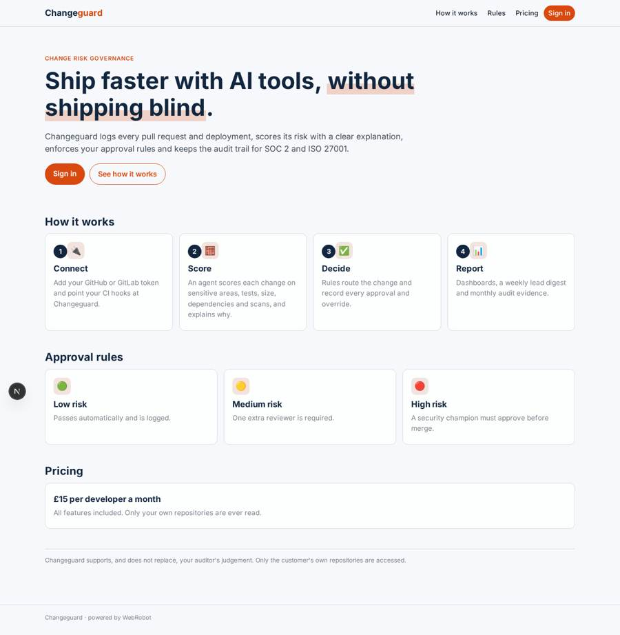
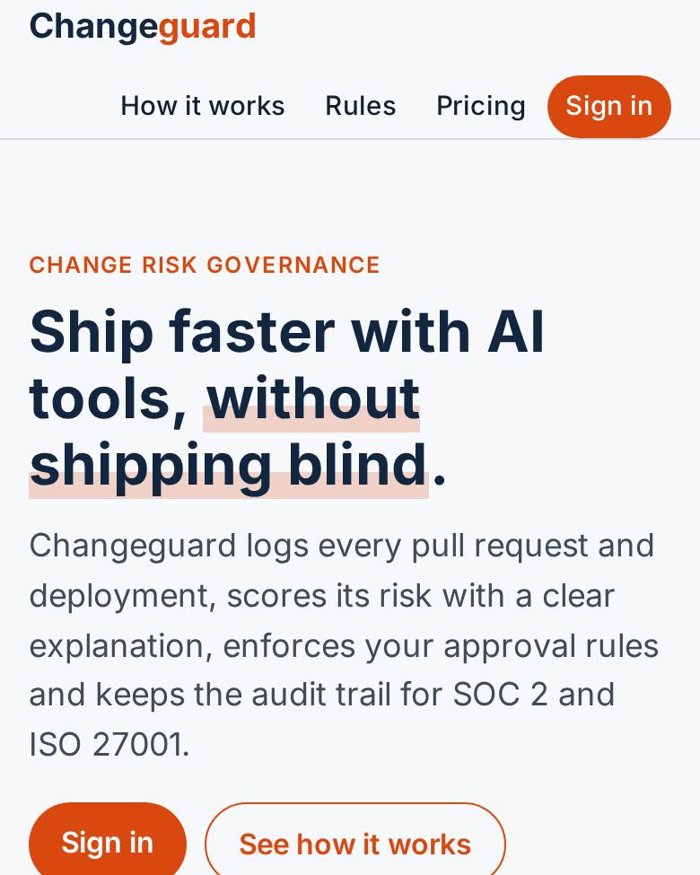
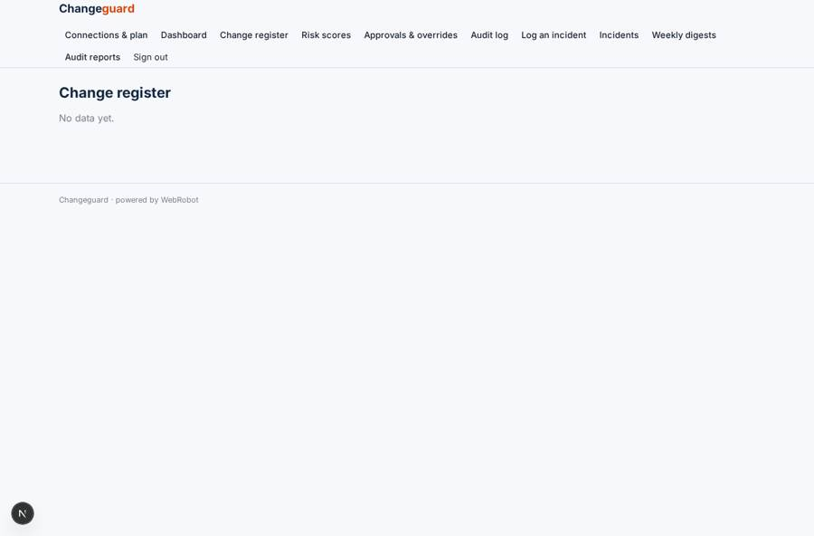
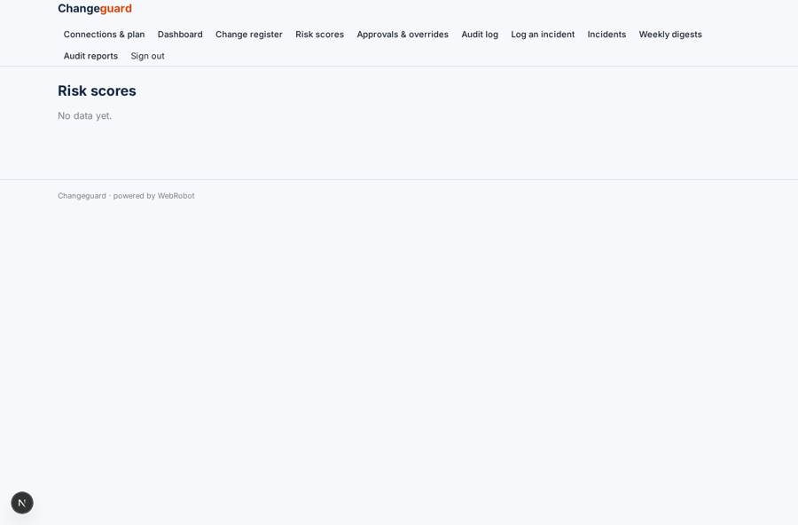
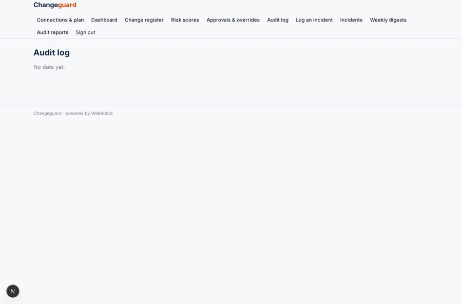
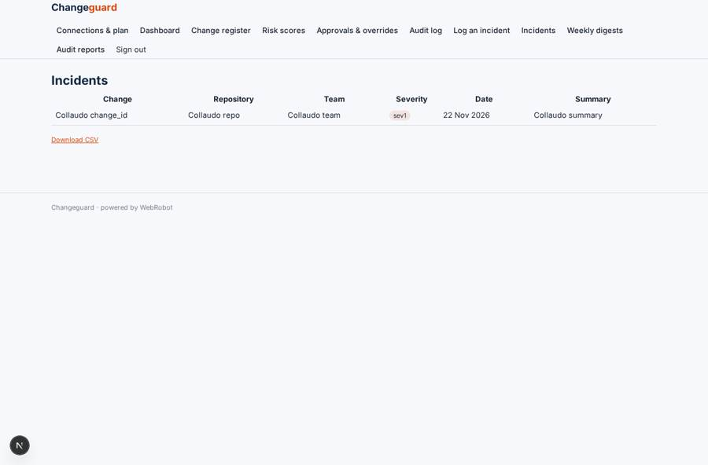

# Changeguard

_Govern the risk of software changes in the age of AI coding tools._

**Sector:** Data, media, cyber, devtools · **Manifest:** valid (schema + runtime contract) · **Functional test:** passed (19 checks passed)

## Description given to the app builder

We need an app called Changeguard that governs the risk of software changes as AI coding tools speed up development. An engineering organisation signs up and connects GitHub or GitLab through OAuth and adds CI hooks, as the real product does. Every pull request and deployment is logged in a change register with repository, author, files touched, size, whether AI tools wrote part of it, tests run and reviewers. An agent scores each change's risk based on sensitive areas touched such as authentication or payments, lack of tests, size, dependencies added and security scan results, and explains the score. Rules decide what happens: low-risk changes pass, medium need one extra reviewer, high-risk changes need approval from a security champion before merge. Approvals and overrides are recorded for audit. Dashboards show change volume, risk trends per team, approval times and incidents linked to changes. Weekly emails go to engineering leads, and monthly reports support SOC 2 and ISO 27001 audits. Roles: admin, engineering lead, security champion, developer. Pricing: £15 per developer a month. English only. Only the customer's own repositories.

## Functional test: what did not pass

- **template instance created and run** (template weekly_digest): reserved to admin/lead _(warning)_
- **template instance created and run** (template monthly_audit): reserved to admin/lead _(warning)_

## Navigation recording

Signed in as the app's admin, the recorder opened 7 menu page(s): Connections & plan, Dashboard, Change register, Risk scores, Approvals & overrides, Audit log, Log an incident.
- data page empty: changes_table (table)
- data page empty: assessments (table)
- data page empty: audit (table)

Empty data pages are mostly expected on the local runtime: agents are mocked there, so the collections they fill stay empty.

## Features not expressible today (spec.extensions)

- **oauth_git_connect**: OAuth sign-in/connection to GitHub and GitLab is not available yet: users paste a read-only API token on the account page, and CI or Git provider webhooks post changes to /api/hooks/ci_hook.
- **per_developer_seats**: Billing per developer seat (£15 per developer a month) is not available yet: the plan is a flat £15 per month and the seat count must be handled by the owner. Roles are assigned per user; merge blocking in the Git provider (required status check) needs a CI step calling the app.
- **org_wide_team_roles**: Engineering lead and security champion see records of their organisation through the members and lead_email fields on each change; webhooks must supply them.

## Screenshots (interpretive runtime, test data)

### home-anon

### home-mobile

### changes_table

### assessments

### audit

### incidents_table

