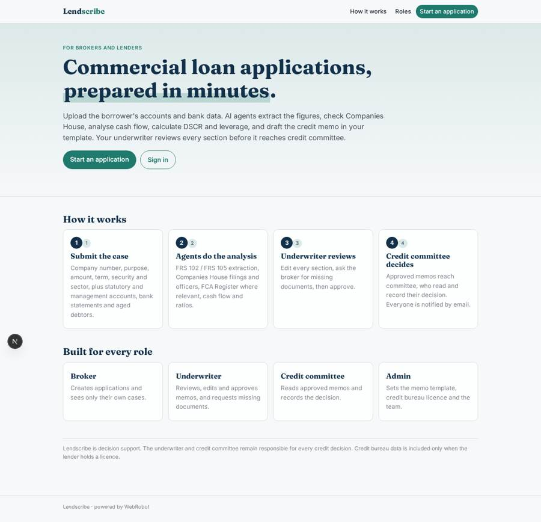
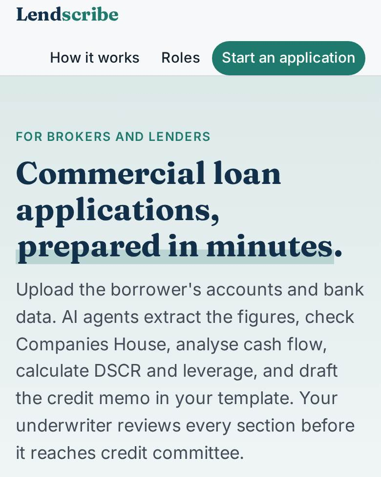
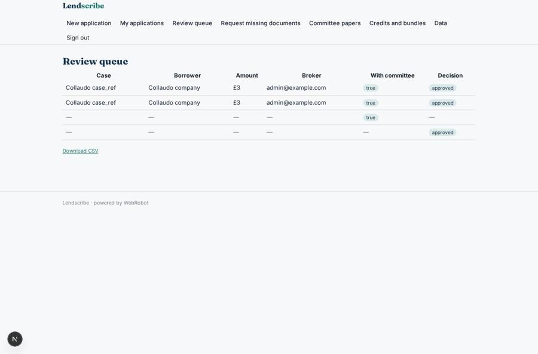
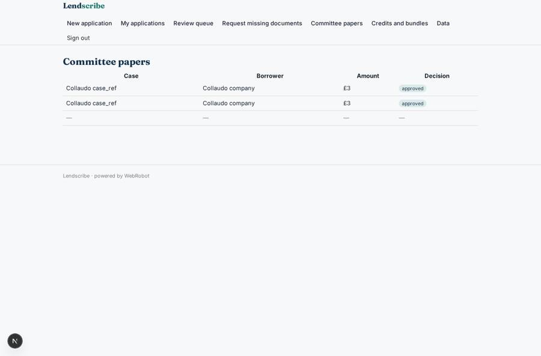
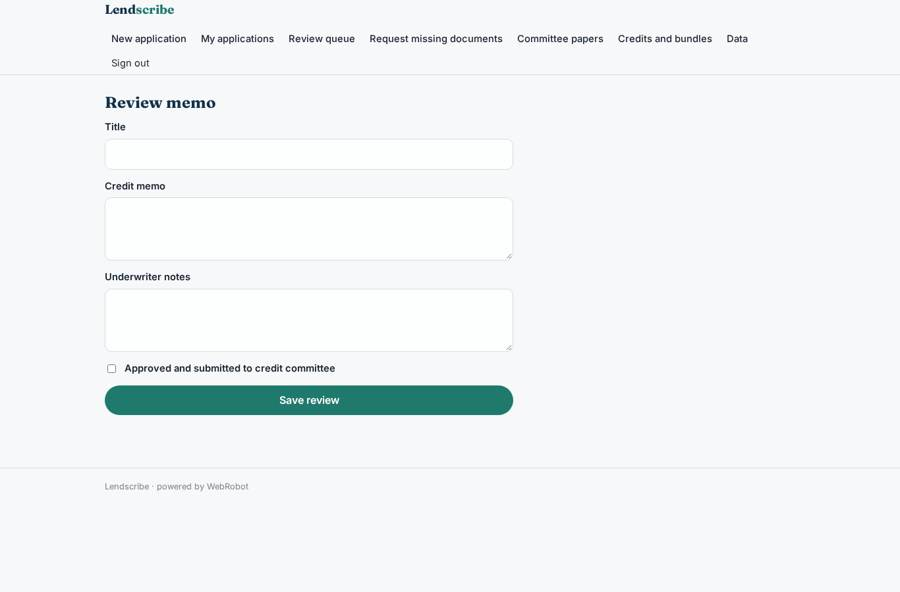
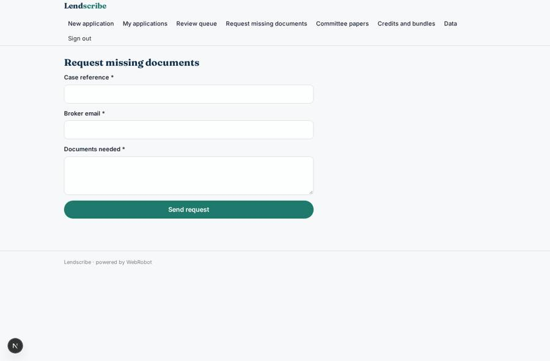

# Lendscribe

_Commercial loan applications prepared in minutes._

**Sector:** Fintech, proptech, insurtech · **Manifest:** valid (schema + runtime contract) · **Functional test:** passed (21 checks passed)

## Description given to the app builder

We need Lendscribe, an app that prepares commercial loan applications for lenders and brokers in minutes. A broker or lender signs up as an organisation; a broker creates an application with a form (borrower company number, loan purpose, amount, term, security offered, sector) and uploads the borrower's statutory accounts, management accounts, bank statements and aged debtor lists. The borrower can also connect its bank account through Open Banking via an authorised AISP partner so twelve months of transactions arrive directly. Agents extract figures from FRS 102 and FRS 105 accounts, pull filed iXBRL accounts and officers from Companies House, check the FCA Register where relevant, analyse cash flow from the bank data, calculate debt service cover and leverage, and write a credit memo in the lender's template with strengths, risks and mitigants. Credit bureau data is added only if the lender has a licence. The underwriter reviews every section, edits, asks the broker for missing documents and approves the memo before it is submitted to credit committee. Roles: broker (own cases), underwriter, credit committee (read and decide), admin. Email notifications at each stage. Pricing: per application, with monthly bundles. English.

## Functional test: what did not pass

- **trigger has its effect** (trigger memo_drafted): email to role:underwriter: no such recipient in the test (role nobody holds or empty field) _(warning)_

## Navigation recording

Signed in as the app's admin, the recorder opened 6 menu page(s): New application, My applications, Review queue, Request missing documents, Committee papers, Credits and bundles.
- agent run did not open: new: the run did not open
- data page empty: applications (history)

Empty data pages are mostly expected on the local runtime: agents are mocked there, so the collections they fill stay empty.

## Features not expressible today (spec.extensions)

- **open_banking_aisp**: Borrower consent flow and 12-month transaction feed from an authorised AISP partner needs OAuth/redirect consent, which is not available yet. For now bank statements are uploaded as PDF or CSV; a partner export can be dropped into the same field. A webhook trigger can later save the AISP's transactions as records.
- **fca_register_api**: The FCA Register API needs two auth headers, which a credential cannot carry yet. The agent checks the public FCA Register through the WebRobot MCP instead.
- **credit_bureau_api**: Credit bureau data is not connected. The memo includes bureau data only when the admin sets bureau_licensed in lender settings and the data is supplied; a licensed bureau API key tool can be added per lender.

## Screenshots (interpretive runtime, test data)

### home-anon

### home-mobile

### queue

### committee

### review

### request_docs

