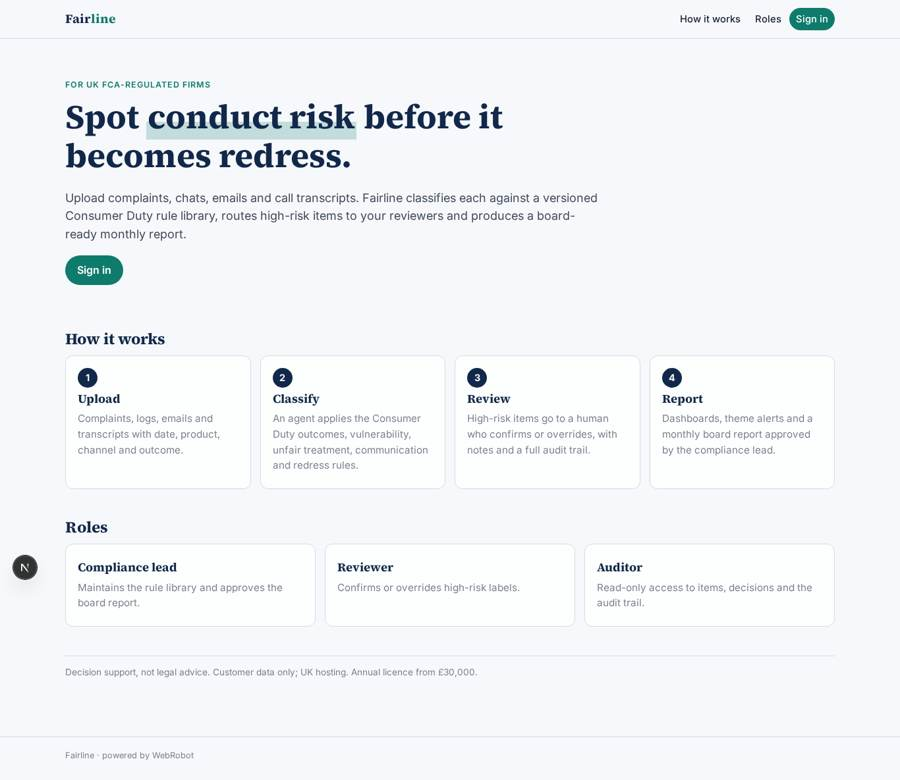
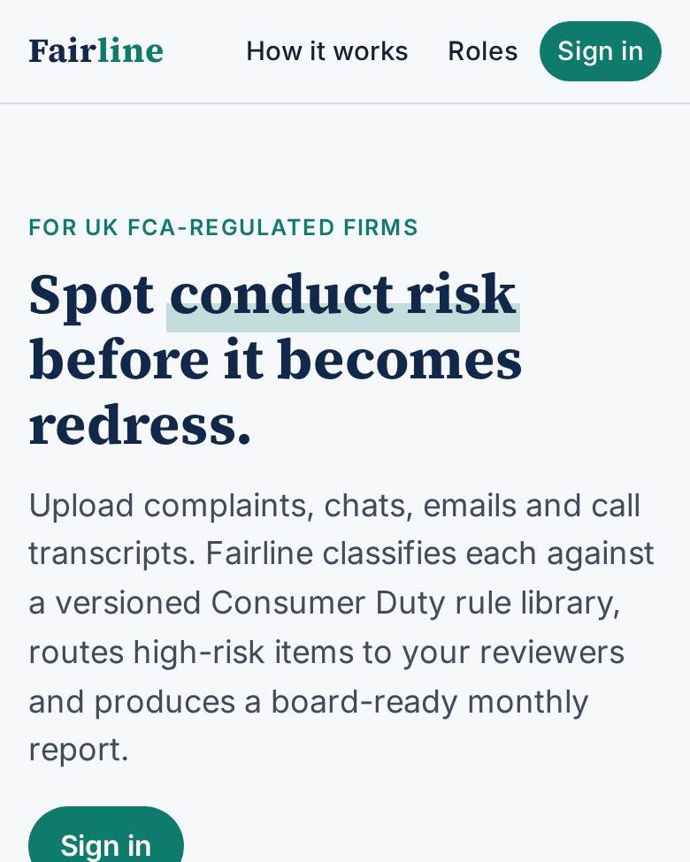
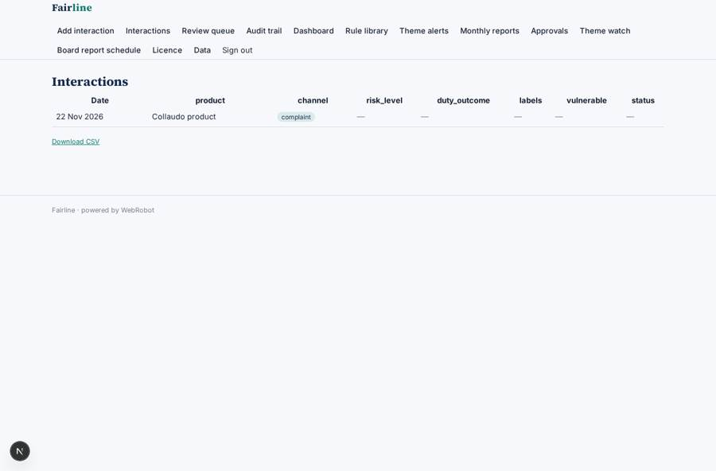
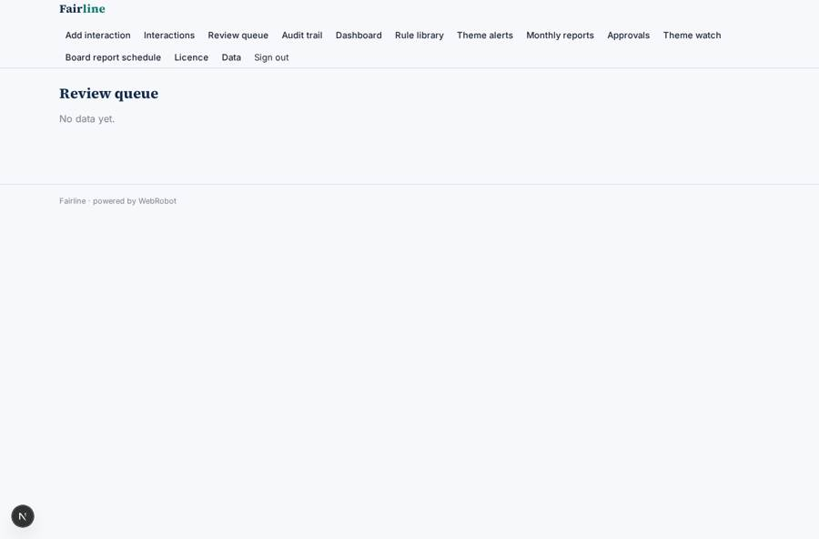
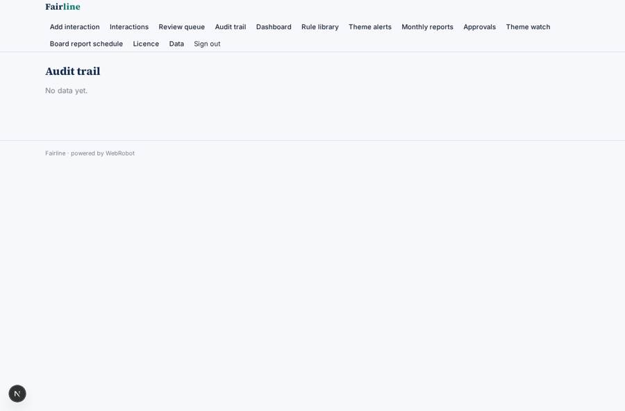
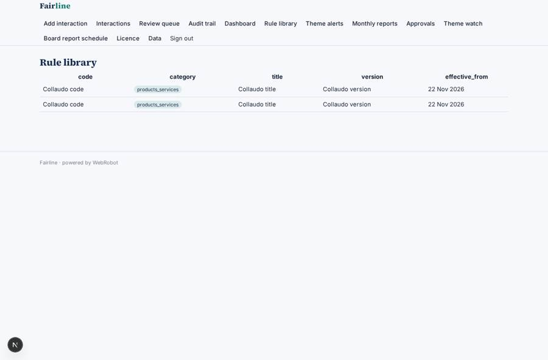

# Fairline

_Consumer Duty conduct-risk analysis for complaints and customer conversations._

**Sector:** Data, media, cyber, devtools · **Manifest:** valid (schema + runtime contract) · **Functional test:** passed (26 checks passed)

## Description given to the app builder

I want an app called Fairline that helps UK regulated firms analyse complaints and customer conversations for conduct risk under the FCA Consumer Duty. A bank, insurer or lender signs up and uploads complaints, chat logs, emails and call transcripts, or connects its CRM and contact-centre system through OAuth as the real product does. The real product also ingests call recordings and transcribes the audio; I want that too. Each record stores date, product, channel, outcome and text. An agent classifies each item against a rule library: the four Consumer Duty outcomes, vulnerability indicators, unfair treatment, poor communication and potential redress. The rule library is UK regulatory content that compliance staff maintain and version. Items flagged as high risk go to a human reviewer, who confirms or overrides the label and adds notes; every decision is kept in an audit trail. Dashboards show risk themes by product, trends, vulnerable-customer cases and time to resolution, and produce a board-ready monthly Consumer Duty report that the compliance lead must approve. Alerts email the risk team when a theme rises. Roles: admin, compliance lead, reviewer, read-only auditor. Pricing: annual licence from £30,000. English only. Customer data only, kept in the UK.

## Functional test: what did not pass

- **form saves a record** (form review): only role reviewer may fill it, and the test cannot hold that role _(warning)_
- **form saves a record** (form override): only role reviewer may fill it, and the test cannot hold that role _(warning)_
- **template instance created and run** (template monthly_report): reserved to compliance_lead/admin _(warning)_
- **template instance created and run** (template theme_watch): reserved to compliance_lead/admin _(warning)_
- **page opened by a role allowed to** (view review): only role reviewer/compliance_lead may open it, the test cannot hold it _(warning)_
- **page opened by a role allowed to** (view override): only role reviewer/compliance_lead may open it, the test cannot hold it _(warning)_

## Navigation recording

Signed in as the app's admin, the recorder opened 7 menu page(s): Add interaction, Interactions, Review queue, Audit trail, Dashboard, Rule library, Theme alerts.
- data page empty: review_queue (table)
- data page empty: audit (table)
- data page empty: alerts (table)

Empty data pages are mostly expected on the local runtime: agents are mocked there, so the collections they fill stay empty.

## Features not expressible today (spec.extensions)

- **crm_oauth**: OAuth connection to CRM and contact-centre systems is not available yet; data comes in by upload (files and pasted text) or a webhook trigger.
- **audio_transcription**: Call recording ingestion and audio transcription is not available yet; upload transcripts (pdf, docx, txt, csv). Audio files are not accepted.
- **uk_data_residency**: UK-only data hosting is a deployment/contract setting of the platform, not expressible in the manifest; confirm UK region before publishing.
- **single_firm_deployment**: Staff roles (reviewer, compliance lead, auditor) see all records of the app, so deploy one app per licensed firm.
- **rule_library_maintenance**: Compliance staff maintain and version the rule library on the built-in admin data page (new version = new records with version and effective_from).

## Screenshots (interpretive runtime, test data)

### home-anon

### home-mobile

### items

### review_queue

### audit

### rules

