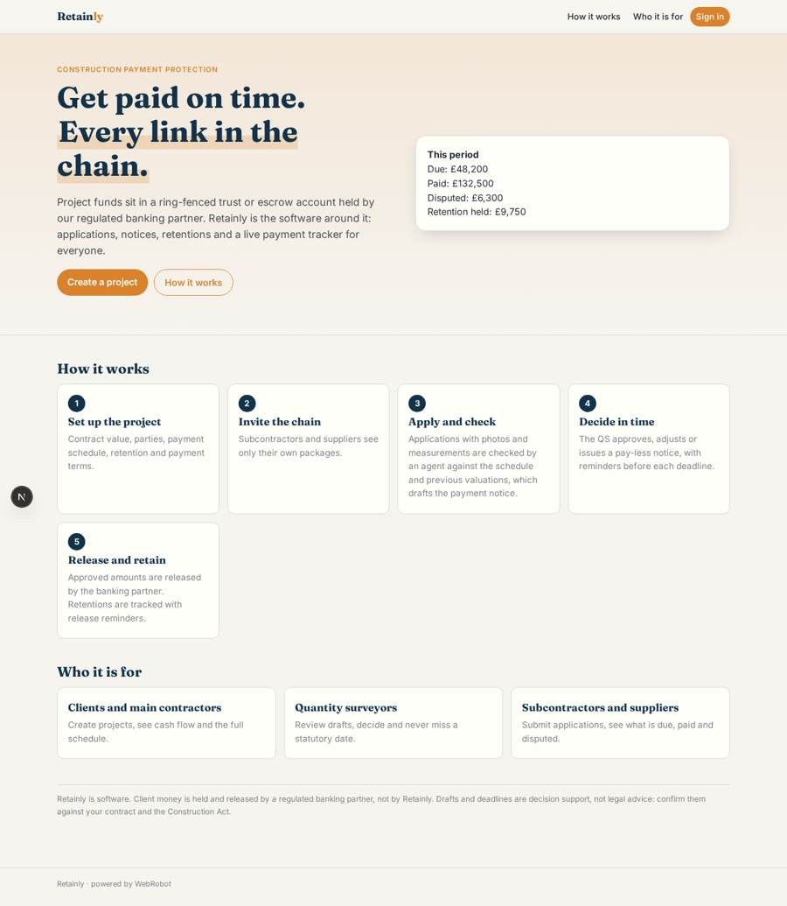
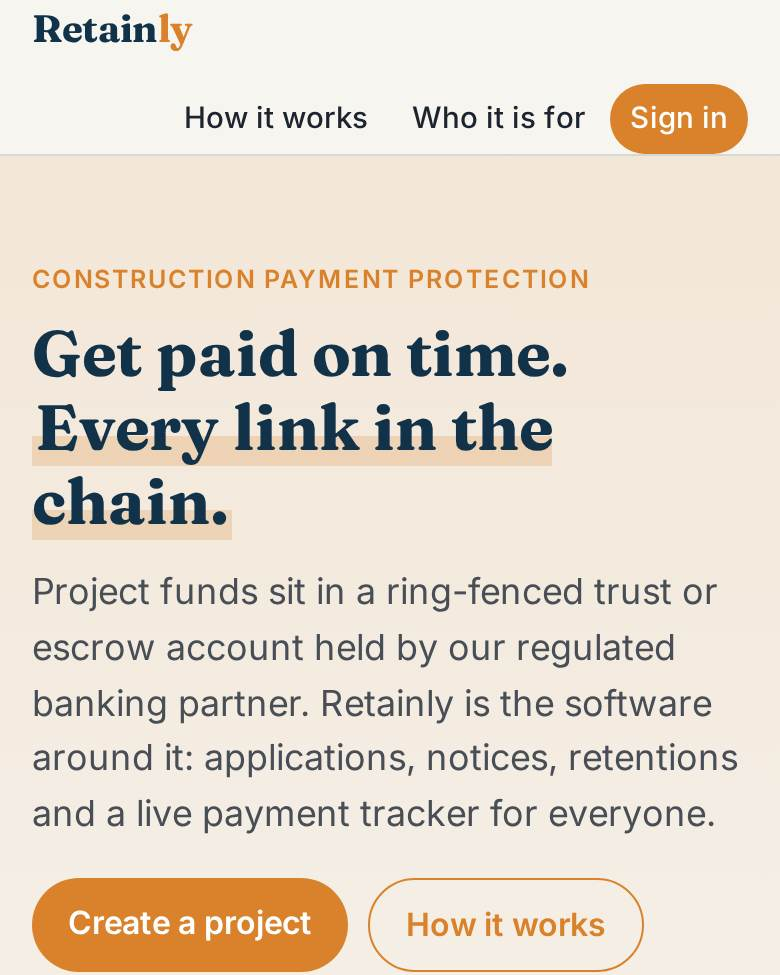
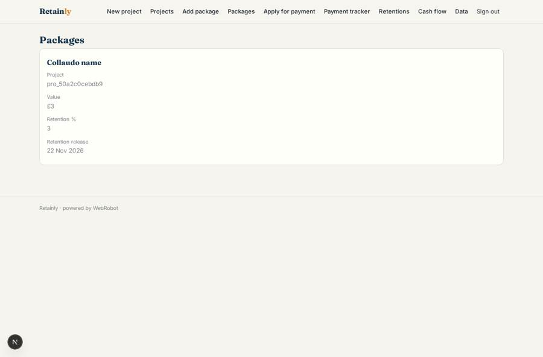
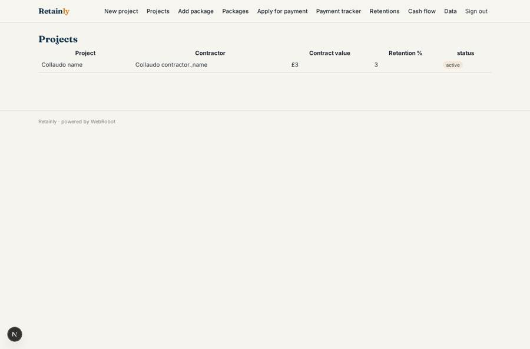
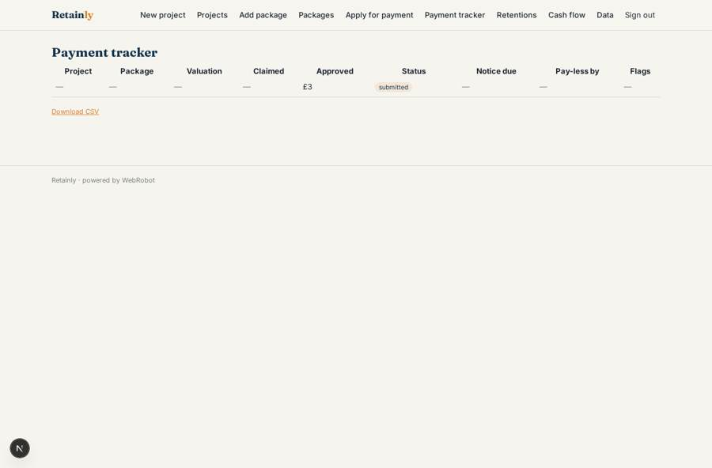
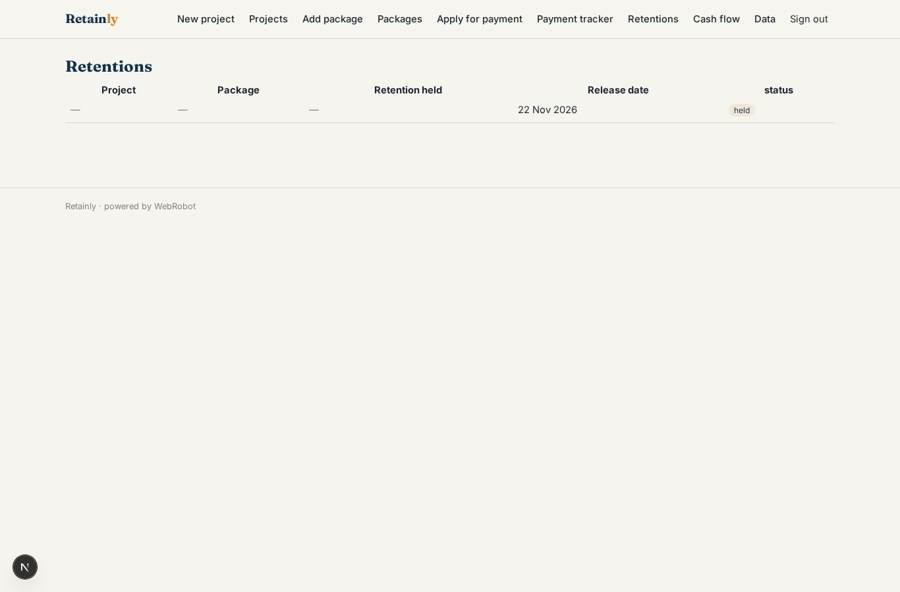

# Retainly

_Protected project payments for construction supply chains._

**Sector:** Fintech, proptech, insurtech · **Manifest:** valid (schema + runtime contract) · **Functional test:** 1 failure(s) (20 checks passed)

## Description given to the app builder

We want Retainly, which protects payments in construction supply chains by ring-fencing project funds. Holding client money in a ring-fenced trust or escrow account is done by our regulated banking partner; I need the software around it. A client or main contractor signs up and creates a project with a form: contract value, parties, payment schedule, retention percentage, payment terms under the Construction Act. Subcontractors and suppliers are invited and see their own packages. Each period, subcontractors submit applications for payment with supporting photos and measurements; an agent checks them against the schedule and previous valuations and drafts the payment notice. The contractor's quantity surveyor approves, adjusts or issues a pay-less notice within the statutory timetable, with reminders before deadlines. Approved amounts are released from the protected account by the partner. Retentions are tracked with release dates and automatic reminders. A payment schedule tracker shows what is due, paid and disputed for everyone in the chain. Roles: client, main contractor, QS, subcontractor, supplier, admin. Dashboards show cash flow per project. Pricing: percentage of project value protected. English.

## Functional test: what did not pass

- **form can be filled (options, uploads)** (form apply): required package (options from collection:packages) has no option to choose
- **saved record shown where its collection is read** (view applications): a record was saved in applications (by admin) but the page does not show it (as user) _(warning)_
- **saved record shown where its collection is read** (view retentions): a record was saved in retentions (by user) but the page does not show it (as user) _(warning)_

## Navigation recording

Signed in as the app's admin, the recorder opened 7 menu page(s): New project, Projects, Add package, Packages, Apply for payment, Payment tracker, Retentions.
No issue found.

Empty data pages are mostly expected on the local runtime: agents are mocked there, so the collections they fill stay empty.

## Features not expressible today (spec.extensions)

- **fee_on_protected_value**: Pricing is a percentage of project value protected (configured as 0.5%); the fee base is the funded value of each project, which needs a billing rule tied to the banking partner's funding events.
- **partner_release_sync**: Funding and release events from the banking partner arrive on the partner_hook webhook and are stored in the admin-only partner_events collection. Matching them to applications automatically needs custom mapping; for now the QS records the release reference on the decision.
- **decision_links**: The decision and retention update forms open as /v/decide?id=<record>; a button on each tracker row that opens them is not available yet.
- **stat_dates**: Deadlines use contract or Scheme defaults (7 days to due date, 17 days to final date, pay-less notice 5 days before) set per project and package; the QS must confirm them against the contract.

## Screenshots (interpretive runtime, test data)

### home-anon

### home-mobile

### packages

### projects

### applications

### retentions

