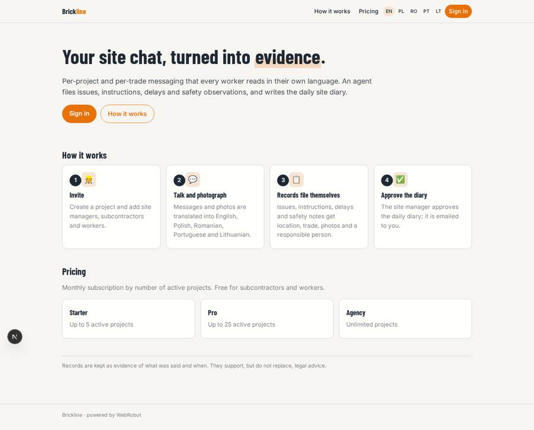
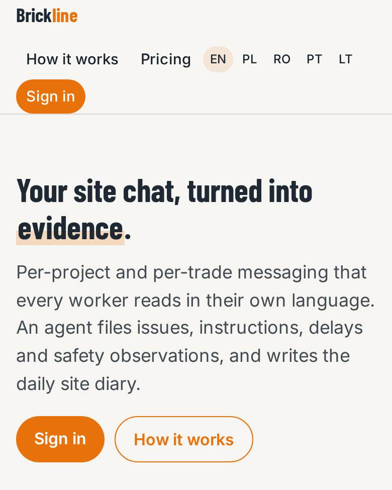
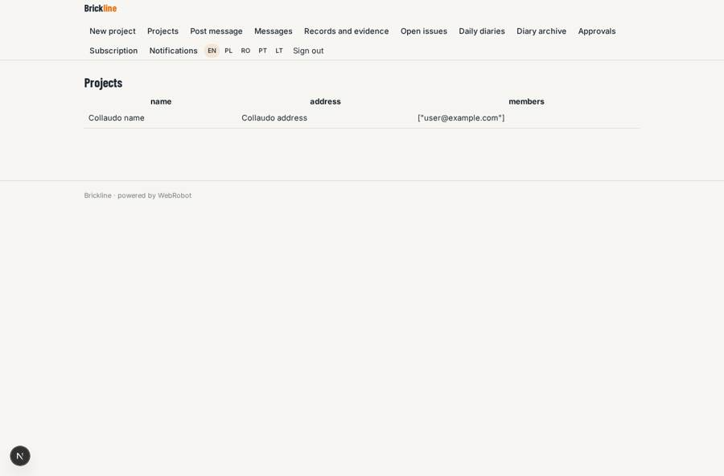
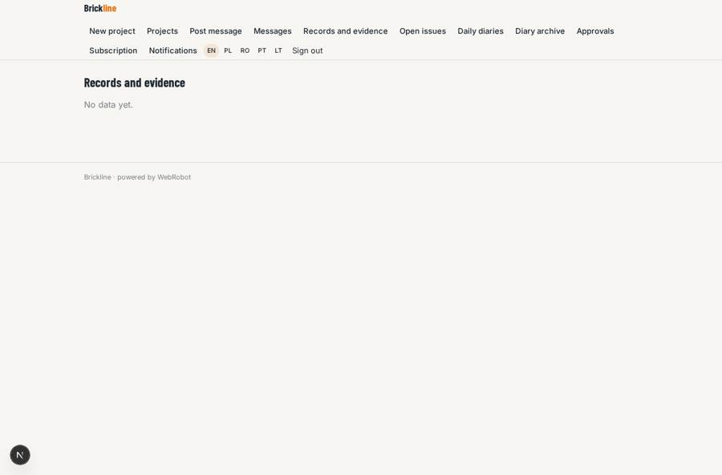
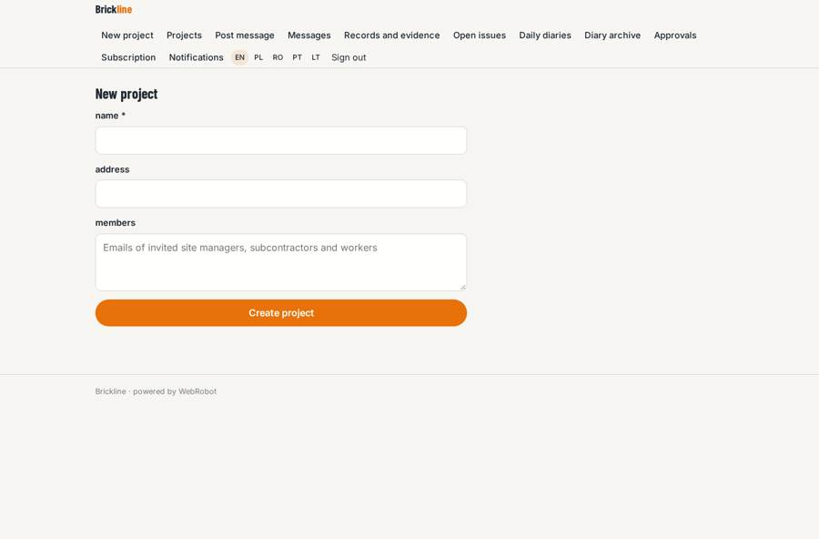
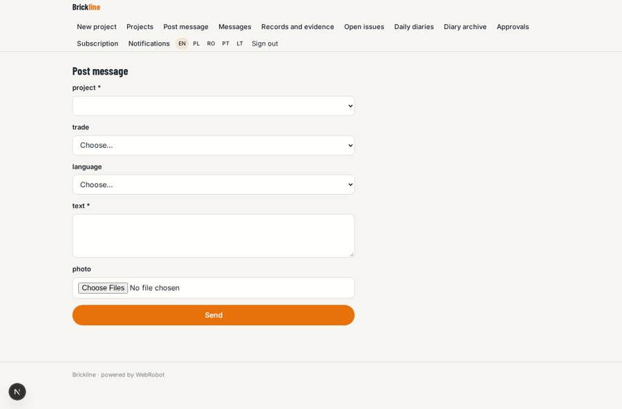

# Brickline

_Site communication that turns chat into evidence._

**Sector:** Fintech, proptech, insurtech · **Manifest:** valid (schema + runtime contract) · **Functional test:** passed (17 checks passed)

## Description given to the app builder

We need Brickline, a communication app for construction sites that replaces WhatsApp groups. A contractor signs up, creates projects and invites site managers, subcontractors and workers by phone number. Everyone uses a phone app with real-time messaging per project and per trade, photos from the camera, voice notes and push notifications. Many workers speak different languages, so every message and voice note is transcribed and translated automatically into each reader's language (English, Polish, Romanian, Portuguese, Lithuanian and others). An agent turns conversations into records: it detects issues, instructions, delays and safety observations, files them as structured entries with location, trade, photos and responsible person, and produces a daily site diary for the site manager to review and approve. Instructions that change scope are flagged for the project manager's approval. Roles: company admin (all projects), project manager, site manager, subcontractor (own trade), worker. Everything is searchable as evidence for disputes, and the daily diary is emailed as PDF. Dashboards show open issues per project. Pricing: monthly subscription per active project, free for subcontractors and workers. English plus the translated languages.

## Navigation recording

Signed in as the app's admin, the recorder opened 7 menu page(s): New project, Projects, Post message, Messages, Records and evidence, Open issues, Daily diaries.
- data page empty: records (table)

Empty data pages are mostly expected on the local runtime: agents are mocked there, so the collections they fill stay empty.

## Design checks (linter)

- mobile.capabilities: a share button (view feed) needs 'share' in the phone app

## Features not expressible today (spec.extensions)

- **voice_notes**: Voice notes with transcription are not available yet: audio files cannot be uploaded or read by the agents. Needs an audio file type and a speech-to-text tool.
- **realtime_chat**: Real-time group messaging per project/trade is approximated by a message form and list; no live chat rooms yet.
- **phone_invites**: Invitations by phone number (SMS/WhatsApp) are not available; members are added by email.
- **reader_language**: Messages carry all five translations as columns; showing only each reader's own language and adding other languages needs custom code.
- **pdf_diary_email**: The diary email is plain text with a link to the printable report; attaching a PDF is not available yet.
- **per_project_price**: Subscription is tiered by number of active projects; exact per-active-project billing is not available.

## Screenshots (interpretive runtime, test data)

### home-anon

### home-mobile

### projects

### records

### new_project

### post

