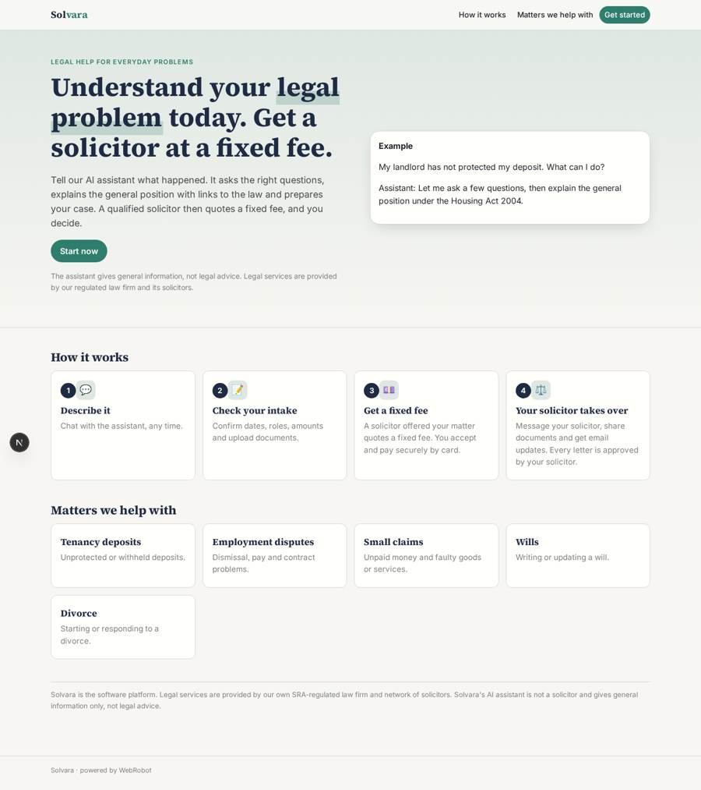
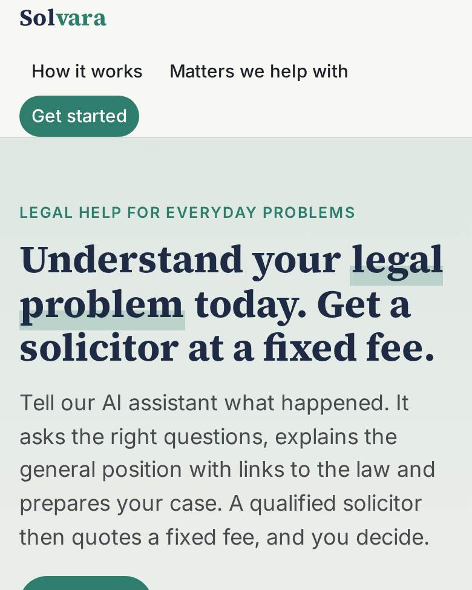
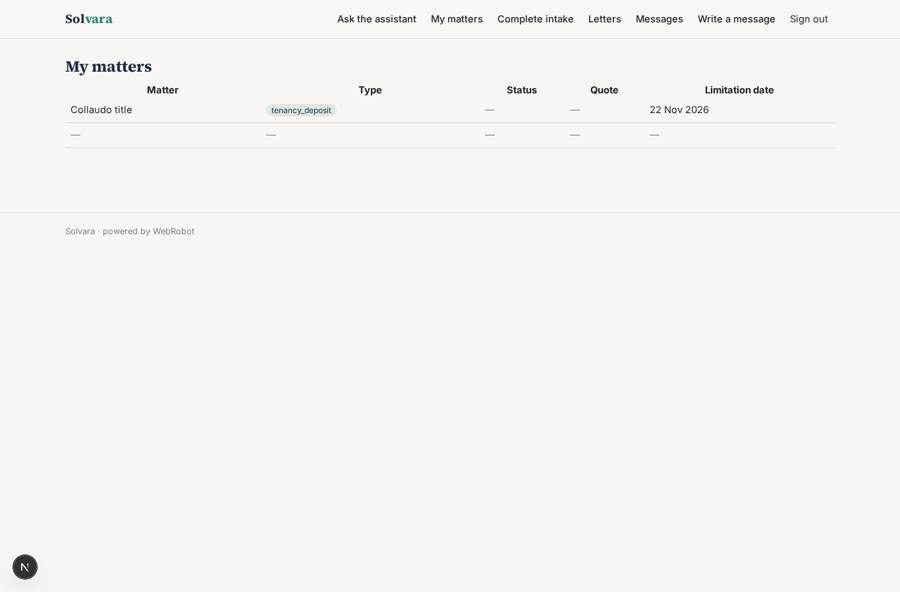
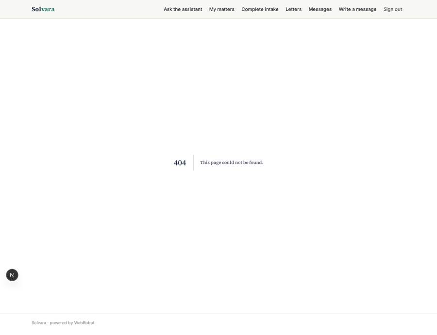
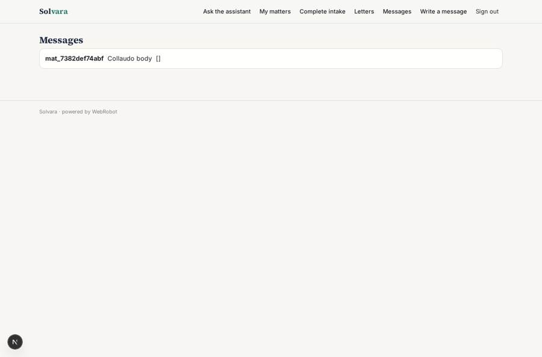

# Solvara

_Everyday legal problems, explained by AI and handled by qualified solicitors._

**Sector:** B2B AI and SaaS · **Manifest:** valid (schema + runtime contract) · **Functional test:** passed (25 checks passed)

## Description given to the app builder

I want Solvara, a consumer legal service where people get help with everyday legal problems from an AI assistant backed by qualified solicitors. Part of this is outside the software: the legal work itself is done by our own regulated law firm and a network of solicitors, which needs SRA authorisation and covers reserved legal activities; I need the software around it. A consumer signs up and describes the problem in a chat; an agent asks follow-up questions, classifies the matter (tenancy deposit, employment dispute, small claim, will, divorce), explains the general position with references to legislation.gov.uk and states clearly that this is not advice. It then fills an intake form with dates, parties' roles, amounts and documents uploaded. Matters go to a queue where solicitors see only matters offered to them, quote a fixed fee and accept. The consumer pays through Stripe, and the platform takes a commission with the rest paid to the solicitor. Solicitor and client exchange messages and documents in the case; every letter drafted by the agent must be approved by the solicitor. Email updates at each stage, reminders for deadlines and limitation dates. Admin dashboard of matters, conversion and solicitor workload. English.

## Functional test: what did not pass

- **form saves a record** (form quote): only role solicitor may fill it, and the test cannot hold that role _(warning)_
- **form saves a record** (form request_letter): only role solicitor may fill it, and the test cannot hold that role _(warning)_
- **saved record shown where its collection is read** (view queue): a record was saved in matters (by user, user) but the page does not show it (as solicitor) _(warning)_

## Navigation recording

Signed in as the app's admin, the recorder opened 2 menu page(s): All matters, Dashboard.
No issue found.

Empty data pages are mostly expected on the local runtime: agents are mocked there, so the collections they fill stay empty.

## Features not expressible today (spec.extensions)

- **sra_regulation**: Legal work and reserved activities are done by the owner's own SRA-authorised law firm and solicitors; the app only provides software around it. Terms, engagement letters and complaints process to be supplied by the firm.
- **quote_checkout**: Paying the accepted fixed fee by Stripe (platform commission, remainder to the solicitor) and moving the matter to 'paid' needs a checkout tied to the quote. The commission is set as the per-transaction fee; the exact checkout flow may need custom work.
- **matter_offer**: Admins offer a matter by setting status 'offered' and the solicitor's email on the built-in data page. Automatic matching by speciality and workload is not available; the participants' emails in messages are entered on the form.
- **sms_notifications**: SMS, WhatsApp and push messages are not available yet; updates go by email.

## Screenshots (interpretive runtime, test data)

### home-anon

### home-mobile

### my_matters

### queue

### letters_list

### messages

