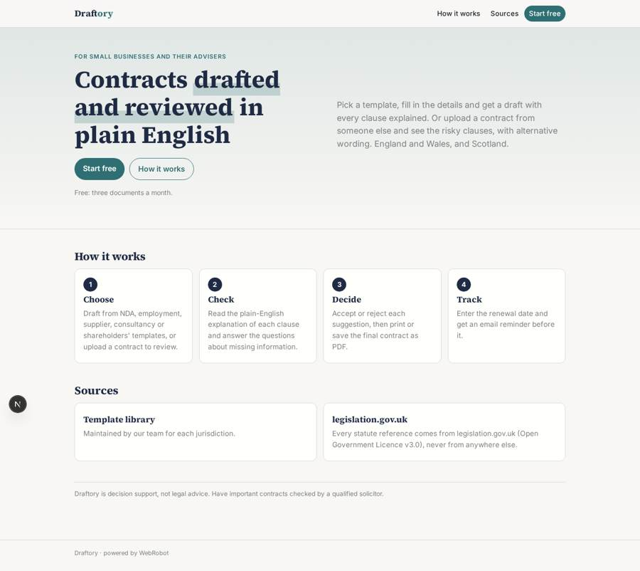
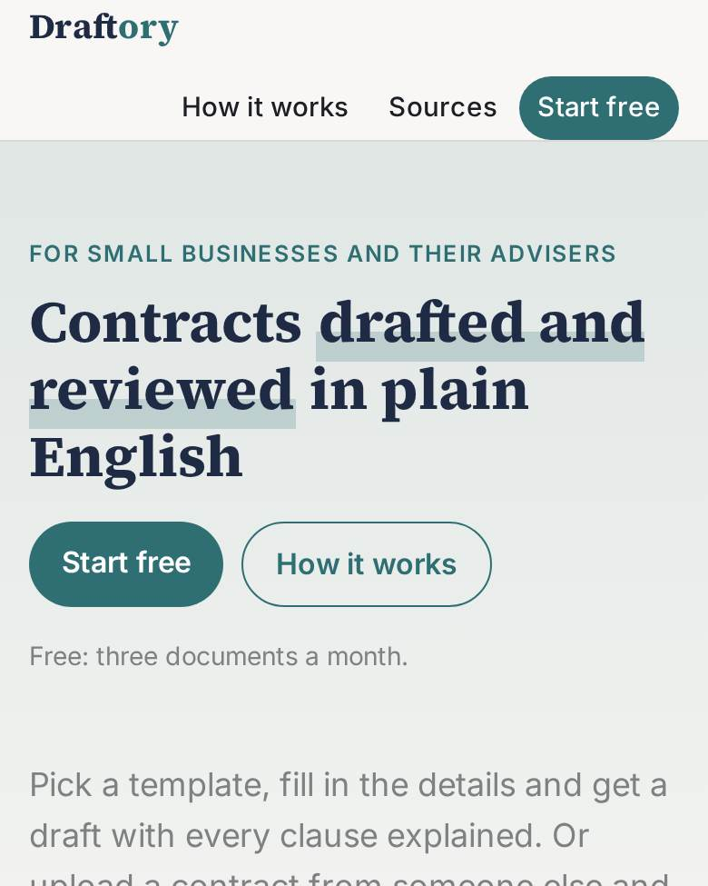
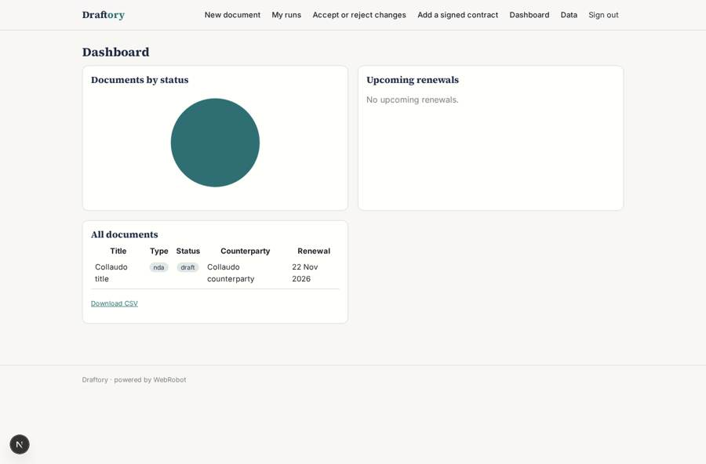
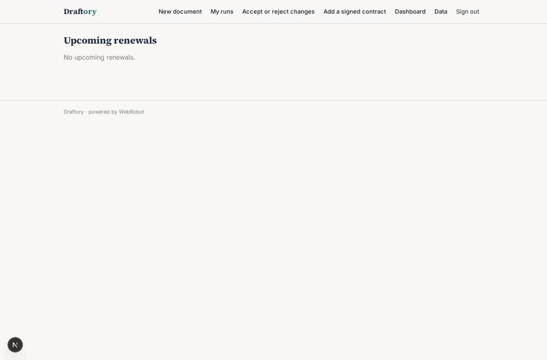
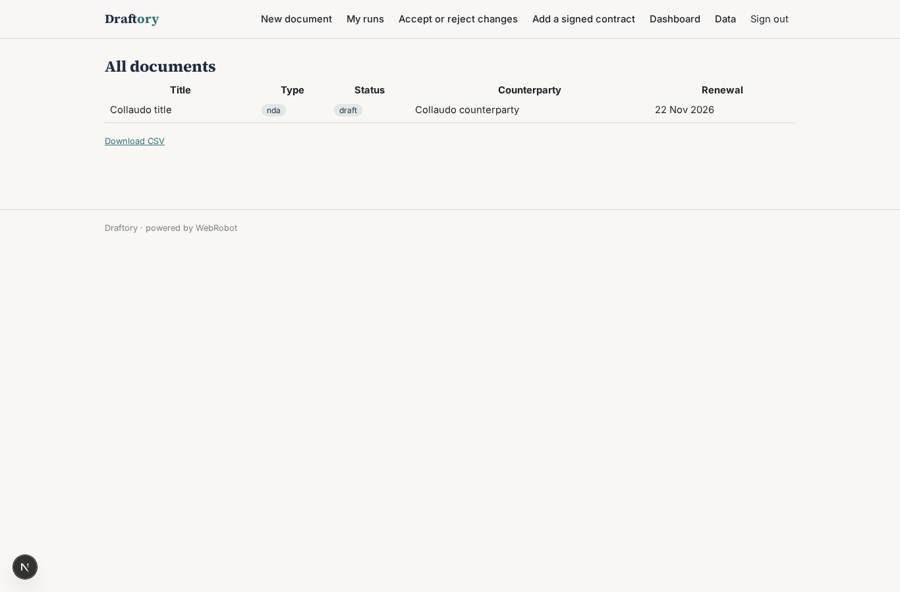
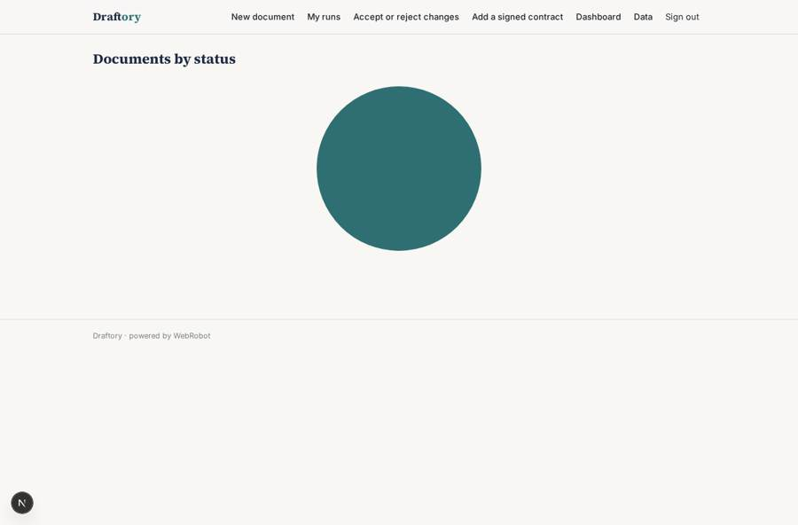

# Draftory

_Draft and review contracts in plain English._

**Sector:** B2B AI and SaaS · **Manifest:** valid (schema + runtime contract) · **Functional test:** passed (13 checks passed)

## Description given to the app builder

We need Draftory, a self-serve assistant that lets small businesses and their advisers draft and review contracts. Anyone can sign up with email; each account can invite colleagues, who share the account's documents, while our admin manages the template library. A user picks a template (NDA, employment contract, supplier agreement, consultancy, shareholders' agreement) and fills a form: parties, jurisdiction (England and Wales or Scotland), dates, fees, term, notice period, special terms. An agent drafts the contract from the template library, explains each clause in plain English and flags missing information as questions. In review mode the user uploads a third-party contract and says which side they are on; the agent lists risky clauses, suggests alternative wording and produces a summary table. The user accepts or rejects each suggestion before downloading the final Word or PDF file. References to statutes come from legislation.gov.uk only. An optional Microsoft Word add-in, where users connect their own Microsoft account, would let them run reviews without leaving Word. Email reminders for contract renewal dates entered by the user, and a dashboard of drafts, signed contracts and upcoming renewals. Pricing: free tier with three documents a month, then monthly subscription plans via Stripe. English.

## Functional test: what did not pass

- **saved record shown where its collection is read** (view by_status): a record was saved in contracts (by user) but the page does not show it (as user) _(warning)_

## Navigation recording

Signed in as the app's admin, the recorder opened 5 menu page(s): New document, My runs, Accept or reject changes, Add a signed contract, Dashboard.
- agent run did not open: new: the run did not open

Empty data pages are mostly expected on the local runtime: agents are mocked there, so the collections they fill stay empty.

## Features not expressible today (spec.extensions)

- **word_addin**: The optional Microsoft Word add-in needs sign-in with the user's own Microsoft account (OAuth), which is not available yet. Reviews run from the web app for now.
- **word_export**: Download as a Word (.docx) file is not available yet. The final contract is a printable report that can be saved as PDF; Word export needs custom code.
- **per_suggestion_decisions**: The approval is one accept or reject decision for the whole set of suggestions. Deciding each suggestion separately needs custom code.
- **account_invites**: Colleagues share documents through the members list on each document. A single account-wide invite list with automatic sharing of all documents is not available yet.

## Screenshots (interpretive runtime, test data)

### home-anon

### home-mobile

### dashboard

### renewals

### all_contracts

### by_status

