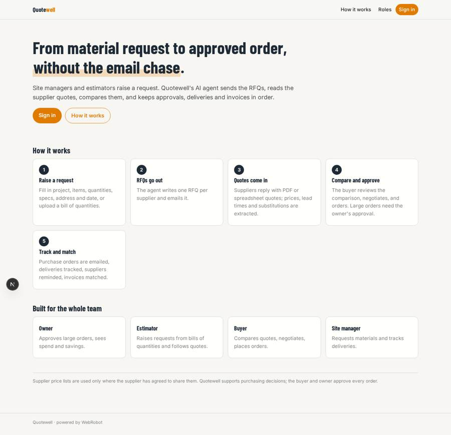
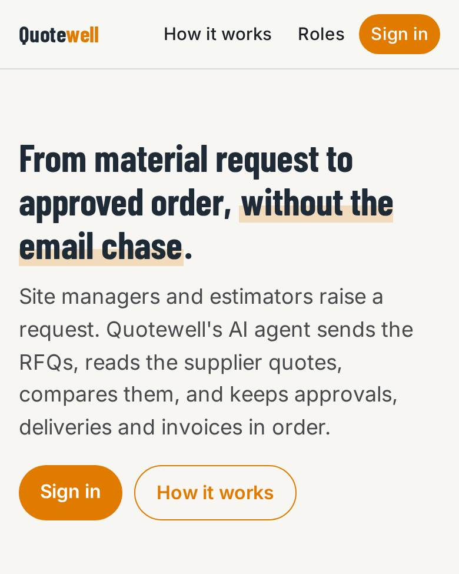
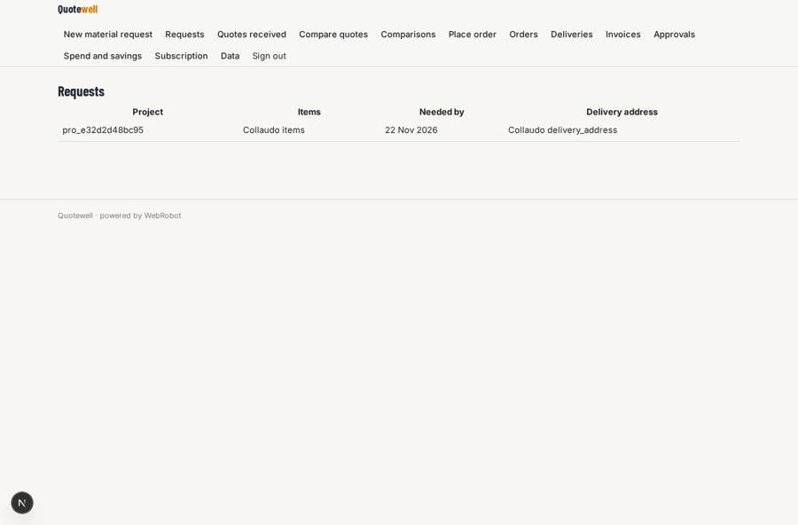
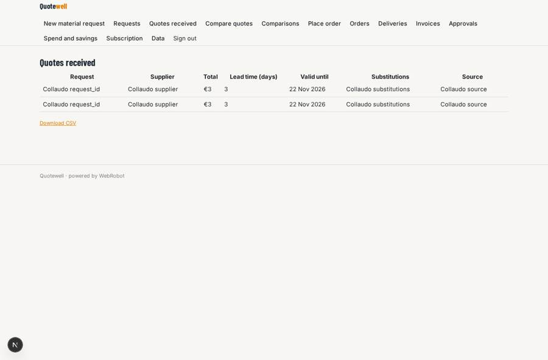
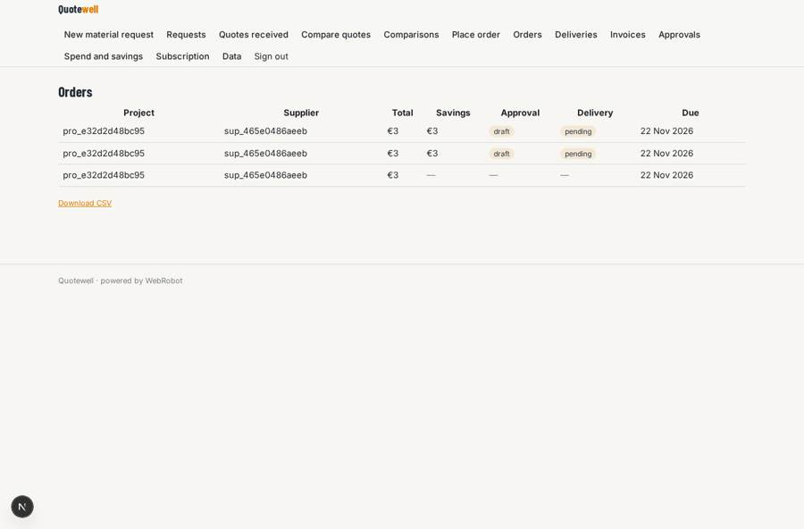
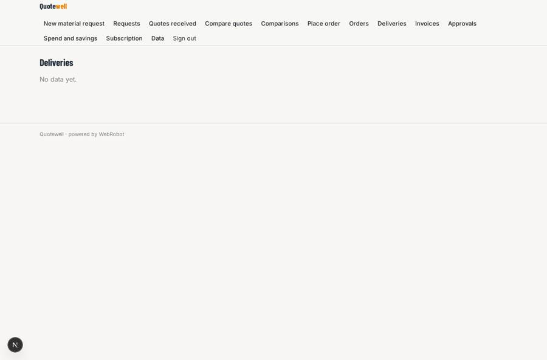

# Quotewell

_AI procurement for small and mid-size building contractors._

**Sector:** Fintech, proptech, insurtech · **Manifest:** valid (schema + runtime contract) · **Functional test:** passed (34 checks passed)

## Description given to the app builder

I want Quotewell, AI procurement for small and mid-size building contractors. The contractor signs up with roles for owner, estimator, buyer and site manager. A site manager or estimator raises a material request with a form: project, items, quantities, specifications, delivery address, required date, or uploads a bill of quantities or drawing schedule. An agent turns it into requests for quotation and emails them to the contractor's chosen suppliers. Suppliers reply by email with PDF or spreadsheet quotes; the app receives these inbound emails, extracts prices, lead times and substitutions, and builds a comparison table highlighting the best overall option. Supplier price lists are used only where the supplier has agreed to share them. The buyer reviews the comparison, negotiates if needed, and approves the order; orders above a set value need the owner's approval. The approved purchase order is emailed to the supplier, deliveries are tracked, and the agent reminds suppliers before the due date. Invoices are matched against orders. Dashboards show spend by project and supplier and savings achieved. Pricing: monthly subscription by number of users. English.

## Navigation recording

Signed in as the app's admin, the recorder opened 7 menu page(s): New material request, Requests, Quotes received, Compare quotes, Comparisons, Place order, Orders.
No issue found.

Empty data pages are mostly expected on the local runtime: agents are mocked there, so the collections they fill stay empty.

## Features not expressible today (spec.extensions)

- **user_seat_limit**: The plan limits (5, 15, 40 users) are described in the plans but not enforced by the runtime; the owner invites users within the plan.
- **approval_threshold**: The owner approval threshold (10000) is written in the po_agent system prompt; change it there.
- **inbound_email_address**: The inbound mailbox for supplier replies is set when the email channel is activated; RFQs ask suppliers to reply to the same thread.

## Screenshots (interpretive runtime, test data)

### home-anon

### home-mobile

### my_requests

### quotes_table

### orders

### deliveries

