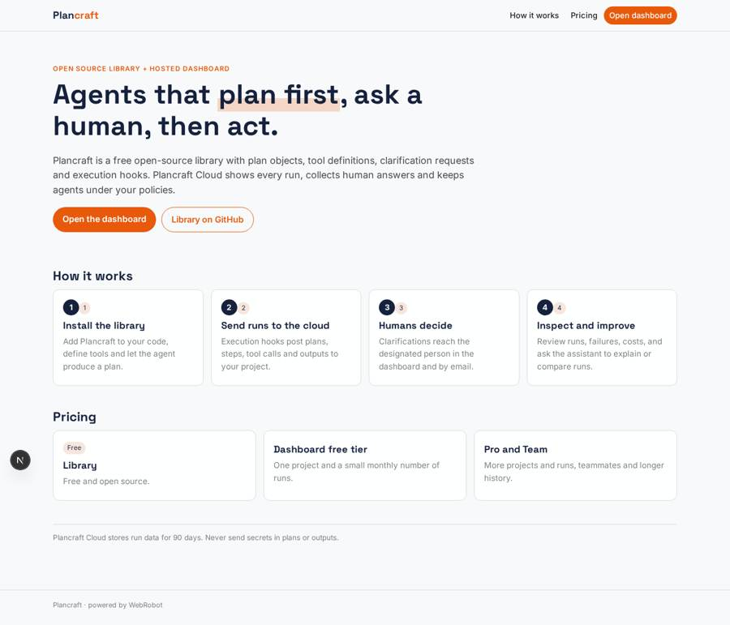
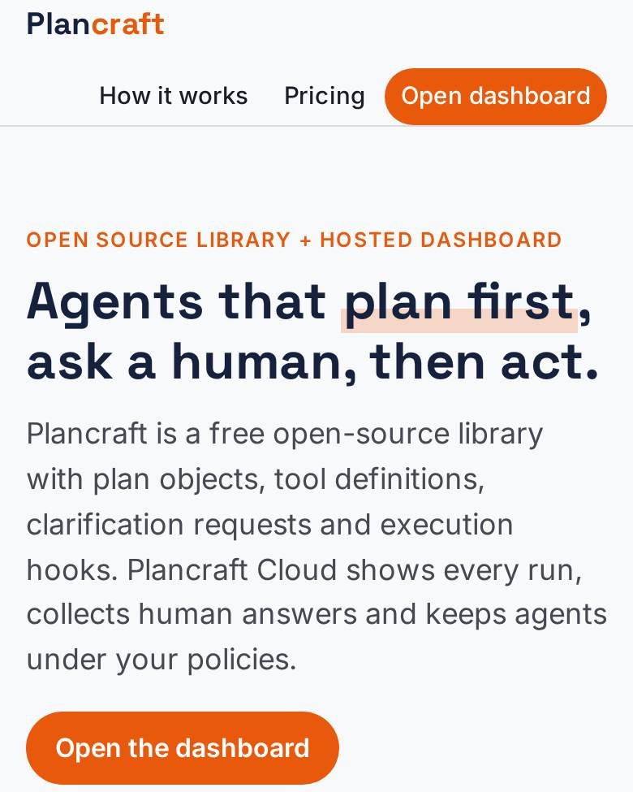
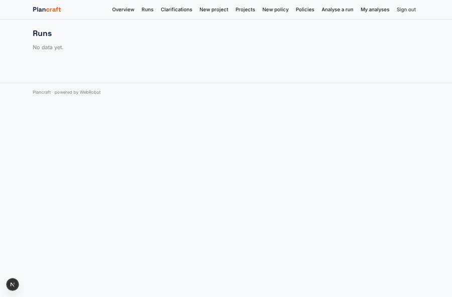
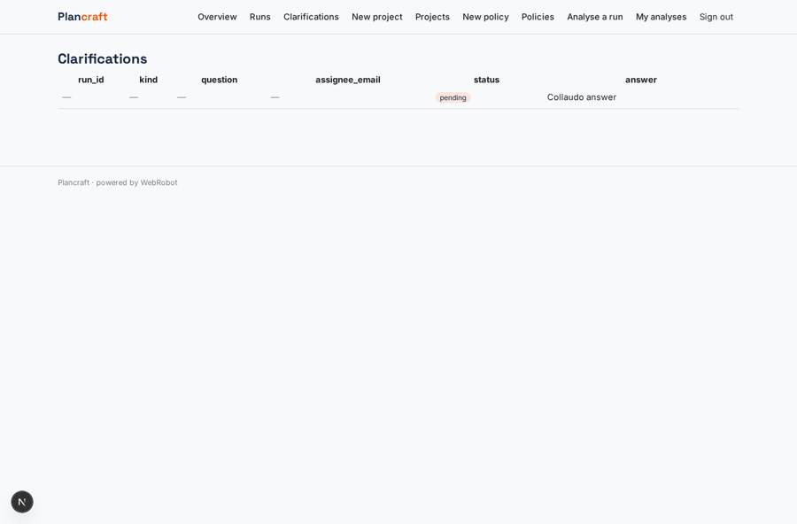
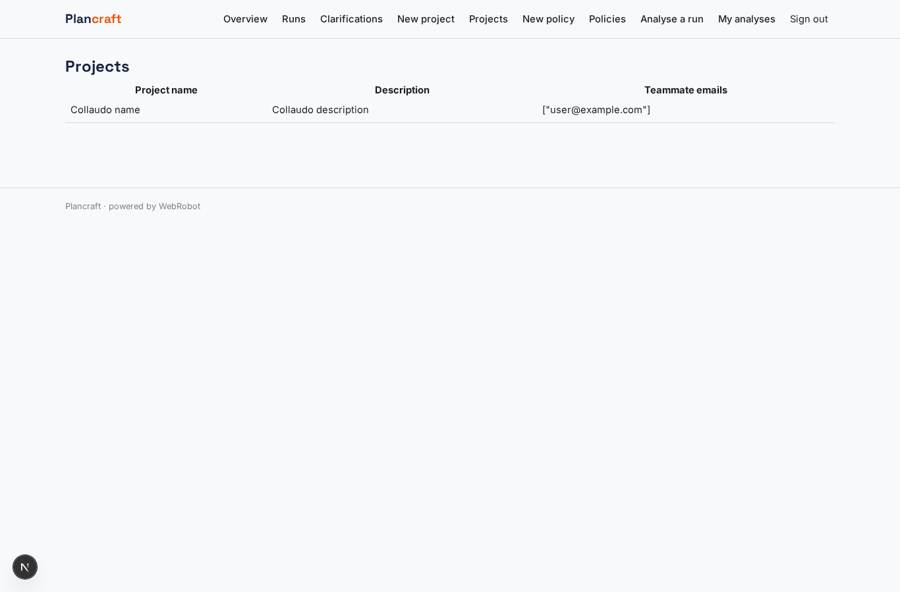
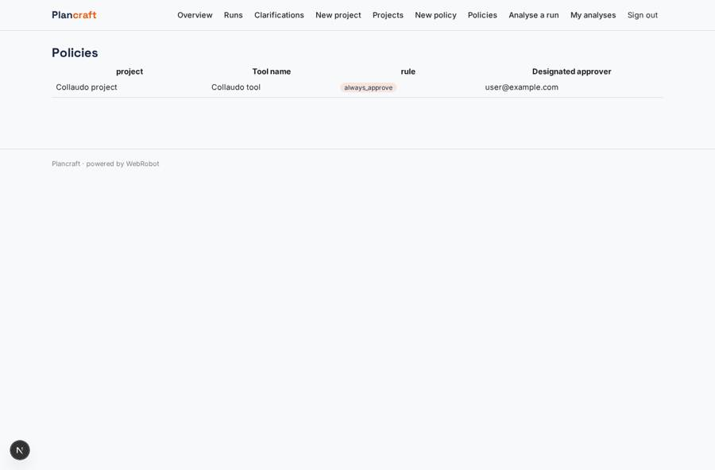

# Plancraft

_Hosted dashboard for agents that plan first, ask humans, then act._

**Sector:** B2B AI and SaaS · **Manifest:** valid (schema + runtime contract) · **Functional test:** 1 failure(s) (16 checks passed)

## Description given to the app builder

I want Plancraft, a developer framework for building controllable AI agents that plan first, ask humans for clarification, and only then act. The main product is outside an app: it is an open-source software library that developers install and call from their own code, with plan objects, tool definitions, clarification requests and execution hooks; I need the software around it. Around the library we need a hosted dashboard: developers sign up, create a project, get API keys, and invite teammates; each project sees only its runs. Every agent run sends its plan, steps, tool calls and outputs to the dashboard, where a developer can inspect them, replay a run and compare versions. When an agent needs a human decision (approve a payment, confirm a recipient, provide missing input) the clarification appears in the dashboard and by email, and the designated person answers there. Policies define which tools always need approval. Tool credentials are stored per end user so agents act with that user's permissions. Dashboards show runs, failures, clarifications pending and token costs. Pricing: free open-source library, hosted dashboard with a free tier and paid plans by number of runs. English.

## Functional test: what did not pass

- **run started and report ready** (view new_triage): required run (options from collection:agent_runs) has no option
- **trigger has its effect** (trigger clarification_email): email to record.assignee_email: no such recipient in the test (role nobody holds or empty field) _(warning)_

## Navigation recording

Signed in as the app's admin, the recorder opened 7 menu page(s): Overview, Runs, Clarifications, New project, Projects, New policy, Policies.
- data page empty: run_list (table)

Empty data pages are mostly expected on the local runtime: agents are mocked there, so the collections they fill stay empty.

## Features not expressible today (spec.extensions)

- **api_keys**: Per-project API keys, generated and revoked by developers, are not available yet: the library authenticates with the app's single webhook secret, so runs are attributed through the project and members fields it sends.
- **run_quota**: Free-tier and paid limits on runs ingested per month cannot be enforced on webhook writes yet; only project counts are limited.
- **replay_compare**: Replaying a run and diffing versions side by side is not available; the triage assistant compares runs in words.
- **end_user_credentials**: Per-end-user tool credentials for the developers' agents are not available: app credentials cover only the app's own users.
- **approval_enforcement**: Policies are stored and visible; enforcing them happens in the Plancraft library hooks, which read them.

## Screenshots (interpretive runtime, test data)

### home-anon

### home-mobile

### run_list

### clarifications

### projects

### policies

