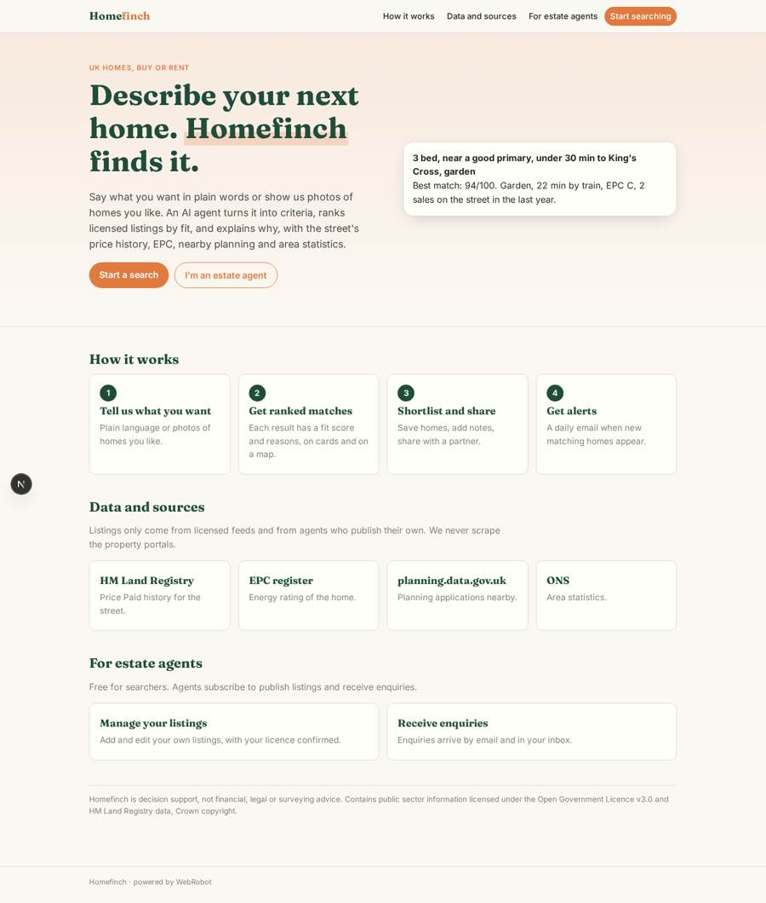
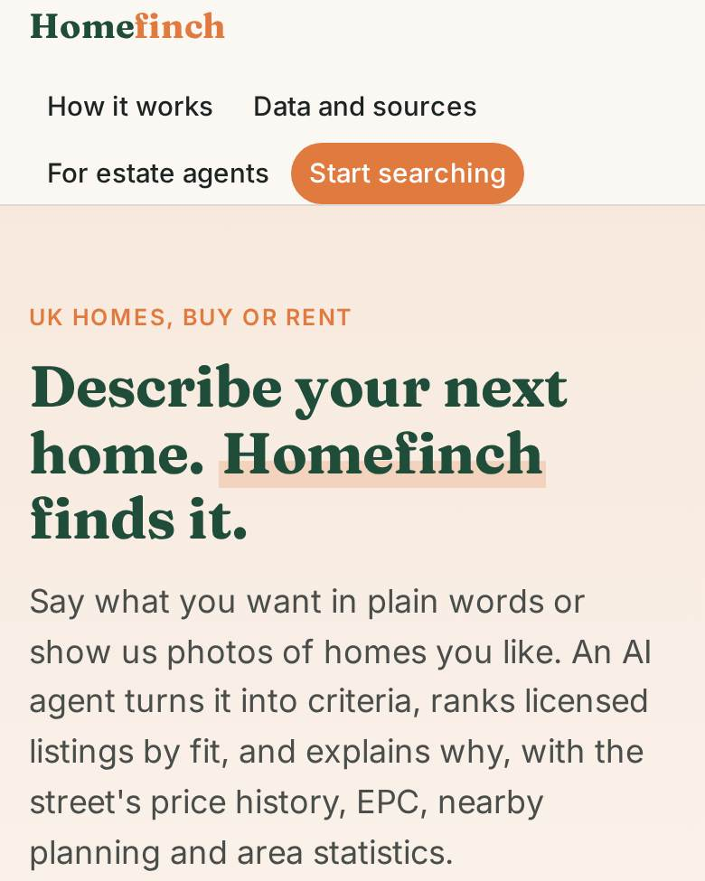
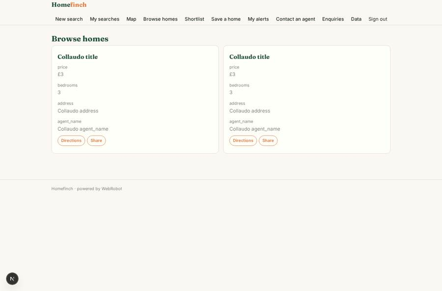
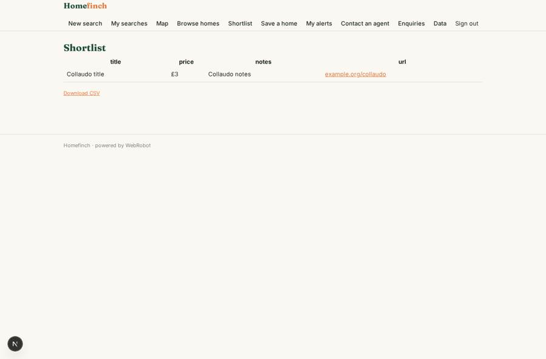
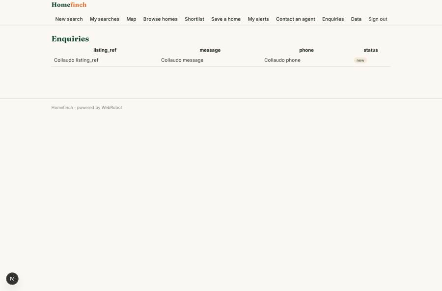
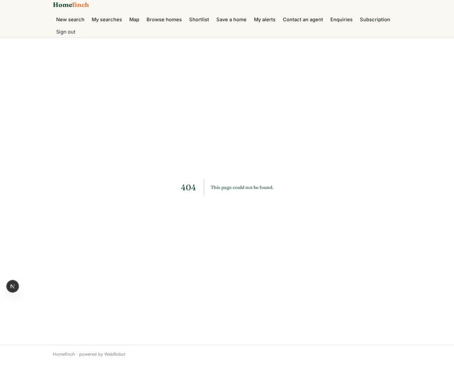

# Homefinch

_Describe your next home in plain words. Homefinch finds it._

**Sector:** Fintech, proptech, insurtech · **Manifest:** valid (schema + runtime contract) · **Functional test:** passed (21 checks passed)

## Description given to the app builder

I want Homefinch, an AI home-search agent for people buying or renting in the UK. Users sign up and describe what they want in plain language ("three bedrooms near a good primary school, under 30 minutes to King's Cross, a garden"), or upload photos of homes they like. The agent turns this into structured criteria and searches property listings, ranking them by fit and explaining why, including features recognised in listing photos. Listings must come from licensed feeds from estate agents or a listings data provider; the big portals forbid scraping, so the app only uses listing data where we have an agreement or the customer has a licence. Each result card is enriched with open data: HM Land Registry Price Paid history for the street, EPC rating, planning applications nearby from planning.data.gov.uk and area statistics from ONS. Results appear on a map and as cards. Users save shortlists, add notes, share them with a partner, and get scheduled email alerts for new matches. Estate agents can sign up to manage their own listings and receive enquiries. Pricing: free for searchers, subscription for agents. English.

## Functional test: what did not pass

- **form saves a record** (form listing_form): only role agent may fill it, and the test cannot hold that role _(warning)_
- **page opened by a role allowed to** (view my_listings): only role agent may open it, the test cannot hold it _(warning)_
- **page opened by a role allowed to** (view listing_form): only role agent may open it, the test cannot hold it _(warning)_

## Navigation recording

Signed in as the app's admin, the recorder opened 7 menu page(s): New search, My searches, Map, Browse homes, Shortlist, Save a home, My alerts.
No issue found.

Empty data pages are mostly expected on the local runtime: agents are mocked there, so the collections they fill stay empty.

## Features not expressible today (spec.extensions)

- **agent_signup**: Estate agents get the agent role by invitation from an admin (invite role); a self-service agent sign-up with verification is not available yet.
- **licensed_feeds**: Listings come only from licensed feed providers posting to the webhook /api/hooks/listing_feed and from agents confirming their licence. The admins must sign the feed agreements; no portal is scraped.
- **photo_recognition**: Features recognised in listing photos are read from the listing's photo_features field supplied by the feed or provider. The agent cannot yet view photos of listings; it can view photos uploaded by the user.
- **enquiry_prefill**: The enquiry form asks for the agent's email shown on the card; prefilling it from the chosen listing is not available yet.
- **school_quality**: Ofsted and school-catchment data are not wired in; the agent will not claim school quality.
- **shortlist_sharing**: Sharing a shortlist item with a partner works by listing their email; the partner must have a Homefinch account.

## Screenshots (interpretive runtime, test data)

### home-anon

### home-mobile

### browse

### shortlist_view

### enquiries_view

### my_listings

