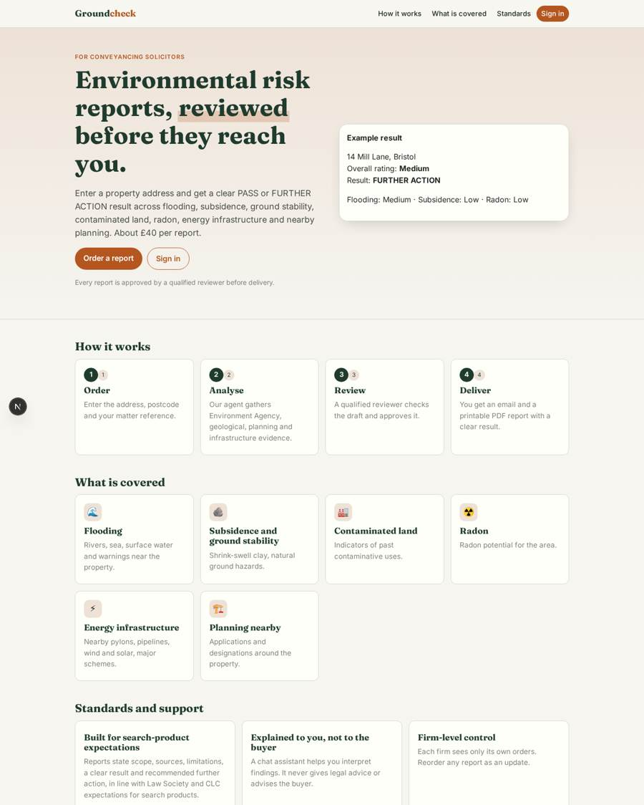
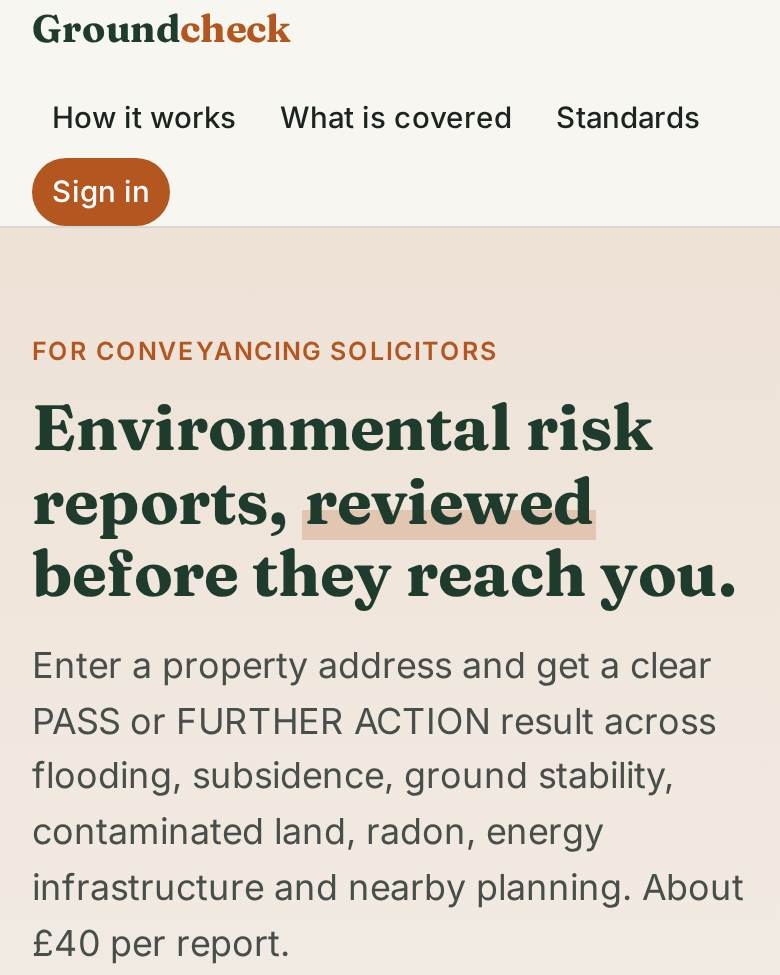
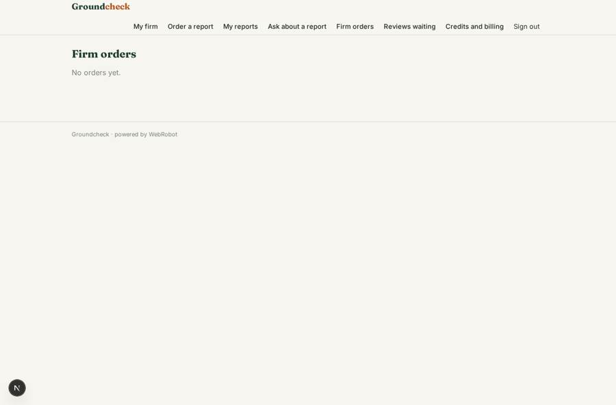
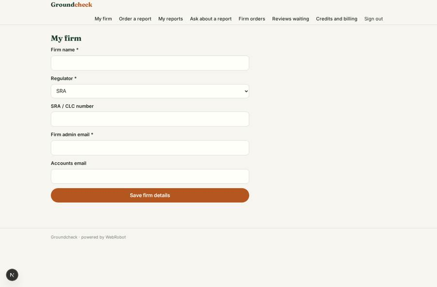
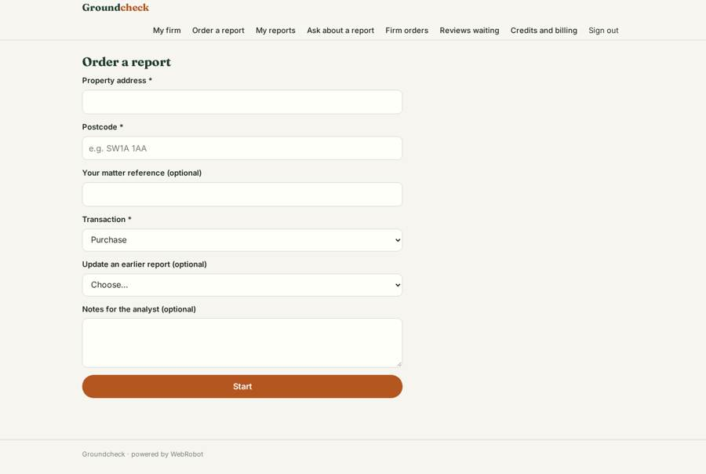
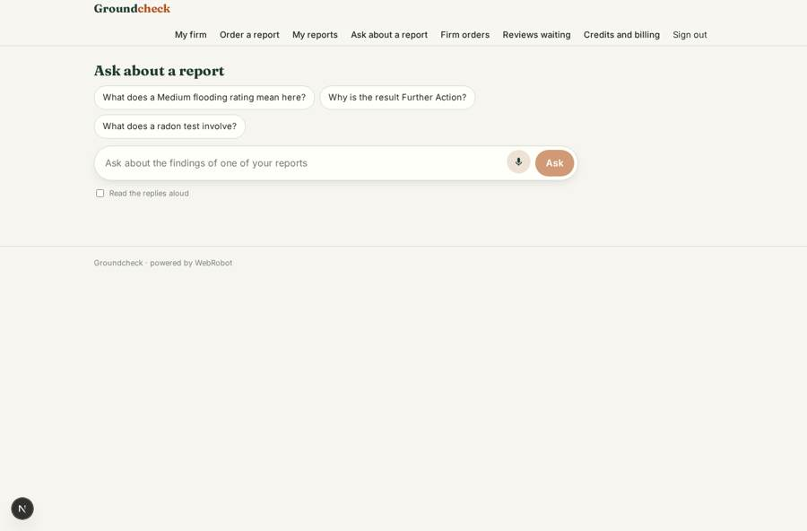

# Groundcheck

_Environmental risk reports for conveyancing, reviewed by a qualified person._

**Sector:** Sanità, istruzione, energia, gov · **Manifest:** valid (schema + runtime contract) · **Functional test:** passed (13 checks passed)

## Description given to the app builder

We need Groundcheck, AI environmental risk reports for conveyancing. Solicitors sign up, enter a property address, and order a report paid per report through Stripe. An agent gathers Environment Agency flood data, and BGS geology and contaminated-land data only if we have a licence, then writes a PDF report with a risk rating; a qualified reviewer approves before delivery. Solicitors get email notifications. PI insurance is ours. The report covers flooding, subsidence, ground stability, contaminated land, radon, energy infrastructure and planning nearby, with a clear pass or further-action result. Roles are solicitor, firm admin, reviewer and our admin; each firm sees only its own orders. Reports can be reordered for updates, and firms get monthly invoices for volume. Each report must meet Law Society and CLC expectations for search products. An assistant explains report findings to the solicitor in chat but never gives legal advice to the buyer. Pricing about £40 per report. English only.

## Navigation recording

Signed in as the app's admin, the recorder opened 7 menu page(s): My firm, Order a report, My reports, Ask about a report, Firm orders, Reviews waiting, Credits and billing.
No issue found.

Empty data pages are mostly expected on the local runtime: agents are mocked there, so the collections they fill stay empty.

## Features not expressible today (spec.extensions)

- **bgs_licence**: BGS geology, radon and contaminated-land data require a licence. Until the admins obtain it and set the BGS key, those sections are reported as not assessed and the result is FURTHER ACTION. The exact BGS endpoint must be confirmed against the licence terms.
- **monthly_invoicing**: Monthly invoices per firm for volume are not available yet; firms pay per report by Stripe (credit packs). Invoicing needs to be handled outside the app, using the firm orders export.
- **reorder_discount**: Reorders as updates are supported as a new order linked to the earlier one, at the normal price; a reduced update price is not available.
- **reviewer_queue_alert**: Reviewers are not emailed when a draft awaits approval (no trigger exists for approval requests yet); they use the Reviews waiting page.
- **compliance_and_insurance**: Law Society / CLC search-product accreditation, qualified-reviewer competence, and PI insurance are the owner's responsibility and are not verified by the app; the report structure is designed to support them.

## Screenshots (interpretive runtime, test data)

### home-anon

### home-mobile

### firm_orders

### firm

### new_order

### explain

