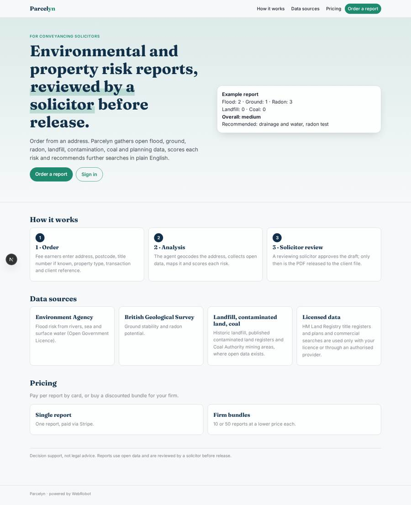
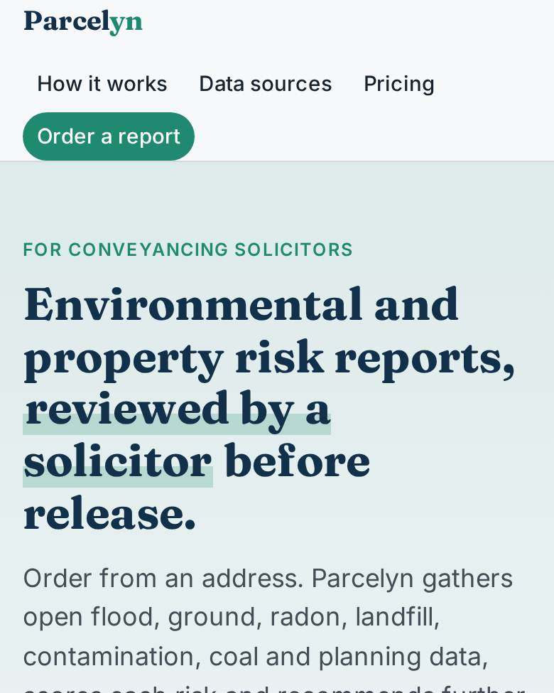
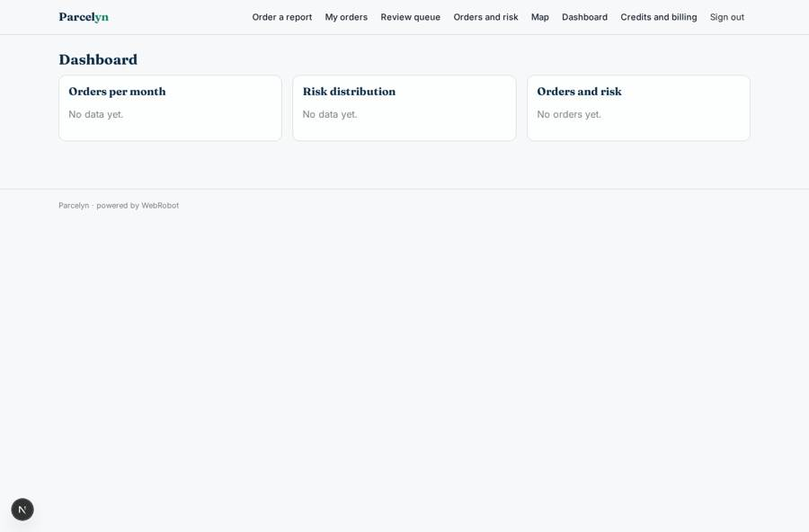
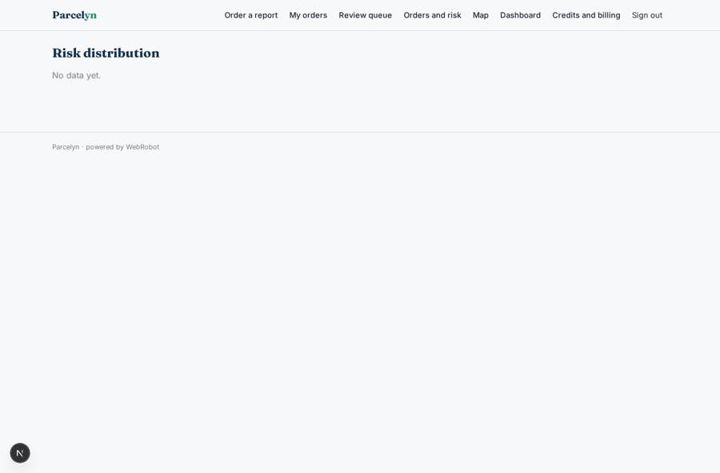
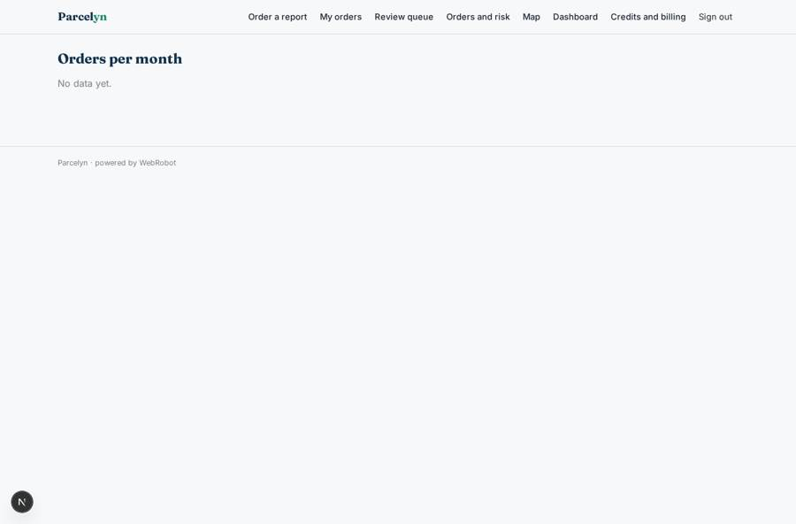

# Parcelyn

_Environmental and property risk reports for conveyancers, reviewed by a solicitor before release._

**Sector:** B2B AI and SaaS · **Manifest:** valid (schema + runtime contract) · **Functional test:** passed (11 checks passed)

## Description given to the app builder

We need Parcelyn, which produces environmental and property risk reports for conveyancing solicitors. The firm signs up and fee earners order reports; each fee earner sees their own orders, the firm's admin all orders. The order form asks for address, postcode, title number if known, property type, transaction type and client reference. An agent geocodes the address and collects open data: Environment Agency flood risk from rivers, sea and surface water, British Geological Survey ground stability and radon, historic landfill, contaminated land registers where published, coal mining areas, and planning information where available as open data. It draws a map, scores each risk, writes a plain-English summary with recommended further searches, and a solicitor reviews before the PDF is released to the client file. The full product also uses HM Land Registry title registers and plans and commercial search data, which are paid or licensed: use them only if the customer has a licence or through an authorised provider. Email when a report is ready and reminders for reports pending review. Dashboard of orders, turnaround and risk distribution. Pricing: pay per report via Stripe, with discounted bundles for firms. English.

## Navigation recording

Signed in as the app's admin, the recorder opened 7 menu page(s): Order a report, My orders, Review queue, Orders and risk, Map, Dashboard, Credits and billing.
- data page empty: dashboard (dashboard)

Empty data pages are mostly expected on the local runtime: agents are mocked there, so the collections they fill stay empty.

## Features not expressible today (spec.extensions)

- **turnaround_metric**: Turnaround time (order to release) is not computed yet: the dashboard shows orders per month and risk distribution; the approval decision time is visible in the review queue.
- **licensed_data**: HM Land Registry title registers and plans and commercial search data need a licence or an authorised provider; an org credential is declared but a tool is added only once the provider and its API host are known.
- **firm_scope**: Assumes one firm per app instance: the admin role sees all orders of the app. Several firms in one app would need a firm-specific role.

## Screenshots (interpretive runtime, test data)

### home-anon

### home-mobile

### dashboard

### all_reports

### risk_distribution

### orders_over_time

